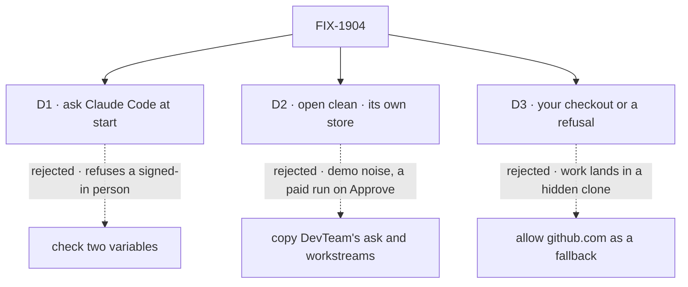

# FIX-1904 · Decisions

[Spec](SPEC.md) · **Decisions** · [Rules](BUSINESS-RULES.md) · [Plan](PLAN.md) · [Docs](DOCS.md) · [Evolution](EVOLUTION.md)

The epic decided what this profile is ([D2](../../epics/FIX-1903/DECISIONS.md#d2)), that its
coder is Claude Code with a loud refusal ([Q1](../../epics/FIX-1903/DECISIONS.md#q1), accepted
at merge), and that a run's worktree comes from your checkout
([D3](../../epics/FIX-1903/DECISIONS.md#d3)). These three cards are what this issue adds.

## The tree

Solid edges are what you sign. Dashed edges lost, and the label says why.

## D1 · "No credential" is Claude Code's own answer, asked once at start

| | |
|---|---|
| **Instead of** | Refusing unless `ANTHROPIC_API_KEY` or `CLAUDE_CODE_OAUTH_TOKEN` is set |
| **Because** | Most Claude Code users are signed in, and a sign-in is not a variable: a file under the home folder on Linux, the keychain on macOS. A variable check refuses them. The Agent SDK reports the account it would use (`accountInfo()`; `apiKeySource` is `'none'` with none), so the Lab asks once before it listens, spending no model turn. A failed check only refuses: a run is never the script unasked ([ER-2](../../epics/FIX-1903/BUSINESS-RULES.md#what-a-person-gets-and-what-they-dont)) |
| **Locks in** | Every start spawns Claude Code once, a second or two. "Signed in is enough" becomes a docs promise. DevTeam, still on the script, skips the check |

![D1: how the Lab knows there is no Claude credential. Chosen: ask Claude Code at start. Instead of: check two variables. It comes down to the first row, a person signed in to Claude Code with no variable set: they start, against refused. Second row, the price: one Claude Code spawn per start, against none. Third row, a tie: a person with nothing is refused either way, with the variable named. Locks in signed in is enough, as a docs promise. Flips if the SDK can't report the account without a model turn](figures/d1-ask-claude-code.svg)

It comes down to the signed-in person: two variables refuse them, and they are most of the people.

**What would change my mind:** the SDK can't say "no account" without spending a model turn, or
takes more than a few seconds. That is [PLAN](PLAN.md#checks) V1, run first. If it fails, this
card is reopened on the PR, not replaced by a guess at files.

## D2 · The profile opens clean: two projects, no demo ask, no workstreams, its own store

| | |
|---|---|
| **Instead of** | Copying DevTeam's start: a feature waiting for approval in Inbox, and two workstreams opened on a project |
| **Because** | DevTeam's ask is a demo feature. Here, Approve would start a paid Claude Code run on this repository for work nobody wants. A workstream opened at boot is a demo too. Its own store keeps DevTeam's rows out of the first open |
| **Locks in** | A person's first act is asking for work; Inbox is empty until a worker asks. The two profiles never share data |

![D2: what the profile holds at open. Chosen: two projects only, its own store. Instead of: DevTeam's start copied, an ask and workstreams. It comes down to the first row, what Approve on the first Inbox card does: nothing to approve, against a paid run on this repository for a demo feature. Second row, the price: an empty Inbox at first open, against a card to try. Third row: DevTeam's rows never show, against Storefront showing from a shared store. Locks in the first act is asking for work. Flips if people need a sample item to learn the screens](figures/d2-open-clean.svg)

It comes down to what Approve does on the first card: on this repository it is a paid run on a demo feature.

## D3 · A run's work lands in your checkout, or it is refused by name; the profile reaches no remote

| | |
|---|---|
| **Instead of** | Allowing `github.com` in the profile's remotes, so a run the checkout mapping misses is cloned from GitHub |
| **Because** | The epic wants the branch a person reviews in the repository they review in. A clone fallback hides it, and nothing on screen says which happened. With no remote allowed, a missed run is refused by name. The mapping names the two addresses (`shared`/`fsd`, `shared`/`shift-manager`), so another project with the same remote gets no worktree of the checkout ([ER-13](../../epics/FIX-1903/BUSINESS-RULES.md#what-no-child-may-do)) |
| **Locks in** | The profile works only from a checkout of this repository. A project a person adds with a remote is refused until remotes are allowed. A run branches from local `main`, never fetched |

![D3: what happens to a run the checkout mapping misses. Chosen: refused by name, the profile reaches no remote. Instead of: cloned from GitHub. It comes down to the first row, where the branch a person reviews ends up: their checkout or a named refusal, against a hidden clone with nothing said. Second row, the price: a project created on this Lab with a remote is refused, against cloned. Third row, a tie: the two dev projects get a worktree of the checkout either way. Locks in the profile needs a checkout of this repository. Flips if people add their own repository projects to this Lab](figures/d3-checkout-or-refused.svg)

It comes down to where a missed run's branch goes: refused is visible, and a hidden clone is not.

## Decided, not asked

- **The profile is `fsd`, at `teams/devteam/fsd.fsdev.config.mts`**, beside the tree, so `--dev`
  restarts on a `WORKER.md` save. Not `profiles/` (the shift themes, shipped); not "dev" (the script
  and the flag).
- **`baseRef: "main"`** on the checkout mapping. Without it a run branches from whatever the person
  has checked out (FIX-1906's brief, §3).
- **Both workspace hosts get the mapping**, the board's and the conversation tasks' (the chief of
  staff's path), from one option.
- **The check runs only for Claude Code.** `stub` starts with no credential; an unknown value is refused.
- **The chief of staff's model key is not checked.** Screen work needs no model; a keyless turn
  fails with the provider's error, as today. The docs name the key.
- **The Claude Code run is DevTeam's**: 30 turns, 10 minutes. FIX-1906 measured a worktree install
  at ~6 s and a full build at ~86 s.
- **The brief is the existing field**, read by people and the project coordinator, not the run.
- **The stale docs line is fixed here**: DevTeam opens with three projects, not "Storefront and
  Platform" ([DOCS](DOCS.md)).

## Considered and dropped

| Alternative | Why not |
|---|---|
| Edit DevTeam's default projects | Epic D2: five goal checks serve DevTeam's config unedited |
| A refusal when the Agent SDK isn't installed only at the first run | Late and silent until someone files work. The start check covers it |
| A setting in each project for the coder | A coder default is the host's, and only one profile needs it |
| Fetch `main` before each run | A network call on every run, and it moves `main` under the person. Not this issue's |

## How it got here

- **Draft (2026-10-12)** — framed as the epic's dev profile minus Linear. FIX-1906's thread
  refined the mapping into a `projectWorkspace()` option with `baseRef`; this spec fills it in for
  two projects and keeps the profile's hosts off every remote.

**Open: none.**
