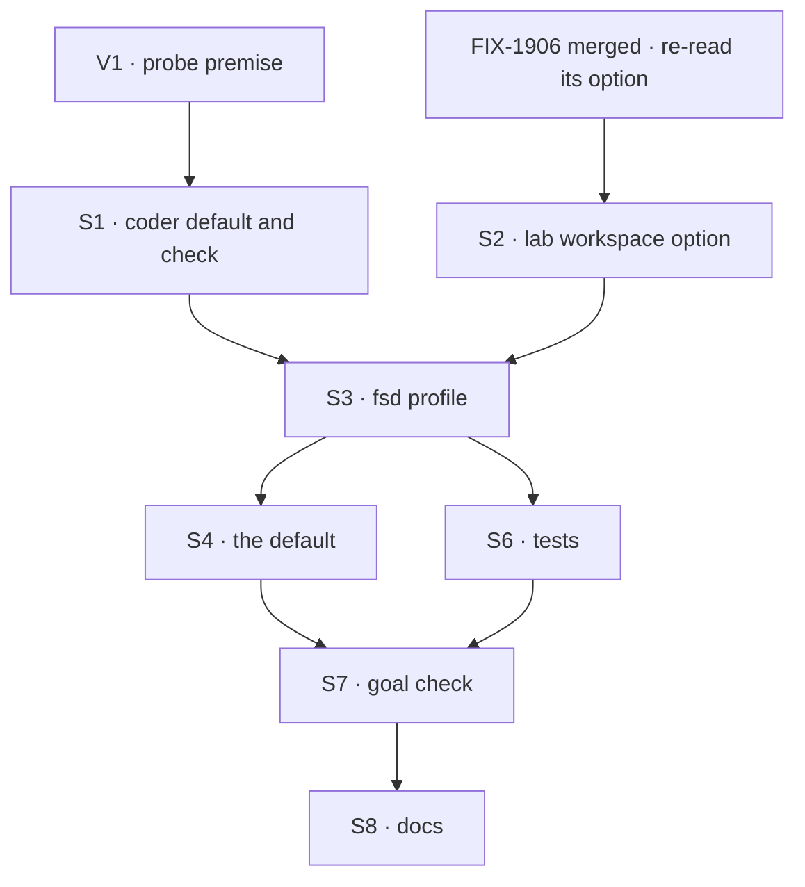

# FIX-1904 · Plan

[Spec](SPEC.md) · [Decisions](DECISIONS.md) · [Rules](BUSINESS-RULES.md) · **Plan** · [Docs](DOCS.md) · [Evolution](EVOLUTION.md)

Written for the implementing agent. IDs cross-reference [BUSINESS-RULES.md](BUSINESS-RULES.md)
(BR-n), [DECISIONS.md](DECISIONS.md) (D-n) and the epic's rules (ER-n). `tdd`. **One PR, opened
from `main` after FIX-1906 merges.** No Layer 1 change (ER-9): every surface is in
`packages/shift-manager` (repository-only files and its README), `goals/` and `apps/docs`.

## What FIX-1906 provides, and what this issue adds

Named from FIX-1906's design brief and [epic D3](../../epics/FIX-1903/DECISIONS.md#d3). It is
**not merged** when this spec is written; re-read its merged spec and code before S3.

| FIX-1906 provides (consume, don't rebuild) | FIX-1904 adds |
|---|---|
| A `projectWorkspace()` option in workforce that maps a remote to a checkout for named project addresses: `checkouts: [{ remote, checkout, projects: [{ visibility, id }], baseRef? }]`. A row is mapped only when its address is named and its `repository` equals `remote` | The two entries' values: this repository's remote, the checkout path worked out at start, `shared`/`fsd` and `shared`/`shift-manager`, `baseRef: "main"` |
| The host's existing operator allowance, `localWorkspaceHost({ localRepositories })`, now accepting the project's kept files beside the worktree (`checkout/` and `project/`) | The same checkout path in `localRepositories`, on both of the Lab's hosts |
| No collision between two runs on one checkout (ER-4); a settled run's branch stays checked out in its worktree | Nothing. The docs say how to review that branch |
| The dependency strategy: the machine's pnpm store, and a first-run `pnpm install` by the agent (~6 s), a full build ~86 s | Nothing; the run budget already covers it |

## Surfaces

| ID | Package · file or role | Change | Rules |
|---|---|---|---|
| S1 | `shift-manager` · `teams/devteam/harness.mts` | `selectHarness` takes the profile's default choice; DevTeam passes `stub` (today's), `fsd` passes `claude-code`. Add the coder check (D1): when the choice is Claude Code, resolve the SDK through `@flow-state-dev/claude-code/sdk`'s exported resolver, ask it for the account without a prompt, and refuse on none or on a load failure. A start line names the coder | BR-6 to BR-12 |
| S2 | `shift-manager` · `teams/devteam/host.mts` · the lab's workspace options | `LabWorkspaceHost` gains the checkout mapping as one optional field. `openLab` passes it to `projectWorkspace()` and the checkout path to `localRepositories`, on **both** `labWorkspaceHost` and `answerWorkspaceHost`. Absent means today, so DevTeam is unchanged | BR-13 to BR-15 · ER-10 |
| S3 | `shift-manager` · new `teams/devteam/fsd.fsdev.config.mts` | The `fsd` profile: the same tree through `openLab`; SQLite at `FSD_STORE` or `.fsdev/fsd.sqlite`; the two projects with their briefs and members as DevTeam sets them; `inventory` and `devtool` on; no `ask`, no `workstreams` (D2); `remotes: { allow: [] }` (D3); the S2 mapping with the checkout worked out from the file's own location; the S1 harness with default `claude-code` | BR-1 to BR-5 · BR-16 |
| S4 | `shift-manager` · `scripts/checkout.mts` | The default `--config` becomes S3's file. Header updated | BR-1 · BR-4 |
| S5 | `shift-manager` · `package.json` | `@anthropic-ai/claude-agent-sdk` as a devDependency, if S1's probe can't reach it through `claude-code`'s resolver under pnpm's strict layout. Check before adding | BR-8 |
| S6 | `shift-manager` · tests | The S3 config under `goal-labs.test.ts` beside DevTeam, run with `DEVFORCE_LAB_HARNESS=stub`; S1's cases with a scripted probe | BR-2 to BR-12 |
| S7 | `goals/shift-manager/it-opens-on-fsd-and-shift-manager/` | `goal.md` from SPEC's goal; `run.mts` with legs a to d and the controls `silent-stub` and `no-checkout` (each a seam in S1 and S3 the check flips, never in production code paths a person runs) | The goal |
| S8 | Docs | Publish [DOCS.md](DOCS.md): `apps/docs/docs/shift-manager/overview.md`, `packages/shift-manager/README.md`, `teams/devteam/README.md`. No changeset: nothing in the published files changes but the README | ER-21 |

Removed: nothing. DevTeam's config and files stay as they are.

## Sequence

V1 runs first: if it fails, D1 is reopened on the PR before S1 is built.

## Checks

| ID | Runs after | Passes when |
|---|---|---|
| V1 | before S1 | On Linux, the SDK reports an account for a signed-in home and for `ANTHROPIC_API_KEY`, and none for an empty home with no variable, with no model turn spent and in under ~5 s. Record the times in the PR |
| V2 | S1 | BR-6 to BR-12 with a scripted probe. BR-12's red state: a probe that returns "none" never yields the script |
| V3 | S2 | DevTeam's hosts are built exactly as before with the field absent; with it present, both hosts get the mapping. Red state: drop it from `answerWorkspaceHost`, and a conversation task's run is refused |
| V4 | S3, S6 | BR-1 to BR-3 and BR-5 on a temp store, script coder |
| V5 | S2, S4 | Every model-free goal check that imports DevTeam's `host.mts` or serves its config (`rg -l "teams/devteam" goals`, about twenty, among them `goals/devforce-lab/*` and `goals/shift-manager/it-groups-workstreams-under-their-projects`) passes unchanged. The model-backed ones are rerun where a key is at hand, and the rest named in the PR (BR-4, ER-10) |
| VG | S7 | [The goal](SPEC.md#the-goal-and-how-well-know-its-met): legs a to d PASS, after `GOAL_CONTROL=silent-stub` FAILED leg c and `GOAL_CONTROL=no-checkout` FAILED leg b, and today's `main` FAILED leg a. The implementation PR shows the three FAILs before the PASS |
| V6 | S8 | `rg -n "seat"` over the changed prose prints nothing (ER-16); `rg` for a machine path in the S3 file prints nothing (BR-16) |

Second path (BP-035): a second open on a kept store (BR-3); a conversation task, not only a board row (V3); the checkout on a branch other than `main` (VG input).

## Pinned names

| Where | Name | Why pinned |
|---|---|---|
| Profile | `fsd`, at `teams/devteam/fsd.fsdev.config.mts` | Docs and the default point at it |
| Project ids · titles | `fsd` · FSD, `shift-manager` · Shift Manager | Rows a person sees; FIX-1905 adds Linear to them; the mapping names them |
| Repository | `https://github.com/fixpoint-labs/flow-state-dev.git` | The row's remote, and the mapping's `remote`, must match exactly |
| Store | `packages/shift-manager/.fsdev/fsd.sqlite`, or `FSD_STORE` | Docs tell a person to delete it for a fresh start |
| Coder variable | `DEVFORCE_LAB_HARNESS` with `stub` and `claude-code` | Existing; the refusal names it |
| Goal check | `goals/shift-manager/it-opens-on-fsd-and-shift-manager/` | Cited by the epic's closure |

Briefs, illustrative: FSD, "The framework: the packages under `packages/` other than Shift
Manager, their docs and their goal checks." Shift Manager, "This app: `packages/shift-manager`,
its pages, its team profiles and its checks under `goals/shift-manager/`."

## Guardrails

| Rule | Because |
|---|---|
| Nothing in S1 or S3 changes DevTeam's behaviour or default | ER-10. Five goal checks read DevTeam unedited |
| The coder check has two outcomes, run or refuse. No path returns the script without `stub` | ER-2 and Q1: a run that quietly used the script reads as an agent's |
| One mapping value feeds both workspace hosts | Two writers of one rule drift; the conversation path is the one the goal uses (tenet 5) |
| The profile's remotes allow list stays empty | D3: a missed mapping must be a refusal, never a clone |
| The checkout path is computed, never written | ER-11; the file is in the repository and a path is one machine's |
| No "seat" in code or prose | ER-16 |

## Docs

Publish [DOCS.md](DOCS.md) after VG passes. FIX-1905 adds the Linear sentences to the same
paragraph later; leave them out.

## At implement time

- Read FIX-1906's merged option names and its refusal reason for an unlisted path; S2 and BR-14's
  check use them as shipped.
- `--dev` serves the pages through Vite from `packages/shift-manager`, and the runs root sits in
  `.fsdev/` under it. Check that a run's file writes and its `pnpm install` don't reload the page or
  exhaust the watcher. If they do, keep the runs root out of what Vite watches.
- The probe's spawn uses the same environment the run gets (`CLAUDE_CODE_PASS` in `harness.mts`),
  so the check and the run agree on the account.

## Follow-ups

- The Claude Code run's 30 turns and 10 minutes are DevTeam's. If the closure or first use shows
  real FSD items need more, raise it there.
