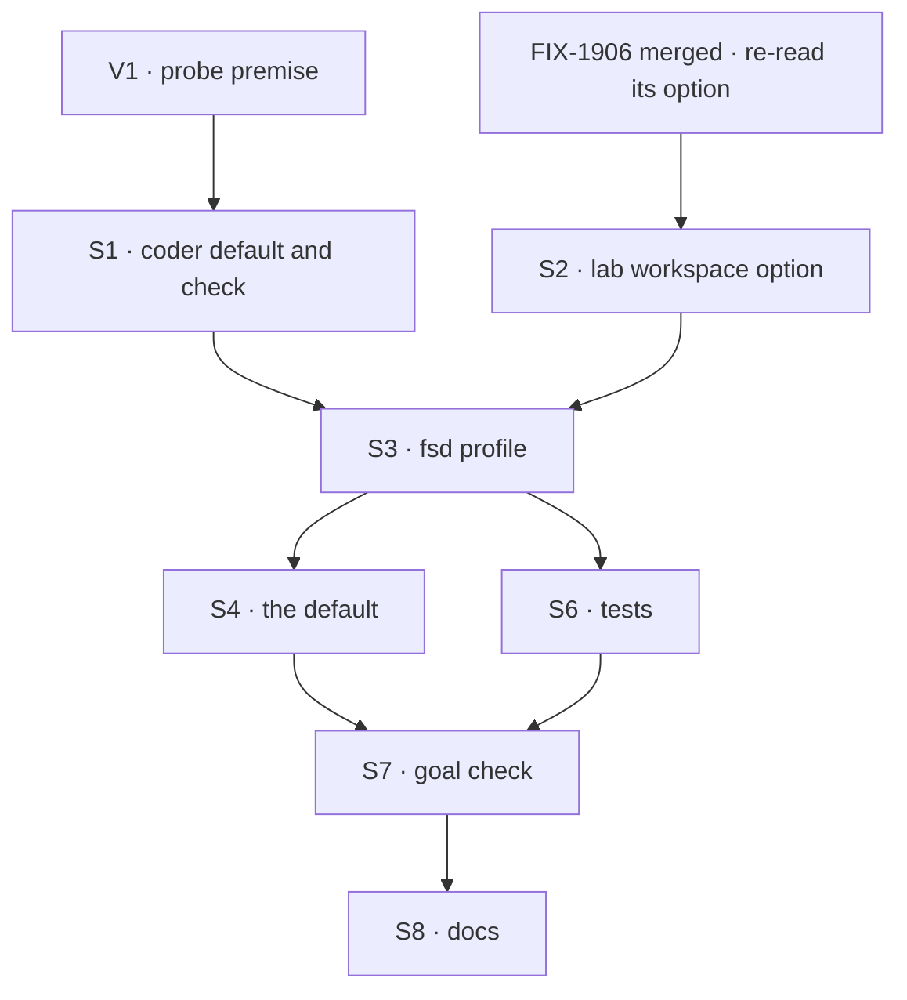

# FIX-1904 · Plan

[Spec](SPEC.md) · [Decisions](DECISIONS.md) · [Rules](BUSINESS-RULES.md) · **Plan** · [Docs](DOCS.md) · [Evolution](EVOLUTION.md)

Written for the implementing agent. IDs cross-reference [BUSINESS-RULES.md](BUSINESS-RULES.md)
(BR-n), [DECISIONS.md](DECISIONS.md) (D-n) and the epic's rules (ER-n). `tdd`. **One PR, opened
from `main` after FIX-1906 merges.** No Layer 1 change (ER-9): `@flow-state-dev/claude-code` is an
integration package, not Layer 1, and gains one export (S1). Every other surface is in
`packages/shift-manager` (repository-only files and its README), `goals/` and `apps/docs`.

## What FIX-1906 provides, and what this issue adds

Named from FIX-1906's spec as of its review round 1 ([PR #3177](https://github.com/fixpoint-labs/flow-state-dev/pull/3177), `0c42dfd`) and [epic D3](../../epics/FIX-1903/DECISIONS.md#d3). It is
**not merged** when this spec is written; re-read its merged spec and code before S3.

| FIX-1906 provides (consume, don't rebuild) | FIX-1904 adds |
|---|---|
| A `projectWorkspace()` option in workforce that maps a remote to a checkout for named shared projects: `checkouts: [{ remote, checkout, projects: [{ orgId, id, tenantId? }], baseRef? }]`. A row is mapped only when it is shared, an entry names its id with the run's server-set `session.identity.orgId` (and `tenantId`, exactly), and its `repository` equals `remote`. A private row, or a session with no `orgId`, is never mapped | The two entries' values: this repository's remote, the checkout path worked out at start, `{ orgId: LAB_ORG_ID, id: "fsd" }` and `{ orgId: LAB_ORG_ID, id: "shift-manager" }` with no `tenantId`, `baseRef: "main"`. `LAB_ORG_ID` (`"devforce-lab"`) is exported from `teams/devteam/host.mts`, the organization every Lab session is opened in (its door's `resolvePrincipal`, `openWorkerSession`, in-process runs); the Lab sets no tenant |
| The host's existing operator allowance, `localWorkspaceHost({ localRepositories })`, now accepting the project's kept files beside the worktree (`checkout/` and `project/`) `localRepositories` derived from the unique `checkouts[].checkout` paths, on both of the Lab's hosts, never configured separately |
| No collision between two runs on one checkout (ER-4); a settled run's branch stays checked out in its worktree | Nothing. The docs say how to review that branch |
| The dependency strategy: the machine's pnpm store, and a first-run `pnpm install` by the agent (~6 s), a full build ~86 s | Nothing; the run budget already covers it |

## Surfaces

| ID | Package · file or role | Change | Rules |
|---|---|---|---|
| S1 | `claude-code` · `src/sdk/`, exported from `@flow-state-dev/claude-code/sdk` · then `shift-manager` · `teams/devteam/harness.mts` | **The shared probe** (D1, with FIX-1915; whichever lands first builds it): `probeClaudeAccount({ env, timeoutMs })` resolves `account` (an `apiKeySource` or `tokenSource` came back), `none` (neither, or no answer within `timeoutMs`, with that reason) or `sdk-missing`. One streaming-input `query()` that never sends a message, closed after `accountInfo()`, as in V1. The caller passes the run's environment (`CLAUDE_CODE_PASS`), so probe and run see one account. Then in `harness.mts`: `selectHarness` takes the profile's default choice; DevTeam passes `stub` (today's), `fsd` passes `claude-code`; on Claude Code it calls the probe and refuses on `none` or `sdk-missing`. A start line names the coder | BR-6 to BR-12 |
| S2 | `shift-manager` · `teams/devteam/host.mts` · the lab's workspace options | `LabWorkspaceHost` gains the checkout mapping as one optional field. `openLab` passes it to `projectWorkspace()` and derives `localRepositories` from its unique `checkouts[].checkout` paths, on **both** `labWorkspaceHost` and `answerWorkspaceHost`. Absent means today, so DevTeam is unchanged | BR-13 to BR-15 · ER-10 |
| S3 | `shift-manager` · new `teams/devteam/fsd.fsdev.config.mts` | The `fsd` profile: the same tree through `openLab`; SQLite at `FSD_STORE` or `.fsdev/fsd.sqlite`; the two projects with their briefs and members as DevTeam sets them; `inventory` and `devtool` on; no `ask`, no `workstreams` (D2); `remotes: { allow: [] }` (D3); the S2 mapping with the checkout worked out from the file's own location and both entries naming `LAB_ORG_ID`; the S1 harness with default `claude-code` | BR-1 to BR-5 · BR-16 |
| S4 | `shift-manager` · `scripts/checkout.mts` | The default `--config` becomes S3's file. Header updated | BR-1 · BR-4 |
| S5 | `shift-manager` · `package.json` | `@anthropic-ai/claude-agent-sdk` as a devDependency. Expected: it is only an optional peer of `claude-code`, so pnpm's strict layout won't resolve it from `shift-manager` without it | BR-8 |
| S6 | `shift-manager` · tests | The S3 config under `goal-labs.test.ts` beside DevTeam, run with `DEVFORCE_LAB_HARNESS=stub`; S1's cases with a scripted probe | BR-2 to BR-12 |
| S7 | `goals/shift-manager/it-opens-on-fsd-and-shift-manager/` | `goal.md` from SPEC's goal; `run.mts` with legs a to c and the controls `silent-stub` and `no-checkout`, read by one `GOAL_CONTROL` interpreter in the goal folder. The shipped `fsd.fsdev.config.mts` carries no control branch: `no-checkout` is a `run.mts` override, and only `silent-stub` needs a seam in S1 | The goal |
| S8 | Docs | Publish [DOCS.md](DOCS.md): `apps/docs/docs/shift-manager/overview.md`, `packages/shift-manager/README.md`, `teams/devteam/README.md`. A changeset for `@flow-state-dev/claude-code` if this PR builds the probe (none if FIX-1915 did); nothing else published changes but the README | ER-21 |

Removed: nothing. DevTeam's config and files stay as they are.

## Sequence

V1's open row (a signed-in home) runs first: if it fails, D1 is amended before S1 is built.

## Checks

| ID | Runs after | Passes when |
|---|---|---|
| V1 | spec phase; one row at S1 | Run on this spec ([D1](DECISIONS.md#d1)): a source for `ANTHROPIC_API_KEY` and `CLAUDE_CODE_OAUTH_TOKEN`, none for an empty home, no message emitted, under 0.8 s. Left, S1's first step: with only a signed-in `HOME` and the run's `CLAUDE_CODE_PASS` environment, the probe says `account` and a Claude Code run on that environment succeeds. If not, stop and amend D1 |
| V2 | S1 | BR-6 to BR-12 with a scripted probe, BR-9 (`stub`, no credential, listens, names the script) among them. BR-12's red state: a probe that returns "none" never yields the script |
| V3 | S2 | DevTeam's hosts are built exactly as before with the field absent; with it present, both hosts get the mapping. Red state: drop it from `answerWorkspaceHost`, and a conversation task's run is refused |
| V4 | S3, S6 | BR-1 to BR-3 and BR-5 on a temp store, script coder |
| V5 | S2, S4 | Every model-free goal check that imports DevTeam's `host.mts` or serves its config (`rg -l "teams/devteam" goals`, about twenty, among them `goals/devforce-lab/*` and `goals/shift-manager/it-groups-workstreams-under-their-projects`) passes unchanged. The model-backed ones are rerun where a key is at hand, and the rest named in the PR (BR-4, ER-10) |
| VG | S7 | [The goal](SPEC.md#the-goal-and-how-well-know-its-met): legs a to c PASS, after `GOAL_CONTROL=silent-stub` FAILED leg c and `GOAL_CONTROL=no-checkout` FAILED leg b, and today's `main` FAILED leg a. The implementation PR shows the three FAILs before the PASS |
| V6 | S8 | `rg -n "seat"` over the changed prose prints nothing (ER-16); `rg` for a machine path in the S3 file prints nothing (BR-16) |

Second path (BP-035): a second open on a kept store (BR-3); a conversation task, not only a board row (V3); the checkout on a branch other than `main` (VG input).

## Pinned names

| Where | Name | Why pinned |
|---|---|---|
| Profile | `fsd`, at `teams/devteam/fsd.fsdev.config.mts` | Docs and the default point at it |
| Project ids · titles | `fsd` · FSD, `shift-manager` · Shift Manager | Rows a person sees; FIX-1905 adds Linear to them; the mapping names them |
| Repository | `https://github.com/fixpoint-labs/flow-state-dev.git`, one `const` in the S3 file | It feeds both the rows' `repository` and the mapping's `remote`; a drift is a silent miss and a refusal by name (BR-14) |
| Store | `packages/shift-manager/.fsdev/fsd.sqlite`, or `FSD_STORE` | Docs tell a person to delete it for a fresh start |
| Coder variable | `DEVFORCE_LAB_HARNESS` with `stub` and `claude-code` | Existing; the refusal names it |
| Goal check | `goals/shift-manager/it-opens-on-fsd-and-shift-manager/` | Cited by the epic's closure |

Briefs, illustrative: FSD, "The framework: the packages under `packages/` other than Shift
Manager, their docs and their goal checks." Shift Manager, "This app: `packages/shift-manager`,
its pages, its team profiles and its checks under `goals/shift-manager/`."

## Guardrails

| Rule | Because |
|---|---|
| Nothing in S1 or S3 changes DevTeam's behaviour or default | ER-10. Five goal checks read DevTeam unedited |
| The coder check has two outcomes, run or refuse. No path returns the script without `stub` | ER-2 and Q1: a run that quietly used the script reads as an agent's |
| One mapping value feeds both workspace hosts, and `localRepositories` is derived from it | Two writers of one rule drift; the conversation path is the one the goal uses (tenet 5) |
| The profile's remotes allow list stays empty | D3: a missed mapping must be a refusal, never a clone |
| The checkout path is computed, never written | ER-11; the file is in the repository and a path is one machine's |
| No "seat" in code or prose | ER-16 |

## Docs

Publish [DOCS.md](DOCS.md) after VG passes. FIX-1905 adds the Linear sentences to the same
paragraph later; leave them out.

## At implement time

- Read FIX-1906's merged option names and its refusal reason for an unlisted path; S2 and BR-14's
  check use them as shipped.
- Confirm every session a Lab run starts from carries `orgId: LAB_ORG_ID` as FIX-1906's source
  reads it. One with none maps nothing, and under D3 that run is refused by name (BR-14), never cloned.
- `--dev` serves the pages through Vite from `packages/shift-manager`, and the runs root sits in
  `.fsdev/` under it. Check that a run's file writes and its `pnpm install` don't reload the page or
  exhaust the watcher. If they do, keep the runs root out of what Vite watches.
- Branch names: two `localWorkspaceHost` roots can sit over this one checkout (this Lab, and
  FIX-1915's Kitchen Sink mode). This Lab's branches start `conductor/`, Kitchen Sink's
  `kitchen-sink/`, under separate worktree roots; keep it so.

## Notes from review

Verbatim from the spec PR's reviewers, for the implementer to judge against the code.

- **Cursor, on S1:** "Consider pulling D1's probe into a named `assertClaudeAccountAtStart()` (or similar) that fsd config calls explicitly, with DevTeam still `selectHarness("stub")` — keeps "empty env = stub" true for every other caller of `selectHarness()` and makes the expensive path obvious in code review."
- **Cursor, on S3:** "Second full config file is epic-correct; the duplication smell is the **`openLab({...})` blob**. A shared builder for store path + roster discovery + harness wiring would keep S3 to ~deltas (projects, remotes `[]`, mapping, no ask/workstreams) without changing any BR."
- **Cursor, on S7:** "require `GOAL_LEG` / split legs like `it-hands-a-run-the-work-it-approved` and `it-groups-workstreams-under-their-projects`, and state whether leg b's two projects run sequentially (likely) so implementers do not accidentally rerun the whole goal for each control."
- **Cursor, review body:** "Document that **every `loadFsdevConfig` of `fsd`** likely pays the probe unless `stub` is set — tests/tools should default stub for fsd loads (S6 already points that way)." And: "If V1 passes but cold start feels rough in practice, **process-lifetime cache** of a successful probe is an implementation detail worth mentioning in PLAN (still one probe per `shift-manager:dev` invocation)."

## Follow-ups

- The Claude Code run's 30 turns and 10 minutes are DevTeam's. If the closure or first use shows
  real FSD items need more, raise it there.
