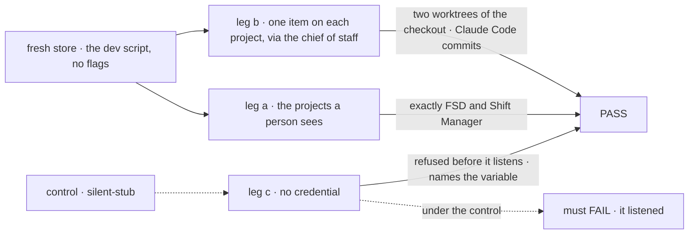
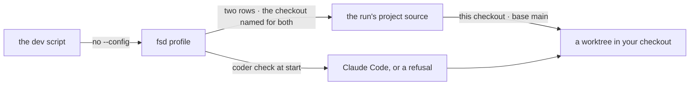

# FIX-1904 · shift-manager:dev ships two default projects, FSD and Shift Manager, on the flow-state-dev repo

**Spec** · [Decisions](DECISIONS.md) · [Rules](BUSINESS-RULES.md) · [Plan](PLAN.md) · [Docs](DOCS.md) · [Evolution](EVOLUTION.md)

## Five people, before and after

| Someone who… | Today | After |
|---|---|---|
| **opens `pnpm shift-manager:dev` to work on FSD** | Finds three demo projects on a scratch repository and a demo feature in Inbox | Finds FSD and Shift Manager, shared, on this repository, each brief naming its focus |
| **asks the chief of staff for an item on one of them** | Gets a script that commits one file to a scratch repository | Claude Code works it in a worktree of their checkout, on a branch cut from `main` |
| **opens it with no Claude credential** | Starts, and every run is the script | The Lab refuses to start and names what to set |
| **wants screen work only, for free** | Gets the script by default | Sets `DEVFORCE_LAB_HARNESS=stub`; the start line says so |
| **maintains the DevTeam goal checks** | DevTeam is what `dev` opens | DevTeam is unchanged, behind `--config` ([epic D2](../../epics/FIX-1903/DECISIONS.md#d2)) |

## The goal, and how we'll know it's met

**On a fresh open of `pnpm shift-manager:dev` with no flags, a person sees exactly FSD and Shift
Manager, and an item they ask for on either one is worked by Claude Code in a worktree of their
checkout. With no Claude credential the Lab refuses to start and says what to set.**

| Is it the right goal? | |
|---|---|
| **The real need** | The epic's: the people who build Shift Manager use it every day on this code, with no setup step and a real coding agent ([FIX-1903 goal](../../epics/FIX-1903/SPEC.md#the-goal-and-how-well-know-its-met)) |
| **Smaller, and rejected** | "The two projects show in the sidebar." The epic names it as the undersell: every run would still be a script in a scratch repository |
| **Bigger, and not this issue's** | Linear in reach of the run ([FIX-1905](https://linear.app/fixpoint-labs/issue/FIX-1905)) · two runs at once on one checkout, proved not to collide ([FIX-1906](https://linear.app/fixpoint-labs/issue/FIX-1906)) · the whole journey in a browser ([FIX-1919](https://linear.app/fixpoint-labs/issue/FIX-1919)) |
| **Not done if** | Any other project shows · a run's worktree is not in the checkout, or branches from the current branch · a run is the script unasked · the refusal names no variable · a signed-in person is refused · a DevTeam goal check fails · the goal check ran only on the script |



The check reads what a person reads: the project list through the Lab's routes, `git worktree list`
in the checkout, and the start output. Under the control the Lab starts on the script silently.

| How we verify | |
|---|---|
| **Goal check** | `goals/shift-manager/it-opens-on-fsd-and-shift-manager/` · real model (the chief of staff and Claude Code) · run by the implementer at completion, on Linux · verdict in the implementation PR |
| **Signal** | a: the owner's projects are exactly `fsd` and `shift-manager`, shared, naming this repository's remote, briefs naming their focus. b: both rows settle `completed`; `git worktree list` in the checkout names both places; each branch descends from `main` and commits the file the item asked for, and no `SCRIPTED-RUN.md`. c: exit before listening; output names `ANTHROPIC_API_KEY` and `DEVFORCE_LAB_HARNESS=stub`. d: with `stub` and no credential it listens and names the script |
| **Input** | A fresh store; a stamp picked at run time in each item's text. The checkout on a branch other than `main`, so b can tell `main` from HEAD |
| **Anti-game** | No assertion on the profile file or a mocked harness. The check sets only the store location (a temp file), and in c and d takes credentials away |
| **Control that must fail** | `GOAL_CONTROL=silent-stub`: leg c must FAIL on *exit before listening*. `GOAL_CONTROL=no-checkout`: leg b must FAIL on *`git worktree list` names both places*, with the run refused by name and nothing cloned. Today's `main`: leg a must FAIL on *exactly `fsd` and `shift-manager`* |

## What changes


Read across: the same command and worker tree; what the Lab holds and where work lands change.

**What a person types:**

```diff
- pnpm shift-manager:dev                               # DevTeam: demo projects, the script
+ pnpm shift-manager:dev                               # fsd: FSD and Shift Manager, Claude Code
+ DEVFORCE_LAB_HARNESS=stub pnpm shift-manager:dev     # the same Lab on the script, free
+ pnpm --filter @flow-state-dev/shift-manager dev --config teams/devteam/fsdev.config.mts   # DevTeam
```

## How an item reaches the checkout



The mapping from the projects to the checkout is FIX-1906's option; this profile fills it in.

## What stays as it is

- **DevTeam**: its projects, workstreams, ask, store and scripted default ([ER-10](../../epics/FIX-1903/BUSINESS-RULES.md#what-no-child-may-do)).
- **The worker tree**: the chief of staff, the EM and the coder are the same files.
- **The Claude Code run's setup**: the variables it sees, its tools, its turn and time budgets.
- **How a run finds its project**, and where its worktree and branch go ([FIX-1906](https://linear.app/fixpoint-labs/issue/FIX-1906)).

## Sign off

**[The goal](#the-goal-and-how-well-know-its-met), at that size:** a fresh open shows the two
projects, a real agent works an item in your checkout, and a missing credential stops the start.
If wrong: we ship a sidebar change while every run is still a script, or one that needs a setup step.

1. **[D1](DECISIONS.md#d1) · "No credential" is Claude Code's own answer at start, not a check of
   two variables.** If wrong: a signed-in person is refused, or a probe slows every start.
2. **[D2](DECISIONS.md#d2) · The profile opens clean: two projects, no demo ask, no workstreams,
   its own store.** If wrong: a person misses the Inbox demo the DevTeam profile still shows.
3. **[D3](DECISIONS.md#d3) · A run's work lands in your checkout or is refused; the profile
   reaches no remote.** If wrong: a person running from outside a checkout gets refusals, not clones.

**Open: none.** D1 is the one to weigh. Reasoning: [DECISIONS.md](DECISIONS.md). Cases:
[BUSINESS-RULES.md](BUSINESS-RULES.md).

Feature · `shift-manager` (repository-only files, README) + `apps/docs` · small–medium · 1 PR, after FIX-1906 merges · epic [FIX-1903](../../epics/FIX-1903/SPEC.md)
