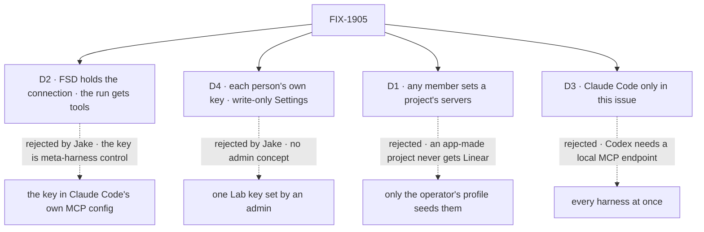

# FIX-1905 · Decisions

[Spec](SPEC.md) · **Decisions** · [Rules](BUSINESS-RULES.md) · [Plan](PLAN.md) · [Docs](DOCS.md) · [Evolution](EVOLUTION.md)

The epic set the frame: servers are a project setting read at run start
([FIX-1903 D4](../../epics/FIX-1903/DECISIONS.md#d4)), named by a host-approved alias
([ER-14](../../epics/FIX-1903/BUSINESS-RULES.md#what-no-child-may-do)). Jake then moved the key
and the connection to FSD ([comment](https://github.com/fixpoint-labs/flow-state-dev/pull/3174#issuecomment-6131359139))
and gave each user their own key. What that contradicts in the epic is listed in
[EVOLUTION.md](EVOLUTION.md), for the epic's own amendment.

## The tree

Solid edges are what you're signing. Dashed edges lost, and the label says why.

## D2 · FSD holds the MCP connection and the key; the run receives tools, never the key

| | |
|---|---|
| **Instead of** | Handing Claude Code the server's address and key in its own MCP config, so Claude Code connects (this spec's first draft) |
| **Because** | The connection is harness-level infrastructure, whichever harness runs. FSD decides which servers a run reaches, with whose key, and must be able to observe, close and swap them without the harness's cooperation. FSD already has the client: `createMcpManager` (`packages/tools/src/mcp/manager.ts`) connects, lists and calls. The run gets each server as an in-process MCP server: Claude Code sees `{ type: "sdk", name }` and calls tools back over the SDK's control channel. Checked in the locked Agent SDK 0.3.234: `createSdkMcpServer` exists and its docs name proxying a real server; an in-process server keeps a string-prompt run's input open (`hasBidirectionalNeeds`, as `canUseTool` already does here), so no streaming-input change |
| **Locks in** | The key is never handed to the run: not its command line, environment, MCP config, session, logs, run record or page. It is not *unreachable*: an unsandboxed run, as the Lab's own OS user, can read the Lab's store and process. Every tool call takes one extra in-process hop. A Lab that can't reach Linear gives no run Linear |

![D2: who holds the MCP connection and the key. Chosen: FSD, with the run receiving tools only. Instead of: Claude Code's own MCP config with the address and key. It comes down to the first row, who controls the connection: FSD, for any harness, observable and closable, against the harness, configured per run. Second row, where the key is handed: nowhere in the run, against the Claude Code process's command line. Third row, the price: one extra hop per tool call and FSD's client in the run's path, against none. Fourth row, a tie: an unsandboxed run can still read the Lab's store either way. Locks in: never handed to the run, not unreachable. Flips if coding runs can't take in-process tools](figures/d2-key-path.svg)

It comes down to who controls the connection: Claude Code's config put the key in its command line.

**What would change my mind:** a harness that can take no in-process tools and no local
endpoint. Then that harness gets no project servers, rather than the key.

## D4 · Each person sets their own key, on a write-only Settings page; a run uses its owner's key

| | |
|---|---|
| **Instead of** | One key per server for the whole Lab, set by an operator or admin (the Architect's "Lab secret store") |
| **Because** | Jake: "We don't have a concept of admins, just let each user set their own key." It also fixes D1's old price: a run acts in Linear as the person it works for, so turning Linear on for a project lends nobody's key to anyone |
| **Locks in** | A key is a user-scoped record in the Lab's store, keyed by server name. The page lists the servers the Lab offers with *set · when* or *not set*, and takes a new value, a replacement or a clear; it never shows a value or its last four. A run uses its owner's key: the user its session belongs to, the identity harness-manager records as the run's owner, never a field a caller sends (BP-031). An owner with no key gets the run without that server, said in its session. `seedEnv` (`LINEAR_MCP_API_KEY`) stands in only for the Lab's own operator identity, the one headless goal and CI runs use, and only while that identity has no stored key. The value is stored as written, not encrypted |

![D4: whose key a run uses. Chosen: each person's own, set on a write-only page. Instead of: one Lab key set by an admin. It comes down to the first row, who a run acts as in Linear: the person it works for, against the key's owner for everyone. Second row, the price: each person sets a key before their runs get Linear, against one setup. Third row, a cost both share: the key is a plain record in the Lab's store. Locks in user-scoped keys, write-only, operator seed for headless runs. Flips if the Lab gains roles or OAuth sign-in](figures/d4-whose-key.svg)

It comes down to who a run acts as: one Lab key made every run its owner.

**What would change my mind:** Linear OAuth per person, which replaces the pasted key with a
sign-in; or a Lab whose store leaves the machine, which earns encryption at rest.

## D1 · Any member turns a project's servers on or off, choosing from the names the Lab offers

| | |
|---|---|
| **Instead of** | Only the operator's profile config seeds a project's servers, with no write after create |
| **Because** | It is how a project's repository already works: set at create or later by `setRepository`, members only. The host approves what each name reaches, so a member picks among approved choices. Operator-only means a project made in the app, or a dev store opened before this ships, never gets Linear |
| **Locks in** | A member turns a server on for every run on the project. Each run then acts in that tool as its own requester (D4), and one with no key runs without it |

![D1: who turns on a project's MCP servers. Chosen: any member, from the names the Lab offers, at create or later. Instead of: only the operator's profile, at create. It comes down to the first row, a project made in the app: it can get Linear, against never. Second row, the price: a member decides for every run on the project, against the operator alone. Third row, a tie: no address or key on the row either way. Locks in members choosing, each run acting as its requester. Flips if a server should be on only for some members](figures/d1-who-sets-it.svg)

It comes down to a project made in the app: operator-only means it never gets Linear.

**What would change my mind:** a server some members should not reach. Then a name gets an
operator-only mark, and only the profile can assign it.

## D3 · Only Claude Code runs get project servers in this issue

| | |
|---|---|
| **Instead of** | Every harness at once, through a feed on harness-manager's slot |
| **Because** | With FSD holding the connection, half the work is harness-neutral: the key, the connection, the tool list and the call. Only the last hop differs. Claude Code takes in-process MCP servers (Agent SDK 0.3.234). Cursor's local runtime takes in-process `customTools` (`@cursor/sdk` 1.0.31), which its package doesn't yet resolve per run. Codex takes only CLI config (`@openai/codex-sdk` 0.152.1), so FSD would have to serve a local MCP endpoint for it. The dev profile runs Claude Code ([FIX-1903 Q1](../../epics/FIX-1903/DECISIONS.md#q1)) |
| **Locks in** | A Cursor or Codex run on a project naming Linear runs without it, and its session says so. Cursor is a small follow-up; Codex is a design of its own |

![D3: which harnesses get a project's servers in this issue. Chosen: Claude Code only. Instead of: every harness at once. It comes down to the first row, what each harness needs: Claude Code an in-process server, which it takes today, against Codex a local MCP endpoint FSD would have to serve. Second row, the price: Cursor and Codex runs wait, against all at once. Third row, a tie: the FSD half is the same either way. Locks in Claude Code first, Cursor a small follow-up. Flips if a goal needs Linear on Cursor or Codex](figures/d3-which-harnesses.svg)

It comes down to what Codex needs: a local MCP endpoint, a design of its own.

**What would change my mind:** a goal that needs Linear on a Cursor run. Its in-process tools
make that one option on `@flow-state-dev/cursor`, fed by the same resolver.

## Decided, not asked

- **`mcpTools` can't carry a remote server.** Its type holds tools and a call function only; no
  URL, command or headers fit. Setting it means exactly those servers: `strictMcpConfig` and
  `disableClaudeAiConnectors`, as round 1 found ([BR-12](BUSINESS-RULES.md#what-a-run-reaches)).
- **A relayed server's tools are allowed** (`mcp__<name>__*`); `disallowedTools` still narrows.
- **Connections are per run**, opened at run start and closed when it ends, abort included.
- **Read fresh on every attempt**: the server list and the key. A key set after a failed attempt
  counts on the next.
- **The key is written outside the action pipeline.** An action's input is stored on its request
  record for resume (`RequestRecord.input`, `packages/engine/src/stores/types.ts`), so a plain
  action would keep the key in request history and traces.
- **A name is lowercase letters, digits and hyphens**; it becomes the tool prefix.
- **A connection that fails is said in the run's session**, with the server's name, never its
  address or headers.
- **The chief of staff gets no new tool**, and DevTeam is untouched.

## Considered and dropped

| Alternative | Why not |
|---|---|
| The key in Claude Code's MCP config, or its environment | D2. Jake: "D2 can't be through Claude" |
| A second MCP client in workforce or harness-manager | `createMcpManager` is FSD's client; it gains a call path instead |
| Show the key's last four on the page | Tells nobody anything they need. *Set* and when is enough |
| Encrypt keys at rest with a host secret | The Lab's own user can read that secret too. Recorded as D4's flip |
| Servers on the run source's answer, a `WORKER.md`, or the hand-over | Not a workspace concept; the epic dropped the others ([FIX-1903 D4](../../epics/FIX-1903/DECISIONS.md#d4)) |

**Which methods already do this job:** `projectWorkspace()` (the same lookup, shared) and
`createMcpManager` (the client, reused). Searched `mcp`, `mcpServers`, `customTools` across
`packages/*/src` and the three harness SDKs at their locked versions.

## Settled

- **Claude Code takes in-process MCP servers with a string prompt** — **CONFIRMED** in Agent SDK
  0.3.234 (`sdk.mjs`): a `type: "sdk"` entry's instance stays in the host process, is never
  written to `--mcp-config` (only non-SDK servers are), crosses to Claude Code by name in the
  initialize message, and holds the input open. D2 rests on it.
- **`strictMcpConfig` alone does not keep out claude.ai connectors** — **CONFIRMED** in round 1;
  `disableClaudeAiConnectors` does, honoured from `--settings`.
- **Codex has no in-process tool path; Cursor does** — **CONFIRMED** from `@openai/codex-sdk`
  0.152.1 (`config` only) and `@cursor/sdk` 1.0.31 (`local.customTools`). D3 rests on it.

## How it got here

- **Draft** — the epic's D4 made concrete; Claude Code took a per-run `mcpServers` with the key.
- **Review round 1** — "exactly the project's servers" also turns off claude.ai connectors.
- **Jake's override, then a re-draft** — the key is FSD's, configured on a settings page; each
  user sets their own; no admins. D2 flipped, D4 added, D1's price and D3 re-weighed, and the
  Architect's pins folded: one client (`createMcpManager`), relayed tools rather than a remote
  config, a thin page.

**Open: none.**
