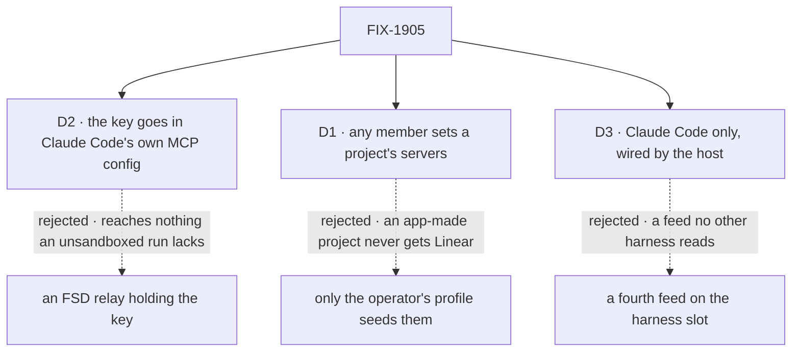

# FIX-1905 · Decisions

[Spec](SPEC.md) · **Decisions** · [Rules](BUSINESS-RULES.md) · [Plan](PLAN.md) · [Docs](DOCS.md) · [Evolution](EVOLUTION.md)

What was considered, what was chosen, why, and what each choice locks in. The epic already
decided the frame: servers are a project setting read when a coding run starts
([FIX-1903 D4](../../epics/FIX-1903/DECISIONS.md#d4)), named by a host-approved alias with the
address and credential in host config ([ER-6](../../epics/FIX-1903/BUSINESS-RULES.md#what-a-person-gets-and-what-they-dont), [ER-14](../../epics/FIX-1903/BUSINESS-RULES.md#what-no-child-may-do)).
These three are the calls left inside it.

## The tree

Solid edges are what you're signing. Dashed edges lost, and the label says why.

## D1 · Any member turns a project's servers on or off, choosing from the names the server offers

| | |
|---|---|
| **Instead of** | Only the operator's profile config seeds a project's servers, with no write after create |
| **Because** | It is how a project's repository already works: set at create or later by `setRepository`, members only. The host has already approved what each name reaches and with which key, so a member picks among approved choices, never a new address. Operator-only means a project created in the app, or a dev store opened before this ships, can never get Linear |
| **Locks in** | Every member of a shared project can make all its coding runs act in Linear as whoever owns the host's key. A name the host stops offering is skipped at run start, out loud |

![D1: who turns on a project's MCP servers. Chosen: any member, from the names the server offers, at create or later. Instead of: only the operator's profile, at create. It comes down to the first row, a project made in the app: it can get Linear, against never. Second row, the price: a member can make every run on the project act in Linear as the key's owner, against the operator alone. Third row, a tie: no address or key on the row either way. Locks in: members wield the host's key through approved names. Flips if a host's key carries more than members should wield](figures/d1-who-sets-it.svg)

It comes down to a project made in the app: operator-only means it never gets Linear.

**What would change my mind:** a host whose key reaches more than a project's members should
wield. Then a name gets an operator-only mark, and only the profile can assign it.

## D2 · The key reaches Claude Code in its own MCP config, not through an FSD-side relay

| | |
|---|---|
| **Instead of** | The server connects to Linear itself (`createMcpManager` in `@flow-state-dev/tools/mcp`) and relays the tools into the run as an in-process MCP server, so the key never leaves the server process |
| **Because** | The Agent SDK takes a run's MCP servers natively, and the Claude Code process holds the connection. The relay's gain is smaller than it looks: a run with a shell and no sandbox runs as the server's own user, so it can already read any secret the server process holds, through that process's environment. The relay costs a second MCP client path in a coding run, and the SDK's streaming-input mode |
| **Locks in** | The promise is *not handed to the run*: not in its environment, a log, a session item or the page. It is not *unreachable*: the run's shell can find the key in the Claude Code process's arguments. The docs say so |

![D2: how the Linear key reaches the run's MCP connection. Chosen: in Claude Code's own MCP config. Instead of: an FSD relay that holds the key in the server process. It comes down to the first row, what an unsandboxed run can reach: the key, in the Claude Code process's arguments, against the key, in the server process's environment, so both reach it. Second row, the price: one MCP client, Claude Code's, against a second client and relay path plus streaming input. Third row, a tie: not in the run's environment, logs or session either way. Locks in the promise not handed to the run, not unreachable. Flips if runs go sandboxed](figures/d2-key-path.svg)

It comes down to what an unsandboxed run can reach: the key, either way.

**What would change my mind:** coding runs going sandboxed (the harness's `sandbox` option).
Then the run can't read the server's environment, the relay is the only path that keeps the key
out, and it earns its cost.

## D3 · Only Claude Code runs get project servers in this issue; the host wires them into its harness

| | |
|---|---|
| **Instead of** | A fourth feed on harness-manager's slot (`cwd`, `resume`, `onSession`, and the servers) that every harness receives |
| **Because** | A feed is a promise every harness must keep, and Codex's package takes no MCP option today. The host already writes the harness inside the slot, so it can hand Claude Code the resolver directly. [ER-9](../../epics/FIX-1903/BUSINESS-RULES.md#what-no-child-may-do) gives `claude-code` one generic option and nothing else. The dev profile runs Claude Code ([FIX-1903 Q1](../../epics/FIX-1903/DECISIONS.md#q1)) |
| **Locks in** | A Codex or Cursor run on a project that names Linear gets no Linear until its own package takes a per-run option, and the host says so at start rather than leaving it silent |

![D3: which harnesses get a project's MCP servers. Chosen: Claude Code, with the host wiring the resolver into it. Instead of: a fourth feed on the harness slot that every harness receives. It comes down to the first row, what a harness must honour: only the one that opts in, against every harness, Codex included, with no option to receive it. Second row, the price: Linear for Codex and Cursor runs waits on their packages, against all harnesses at once. Third row, a tie: the same project read either way. Locks in Claude Code only for now. Flips if a second harness needs project servers for a goal](figures/d3-claude-code-only.svg)

It comes down to what a harness must honour: a feed binds Codex to an option it lacks.

**What would change my mind:** a goal that needs a second harness to reach Linear. Then the feed
moves into harness-manager's slot, still not into core.

## Decided, not asked

- **Setting `mcpServers` means exactly those servers.** The run loads no MCP server from settings
  files ([BR-9](BUSINESS-RULES.md#what-a-run-reaches)), so a project naming none reaches none, as
  ER-5 says, and the goal check's control can't pass on the operator's own settings. Unset is today.
- **A handed server's tools are allowed** (`mcp__<name>` joins the run's allowed tools). A server
  handed to a run it may not call is a silent no. `disallowedTools` still narrows.
- **Read fresh on every attempt.** The repository is pinned to an attempt's record; servers are not,
  since a retry should see a key set after the first attempt failed.
- **DevTeam is untouched.** `openLab` wires the resolver only when given host servers ([ER-10](../../epics/FIX-1903/BUSINESS-RULES.md#what-no-child-may-do)).
- **A name is lowercase letters, digits and hyphens.** It becomes the tool prefix `mcp__<name>__`.
- **The names are on the row's client fields.** They are not secret; the address and key never are.
- **A server Claude Code reports as failed or needing sign-in is said in the run's session.** A wrong
  key is as silent as a missing one otherwise.
- **The chief of staff gets no new tool.** It may name servers in its existing, asks-first `createProject`.

## Considered and dropped

| Alternative | Why not |
|---|---|
| A relay through `createMcpManager` (the epic review's implementer note) | D2. That manager serves FSD generators; a Claude Code run's MCP client is Claude Code's own, so reusing it means building the relay |
| Connect lazily on the first tool call (the same note) | Claude Code connects at its start, and a server with no key is never handed over, so no spawn is paid for it. Laziness would need the relay |
| The key in the run's environment, expanded into the config | The run's shell inherits it: exactly what [ER-6](../../epics/FIX-1903/BUSINESS-RULES.md#what-a-person-gets-and-what-they-dont) forbids |
| Servers on the run source's answer (`@flow-state-dev/workspace`) | Not a workspace concept, and [ER-9](../../epics/FIX-1903/BUSINESS-RULES.md#what-no-child-may-do) gives workspace's one option to FIX-1906 |
| Servers in a worker's `WORKER.md`, or on the hand-over | The epic dropped both ([FIX-1903 D4](../../epics/FIX-1903/DECISIONS.md#d4)) |

**Which methods already do this job** (*give a run its per-run setting from its project*):
`projectWorkspace()` gives the repository from the same lookup, and is the closest; this issue
shares its lookup rather than copying it. `@flow-state-dev/cursor` already forwards an
`mcpServers` bag verbatim (`packages/cursor/src/types.ts`), and Claude Code's `sandbox` takes a
value or a resolver; the new option takes both shapes and Cursor's name. `createMcpCapability`
gives MCP tools to FSD generators, not to a coding agent. Searched: `mcp`, `mcpServers` across
`packages/*/src`; `HarnessResolver` users; the harness slot's feeds.

## Settled

- **The Agent SDK puts a run's MCP config on the Claude Code process's command line** — **CONFIRMED**
  in `@anthropic-ai/claude-agent-sdk` 0.3.296 (`sdk.mjs`: non-SDK servers become
  `--mcp-config <json>`; `strictMcpConfig` becomes `--strict-mcp-config`). D2's *Locks in* rests on it.
- **LAB-138's decision 3 does not forbid this option** — **CONFIRMED** against its retained spec.
  See [EVOLUTION.md](EVOLUTION.md).

## How it got here

- **Draft** — framed as the epic's D4 made concrete: a row names hosts' server names, the run joins
  them to host config at start through `projectWorkspace`'s own lookup, and Claude Code takes a
  generic per-run `mcpServers`; one PR after FIX-1904.

**Open: none.**
