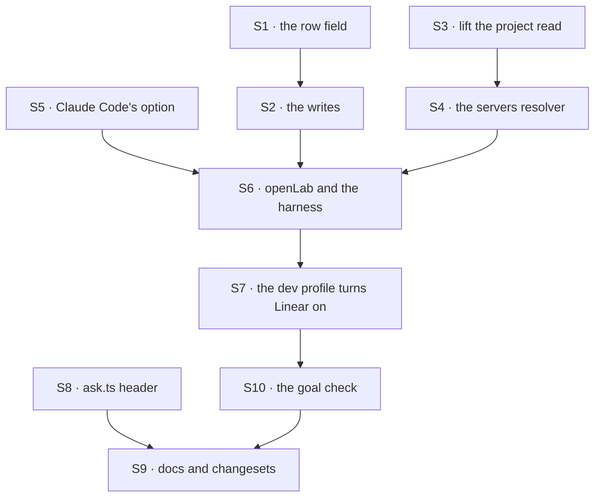

# FIX-1905 · Plan

[Spec](SPEC.md) · [Decisions](DECISIONS.md) · [Rules](BUSINESS-RULES.md) · **Plan** · [Docs](DOCS.md) · [Evolution](EVOLUTION.md)

Written for the implementing agent. IDs cross-reference [BUSINESS-RULES.md](BUSINESS-RULES.md)
(BR-n), [DECISIONS.md](DECISIONS.md) (D-n) and the epic's rules (ER-n). `tdd`. **One PR, opened
from `main` after FIX-1904 merges** ([FIX-1903 D1](../../epics/FIX-1903/DECISIONS.md#d1)). It
depends on FIX-1904 for the dev profile S7 edits; nothing else waits on another issue.

## Surfaces

| ID | Package · role | Change | Rules |
|---|---|---|---|
| S1 | `workforce` · the project row (`projects/collections.ts`) | Add `mcpServers: string[]`, default `[]`, and list it in the client fields | BR-6 BR-19 |
| S2 | `workforce` · the project writes (`projects/project-writes.ts`) | `createProject` takes `mcpServers`. New members-only `setMcpServers { project, mcpServers }`, shaped like `setRepository` and in the `actions` map. `defineProjectBlocks({ mcpServers })` takes the names the host offers; absent, it offers none. Name check beside `repository-value.ts`. New refusals `unknown-mcp-server`, `invalid-mcp-server` | BR-1–BR-5 BR-7 |
| S3 | `workforce` · the run's project (`projects/project-workspace.ts`) | Lift the three-step find (workstream, filing project, the task's `input.project`) and its refusals into one internal reader that returns the project row and its visibility. `projectWorkspace()` answers from it, unchanged | BR-8 BR-10 |
| S4 | `workforce` · the servers resolver, beside S3 | `projectMcpServers(hostServers)` returns a resolver: S3's read, then each named server joined to its host entry as `{ type, url, headers: { Authorization: "Bearer <value>" } }`. Skips a missing variable or an unoffered name and emits one notice for the run. Needs `projectWorkspaceCapability` on the asking block, with the same "not held" message | BR-8 BR-9 BR-11 BR-15 |
| S5 | `claude-code` · `sdk/agent.ts`, `sdk/types.ts` | `mcpServers`: a value or a resolver, resolved once beside `cwd`. When set: the SDK's `mcpServers`, `strictMcpConfig: true`, and `mcp__<name>` added to `allowedTools`. Unset: nothing changes. Read the init message's server statuses and emit a status item for `failed` or `needs-auth`. Nothing Workforce-shaped | BR-12 BR-16 BR-20–BR-23 |
| S6 | `shift-manager` · `teams/devteam/host.mts`, `harness.mts`, `harness-stub.mts` | `openLab({ mcpServers })`: validate the host config at start, give the names to S2, print the BR-14 and BR-17 lines, and add an `mcpServers` feed (S4) to the slot only when given. `claudeCodeHarness` passes it on with `uses: [projectWorkspaceCapability]`. The stub records what it was handed, for V3 | BR-13 BR-14 BR-17 |
| S7 | `shift-manager` · the dev profile config, as FIX-1904 names it | One host entry, `linear` → `https://mcp.linear.app/mcp` and `LINEAR_MCP_API_KEY`; `mcpServers: ["linear"]` on both projects. Nothing else in the file | ER-6 |
| S8 | `harness-manager` · `ask.ts` header | Correct the stale claim: the harness has an MCP option now; the ask stays a file because of its marker-path reasons, not because one can't be built ([EVOLUTION.md](EVOLUTION.md)) | — |
| S9 | Docs and release notes | Per [DOCS.md](DOCS.md). Changesets: `workforce` minor, `claude-code` minor. None for `shift-manager`: the profiles aren't published | — |
| S10 | `goals/shift-manager/a-projects-coding-run-reads-its-linear/` | The goal check, with `goal.md` copied from [SPEC.md](SPEC.md#the-goal-and-how-well-know-its-met) | the goal |

**Removed:** nothing. S3 moves code; no second copy of the lookup may remain.

## Sequence



S1–S2, S3–S4 and S5 are independent; S6 joins them. One PR, so no PR plan.

## Checks

| ID | Runs after | Passes when |
|---|---|---|
| V1 | S2 | BR-1–BR-7, BR-19. Includes a row written without the key (BR-6) |
| V2 | S3 | The existing `projectWorkspace` suite passes unedited. It is the parity check: break one lookup step on purpose, watch it go red, restore |
| V3 | S6 | Model-free, through the real manager and the recording stub: BR-8 on each of the three paths, BR-9, BR-11, BR-15. **Negative control:** a task whose hand-over payload or prompt names `linear`, on a project with `[]`, must still be handed nothing |
| V4 | S5 | BR-12, BR-16, BR-20–BR-23 against a scripted `query`. BR-20 compares the options object with today's, key for key |
| V5 | S6 | BR-13 (DevTeam's handed options equal `main`'s), BR-14, BR-17 |
| V6 | S6 | BR-18: a sentinel key value appears in none of the env handed to the SDK, captured logs, session items, the run row. **Plant it** in a log line once and see V6 fail |
| VG | S10 | [The goal](SPEC.md#the-goal-and-how-well-know-its-met): PASSES on real Claude Code and Linear after FAILING under `GOAL_CONTROL=no-linear` on *the title*. Also run once with `LINEAR_MCP_API_KEY` unset: must FAIL the title and show the BR-15 notice |
| V7 | S9 | `pnpm typecheck` and `pnpm test` green; docs build; the pages read as DOCS.md drafts them, reconciled to what shipped |

Second paths (BP-035): legacy row (V1), retry attempt (V3, BR-11), the off state of the option (V4, BR-20), a host with no config (V5).

## Pinned names

| Where | Name | Why pinned |
|---|---|---|
| Project row field, and the create input | `mcpServers` | Stored; Shift Manager and the chief of staff read rows. Cursor's option uses the same word |
| Write action | `setMcpServers` | Public, beside `setRepository` |
| Host config entry | `{ url, credentialEnv }`, optional `transport: "http" \| "sse"`, default `http` | The epic's docs draft; a host writes it |
| Claude Code option | `mcpServers` | Public; matches Cursor's |
| Refusal reasons | `unknown-mcp-server`, `invalid-mcp-server` | A caller branches on them |

Everything else is yours to name.

## Guardrails

| Rule | Because |
|---|---|
| One reader finds a run's project; `projectWorkspace` and the servers resolver both call it (tenet 5) | Two copies drift, and then a run's checkout and its servers can come from different projects |
| The project is found from session state and the held task row only, never a hand-over payload, prompt or input the model can set (BP-031) | ER-5, and V3's control |
| No resolved server config is logged, recorded, emitted or put in `env` | ER-6. Headers carry the key |
| Nothing is added to core, engine, orchestration or workspace; `claude-code` gains one option with no project or worker in it ([ER-9](../../epics/FIX-1903/BUSINESS-RULES.md#what-no-child-may-do)) | Workforce concepts stay in Layer 2 |
| A host without server config hands Claude Code exactly today's options (BP-030) | DevTeam's goal checks serve it unedited (ER-10) |
| Docs and code call a team's agents "workers" | [ER-16](../../epics/FIX-1903/BUSINESS-RULES.md#what-no-child-may-do) |

## Docs

Reconcile [DOCS.md](DOCS.md) against what shipped, then publish it in this PR, after V3 and
V4 pass. It owns the MCP subsection of `projects.md`, the Claude Code option, and the Linear
sentences FIX-1904 left out of the shared paragraph ([FIX-1903 DOCS](../../epics/FIX-1903/DOCS.md#ownership)).

## Sketch · pseudocode, illustrative, react to the shape

```
the run's project (one reader, lifted from the source):
    workstream link → filing project → the held task's input.project → refusal

projectMcpServers(host) → resolver(ctx):
    found ← the run's project (ctx)
    if refused: answer {}                         ← the source already refused the run
    for name in found.row.mcpServers:
        entry ← host[name];  value ← process env[entry.credentialEnv]
        if no entry or no value: note it; skip    ← BR-15, one notice per run
        else servers[name] ← { type, url, headers: bearer value }
    answer servers

claude-code, per run, beside cwd:
    servers ← option is a function ? option(ctx) : option
    if set: sdk.mcpServers ← servers; strict ← true; allowedTools += "mcp__" + each name
```

**POC:** none built. The two premises are read off code: the SDK's argument building (DECISIONS
→ Settled) and the harness's `uses` slot. V3 is where the second is proved.

## At implement time

- **FIX-1904's profile**: its file, its project ids and its harness default. S7 edits only what
  [the epic's seam table](../../epics/FIX-1903/PLAN.md#coordination-seams-to-watch) allows.
- **The harness block reads the same held task.** S4 resolves inside the harness block, which
  must see the same request and session as the manager's open step. V3's task path proves it. If
  it can't, stop and surface it; don't move the read into a hand-over.
- **`--strict-mcp-config` drops user-scope servers.** Confirm once with a real run on a machine
  whose own Claude Code config names a server; BR-9 and VG's control rest on it.
- **FIX-1906** may touch `project-workspace.ts` or `local-host.ts`; rebase S3 onto it.
  **FIX-1915** (open) edits `claude-code`'s README and work records, not its query options.
- Check [EVOLUTION.md](EVOLUTION.md)'s claims against the code before S8.

## Follow-ups

- Codex and Cursor take no per-run MCP resolver ([D3](DECISIONS.md#d3)). Not filed: no goal needs it.
- With a per-run MCP option, a run's question could be a tool rather than a file (`ask.ts`). A
  design change to the ask; not in scope.
