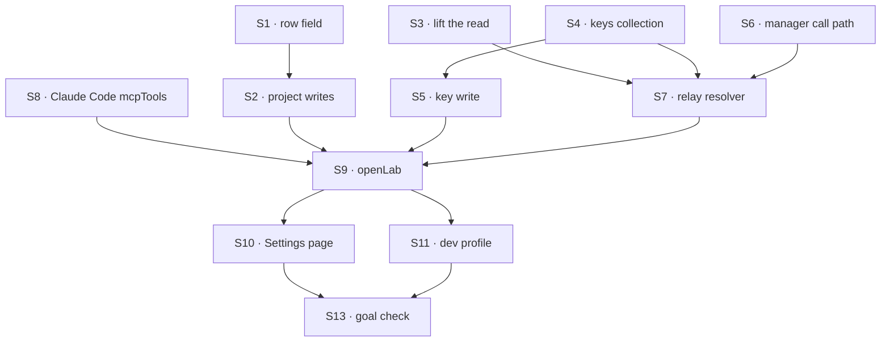

# FIX-1905 · Plan

[Spec](SPEC.md) · [Decisions](DECISIONS.md) · [Rules](BUSINESS-RULES.md) · **Plan** · [Docs](DOCS.md) · [Evolution](EVOLUTION.md)

Written for the implementing agent. IDs cross-reference [BUSINESS-RULES.md](BUSINESS-RULES.md)
(BR-n), [DECISIONS.md](DECISIONS.md) (D-n) and the epic's rules (ER-n). `tdd`. **One PR, opened
from `main` after FIX-1904 merges** ([FIX-1903 D1](../../epics/FIX-1903/DECISIONS.md#d1)). The
settings page grows it by about half against the first draft, not double; S5 and S10 are the
slice that would split off if it proves larger, and that goes back to the epic, not split here.

## Surfaces

| ID | Package · role | Change | Rules |
|---|---|---|---|
| S1 | `workforce` · the project row (`projects/collections.ts`) | Add `mcpServers: string[]`, default `[]`, in the client fields | BR-6 BR-26 |
| S2 | `workforce` · the project writes (`projects/project-writes.ts`) | `createProject` takes `mcpServers`. New members-only `setMcpServers { project, mcpServers }`, shaped like `setRepository`. `defineProjectBlocks({ mcpServers })` takes the names the host offers; absent, none. Name check beside `repository-value.ts`. Refusals `unknown-mcp-server`, `invalid-mcp-server` | BR-1–BR-7 |
| S3 | `workforce` · the run's project (`projects/project-workspace.ts`) | Lift the three-step find and its refusals into one internal reader returning the row, its visibility and the run's owner. `projectWorkspace()` answers from it, unchanged | BR-13 BR-15 |
| S4 | `workforce` · keys, a user-scoped collection | `mcp-credentials/*` at user scope, keyed by server name: `{ value, setAt }`. Client read exposes `setAt` only (BP-015), so a record's existence is *set*. Not installed on any generator's capability | BR-8 BR-9 |
| S5 | `workforce` + host · the key write | Set and clear for the requesting user, refusals `unknown-mcp-server`, `invalid-mcp-credential`. **Not a plain flow action** ([DECISIONS](DECISIONS.md#decided-not-asked)): a route the Lab registers through the engine's existing transport-adapter dedicated routes, authenticated by the Lab's principal resolver. If that seam can't resolve the principal, stop and surface it; the fallback is a generic engine hook keeping a declared action's input off its record, which needs the epic's ER-9 sign-off | BR-8 BR-10 BR-11 |
| S6 | `tools` · `mcp/manager.ts` | `createMcpManager` gains a call path for one tool by namespaced name (args, abort signal), returning the server's result, and each catalog tool's JSON Schema as plain JSON. No second client. `getServerConfigs()` carries headers: never logged | BR-17 |
| S7 | `workforce` · the relay resolver, beside S3 | `projectMcpTools(hostServers, { operator })` returns a resolver: S3's read; per named server, the owner's key (S4), else the seed for the operator (BR-22), else skip with a notice; one `createMcpManager` per run; answer `{ [name]: { tools, close } }` in `mcpTools`' shape (structural, no import of `claude-code`). Needs `projectWorkspaceCapability` and S4's capability on the asking block | BR-13 BR-14 BR-16 BR-21–BR-23 |
| S8 | `claude-code` · `sdk/agent.ts`, `sdk/types.ts` | `mcpTools`: a value or a resolver, resolved once beside `cwd`. Each server becomes an in-process SDK server (the Agent SDK's `type: "sdk"` with an `instance`, its tools' JSON Schema passed through). When set: `strictMcpConfig: true`, `settings: { disableClaudeAiConnectors: true }`, `mcp__<name>__*` allowed; each `close` called when the run ends. Unset: nothing changes. The init message's server list is watched for any server not handed (BR-12). Nothing Workforce-shaped | BR-12 BR-17 BR-18 BR-27 BR-28 |
| S9 | `shift-manager` · `teams/devteam/host.mts`, `harness.mts`, `harness-stub.mts` | `openLab({ mcpServers })`: validate at start, give names to S2, register S5's route, print BR-20, and wire `mcpTools: projectMcpTools(...)` into the Claude Code harness only when given. `seedEnv` stays out of `CLAUDE_CODE_PASS`. The stub and other harnesses emit BR-24's notice | BR-19 BR-20 BR-24 |
| S10 | `shift-manager` · `src/` | Route `/settings` and a `Settings` surface, linked from the sidebar: each offered server, *set · date* or *not set*, a password field to set or replace, a clear. Reads S4's exposed field; writes S5 | BR-9 |
| S11 | `shift-manager` · the dev profile config, as FIX-1904 names it | `linear` → `https://mcp.linear.app/mcp`, `seedEnv: "LINEAR_MCP_API_KEY"`; `mcpServers: ["linear"]` on both projects | — |
| S12 | Docs, `ask.ts` header, release notes | Per [DOCS.md](DOCS.md). The `ask.ts` header's stale claims ([EVOLUTION.md](EVOLUTION.md)). Changesets: `workforce` minor, `claude-code` minor, `tools` patch | — |
| S13 | `goals/shift-manager/a-projects-coding-run-reads-its-linear/` | The goal check, `goal.md` copied from [SPEC.md](SPEC.md#the-goal-and-how-well-know-its-met) | the goal |

**Removed:** nothing. S3 moves code; no second copy of the lookup may remain.

## Sequence



S1–S2, S3, S4–S5, S6 and S8 are independent; S9 joins them. One PR, so no PR plan.

## Checks

| ID | Runs after | Passes when |
|---|---|---|
| V1 | S2 | BR-1–BR-7, BR-26, including a row written without the field |
| V2 | S3 | The `projectWorkspace` suite passes unedited. Break one lookup step on purpose, see it red, restore |
| V3 | S5 | BR-8–BR-11. **Sentinel:** a set key's value appears in no request record, active request, trace, item, log or response; plant it in a log line once and see V3 fail |
| V4 | S6 | A scripted MCP client: a call by namespaced name returns the server's result; an abort reaches it |
| V5 | S9 | Model-free, through the real manager and a recording harness: BR-13 on each path, BR-14 with two users, BR-16, BR-21–BR-23. **Negative control:** a task whose payload or prompt names `linear`, on a project with `[]`, is relayed nothing |
| V6 | S8 | BR-12 (both flags), BR-17, BR-18, BR-27, BR-28 against a scripted `query`; BR-27 compares the options with today's, key for key |
| V7 | S9 | BR-19 (DevTeam's options equal `main`'s), BR-20, BR-24. BR-25 with a sentinel key across the SDK options, env, logs, items, run row |
| V-page | S10 | In a browser on the dev profile: set, replace, clear; the value never re-renders, and the page's network responses never carry it |
| VG | S13 | [The goal](SPEC.md#the-goal-and-how-well-know-its-met): PASSES after FAILING under `GOAL_CONTROL=no-linear` and `no-key`, on *the title*. The key absent from `/proc/<pid>/cmdline` and `environ` of the live Claude Code process |
| V8 | S12 | `pnpm typecheck`, `pnpm test`, docs build; pages match DOCS.md, reconciled |

Second paths (BP-035): legacy row (V1), retry (V5, BR-16), the option off (V6), a host with no
config (V7), concurrent set and run (the run reads one value or the other, never a mix).

## Pinned names

| Where | Name | Why pinned |
|---|---|---|
| Project row field, create input | `mcpServers` | Stored; clients read rows |
| Project write | `setMcpServers` | Public, beside `setRepository` |
| Host config entry | `{ url, seedEnv? }`, HTTP transport only | A host writes it |
| Claude Code option | `mcpTools` | Public; says it carries tools, not a remote config |
| Relay resolver | `projectMcpTools` | Public in `workforce` |
| Keys collection | `mcp-credentials/*`, user scope | Stored |
| Refusals | `unknown-mcp-server`, `invalid-mcp-server`, `invalid-mcp-credential` | A caller branches on them |
| Shift Manager route | `/settings` | A link opens it |

Everything else is yours to name.

## Guardrails

| Rule | Because |
|---|---|
| One reader finds a run's project and owner; `projectWorkspace` and the relay both call it (tenet 5) | Two copies drift |
| Project and owner come from session state and the held row, never a payload, prompt or input the model can set (BP-031) | ER-5, V5's control |
| One MCP client: `createMcpManager` | The Architect's pin; one path serves generators and runs |
| No key, header or server config is logged, recorded, emitted, put in `env` or in Claude Code's options | ER-6 as amended, D2 |
| Nothing in core, engine, orchestration or workspace; `claude-code` and `tools` gain generic options only ([ER-9](../../epics/FIX-1903/BUSINESS-RULES.md#what-no-child-may-do)) | Keys and projects are Layer 2 |
| A host without server config hands Claude Code exactly today's options (BP-030) | DevTeam's checks serve it unedited (ER-10) |
| "Worker" for a team's agents, in docs and code | [ER-16](../../epics/FIX-1903/BUSINESS-RULES.md#what-no-child-may-do) |

## Docs

Reconcile [DOCS.md](DOCS.md) against what shipped, then publish it in this PR after V5 and V6.

## Sketch · pseudocode, illustrative, react to the shape

```
projectMcpTools(host, { operator }) → resolver(ctx):
    found ← the run's project and owner (ctx)          ← refused: answer {}
    for name in found.row.mcpServers:
        entry ← host[name]
        key ← stored key(found.owner, name) ?? (found.owner = operator ? env[entry.seedEnv] : none)
        if no entry or no key: notice; skip
        else configs += { name, http, entry.url, bearer key }
    manager ← createMcpManager(configs); await tools    ← failures: notice per server
    answer { name: { tools: catalog + call via manager, close: manager.close } }

claude-code, per run, beside cwd:
    servers ← option(ctx) or option
    sdk.mcpServers ← each as { type: "sdk", name, instance: server over its tools }
    strict; no claude.ai connectors; allow mcp__<name>__*; finally: close each
```

**POC:** none built. The SDK facts are read off the three locked packages (DECISIONS → Settled).

## At implement time

- **The harness block sees the same held task and owner.** V5's task path proves it. If it can't,
  stop and surface it; don't move the read into a hand-over.
- **The in-process server with raw JSON Schema.** `tool()` in the Agent SDK takes zod shapes; an
  MCP `Server` from `@modelcontextprotocol/sdk` (the Agent SDK's peer) takes the upstream schema
  as is. Prove one call end to end on the real SDK before S9.
- **Exactly the handed servers, nothing from the account** — confirm once on a signed-in
  account with a cloud connector, on a machine whose own config names a server: the init message
  lists only the relayed ones. If a connector shows, the notice makes it visible; stop and surface.
- **FIX-1906** may touch `project-workspace.ts`; rebase S3 onto it. **FIX-1915** edits
  `claude-code`'s README and work records, not its query options.

## Notes from review

Recorded verbatim for the implementer; none changes the approach.

- *cursor[bot], round 1, on S8 (now S12):* "S8 is comment-only hygiene on `ask.ts`. It doesn't affect BRs or the goal. Consider deferring to a one-line follow-up so the implementation PR stays "MCP delivery + tests" without EVOLUTION/LAB-138 argument surface in the same merge."
- *cursor[bot], round 1:* "pin **HTTP-only** for v1 (drop `transport: sse` from pinned names until a host needs it)" — taken.
- *cursor[bot], round 1:* "Worth a one-line implementer note: **same-attempt memo** of the lifted project reader would avoid ~3× `heldTask` + row reads per attempt (workspace source ×2 + MCP resolver) without weakening BR-11 (fresh read **between** attempts)."
- *cursor[bot], round 1:* "**BR-15 notices from S4:** confirm whether `projectMcpServers` can emit session notices from resolver context, or return skip reasons and let `claude-code` emit once (avoid duplicate paths)."
- *cursor[bot], round 1:* "**Fourth feed only in shift-manager** is correct per D3; don't extend `harness-manager`'s `HarnessFeeds` type."
- *chatgpt-codex-connector[bot], round 1, on the cloud connectors:* if the setting proves insufficient on the real run, `ENABLE_CLAUDEAI_MCP_SERVERS=false` in the env handed to Claude Code is the fallback to try; it holds no secret.

## Follow-ups

- Cursor takes relayed tools through `local.customTools` ([D3](DECISIONS.md#d3)). Not filed: no goal needs it.
- Codex needs a local MCP endpoint FSD serves. A design of its own; not filed.
- Epic FIX-1903 amendment for Jake's calls ([EVOLUTION.md](EVOLUTION.md)): filed by the epic.
