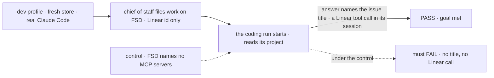
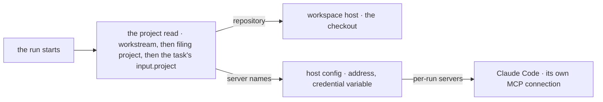

# FIX-1905 · A project has MCP settings, and its workers get those MCPs (Linear first)

**Spec** · [Decisions](DECISIONS.md) · [Rules](BUSINESS-RULES.md) · [Plan](PLAN.md) · [Docs](DOCS.md) · [Evolution](EVOLUTION.md)

## Six people, before and after

| Someone who… | Today | After |
|---|---|---|
| **asks the chief of staff to work FIX-1234 on FSD** | The coding agent has no Linear. It guesses from the id, or the person pastes the issue in | The run reads FIX-1234 through Linear, because the FSD project names Linear |
| **approves a row in Inbox, or files from a project's conversation** | The same: no Linear on any path | The same as above. Every path that starts a coding run on the project gets its servers, and none waits on a coordinator's hand-over |
| **works on a project that names no MCP servers** | The run gets whatever MCP servers the server machine's own Claude Code settings hold | The run gets none. What a run reaches is the project's to say, not the operator's laptop's |
| **starts the Lab without `LINEAR_MCP_API_KEY`** | n/a | The Lab starts and says once that Linear is off. Each run that misses it says so in its session, and still runs |
| **saves a project naming an address, a variable, or a name the server doesn't offer** | n/a | Refused when saved, naming the names the server does offer |
| **builds on `claudeCodeAgent` outside Workforce** | No way to hand a run MCP servers | An `mcpServers` option: a value, or a resolver read once per run. Unset is today, byte for byte |

The person in the first row is the epic's whole reason. Without this issue the dev Lab's coder
works an issue it can't read ([FIX-1903 D4](../../epics/FIX-1903/DECISIONS.md#d4)).

## The goal, and how we'll know it's met

**A coding run on a project that names Linear can read the Linear issue it was given, however
the work reached it; a run on a project that names none reaches no MCP server.**

| Is it the right goal? | |
|---|---|
| **The real need** | "Without it the agent works an issue it can't read" ([FIX-1903, the set](../../epics/FIX-1903/SPEC.md#the-set--as-of-2026-10-12)), on runs that never pass a coordinator ([ER-5](../../epics/FIX-1903/BUSINESS-RULES.md#what-a-person-gets-and-what-they-dont)) |
| **Smaller, and rejected** | "A project row stores `mcpServers`." Hittable while no run ever connects, or only runs a coordinator hands over do |
| **Bigger, and not this issue's** | Both dev projects worked side by side in your checkout: the closure, [FIX-1919](https://linear.app/fixpoint-labs/issue/FIX-1919). MCP for workers that don't code, and each person signing in to Linear as themselves: later epics |
| **Not done if** | The goal check passes only on a run a coordinator handed over · the title is in the prompt · the control passes because the operator's own Claude Code settings carry Linear · a missing key is silent · DevTeam's runs change |



The check reads the run's own answer and session against the title it fetched from Linear
itself. Under the control the same run must fail, or the pass proves nothing.

| How we verify | |
|---|---|
| **Goal check** | `goals/shift-manager/a-projects-coding-run-reads-its-linear/` · real Claude Code, real Linear · run by the implementer at completion · verdict in the implementation PR |
| **Signal** | The run's final answer contains the issue's title, as the check reads it from Linear's API, and the run's session holds at least one `mcp__linear__` tool call |
| **Input** | A held-out Linear issue picked at run time, named by id only, that the repository never mentions (`git grep` of the id on the run's base finds nothing), so the checkout can't supply the title. Any other such issue must pass too |
| **Anti-game** | No title in the prompt. No assertion on the resolver's output or a stub. The server machine's own Claude Code MCP settings must not count ([BR-9](BUSINESS-RULES.md#what-a-run-reaches)) |
| **Control that must fail** | `GOAL_CONTROL=no-linear`: FSD's servers cleared with `setMcpServers` before filing. Must FAIL on *the title*. Today's `main` must FAIL too: no row can name Linear |

## What changes


The row says *which*; the host says *where* and *with what*. The run joins the two when it starts.

**The dev profile, as FIX-1904 leaves it, gains three lines:**

```diff
  const DEV_PROJECTS = [
-   { id: "fsd", title: "FSD", repository: FSD_REMOTE, /* … */ },
+   { id: "fsd", title: "FSD", repository: FSD_REMOTE, mcpServers: ["linear"], /* … */ },
    // the same on Shift Manager's project
  ];
  const lab = await openLab({
    // …
+   mcpServers: { linear: { url: "https://mcp.linear.app/mcp", credentialEnv: "LINEAR_MCP_API_KEY" } },
  });
```

**A member, later, from a session of their own:**

```diff
+ setMcpServers { project: { visibility: "shared", id: "fsd" }, mcpServers: [] }
```

## How a run gets them



One read finds the project, and both the checkout and the servers come from it. No coordinator's
hand-over and no `dispatchTask` field is involved.

## What stays as it is

- **DevTeam**: no MCP servers, and its Claude Code runs exactly as today ([ER-10](../../epics/FIX-1903/BUSINESS-RULES.md#what-no-child-may-do)).
- **`handOff`, `dispatchTask` and every hand-over tool** ([ER-8](../../epics/FIX-1903/BUSINESS-RULES.md#what-no-child-may-do)).
- **Core, engine, orchestration, workspace and harness-manager's slot.** Nothing is added there.
- **The ask stays a file.** A per-run MCP option makes an ask tool possible; this issue builds none.
- **Stored projects.** A row from before reads as naming no servers. No migration.

## Sign off

**[The goal](#the-goal-and-how-well-know-its-met), at that size:** every path, and exactly the
project's servers. If wrong: Linear only on some runs, or runs reaching servers nobody chose.

1. **[D2](DECISIONS.md#d2) · The key reaches Claude Code in its own MCP config, not through an
   FSD relay.** If wrong: a run with a shell can read the Linear key, which we then promise it
   can't. **The one to weigh.**
2. **[D1](DECISIONS.md#d1) · Any member turns a project's servers on or off, from the names the
   server offers.** If wrong: one member can make everyone's runs act in Linear as the key's owner.
3. **[D3](DECISIONS.md#d3) · Only Claude Code runs get them, wired by the host.** If wrong: a
   Codex or Cursor run on a Linear project has no Linear until its package adds the option.

**Open: none.** Reasoning: [DECISIONS.md](DECISIONS.md). Cases: [BUSINESS-RULES.md](BUSINESS-RULES.md).

Feature · `workforce` + `claude-code` + `shift-manager` · medium (10 surfaces, 8 checks, 6 doc files) · 1 PR, after FIX-1904 merges · epic [FIX-1903](../../epics/FIX-1903/SPEC.md)
