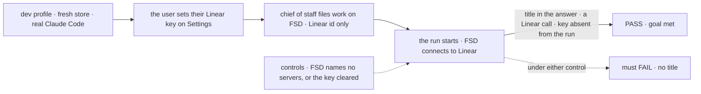
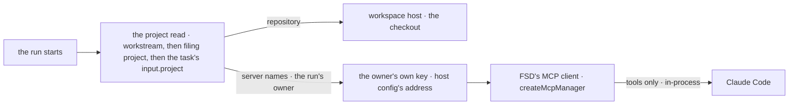

# FIX-1905 · A project has MCP settings, and its workers get those MCPs (Linear first)

**Spec** · [Decisions](DECISIONS.md) · [Rules](BUSINESS-RULES.md) · [Plan](PLAN.md) · [Docs](DOCS.md) · [Evolution](EVOLUTION.md)

## Seven people, before and after

| Someone who… | Today | After |
|---|---|---|
| **asks the chief of staff to work FIX-1234 on FSD** | The coding agent has no Linear. It guesses from the id, or the person pastes the issue in | The run reads FIX-1234 through Linear, as that person, because the FSD project names Linear and they set their Linear key |
| **approves a row in Inbox, or files from a project's conversation** | The same: no Linear on any path | The same as above. Every path that starts a coding run on the project gets its servers, and none waits on a coordinator's hand-over |
| **opens Settings in Shift Manager** | No such page | Sees each server the Lab offers, with *set* or *not set* for their own key. Pastes a key, replaces it, or clears it. The page never shows a key back |
| **asks for work but never set a key** | n/a | The run starts without Linear, and its session says their Linear key isn't set and where to set it |
| **works on a project that names no MCP servers** | The run gets whatever MCP servers the server machine's own Claude Code settings hold | The run gets none. What a run reaches is the project's to say |
| **saves a project naming an address, a variable, or a name the Lab doesn't offer** | n/a | Refused when saved, naming the names the Lab does offer |
| **builds on `claudeCodeAgent` outside Workforce** | No way to give a run tools served from the host process | An `mcpTools` option: tools the host serves in-process, a value or a resolver read once per run. Unset is today, byte for byte |

The first row is the epic's reason ([FIX-1903 D4](../../epics/FIX-1903/DECISIONS.md#d4)).

## The goal, and how we'll know it's met

**A coding run on a project that names Linear can read the Linear issue it was given, through
FSD's own connection, with the requester's key, however the work reached it; a run on a project
that names none reaches no MCP server, and the key never reaches the run.**

| Is it the right goal? | |
|---|---|
| **The real need** | "Without it the agent works an issue it can't read" ([FIX-1903, the set](../../epics/FIX-1903/SPEC.md#the-set--as-of-2026-10-12)), on runs that never pass a coordinator ([ER-5](../../epics/FIX-1903/BUSINESS-RULES.md#what-a-person-gets-and-what-they-dont)). And Jake's call on this PR: the key is FSD's to hold and configure, not Claude Code's ([comment](https://github.com/fixpoint-labs/flow-state-dev/pull/3174#issuecomment-6131359139)) |
| **Smaller, and rejected** | "A project row stores `mcpServers`." Hittable while no run ever connects. Also: "the run reads Linear", passable with the key in Claude Code's own config, which Jake rejected |
| **Bigger, and not this issue's** | Both dev projects worked side by side in your checkout: the closure, [FIX-1919](https://linear.app/fixpoint-labs/issue/FIX-1919). MCP for workers that don't code. Signing in to Linear with OAuth. A general secrets store |
| **Not done if** | The pass rests on a run a coordinator handed over · the title is in the prompt · the key appears in the run's command line, environment, session or MCP config · the control passes on the operator's own Claude Code settings · a missing key is silent · DevTeam's runs change |



The check reads the run's answer and session against the title it fetched from Linear itself,
and searches the run's own process for the key. Under either control the run must fail.

| How we verify | |
|---|---|
| **Goal check** | `goals/shift-manager/a-projects-coding-run-reads-its-linear/` · real Claude Code, real Linear · run by the implementer at completion · verdict in the implementation PR |
| **Signal** | The answer contains the issue's title, as the check reads it from Linear's API; the session holds at least one `mcp__linear__` call; and the key's value is in none of the Claude Code process's command line or environment (read from `/proc` while it runs), its session items, or the run record |
| **Input** | A held-out Linear issue picked at run time, named by id only, that the repository never mentions (`git grep` on the run's base finds nothing). The key is set through the settings write as the filing user, with `LINEAR_MCP_API_KEY` unset in the Lab's environment, so the stored path is what passes |
| **Anti-game** | No title in the prompt. No assertion on a resolver's output or a stub. The server machine's Claude Code MCP settings and its account's claude.ai connectors must not count ([BR-12](BUSINESS-RULES.md#what-a-run-reaches)) |
| **Controls that must fail** | `GOAL_CONTROL=no-linear`: FSD's servers cleared with `setMcpServers` before filing. `GOAL_CONTROL=no-key`: the user's key cleared on the settings write. Each must FAIL on *the title*. Today's `main` must FAIL too |
| **Which check is canonical** | This one, for *the project's servers reach the run*. [FIX-1919](https://linear.app/fixpoint-labs/issue/FIX-1919)'s leg a re-runs it among every child's own |

## What changes

![Left to right across the top: a project row naming linear; the coding run starting and reading its project and its owner once, through the same read that gives it its repository; FSD's own MCP client connecting to Linear's address with the run owner's key; Claude Code receiving only the tools, as an in-process server, with no address and no key. Two inputs rise into FSD's client from below: the host config approving linear and its address, and the settings page where each person stores their own key, write-only. Below a dashed fence: never on the row, an address or a key; never handed to the run, the key, in its command line, environment, MCP config, session or logs.](figures/what-changes.svg)

The row says *which*; the host says *where*; the person says *with what key*. FSD connects; the
run gets tools.

**The dev profile, as FIX-1904 leaves it, gains three lines:**

```diff
  const DEV_PROJECTS = [
-   { id: "fsd", title: "FSD", repository: FSD_REMOTE, /* … */ },
+   { id: "fsd", title: "FSD", repository: FSD_REMOTE, mcpServers: ["linear"], /* … */ },
    // the same on Shift Manager's project
  ];
  const lab = await openLab({
    // …
+   mcpServers: { linear: { url: "https://mcp.linear.app/mcp", seedEnv: "LINEAR_MCP_API_KEY" } },
  });
```

**A person, on Shift Manager's new `/settings`:** *Linear · not set* → paste a key → *Linear · set
12 Oct*. Replace or clear it there.

## How a run gets them



One read gives the checkout and the servers. FSD holds the connection and closes it at run end.

## What stays as it is

- **DevTeam**: no MCP servers, and its Claude Code runs exactly as today ([ER-10](../../epics/FIX-1903/BUSINESS-RULES.md#what-no-child-may-do)).
- **`handOff`, `dispatchTask` and every hand-over tool** ([ER-8](../../epics/FIX-1903/BUSINESS-RULES.md#what-no-child-may-do)).
- **Core, engine, orchestration, workspace and harness-manager's slot.** Nothing is added there.
- **FSD's MCP client.** `createMcpManager` in `@flow-state-dev/tools/mcp` is the only client; it gains a call path, no second client is written.
- **Stored projects.** A row from before reads as naming no servers. No migration.

## Sign off

**[The goal](#the-goal-and-how-well-know-its-met), at that size:** every path, exactly the
project's servers, the requester's key, never handed to the run. If wrong: Linear on some runs
only, or a key a run can read from its own process.

1. **[D2](DECISIONS.md#d2) · FSD holds the MCP connection and the key; the run gets tools only.**
   Jake's call, made concrete. If wrong: a second hop on every tool call, and a run that
   can't use Linear when the Lab's process can't reach Linear.
2. **[D4](DECISIONS.md#d4) · Each person sets their own key, on a write-only Settings page, and
   a run uses the key of the person it works for.** Jake's call; the defaults are mine. If wrong:
   someone who never set a key gets runs without Linear until they do. **The one to weigh:** the
   store is a plain record, readable by anyone who can read the Lab's store.
3. **[D1](DECISIONS.md#d1) · Any member turns a project's servers on or off, from the names the
   Lab offers.** If wrong: one member decides that every run on the project acts in Linear as
   its requester.
4. **[D3](DECISIONS.md#d3) · Only Claude Code runs get them in this issue.** If wrong: a Cursor or
   Codex run on a Linear project has no Linear until its package takes relayed tools.

**Open: none.** Reasoning: [DECISIONS.md](DECISIONS.md). Cases: [BUSINESS-RULES.md](BUSINESS-RULES.md).

Feature · `workforce` + `tools` + `claude-code` + `shift-manager` · medium-large (13 surfaces, 10 checks, 7 doc files) · 1 PR, after FIX-1904 merges · epic [FIX-1903](../../epics/FIX-1903/SPEC.md)
