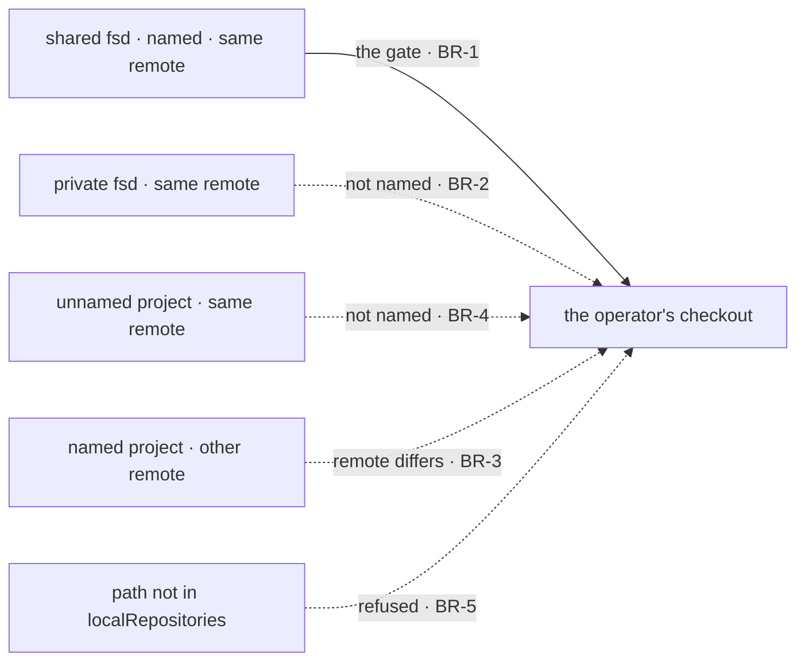

# FIX-1906 · Business rules

[Spec](SPEC.md) · [Decisions](DECISIONS.md) · **Rules** · [Plan](PLAN.md) · [Docs](DOCS.md) · [Evolution](EVOLUTION.md)

The cases, written as rules. Each says what a person or the system does and what happens. The
*proved by* column is the check the plan runs. Epic rules are cited as ER-n
([FIX-1903](../../epics/FIX-1903/BUSINESS-RULES.md)); this issue owns ER-3 and ER-4.

## Which projects get your checkout

| # | When | Then | Proved by |
|---|---|---|---|
| BR-1 | A run's project is named in the mapping by visibility and id, and its row's repository equals the mapping's `remote` | The source answers the checkout path, with the project's kept files and the mapping's `baseRef` | CI · goal leg a |
| BR-2 | A project with the same id but the other visibility, and the same remote, runs | Not mapped: the source answers the row's remote, as today, and the host clones it or refuses it by its allowlist | CI · goal leg b, failing under `match-by-id` |
| BR-3 | A named project's row names a different remote, or none | Not mapped. Its remote goes the remote way; with none, the run works on its files alone, as today | CI |
| BR-4 | A project the mapping doesn't name has the mapped remote on its row | Not mapped (ER-13) | CI |
| BR-5 | The mapping names a checkout the host doesn't list in `localRepositories` | The host refuses the run as `invalid-remote` before any git process, naming the path. Never a clone, never a silent fallback | CI |
| BR-6 | The mapping is built with a relative checkout path, a remote a row couldn't store, or one project address named twice | Refused when `projectWorkspace()` is called, naming the entry | CI |
| BR-7 | No `checkouts` option is given | Every answer is exactly today's | Existing suite |

## The place and the branch

| # | When | Then | Proved by |
|---|---|---|---|
| BR-8 | A mapped run starts | Its place is `checkout/`, a worktree of the operator's checkout on the run's own branch, with `project/` beside it, never inside it. `git worktree list` in the checkout names it (ER-3) | CI · goal leg a |
| BR-9 | The mapping has no `baseRef` | The branch is cut from the checkout's `HEAD`, whatever it is checked out on. Nothing is fetched | CI |
| BR-10 | The mapping's `baseRef` names a branch the checkout doesn't have | The provision fails naming the ref; nothing is left behind | CI |
| BR-11 | The run writes in `project/` | Saved to `project-files/<projectId>/` and absent from `git status` in the worktree (FIX-1762 BR-28, BR-29) | CI · goal leg a |
| BR-12 | A fixed `sourceRepo` app, or any local repository answered with no kept files, runs | Unchanged: the place is the checkout itself (FIX-1762 BR-22) | Existing suite |
| BR-13 | A settled run continues, after an answered question or a person's turn | The same worktree is handed back on the same branch, with its uncommitted work. The branch was never detached (D3) | Existing harness-manager goals, rerun |
| BR-14 | A person ran `git worktree remove` on a settled run's worktree, then the run continues | The worktree is added again on the run's existing branch | CI |
| BR-15 | A person checked the run's branch out in their own tree, then the run continues | The provision fails: git won't check a branch out twice. Nothing is reset | CI |
| BR-16 | The mapping changes or is removed while a run is in flight | The run keeps the repository its record names. New runs follow the new mapping | CI |

## Two projects on one checkout

| # | When | Then | Proved by |
|---|---|---|---|
| BR-17 | Two runs on two projects mapped to one checkout start at once | Two places, two worktrees, two branches; both commit, both save their own kept files under their own key prefix, and both settle (ER-4) | CI, ten iterations, with the control below |
| BR-18 | The same two runs are given one place, the control | The second provision is refused: the live checkout is on the other branch. The "both settle" assertion fails | CI |
| BR-19 | Git finds one of its own lock files held (`*.lock` exists) during a provision | That provision fails loudly, naming git's error. It is not retried by the host, and no repository-wide lock is taken | CI, a planted lock |
| BR-20 | Both runs commit at the same moment | Separate indexes and separate refs, so neither waits on the other | CI, inside BR-17 |

One path crosses into your checkout, at the gate the mapping defines; every other approach stays
outside. The same fence is drawn in [SPEC.md](SPEC.md#what-changes).

## Failure taxonomy

Nothing here retries. A refusal (BR-5) is the host's existing `WorkspaceRefusedError` and fails
the run before any agent is paid. A bad mapping (BR-6) fails at boot. A git failure (BR-10,
BR-15, BR-19) fails that provision with git's message, leaving the checkout and every other
worktree as they were. A project that isn't mapped is not an error: it is today's behaviour.

## Acceptance criteria this issue owns

[The goal](SPEC.md#the-goal-and-how-well-know-its-met): on this repository's checkout, a named
project's run is a worktree there that installs and builds, a private twin is not, and each leg
fails under its control. ER-3 and ER-4 are proved here and consumed by FIX-1904 and the closure.
