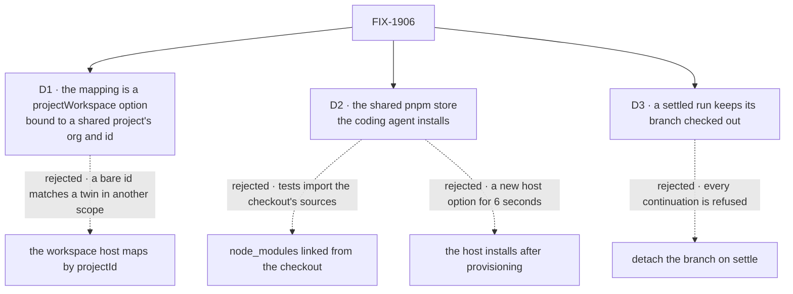

# FIX-1906 · Decisions

[Spec](SPEC.md) · **Decisions** · [Rules](BUSINESS-RULES.md) · [Plan](PLAN.md) · [Docs](DOCS.md) · [Evolution](EVOLUTION.md)

What was considered, what was chosen, why, and what each choice locks in. The epic already
decided that worktrees come from your checkout, that the row keeps naming a remote, and that the
mapping is the operator's and bound to project ids ([FIX-1903 D3](../../epics/FIX-1903/DECISIONS.md#d3),
[ER-13](../../epics/FIX-1903/BUSINESS-RULES.md#what-no-child-may-do)). These three are what that
costs on the real code. All three are engineering calls; D1 refines the epic's wording; the epic
coordinator accepted it as a stricter reading of ER-13, with no epic amendment needed ([ER-17](../../epics/FIX-1903/BUSINESS-RULES.md#how-the-set-is-run)).

## The tree

Solid edges are what you're signing. Dashed edges lost, and the label says why.

## D1 · The checkout mapping is an option of `projectWorkspace()`, bound to a shared project's organization and id, not the workspace host's

| | |
|---|---|
| **Instead of** | The epic's wording, "the workspace host gains that mapping": a `localWorkspaceHost` option from a remote and project ids to a checkout |
| **Because** | The host sees only the source's answer, and its `projectId` is a bare id. A project's address, `{ visibility, id }`, is relative to the run too: shared projects live in the current organization's scope and private ones in the current user's (`packages/workforce/src/projects/collections.ts`, `projectAddressSchema`). So a bare id, or even the address, matches a twin: any user who creates a private `fsd` with the same remote, or, on a server serving several organizations, another organization's shared `fsd`, would get a worktree of the operator's checkout, which ER-13 forbids. `projectWorkspace()` reads the stored row at its visibility (`answer()` in `project-workspace.ts`) and holds the run's context, so it can match the row's id and repository against the session's organization, `orgId` and `tenantId` as `principalFromContext` reads them from a verified principal (`packages/workspace/src/scope-identity.ts`), never the task's payload (BP-031). The host keeps the allowance it has: a path not in `localRepositories` is refused, as today |
| **Locks in** | Only shared projects map. A private project lives in one user's scope and the epic needs none mapped; this flips if a person needs their private project in their checkout. A session with no organization matches no entry. Workforce gains one option; the workspace host gains none, stricter than [ER-9](../../epics/FIX-1903/BUSINESS-RULES.md#what-no-child-may-do) allows. An operator names the checkout twice, once in the mapping and once in `localRepositories`, and a mismatch is a loud refusal. A run source other than `projectWorkspace()` gets no mapping; it answers the path itself |

![D1: where the mapping from a remote to a checkout lives. Chosen: an option of projectWorkspace, bound to a shared project's organization and id. Instead of: an option of the workspace host, bound to project ids. It comes down to the first row, a twin with the same id and remote, private or in another organization: no worktree under the chosen option, the operator's checkout under the other. Second row, the price: the checkout is named twice, in the mapping and in localRepositories, against once. Third row, a tie: the row stays a remote either way. Locks in: workforce gains one option, the host none. Flips if: the host learns a project's full address and organization from a trusted source](figures/d1-mapping-in-the-source.svg)

It comes down to a twin, private or in another organization: a bare id can't tell it from the shared project, so the host would hand it your checkout.

**What would change my mind:** the source's answer carrying the project's full address and organization. Then
the host could bind it safely, and every run source would get the mapping for free.

## D2 · A fresh worktree gets its dependencies from the machine's shared pnpm store, installed by the coding agent

| | |
|---|---|
| **Instead of** | `node_modules` linked from the checkout · the host running the install after it provisions the place |
| **Because** | pnpm's store is per user and content-addressed, so every worktree on the machine already shares it: an offline install took 6 to 7 s and hard-linked every file ([the POC](poc/kill-line/README.md)). Linked from the checkout, pnpm's relative workspace links (`../../../core`) resolve to the checkout's sources, so the agent's tests import code it didn't edit, silently. A host install needs a new workspace or harness option for six seconds the agent already spends: this repository's agent docs tell it to run `pnpm install` |
| **Locks in** | A run's first build waits for one install, about 6 s on a warm store; on a machine whose store is cold, the first worktree pays a network install. An agent that skips it fails its first build loudly, with no `node_modules`; it is never silently wrong. The epic's kill line is met |

![D2: how a fresh worktree gets its dependencies. Chosen: the machine's shared pnpm store, installed by the coding agent. Instead of: node_modules linked from the checkout, or the host installing after it provisions. It comes down to the first row, what the agent's tests import: the worktree's own sources for the chosen option and for a host install, the checkout's sources, silently, when linked. Second row, the price: the agent spends about six seconds on an install, against none when linked, and a new host option for the host install. Third row: a missed install fails loudly for the chosen option. Locks in: about six seconds on a warm store per worktree. Flips if: agents skip the install in practice](figures/d2-shared-store.svg)

It comes down to what the tests import: linked dependencies run the checkout's code, not the agent's edits.

**What would change my mind:** coding agents skipping the install in practice. Then the host
runs it, through one generic option.

## D3 · A settled run's branch stays checked out in its worktree

| | |
|---|---|
| **Instead of** | Detaching the worktree's `HEAD` when the run settles, so a person can check the branch out in their own tree |
| **Because** | A settled run continues: an answered question and a person's turn both re-provision the run's live place. `goals/harness-manager/answered-run-continues-its-session` and `a-persons-turn-continues-its-session` show it for a fixed `sourceRepo` with no kept files; the mapped path, `checkout/` plus `project/`, is this issue's goal check, leg c. The host hands back a checkout only when it is on the run's branch (`handBack` in `packages/workspace/src/worktree.ts`), so a detached one is refused, and every continuation would fail |
| **Locks in** | Git won't check the branch out in your own tree while its worktree exists. A person reviews in the worktree or with `git diff main...<branch>`, which the epic's shared docs already say. `git worktree remove` frees the branch; a later continuation adds the worktree again on the same branch |

![D3: what happens to a run's branch when the run settles. Chosen: it stays checked out in its worktree. Instead of: detach it on settle. It comes down to the first row, a continuation after the run settles: it resumes in place under the chosen option, and is refused as not on its branch under the other. Second row, the price: the branch can't be checked out in your own tree until the worktree is removed, against checking it out at once. Third row, a tie: git diff from the checkout works either way. Locks in: review in the worktree or by diff. Flips if: continuation stops re-using the live place](figures/d3-branch-stays.svg)

It comes down to continuation: a detached worktree is refused, so the run's next turn never starts.

## Decided, not asked

- **The mapping carries an optional `baseRef`.** Absent means `HEAD`, as local mode does today,
  with no fetch. A checkout may sit on any branch, so FIX-1904's profile names `main`.
- **With kept files, a local checkout's place is `checkout/` plus `project/`**, the remote
  layout ([FIX-1762 BR-28](../FIX-1762/BUSINESS-RULES.md#the-projects-files-either-kind)). Without
  them the place is the checkout itself, so a fixed `sourceRepo` app is unchanged (BR-12).
- **`tenantId` is matched exactly**: an entry that names one matches only a session in that
  tenant, and one that names none only a session with none. That is narrower than the org scope,
  which is keyed on `orgId` alone (`scopeComponents` in `scope-identity.ts`).
- **The remote is matched exactly as the row stores it**; a named project on another remote is
  not mapped. **The mapping is checked when built**: absolute path, a storable remote, no project named twice.
- **No repository-wide lock.** Places and branches are distinct per run, and git keeps
  concurrent worktrees apart ([Settled](#settled)). A git lock error fails loudly, never retried.
- **A mapped run is never held across machines**, as no local repository is today.
- **The run's record names the checkout path** as its repository, as a fixed `sourceRepo`
  run's does today. That is the host's run record, not a project row ([ER-11](../../epics/FIX-1903/BUSINESS-RULES.md#what-no-child-may-do) holds).
- **No trusted single-user host mode.** ER-13 allows one; the goal doesn't need it.
- **Wiring the Lab's host is FIX-1904's**, including the answer-task host beside it.

## Considered and dropped

| Alternative | Why not |
|---|---|
| A `file://` remote on the row | Epic D3: a machine path in a shared row, and a hidden clone |
| Resolve the checkout from a row's remote alone | ER-13: any project's owner can set a remote |
| A host option keyed by bare `projectId` | D1: a twin, private or in another organization, matches |
| A lock over the whole checkout | Git's own locks suffice; a lock would make two projects wait on each other, which ER-4 forbids |
| Normalising remotes before matching | Two spellings of one remote is config the operator fixes; a fuzzy match widens who gets the checkout |

## Settled

- **A fresh worktree of this repository installs and builds** (the kill line) — **CONFIRMED**
  on `main` at `be18f487`, node 22.22.0, pnpm 10.4.1; commands and results in
  [poc/kill-line/](poc/kill-line/README.md):
  - `git worktree add -b <branch> <dir> origin/main`, then `pnpm install --frozen-lockfile --offline`: exit 0, 6 to 7 s; with an empty store it fails, so the shared store supplied it
  - `pnpm packages:build`: exit 0, 30 of 30 tasks, 86 s with no cache
  - `pnpm --filter @flow-state-dev/workspace test`: 216 of 216, 49 to 52 s
  - `pnpm --filter @flow-state-dev/shift-manager typecheck`: exit 0, 12 s
- **The build cost is paid once per change, not per worktree** — **CONFIRMED**: turbo 2.9.16
  keeps one local cache for every worktree of a repository; a second worktree's full build took
  2 s. (The design brief said turbo's cache was per worktree. It isn't.)
- **Concurrent worktrees of one repository don't collide** — **CONFIRMED**: 36 concurrent
  `git worktree add -b`, every directory named `checkout`, 0 errors; a second worktree on a held
  branch is refused, which is the control.

## How it got here

- **Draft (2026-10-12)** — built on the FIX-1906 thread's spike. D1 moved the mapping from the
  host to the run source after reading what the host can see; raised to the epic coordinator as a
  refinement of epic D3, and accepted there with no epic amendment. The shared turbo cache found while re-running the spike.
- **Review round 1 (2026-10-12)** — Cursor approved with optional notes. Codex: bind the mapping to
  the run's organization, shared projects only (D1, BR-21); prove continuation on the mapped path
  (goal leg c); make the POC's collision control check its own setup; one `patch` changeset.

**Open: none.**
