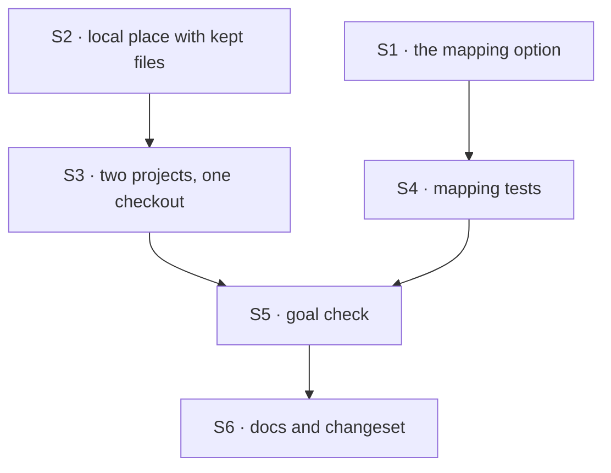

# FIX-1906 · Plan

[Spec](SPEC.md) · [Decisions](DECISIONS.md) · [Rules](BUSINESS-RULES.md) · **Plan** · [Docs](DOCS.md) · [Evolution](EVOLUTION.md)

Written for the implementing agent. IDs cross-reference [BUSINESS-RULES.md](BUSINESS-RULES.md)
(BR-n), [DECISIONS.md](DECISIONS.md) (D-n) and the epic's rules (ER-n). `tdd`. One PR.

## Surfaces

| ID | Package · role | Change | Rules |
|---|---|---|---|
| S1 | `workforce` · `projectWorkspace()` in `src/projects/project-workspace.ts` | Takes an optional `{ checkouts }`. Checked when called (BR-6). Where the project is answered, a **shared** row whose id an entry names, with the session's `orgId` and `tenantId` from `principalFromContext(ctx)` (`@flow-state-dev/workspace`, `scope-identity.ts`) equal to the entry's, and whose `repository` equals the entry's `remote`, answers `{ kind: "repo", repo: <checkout>, baseRef, projectId, files }`. A private row, or a session with no `orgId`, never matches. Everything else is today's answer | BR-1 to BR-4, BR-6, BR-7, BR-21 |
| S2 | `workspace` · `localWorkspaceHost` in `src/local-host.ts` | A local repository answered **with** kept files: place is `<place>/checkout/` (the worktree) plus `<place>/project/`, provisioned and saved as a remote run's are; `locate()` agrees. **Remove** the refusal "is its own place, so it takes no kept files beside it" and invert its test. **Without** kept files: unchanged, marker and lock beside the place as today | BR-8, BR-9, BR-11, BR-12 |
| S3 | `workspace` · tests beside `test/local-host-local.spec.ts` | Two projects on one checkout, concurrent, ten iterations, with the one-place control and a planted git lock; base ref cases; worktree removed by hand; branch checked out elsewhere | BR-10, BR-14, BR-15, BR-17 to BR-20 |
| S4 | `workforce` · tests beside `test/project-workspace-task.test.ts` | Mapping cases, both visibilities, another organization, a tenant named and not, a session with no `orgId`, a task whose payload names another organization, remote mismatch, unnamed project, no option | BR-1 to BR-7, BR-21 |
| S5 | `goals/projects/a-mapped-project-works-in-your-checkout/` | The goal check: `goal.md`, `run.mts`, its controls. A harness manager on `localWorkspaceHost` + `projectWorkspace({ checkouts })` with a scripted harness whose script runs the install and the build in its cwd, against this repository's checkout. Sessions in two organizations; leg c settles leg a's run and sends it a second turn; the `detach` control runs `git switch --detach` in that worktree between the two. Removes its worktrees and branches on exit | ER-3, BR-1, BR-2, BR-8, BR-11, BR-13, BR-21 |
| S6 | Docs and release notes | [DOCS.md](DOCS.md)'s three operations. One `patch` changeset (additive: a new optional option, and a refused combination that now works) for `@flow-state-dev/workspace` and `@flow-state-dev/workforce`, both published | — |

No change to `harness-manager`: it records whatever `locate()` and `provision()` return, and
`pinnedAnswer` already keeps an in-flight run on its recorded repository (BR-16). Nothing in
core, engine or orchestration (ER-9).

## Sequence



S1 and S2 are independent; the goal check needs both.

## Checks

| ID | Runs after | Passes when |
|---|---|---|
| V1 | S1 | BR-1 to BR-4, BR-7 and BR-21: only a shared row named with the session's organization and tenant, on the equal remote, gets the checkout path; a private twin, another organization, a tenant mismatch, no `orgId`, and an organization named in the task's payload all get today's answer. BR-6 refuses each bad entry by name |
| V2 | S2 | A local answer with files gives `cwd` `<place>/checkout`, `filesDir` `<place>/project`, and `save` flushes it (BR-8, BR-11). Without files, the place is the checkout, as today (BR-12). The old refusal test, inverted, fails on `main` |
| V3 | S3 | **ER-4.** One checkout, two shared projects mapped to it, `Promise.all` of two provisions, a commit in each, each project's files saved: `git worktree list` in the checkout names both places, `git branch` holds both branches, each `project/` saved under its own key prefix. Ten iterations. **Control:** the same two runs given one place, where the second provision must be refused and the "both settle" assertion must FAIL; the PR shows it. A planted `*.lock` in the checkout's git directory fails one provision loudly and is not retried (BR-19) |
| V4 | S3 | BR-9 cut from `HEAD`, no fetch · BR-10 a missing `baseRef` fails, nothing left · BR-14 re-added after `git worktree remove` · BR-15 refused when the branch is checked out elsewhere, nothing reset |
| V5 | S4 | BR-16: a run pinned before the mapping changed keeps its recorded repository (`packages/harness-manager/test/workspace-host.spec.ts`, "a retry stays on it after the source moves", extended with a mapped answer) |
| VG | S5 | [The goal](SPEC.md#the-goal-and-how-well-know-its-met): PASSES on this repository after FAILING under `GOAL_CONTROL=no-mapping` (`a:in-checkout`), `GOAL_CONTROL=ignore-org` (`b:other-org-not-in-checkout`) and `GOAL_CONTROL=detach` (`c:continues`) |
| V6 | S5 | The harness-manager goals `answered-run-continues-its-session` and `a-persons-turn-continues-its-session` still PASS for a fixed `sourceRepo`; the mapped path's continuation is VG's leg c (BR-13, D3) |

## Pinned names

| Where | Name | Why pinned |
|---|---|---|
| Option | `projectWorkspace({ checkouts })` | Public. An operator types it |
| Entry | `{ remote, checkout, projects, baseRef? }`, `projects` as `{ orgId, id, tenantId? }[]`, shared projects only | Public. FIX-1904's profile writes it |
| Exported type | `ProjectCheckout` | Public, documented in the workforce README |
| Place layout | `checkout/` and `project/` | Read by people and agents, and the same as a remote run's |
| Goal | `goals/projects/a-mapped-project-works-in-your-checkout/`, controls `no-mapping`, `ignore-org`, `detach` | The closure reruns it |

Everything else is yours to name.

## Guardrails

| Rule | Because |
|---|---|
| Match on the stored row (shared), its id and repository, and the session's server-set `orgId` and `tenantId`; never on `answer.projectId`, the task's payload, or the remote alone (BP-031) | A twin with the same id and remote, private or in another organization, is the attack ER-13 names |
| A local answer with no kept files provisions exactly as today, place, marker and lock (BP-030) | Places for fixed `sourceRepo` apps already exist on disk, and BR-22 promises them |
| Never fetch, reset, switch or clean the operator's checkout | It holds their unpushed work. The host only adds worktrees and branches to it |
| No lock over the checkout, and no retry of a git error | A lock makes two projects wait on each other (ER-4); a retried git error hides the state a person must look at |
| ER-4 asserts on git's view in the checkout, not on what `provision` returned | A host that reported two places but shared one directory would pass otherwise |
| The goal check removes its worktrees and branches even when it fails | It writes into a developer's real checkout |

## Docs

Reconcile and publish [DOCS.md](DOCS.md) with the implementation, after V3 and VG pass. It owns
the epic's ownership row "a checkout on the host's machine"
([FIX-1903 DOCS](../../epics/FIX-1903/DOCS.md#ownership)). If FIX-1905 has already published its
subsection in `projects.md`, link to it rather than repeat it.

## Sketch · pseudocode, illustrative, react to the shape

```
projectWorkspace({ checkouts }):
    check every entry once                                     (BR-6)
    ...find the project as today: workstream, filing project, named project...
    answer(ctx, visibility, row):
        { orgId, tenantId } ← principalFromContext(ctx)               (server-set, BP-031)
        entry ← if visibility = shared and orgId:
                  the entry naming { orgId, tenantId, row.id } whose remote = row.repository
        if entry: repo answer with entry.checkout, entry.baseRef, kept files     (D1)
        else: today's answer

host.provision(answer):
    if answer.repo is a listed local repository:
        if answer has kept files: worktree at place/checkout, files at place/project
        else: worktree at place, as today                      (BR-12)
```

**POC:** [`poc/kill-line/`](poc/kill-line/README.md) inside this spec. It showed a fresh worktree
installs offline from the shared store in 6 to 7 s, builds, and tests pass; that turbo shares its
cache across worktrees; and that 36 concurrent worktrees of one repository don't collide. The
premise held; it chose D2 and dropped a repository lock.

## At implement time

- FIX-1905 may have landed a subsection in `apps/docs/docs/workforce/projects.md`. Link, don't repeat.
- Re-run `poc/kill-line/check.sh` on the commit you build on; a pnpm or turbo upgrade could move it.
- Confirm the harness manager's recorded `workspacePath` follows `locate()` for the new layout.
- Confirm the Lab's run sessions carry `orgId` (and the `tenantId` FIX-1904's entry will name) as
  `principalFromContext` reads them. A session with none maps nothing, so the goal would fail closed.
- D1 is settled for this issue. Its flip (a source answer that carries the full project address and organization, so the host
  can map for every source) is the place to start if a second run source appears; read it before reopening D1.
- FIX-1904's host wiring derives `localRepositories` from the unique `checkouts[].checkout` paths rather
  than spelling the path twice.

## Follow-ups

- **Epic wording**: epic D3 and ER-9 say the workspace host gains the mapping. D1 puts it in
  `projectWorkspace()`. Raised to the epic coordinator (ER-17) and accepted as a stricter reading of
  ER-13; no epic amendment.
- If coding agents skip the install in practice, the host runs it through one generic option (D2's flip).
