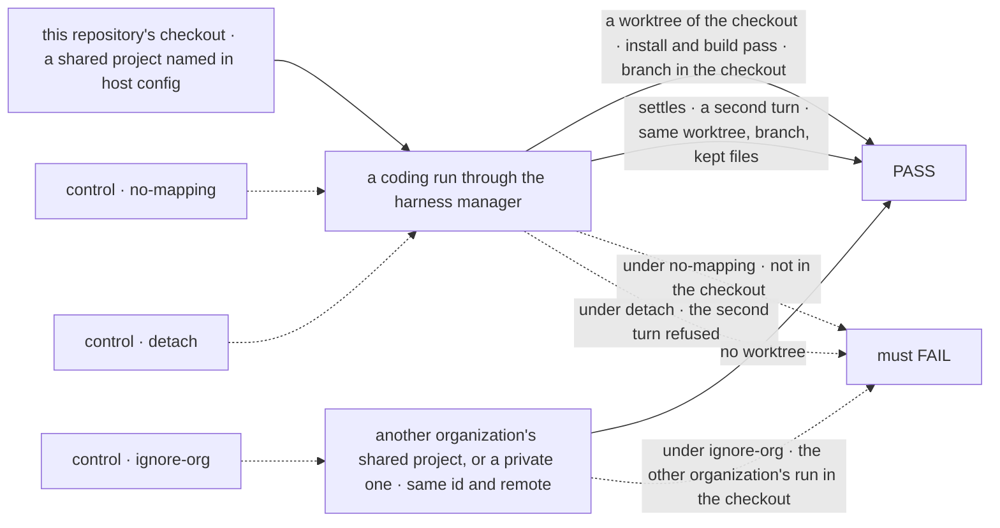
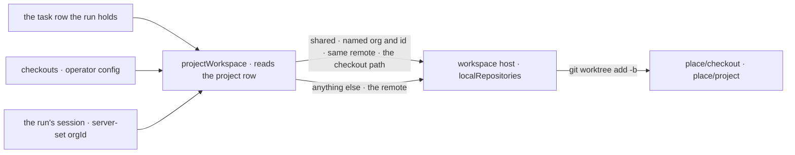

# FIX-1906 · The server knows where a project's local repo checkout lives and can create worktrees from it

**Spec** · [Decisions](DECISIONS.md) · [Rules](BUSINESS-RULES.md) · [Plan](PLAN.md) · [Docs](DOCS.md) · [Evolution](EVOLUTION.md)

## Five people, before and after

| Someone who… | Today | After |
|---|---|---|
| **runs workers on the machine that holds their checkout** | A project's coding run gets a branch in a hidden clone the host made, or a `file://` path in a shared row | The host config names the project and the checkout. Each run is a fresh worktree of that checkout, its branch in `git branch` there |
| **reviews what a run did** | Fetches the branch from the host's clone first | Opens the run's worktree, or runs `git diff main...<branch>` in their checkout |
| **runs one item on each of two projects that share the checkout** | Can't point either at the checkout | Two worktrees, two branches, and neither run waits for the other |
| **creates a project with the same id and remote as a mapped one, private or in another organization on the same server** | No mapping exists | Gets no worktree of the operator's checkout. The host treats its remote as it would any other remote |
| **keeps notes for a project worked in a local checkout** | Refused: a repository on this machine takes no kept files | The notes sit in `project/` beside the worktree and are saved back, as for any repository project |

The epic needs the coding agent in the checkout a person already uses
([FIX-1903 D3](../../epics/FIX-1903/DECISIONS.md#d3)). The host can cut a worktree from a local
repository today, but nothing ties a project to one. This issue also carries the epic's kill line:
a worktree of this repository must install and build.

## The goal, and how we'll know it's met

**A coding run for a project the host config names works in a fresh worktree of the operator's
own checkout, installs and builds there, and leaves its branch in that checkout. A project the
config doesn't name never gets one.**

| Is it the right goal? | |
|---|---|
| **The real need** | "Decide how the checkout location is set and stored … so it can create worktrees as tasks need them. Two projects sharing one checkout must not collide" (the issue), and the epic's kill line: a coding agent can do useful work in a worktree of this repository ([FIX-1903](../../epics/FIX-1903/SPEC.md#the-goal-and-how-well-know-its-met)) |
| **Smaller, and rejected** | "The host can cut a worktree from a listed local repository." True today. Nothing maps a project to it, and the project's files are refused there |
| **Bigger, and not this issue's** | The dev profile wired to this mapping ([FIX-1904](https://linear.app/fixpoint-labs/issue/FIX-1904)) · Linear in the run ([FIX-1905](https://linear.app/fixpoint-labs/issue/FIX-1905)) · the epic's closure run ([FIX-1919](https://linear.app/fixpoint-labs/issue/FIX-1919)) |
| **Not done if** | The goal ran on a scratch repository, not this one · the worktree can't install or build · a project with the same id and remote, private or in another organization, got the checkout · a settled run in the checkout couldn't continue · the project's files landed inside the worktree · the two-project test never failed under its control |



The check reads the checkout itself, `git worktree list` and its branches, not what the host
reports. Each control removes one half of the rule, and the leg that half protects must fail.

| How we verify | |
|---|---|
| **Goal check** | `goals/projects/a-mapped-project-works-in-your-checkout/` · model n/a, a scripted harness · run by the implementer at completion · verdict in the implementation PR |
| **Signal** | Leg a: the run's cwd is listed by `git worktree list` in this repository's checkout (`a:in-checkout`); `pnpm install --frozen-lockfile --offline` and a build of a package with workspace dependencies pass in it (`a:installs`, `a:builds`); the run's branch is in the checkout (`a:branch-in-checkout`); a note in `project/` is saved to the project's files and absent from `git status` (`a:note-saved`). Leg b: a shared project with the same id and remote in a second organization is not a worktree of the checkout (`b:other-org-not-in-checkout`), and neither is a private one (`b:private-not-in-checkout`). Leg c: leg a's run settles, then a second turn is handed back live in the same worktree, on the same branch, with its kept files (`c:continues`) |
| **Input** | This repository, at the commit under test. Another repository listed the same way must pass too; nothing in the check names this one's packages except the build target |
| **Anti-game** | No assertion on `place.repo` or the source's answer: read the checkout. No scratch repository. The check removes its worktrees and branches on exit, so a pass never depends on a leftover |
| **Control that must fail** | `GOAL_CONTROL=no-mapping` (the option removed) must FAIL `a:in-checkout`. `GOAL_CONTROL=ignore-org` (the mapping ignores the organization) must FAIL `b:other-org-not-in-checkout`. `GOAL_CONTROL=detach` (the branch detached on settle, D3's loser) must FAIL `c:continues`. Today's `main` must FAIL `a:in-checkout` |

## What changes


The fence is the mapping. Only a shared project it names, by its organization and id, crosses into your checkout.

**The host config, as an operator writes it:**

```diff
  harnessManager({
    workspace: localWorkspaceHost({
      root: "/var/fsd/runs",
      remotes: { allow: [] },
+     localRepositories: ["/home/me/flow-state-dev"],
-     source: projectWorkspace(),
+     source: projectWorkspace({
+       checkouts: [{
+         remote: "https://github.com/fixpoint-labs/flow-state-dev.git",
+         checkout: "/home/me/flow-state-dev",
+         projects: [{ orgId: "fixpoint", id: "fsd" }, { orgId: "fixpoint", id: "shift-manager" }],
+         baseRef: "main",
+       }],
+     }),
    }),
    uses: [projectWorkspaceCapability],
  });
```

## How a run reaches your checkout



The source decides which projects map, because only it sees a project's visibility beside the
run's server-set organization. The host decides which paths it touches, as today.

## What stays as it is

- **A project row names a remote**, never a folder ([FIX-1762 BR-5](../FIX-1762/BUSINESS-RULES.md#recording-a-repository)).
- **The workspace host's options.** `localRepositories` is still the operator's list of paths.
- **A fixed `sourceRepo` app**: its place is still the checkout itself.
- **Where a run's place goes and what its branch is called.**
- **The DevTeam profile.** Wiring the dev profile is FIX-1904's.

## Sign off

**[The goal](#the-goal-and-how-well-know-its-met), at that size:** a named project's run in a
worktree of your checkout that installs and builds, and no unnamed project there. If wrong: the
dev profile points at a checkout the agent can't build in, or exposes it to any project.

1. **[D1](DECISIONS.md#d1) · The mapping is an option of `projectWorkspace()`, bound to a shared
   project's organization and id, not the workspace host's.** If wrong: a custom run source has to map paths itself.
   It refines epic D3's wording; the epic coordinator accepted it.
2. **[D2](DECISIONS.md#d2) · A fresh worktree installs from the machine's shared pnpm store, run
   by the coding agent.** If wrong: an agent that skips the install fails its first build.
3. **[D3](DECISIONS.md#d3) · A settled run's branch stays checked out in its worktree.** If
   wrong: a person can't `git checkout` the branch in their own tree until they remove the worktree.

**Open: none.** D1 is the one to weigh. Reasoning and what lost: [DECISIONS.md](DECISIONS.md).
The cases: [BUSINESS-RULES.md](BUSINESS-RULES.md).

Feature · `workforce` + `workspace` · medium (2 packages, 1 goal check, 3 doc surfaces) · 1 PR · epic [FIX-1903](../../epics/FIX-1903/SPEC.md)
