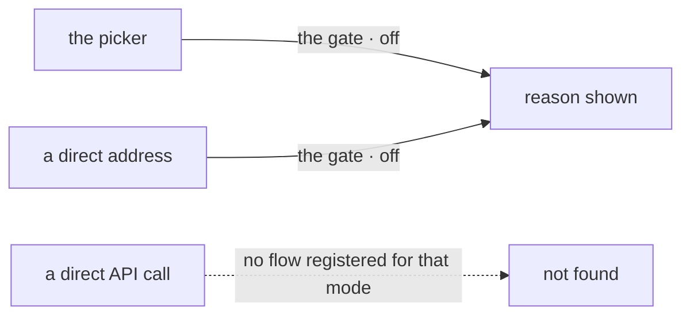

# FIX-1914 · Business rules

[Spec](SPEC.md) · [Decisions](DECISIONS.md) · **Rules** · [Plan](PLAN.md) · [Docs](DOCS.md) · [Evolution](EVOLUTION.md)

The cases, as rules. Each says what a person or the host does and what happens; *proved by* is
the check the plan runs. They refine the epic's [ER-1](../../epics/FIX-1907/BUSINESS-RULES.md#what-a-team-gets-and-what-it-doesnt)
and [ER-8](../../epics/FIX-1907/BUSINESS-RULES.md#what-a-team-gets-and-what-it-doesnt), which
this issue owns, and obey ER-9 to ER-13.

## The front page

| # | When | Then | Proved by |
|---|---|---|---|
| BR-1 | A person opens `/` | Four modes, in this order: Flow State, Claude Code, Codex, Cursor. Each shows available, or unavailable with one reason | Goal check |
| BR-2 | A person picks an available mode | Its own address opens: `/flow-state`, `/claude-code`, `/codex`, `/cursor` | Goal check · component test |
| BR-3 | A person comes back to `/` after using a mode | The picker again. Nothing is remembered or skipped | Goal check |
| BR-4 | The front page is opened on a phone | The four modes stack, each with its reason readable. No horizontal scroll | e2e at a phone viewport |

## Whether a mode can run

| # | When | Then | Proved by |
|---|---|---|---|
| BR-5 | Any host, any setting | Flow State is available. It needs nothing it doesn't need today | Goal check |
| BR-6 | The host is on Vercel (`VERCEL` set) | Each harness mode: unavailable, "runs on a local machine". `KITCHEN_SINK_HARNESS_WORKSPACE` does not override it | Goal check, `VERCEL=1` start |
| BR-7 | `KITCHEN_SINK_HARNESS_WORKSPACE` is unset | In local development (`NODE_ENV !== "production"`), the repository is the top level of the checkout the server runs from, and the host gate is passed. Unavailable, naming the setting and what it is for, only when the server runs outside any git checkout, or in production | Unit test (development legs) · goal check, unset production start |
| BR-8 | The setting is set, but not to the top level of a git checkout: the path doesn't exist, isn't a git repository, or is a directory inside a checkout | Unavailable, naming the path and which of the three it is. Kitchen Sink creates nothing | Unit test · goal check, the not-a-checkout start |
| BR-9 | Not on Vercel, a repository resolved (BR-7, or the setting naming a checkout's top level), the mode's issue not yet merged | Unavailable, "not built yet" | Goal check |
| BR-10 | Not on Vercel, a repository resolved, the mode is built | The mode's own check decides (sign-in, key). Its reason is shown as the mode's issue writes it | That mode's issue |
| BR-11 | A mode's own check throws | Unavailable, with the error's message. The picker still renders the other three | Unit test |
| BR-12 | More than one reason applies | Only the first, in the order of BR-6 to BR-10 | Unit test |
| BR-13 | The host's setting, or a mode's own sign-in or key, changes | Availability is decided once when the server starts, so the picker follows the change at the next restart. No rebuild | Goal check: one build, four starts |

## An unavailable mode refuses everywhere

| # | When | Then | Proved by |
|---|---|---|---|
| BR-14 | A person opens an unavailable mode by its address | The reason the picker shows, and a link back. No rail, no composer, no session created | Goal check |
| BR-15 | A harness mode is unavailable, for any reason in BR-6 to BR-11 | The server registers no flow for that mode, so `/api/flows/<its flow>/…` is not found. The picker and the flow list read the same availability, decided once at start | Unit test here; FIX-1915's goal check once a harness flow exists |
| BR-16 | A host turns harness modes off and restarts | That mode's sessions stay in the store, unlisted and unreachable until it is on again. Nothing is deleted | FIX-1915 |

The picker and a direct address stop at the gate. A direct API call never meets the page, and
finds no flow for that mode on the other side: that is why the page cannot be the only fence.

## Flow State mode

| # | When | Then | Proved by |
|---|---|---|---|
| BR-17 | A person picks Flow State | Today's shell: the assistant's latest session open, Coordinators, Workers and Assistant in the rail, the roster panel, voice, background work | The existing e2e suite and `kitchen-sink-talk` goals, at `/flow-state` |
| BR-18 | `/flow-state?e2eSession=<id>` or `?goalControl=<name>` in a test-mode build | Honoured as `/` honours them today | The e2e suite and goals that pass them |
| BR-19 | Flow State's rail | Lists no harness mode's sessions | Component test |
| BR-20 | Flow State's tasks | Its flows' own task boards and background work. Nothing new is built (ER-8) | Review |

## A harness mode's frame

Built here, filled by FIX-1915, FIX-1916 and FIX-1917.

| # | When | Then | Proved by |
|---|---|---|---|
| BR-21 | An available harness mode opens | A rail with the mode's name and a link back to the picker, listing only its own flow kind's sessions, newest first, with **New session**; the stream slot beside it | Component test; FIX-1915's goal check |
| BR-22 | **New session** in a harness mode | A session on that mode's flow, opened in its stream. No other mode's list changes | Component test |
| BR-23 | A harness mode has no sessions yet | The rail says so and offers **New session** | Component test |

## Failure taxonomy

Nothing on the front page is fatal. A mode whose check fails or throws is shown unavailable
with the reason, and the others still render. The only refusal is BR-14/BR-15: an unavailable
mode does nothing, wherever it is reached from. Nothing retries; a restart re-reads the settings
and re-runs each mode's check.

## Acceptance criteria this issue owns

[The goal](SPEC.md#the-goal-and-how-well-know-its-met): on one production build, the front page
shows four modes with the right reason under each of four host settings, an unavailable mode
opened by address draws no rail, and every browser check that opened the shell passes at
`/flow-state`. The same check fails under `GOAL_CONTROL=gate-open`. It also owns the opening of
Kitchen Sink's README ([ER-18](../../epics/FIX-1907/BUSINESS-RULES.md#the-closure)).
