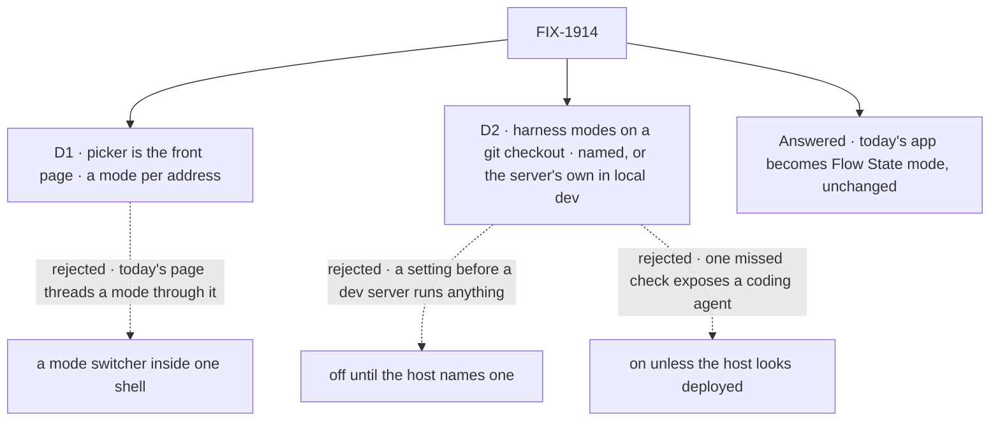

# FIX-1914 · Decisions

[Spec](SPEC.md) · **Decisions** · [Rules](BUSINESS-RULES.md) · [Plan](PLAN.md) · [Docs](DOCS.md) · [Evolution](EVOLUTION.md)

Two decisions and one question the epic put to the product lead, now answered. The epic's D1 to D3 bind this issue and are not reopened here.

## The tree

Solid edges are what you're signing. The question is answered as recommended.

## Answered · Does today's Kitchen Sink become the Flow State mode, or move out?

**Carried from the [epic](../../epics/FIX-1907/DECISIONS.md#flow-state-mode), and answered: it becomes Flow
State mode, unchanged.** The owner decided it by merging this spec (#3167) on 2026-10-12, as the
epic records. The ask is kept below as it was put.

**In plain terms.** Picking **Flow State** either opens today's app as it is (the assistant, the
support desk, its workers, voice, background work), or opens one plain assistant, a peer of the
three coding harnesses, while the support desk moves to another example app.

**The trade-off.** Keeping it costs this issue one address change in 6 files of browser checks
(D1). Flow State mode is then far larger than the other three, so the modes are not like for
like. Moving it out makes the comparison clean, and costs a migration of the support desk's
checks and docs that does nothing for the harnesses: an epic of its own.

**My recommendation: it becomes Flow State mode, unchanged.**

**What would change my mind:** you want Kitchen Sink read first as a harness test bed, and the
support desk under Flow State muddies that.

**What being wrong costs.** Keeping it is cheap to reverse: moving it out later is the same work.
**If the answer is "move it out"**, this spec is re-drafted before it merges, in everything that
describes Flow State: its rules (BR-17 to BR-20), the move and its entry points (S5, S9), the
docs draft, and the support example's lineage row. Flow State becomes "a plain assistant at
`/flow-state`", the 6 files of checks move with the support desk instead of to `/flow-state`, and
a migration issue is filed under the epic. The picker, D1's addresses, D2's gate and the harness
frame are the same under both answers.

It comes down to what depends on it: keeping it moves an address, moving it out is an epic.

## D1 · The picker is its own front page; each mode has its own address, and today's app moves whole to `/flow-state`

| | |
|---|---|
| **Instead of** | A mode switcher at the top of one shell, with Flow State at `/` and the mode held in the page's state or a query |
| **Because** | "Unchanged" stays literal: today's page moves as one file and gains one header row, so nothing in it learns about modes (tenet 3, earn every addition). A switcher threads a mode through a 948-line page that every Flow State check drives. A harness mode gets its own address the closure, the README and a bug report can link to. The epic already promised that links to `/` land on the picker ([EVOLUTION](../../epics/FIX-1907/EVOLUTION.md)) |
| **Locks in** | `/` is the picker, so an old bookmark of `/` lands there, one click from where it went. 6 files of browser checks change address now. A later "open where I left off" request would redirect from `/`, not reshape the shell |

It comes down to "unchanged": a switcher would make today's page carry the mode.

**What would change my mind:** the product wanting Kitchen Sink to reopen in the last mode used,
with the picker one click away rather than in front.

## D2 · Coding harness modes run on a git checkout: the one the host names, or in local development the one the server runs from

Settled with FIX-1915, which owns where a session works (its D1, on [its spec PR](https://github.com/fixpoint-labs/flow-state-dev/pull/3165)).
This spec's gate and FIX-1915's resolver read the setting through one shared function
([below](#shared-with-other-specs)).

| | |
|---|---|
| **Instead of** | Off until the host names a directory, this decision as first reviewed · on unless the host looks deployed |
| **Because** | A harness mode works on the repository itself, each session in its own worktree and branch (FIX-1915 D1). In local development the server already runs from a checkout, so that is the repository, and `pnpm dev` needs no setting. A production server is a different matter: Kitchen Sink has no sign-in, every caller is the same user ([`kitchen-sink-principal`](../../../apps/kitchen-sink/lib/kitchen-sink-principal.ts)), so a reachable production copy runs a harness only when its host names the repository. "Looks deployed" stays rejected: it is a guess that misses a tunnel or a container. Whether the server was started for development is not a guess |
| **Locks in** | **A visible change from the spec as first reviewed:** `pnpm dev` in a checkout shows the three harness modes on (each "not built yet" until its issue lands), with no setting. A production server without `KITCHEN_SINK_HARNESS_WORKSPACE` keeps them off, naming the setting. A setting that isn't the top level of a git checkout keeps them off, naming why. Vercel stays off even with the setting. While off, the host serves no harness flow, so the page is not the only fence |

![D2: when may a coding harness mode run on this host? Chosen: on a git checkout, the one the host names or, in local development, the one the server runs from. Instead of: off until the host names one, as first reviewed. It comes down to the first run on a laptop: the chosen option runs with no setting. Both keep a production copy off unless the host names a repository. The price: a dev server someone else can reach runs an agent for them. Locks in harness modes on under pnpm dev, off in production without the setting, off on Vercel always. Flips if dev servers turn out to be reachable by others](figures/d2-harness-gate.svg)

It comes down to the first run on a laptop: the server's own checkout is the repository, so no setting.

**What would change my mind:** dev servers turning out to be reachable by others in practice,
through tunnels or shared machines. Then off until the host names a repository, in development
too, as first reviewed. Kitchen Sink gaining real sign-in would let deploy detection do instead.

## Decided, not asked

- **Availability is decided on the server, once per start**, never inlined into the browser
  bundle, and the flow list registers a mode's flow only when that mode is available. One build
  must serve a laptop and a deployed copy, and the page and the server must never disagree.
- **One reason per unavailable mode, the first that applies:** Vercel, then no repository (unset
  on a production server or outside a checkout; set to a missing path, a directory that isn't a
  git repository, or one that isn't its checkout's top level), then not built yet, then the mode's
  own check (sign-in, key, sandbox), which its issue supplies.
- **One function reads `KITCHEN_SINK_HARNESS_WORKSPACE`**, and this gate and FIX-1915's resolver
  both call it. It returns the repository or off with a reason: on Vercel, off; set, it must be
  the top level of an existing git checkout, else off naming why; unset with
  `NODE_ENV !== "production"`, the top level of the checkout the server runs from, or off if there
  is none; unset otherwise, off. Built here in S2, since this lands first. The root the worktrees
  live under is derived from the repository by FIX-1915, outside the checkout, and is never a
  second setting.
- **"Not built yet" is an ordinary unavailable reason.** FIX-1914 merges before any harness mode
  works, and the picker never names a mode as runnable before it runs.
- **The picker remembers nothing.** `/` always shows the four.
- **The way back is one link at the top of every mode's rail**, with the mode's name. Switching
  modes goes through the picker.
- **A harness mode is one flow kind**, and its rail lists that kind's sessions with **New
  session**. FIX-1915 builds one shared session-flow factory and registers a kind per harness
  (`claude-code-session`, `codex-session`, `cursor-session`); the epic's "one session flow" rule
  is being amended to say so.

## What already does these jobs

- **Offer a flow only on a host that opted in.** Closest: the `workforce-admin` flow, which is
  "not registered at all unless `WORKFORCE_ADMIN_TOKENS` is set"
  ([README → Hiring while the app runs](../../../apps/kitchen-sink/README.md#hiring-while-the-app-runs)).
  D2's gate follows it on a production server: one setting, and no flow without it. The bash sandbox's
  `VERCEL` check (`selectBashProvider`) is reused as the second signal, not copied.
- **List one flow's sessions in a rail, with New session.** `FlowNavigator` sections by flow
  kind, as the Flow State rail does today. The harness frame is a section, not a new list.
- Searched `apps/kitchen-sink` and `packages/` for `availab`, `unavailable`, `signed in`,
  `preflight` and `probe`: no harness package reports whether it can run. Each mode's own check
  is its issue's; a missing one is filed under the epic (ER-15), not written here.

## Shared with other specs

| With | What is shared | Position |
|---|---|---|
| FIX-1915 (Claude Code mode) | The setting | One function reads `KITCHEN_SINK_HARNESS_WORKSPACE`, as above; this spec's gate and FIX-1915's worktree resolver both call it. FIX-1915 derives the worktree root from the repository it returns |
| FIX-1915, FIX-1916, FIX-1917 | The mode-check slot and the rail | Each fills the slot with its own check and registers its flow only through S3 |

## Considered and dropped

| Alternative | Why not |
|---|---|
| Keep `/` working for old test links with a redirect when it carries `?e2eSession=` | A hidden second front door for tests only. The 6 files change once |
| A dedicated on/off flag beside the setting | Two settings for one decision, and the flag alone leaves the run with no repository |
| A second setting for the worktree root | Nothing else reads it, and the gate and the resolver would have two things to agree on. FIX-1915 derives it |
| Leave the harness frame to FIX-1915 | The epic gives the rail to this issue (ER-1, the rail seam), and FIX-1915's mode PR is planned on it, as are FIX-1916 and FIX-1917's. Built once here, three sibling modes don't race to build it. It has no live path until FIX-1915 lands: a component test proves it here, FIX-1915's goal check in a browser. The kind it lists by is now fixed by FIX-1915, so its shape is not a guess |
| Decide availability per request | The flow list is built once per process, so a per-request page can disagree with it after a change, and a restart is needed anyway |

## How it got here

- **Draft**: framed as the front door the epic's harness modes need; a picker page with a mode
  per address, a server-side gate that the flow list obeys too, and today's app moved whole on
  the open question's recommended answer.
- **Review round 1**: availability moved from per request to once per server start, and the flow
  list now follows each mode's full availability rather than the host alone, because a mode whose
  own check failed would otherwise be served while the picker called it unavailable. The open
  question now gates merge, as the epic says.
- **Review round 2**: aligned with FIX-1915, where the owner moved harness sessions onto the
  repository itself, each in its own worktree and branch. The setting now names a git checkout,
  read by one function shared with FIX-1915, and D2 changed: unset in local development is on,
  using the server's own checkout; a production server stays off without the setting.
- **Amended after merge (Oct 12, cross-spec check)**: the Flow State question recorded as
  answered by the owner's merge of #3167; the merge gate on it is gone.
