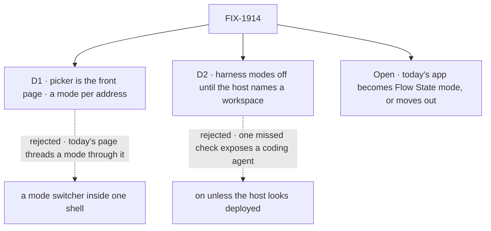

# FIX-1914 · Decisions

[Spec](SPEC.md) · **Decisions** · [Rules](BUSINESS-RULES.md) · [Plan](PLAN.md) · [Docs](DOCS.md) · [Evolution](EVOLUTION.md)

Two decisions and one open question, which the epic put to the product lead and which is still
unanswered. The epic's D1 to D3 bind this issue and are not reopened here.

## The tree

Solid edges are what you're signing. The open question is written on its recommended answer.

## Open · Does today's Kitchen Sink become the Flow State mode, or move out?

**Carried from the [epic](../../epics/FIX-1907/DECISIONS.md#open), unanswered.** This spec is
written on the recommendation, so it can merge either way.

**In plain terms.** Picking **Flow State** either opens today's app as it is (the assistant, the
support desk, its workers, voice, background work), or opens one plain assistant, a peer of the
three coding harnesses, while the support desk moves to another example app.

**The trade-off.** Keeping it costs this issue one address change in 6 files of browser checks
(D1). Flow State mode is then far larger than the other three, so the modes are not like for
like. Moving it out makes the comparison clean, and costs a migration of the support desk's
checks and docs that does nothing for the harnesses: an epic of its own.

**My recommendation: it becomes Flow State mode, unchanged.**

**What would change my mind:** you want Kitchen Sink read first as a harness test bed, and the
support desk under Flow State muddies that.

**What being wrong costs.** Keeping it is cheap to reverse: moving it out later is the same work.
**If the answer is "move it out"**, this spec changes in one place. Flow State's surface becomes
"a plain assistant at `/flow-state`", the 6 files of checks move with the support desk instead of
to `/flow-state`, and a migration issue is filed under the epic. The picker, D1's addresses, D2's
gate and the harness frame are the same under both answers.

It comes down to what depends on it: keeping it moves an address, moving it out is an epic.

## D1 · The picker is its own front page; each mode has its own address, and today's app moves whole to `/flow-state`

| | |
|---|---|
| **Instead of** | A mode switcher at the top of one shell, with Flow State at `/` and the mode held in the page's state or a query |
| **Because** | "Unchanged" stays literal: today's page moves as one file and gains one header row, so nothing in it learns about modes (tenet 3, earn every addition). A switcher threads a mode through a 948-line page that every Flow State check drives. A harness mode gets its own address the closure, the README and a bug report can link to. The epic already promised that links to `/` land on the picker ([EVOLUTION](../../epics/FIX-1907/EVOLUTION.md)) |
| **Locks in** | `/` is the picker, so an old bookmark of `/` lands there, one click from where it went. 6 files of browser checks change address now. A later "open where I left off" request would redirect from `/`, not reshape the shell |

It comes down to "unchanged": a switcher would make today's page carry the mode.

**What would change my mind:** the product wanting Kitchen Sink to reopen in the last mode used,
with the picker one click away rather than in front.

## D2 · Coding harness modes are off until this host names the directory they work in

| | |
|---|---|
| **Instead of** | On by default, turned off when the host looks deployed |
| **Because** | Kitchen Sink has no sign-in: every caller is the same user ([`kitchen-sink-principal`](../../../apps/kitchen-sink/lib/kitchen-sink-principal.ts)). A harness mode on a host someone else can reach lets anyone run a coding agent on that machine, and "looks deployed" is a guess that misses a tunnel or a container. The setting is the directory the run works in, which a harness needs anyway ([epic DOCS](../../epics/FIX-1907/DOCS.md)), so opting in costs nothing extra |
| **Locks in** | A fresh clone shows the three harness modes unavailable, naming the setting. The host serves no harness flow while it is off, so the page is not the only fence. A Vercel host stays off even with the setting |

It comes down to a reachable copy: default-on is one missed check from running agents for anyone.

**What would change my mind:** Kitchen Sink gaining real sign-in, so a reachable copy no longer
means anyone. Then deploy detection is enough.

## Decided, not asked

- **Availability is decided on the server, per request**, never inlined into the browser bundle.
  One build must serve a laptop and a deployed copy.
- **One reason per unavailable mode, the first that applies:** deployed host, then no workspace,
  then not built yet, then the mode's own check (sign-in, key), which its issue supplies.
- **"Not built yet" is an ordinary unavailable reason.** FIX-1914 merges before any harness mode
  works, and the picker never names a mode as runnable before it runs.
- **The picker remembers nothing.** `/` always shows the four.
- **The way back is one link at the top of every mode's rail**, with the mode's name. Switching
  modes goes through the picker.
- **A harness mode is one flow kind**, and its rail lists that kind's sessions with **New
  session**. How FIX-1915 registers its one session flow per harness is its call; if it needs one
  shared kind, it raises that to the epic (ER-15).

## What already does these jobs

- **Offer a flow only on a host that opted in.** Closest: the `workforce-admin` flow, which is
  "not registered at all unless `WORKFORCE_ADMIN_TOKENS` is set"
  ([README → Hiring while the app runs](../../../apps/kitchen-sink/README.md#hiring-while-the-app-runs)).
  D2's gate is the same shape, one setting and no flow without it. The bash sandbox's
  `VERCEL` check (`selectBashProvider`) is reused as the second signal, not copied.
- **List one flow's sessions in a rail, with New session.** `FlowNavigator` sections by flow
  kind, as the Flow State rail does today. The harness frame is a section, not a new list.
- Searched `apps/kitchen-sink` and `packages/` for `availab`, `unavailable`, `signed in`,
  `preflight` and `probe`: no harness package reports whether it can run. Each mode's own check
  is its issue's; a missing one is filed under the epic (ER-15), not written here.

## Considered and dropped

| Alternative | Why not |
|---|---|
| Keep `/` working for old test links with a redirect when it carries `?e2eSession=` | A hidden second front door for tests only. The 6 files change once |
| A dedicated on/off flag beside the workspace setting | Two settings for one decision, and the flag alone leaves the run with no directory |
| Leave the harness frame to FIX-1915 | The epic gives the rail to this issue (ER-1, the rail seam). The frame is one navigator over one flow kind, proved here by a component test and in a browser by FIX-1915 |

## How it got here

- **Draft**: framed as the front door the epic's harness modes need; a picker page with a mode
  per address, a server-side gate that the flow list obeys too, and today's app moved whole on
  the open question's recommended answer.
