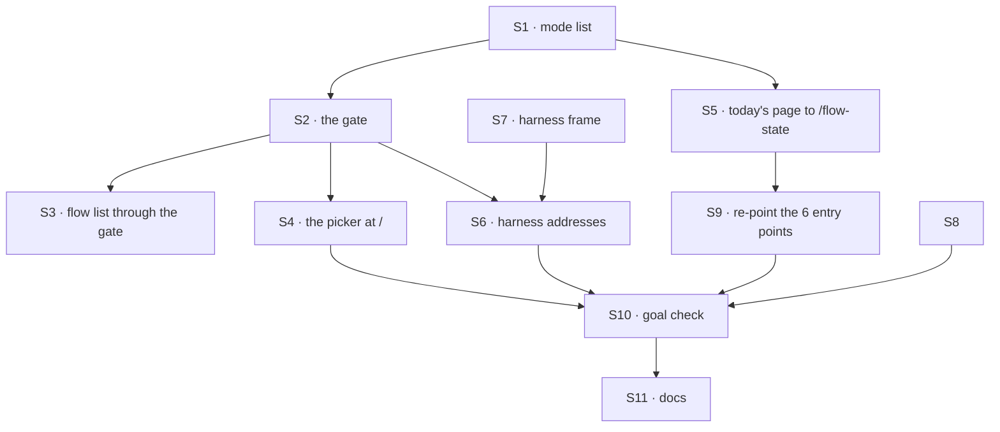

# FIX-1914 · Plan

[Spec](SPEC.md) · [Decisions](DECISIONS.md) · [Rules](BUSINESS-RULES.md) · **Plan** · [Docs](DOCS.md) · [Evolution](EVOLUTION.md)

Written for the implementing agent. IDs cross-reference [BUSINESS-RULES.md](BUSINESS-RULES.md)
(BR-n), [DECISIONS.md](DECISIONS.md) (D-n) and the epic's rules (ER-n). `tdd`. One PR. Everything
is under `apps/kitchen-sink/`, `goals/` and docs; nothing under `packages/`.

## Surfaces

| ID | Where · role | Change | Rules |
|---|---|---|---|
| S1 | `lib/` · the mode list, a leaf module (BP-019) | The four modes: id, label, address, and for a harness mode its flow kind (unset until its issue fills it; see *Pinned names*). Imported by the browser and the server | BR-1 BR-2 |
| S2 | `lib/` · the gate, server only | The one reader of `KITCHEN_SINK_HARNESS_WORKSPACE`, a function FIX-1915's resolver calls too: the repository, or off with a reason ([DECISIONS → Decided, not asked](DECISIONS.md#decided-not-asked)). Then each mode's availability and first reason, in BR-12's order: the host (not Vercel, and the reader returned a repository), then "not built yet", then the mode's own check, a slot its issue fills (it may be async). Evaluated **once per server start** and memoized | BR-5–BR-13 |
| S3 | `fsdev.config.ts` · the flow list | A harness mode's flow is added only when S2 says **that mode** is available, for every reason in BR-6 to BR-11, not the host alone. The config already awaits at module scope, so the result is in hand before `createFlowState`. Today there are none; this is the seam FIX-1915 registers through | BR-15 |
| S4 | `app/page.tsx` · **replaced** | The picker: a server-rendered page reading S2's result, four cards, the reason on each unavailable one | BR-1 BR-3 BR-4 |
| S5 | `app/flow-state/page.tsx` · **moved** | Today's `app/page.tsx`, moved whole. One addition: the rail's header row with the mode name and the link back | BR-17 BR-18 BR-19 |
| S6 | `app/` · the three harness addresses | Each reads S2. Unavailable: the reason page. Available: the harness frame (S7) with the mode's flow kind | BR-14 BR-21 |
| S7 | `components/` · the harness frame | Rail header, one `FlowNavigator` section over the mode's flow kind with **New session**, an empty-state line, and a stream slot for the mode's issue | BR-21–BR-23 |
| S8 | `lib/goal-control.ts` | Add `gate-open`, honoured only in a test-mode build like the others. It forces S2's result to available, so the flow list and the pages both see it | Goal check |
| S9 | The 6 entry-point files, and the 2 tests that name the shell's file | `/` → `/flow-state`, keeping each query; `app/page.tsx` → `app/flow-state/page.tsx` (see [Entry points](#entry-points) and [the two tests](#tests-that-name-the-shells-file)) | BR-17 BR-18 |
| S10 | `goals/kitchen-sink-harness-mode/opens-on-the-picker/` | The goal check: `goal.md`, `run.mts` on `goals/lib/kitchen-sink.mts` | Goal |
| S11 | Docs | Publish [DOCS.md](DOCS.md); `apps/kitchen-sink/CLAUDE.md` layout lines; the `apps/kitchen-sink` row in the root `CLAUDE.md` | ER-18 |

## Entry points

Every place a browser opens Kitchen Sink's front page expecting the shell. Re-derived by
[`poc/entry-points/check.mjs`](poc/entry-points/), which fails if this table misses one.

| File | Opens | Reaches it |
|---|---|---|
| `apps/kitchen-sink/e2e/fixtures.ts` | `/?e2eSession=…` | 7 specs through `openKitchenSink` |
| `apps/kitchen-sink/e2e/talk-from-page.spec.ts` | `/` | itself |
| `apps/kitchen-sink/e2e/workforce-shell.spec.ts` | `/`, twice | itself |
| `goals/lib/kitchen-sink.mts` | `${origin}/` | 4 goals through `openShell` |
| `goals/kitchen-sink-talk/shows-the-reply-without-a-reload/run.mts` | `${origin}/${PAGE_QUERY}` | itself |
| `goals/kitchen-sink-talk/a-person-talks-to-a-seat-a-mailbox-and-back/run.mts` | `${origin}/…`, three times | itself |

8 of the 9 e2e specs and all 6 `kitchen-sink-talk` goals. Only `devtool-loads.spec.ts` opens
nothing but `/devtool`, and doesn't change.

## Tests that name the shell's file

Two unit tests name the shell's file rather than open it, so the entry-points POC (which counts
browser opens) does not see them. Both re-point to `app/flow-state/page.tsx`:

| File | Names `app/page.tsx` as |
|---|---|
| `apps/kitchen-sink/test/shell-imports.test.ts` | The page that mounts `FlowNavigator` (`REGION_MODULES`) |
| `apps/kitchen-sink/test/client-imports.test.ts` | A client component its scan must find. The picker is a server component, so it drops out |

## Sequence



Move first (S5, S9) and run the existing suite before anything new, so a red check is the move's
fault or the picker's, never both.

## Checks

| ID | Runs after | Passes when |
|---|---|---|
| V1 | S2 | Each of BR-6 to BR-12 for each harness mode, with the env and `NODE_ENV` stubbed per case, including BR-7's development legs (a checkout found, none) and BR-8's three. Real temporary directories and `git init`, not a stubbed filesystem. Flow State available in every case. A mode's check runs once per start |
| V2 | S3 | A stand-in harness flow is not registered when its mode is unavailable for any reason (host off, or its own check failing or throwing); it is when the mode is available. D2's check |
| V3 | S5, S9 | The e2e suite and the 6 `kitchen-sink-talk` goals pass at `/flow-state`, before the picker exists |
| V4 | S9 | `node specs/issues/FIX-1914/poc/entry-points/check.mjs --after` passes: nothing still opens `/` expecting the shell |
| V5 | S4, S6 | Component tests: four cards in order; an unavailable mode by address renders the reason and no navigator. D1's check |
| V6 | S7 | Component test over a stubbed session client holding two flow kinds: only the mode's kind listed; **New session** creates on it; empty state (BR-21–BR-23). Flow State's rail lists neither (BR-19) |
| V7 | S8 | `gate-open` is ignored outside a test-mode build |
| VG | all | [The goal](SPEC.md#the-goal-and-how-well-know-its-met): `goals/kitchen-sink-harness-mode/opens-on-the-picker/` PASSES on one build across four starts, after the same run FAILED under `GOAL_CONTROL=gate-open` and on today's `main` |

## Pinned names

| Where | Name | Why pinned |
|---|---|---|
| Addresses | `/`, `/flow-state`, `/claude-code`, `/codex`, `/cursor` | The README, the closure and every browser check type them (D1) |
| Host setting | `KITCHEN_SINK_HARNESS_WORKSPACE`, naming the top level of a git checkout | A person types it (D2). FIX-1915's resolver reads it through the same function and gives a worktree per session via `@flow-state-dev/workspace`; see *At implement time* |
| Goal control | `gate-open` | The goal check and FIX-1915's extension of it use it |
| Flow kinds | `claude-code-session`, `codex-session`, `cursor-session` | One per harness, built by FIX-1915's shared session-flow factory. S1 holds them; S7's rail lists by them |
| Mode labels | Flow State, Claude Code, Codex, Cursor | The epic's ER-1 |

## Guardrails

| Rule | Because |
|---|---|
| Availability is decided on the server, once per start; no `NEXT_PUBLIC_` value carries it | One build serves a laptop and a deployed copy (BR-13). An inlined answer is the hollow pass the goal's one-build input exists to catch |
| The picker and the three harness addresses render dynamically, never prerendered at build | They read only `process.env` and the filesystem, so Next would prerender them and bake the build host's answer into every host |
| The picker and the flow list read one availability result (tenet 5) | Two evaluations drift: a directory or sign-in that changes after start, or a mode's own check failing, and the page says off while the API runs an agent (BR-15) |
| Today's page is moved, not edited, beyond the rail header row | "Unchanged" is the open question's recommended answer, and the move is what lets the suite prove it (V3) |
| No browser check is deleted or skipped to get green | A check that stops running reports nothing, and that is how `main` goes green by checking less. V4 and the entry-points table are the inventory |
| Nothing harness-specific in S7 beyond a flow kind | ER-6 and ER-11: a harness that needs more has found a gap in its package |

## Docs

Reconcile and publish [DOCS.md](DOCS.md) after VG passes, naming only Flow State as runnable
(the epic's rule: the opening never names a mode that doesn't run yet). S11 also updates the
internal lines: `apps/kitchen-sink/CLAUDE.md` → Layout (`app/page.tsx` is the picker; the shell is
`app/flow-state/page.tsx`) and the root `CLAUDE.md` package-map row. No changeset: the app is
private.

## Sketch · pseudocode, illustrative, react to the shape

```
the gate (server, once per start, memoized):
    repository  ←  the shared reader:
        Vercel → off;  set → a checkout's top level, or off naming why;
        unset, not production → the server's own checkout's top level, or off;  unset → off
    host on  ←  not on Vercel  and  a repository
    for each mode:
        flow state       → available
        host not on      → the host's reason
        no flow kind yet → "not built yet"
        otherwise        → await the mode's own check, or its thrown message
the flow list:      add a mode's flow only if that mode is available
the picker at /:    render the four with their availability
a harness address:  unavailable → reason page;  available → frame(mode's flow kind)
```

**POC:** [`poc/entry-points/`](poc/entry-points/) counts every browser open of the front page and
checks this plan's table against it. It found 6 files reaching 8 e2e specs and 6 goals, and its
negative controls fail as they should. The premise held: the move is an address change in 6 files.

## At implement time

- **The setting is one setting, read by one function.** FIX-1915 calls S2's reader of
  `KITCHEN_SINK_HARNESS_WORKSPACE` for the repository and gives a worktree per session via
  `@flow-state-dev/workspace`, under a derived root outside the checkout, as FIX-1915
  defines it. It registers only through S3. If either spec's name changes before merge, use the merged one; never ship two.
- **The mode's own check is FIX-1915's sign-in probe** (its BR-23). Keep the slot's name and shape
  stable once S2 lands; the sibling modes fill it the same way.
- Re-run the entry-points check; a browser check added since this spec must be in the table.
- Open PR #2973 edits `talk-from-page.spec.ts` near its `/` open. Rebase onto it if it lands first.
- Compare [Evolution](EVOLUTION.md)'s predecessor claims with the current shell and README.

## Follow-ups

- None filed. The open question is answered before this spec merges. If the answer is "move it
  out", this spec is re-drafted on its review PR and the support-desk migration is filed under
  FIX-1907.

## Notes from review

Recorded for the implementer, not baked into the design. Verbatim.

- **Cursor · entry-points POC maintenance (PLAN V4).** "V4 ties CI hygiene to this script
  **parsing** the PLAN table + brittle `.goto(` regex (single-line, fixed grammar). For a **6-file**
  set that's already enumerated, consider: (1) one constant in `goals/lib/kitchen-sink.mts` +
  `e2e/fixtures.ts` for `/flow-state`, (2) a one-line `rg` guard in kitchen-sink tests, (3) keep
  `check.mjs` as **retained evidence** without `--after` in the implementation checklist. Reduces
  triple maintenance (table ↔ parser ↔ dated README snapshot)." V4 is a run the implementer does
  once, not a CI job; a shared path constant is the implementer's call.
- **Cursor · DECISIONS duplication.** "'Decided, not asked' duplicates BR-5–15 and the
  availability ordering already normative in BUSINESS-RULES. Consider keeping DECISIONS to **D1,
  D2, open**, plus 'considered and dropped,' with a pointer: *normative cases → BUSINESS-RULES §
  Whether a mode can run*—one source of truth for implementers." BUSINESS-RULES is normative
  where the two differ.
- **Cursor · `gate-open` shape.** "Consider deferring S8 to when server bypass matters, or
  document why server honour is required in the picker gate for this issue alone (mirror
  `landing-control.ts` pattern if you keep it)." Kept: the goal's control leg needs it. Mirror the
  existing `*-control.ts` modules, reading `goalControl()`.
- **Second look · other entry points to `/`.** "`moat.yaml` exposes port 3000 and the README
  links localhost root. Neither is a browser check, so the POC can't see them. Re-grep README and
  docs for `localhost:3000/` at implement time."
- **Second look · V2's layer.** "'not found' is right. Make sure V2 asserts the HTTP status through
  the real route handler, not only the flow-list function, so it covers the layer a caller hits."
