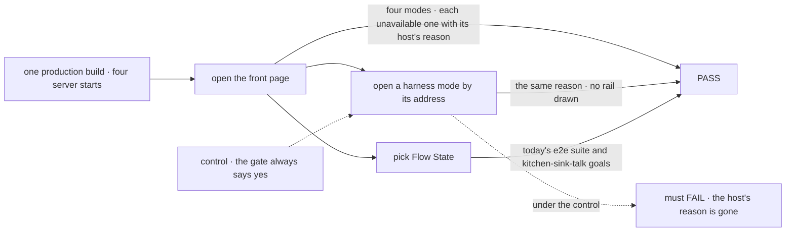
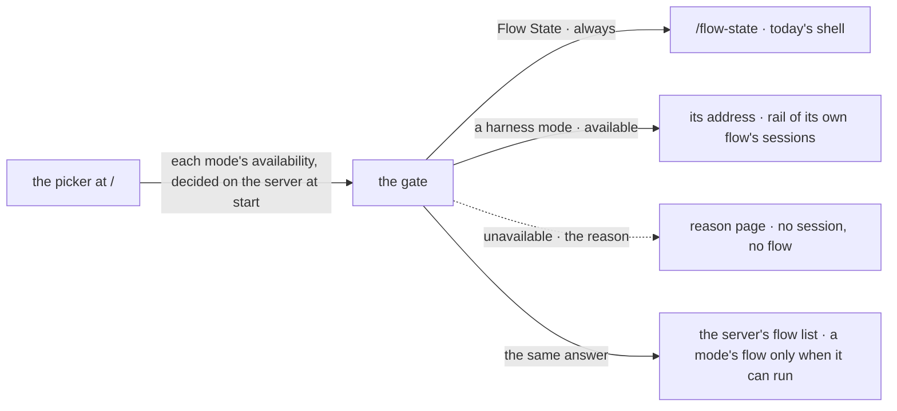

# FIX-1914 · Kitchen Sink opens on a harness picker, and today's app becomes its Flow State mode

**Spec** · [Decisions](DECISIONS.md) · [Rules](BUSINESS-RULES.md) · [Plan](PLAN.md) · [Docs](DOCS.md) · [Evolution](EVOLUTION.md)

## Five people, before and after

| Someone who… | Today | After |
|---|---|---|
| **opens Kitchen Sink** | Lands in the assistant, with the support desk in the rail. No way to reach a coding harness | Lands on a picker of four modes: **Flow State**, **Claude Code**, **Codex**, **Cursor**. Each says whether it can run here |
| **picks Flow State** | n/a | Gets today's app at `/flow-state`, unchanged: the assistant open, the support desk, workers and assistant sessions in the rail |
| **picks a mode this host can't run** | n/a | Sees why, in one line that says what to do. No session opens, nothing runs |
| **picks a coding harness once its issue lands** | n/a | Gets a rail of that harness's own sessions only, with **New session**, beside its stream. FIX-1915, FIX-1916 and FIX-1917 fill the stream |
| **reaches a deployed copy** | The assistant and the support desk | Flow State only. The three coding harnesses show as unavailable with the reason, and the host serves no harness flow at all |

## The goal, and how we'll know it's met

**A person opening Kitchen Sink sees four modes on its front page and opens the one they pick at
its own address; a mode this host can't run says why and runs nothing; and Flow State mode is
today's app, with every browser test and goal that used it passing against it.**

| Is it the right goal? | |
|---|---|
| **The real need** | Kitchen Sink becomes the test bed for each harness, side by side ([epic goal](../../epics/FIX-1907/SPEC.md#the-goal-and-how-well-know-its-met), [ER-1](../../epics/FIX-1907/BUSINESS-RULES.md#what-a-team-gets-and-what-it-doesnt), [ER-8](../../epics/FIX-1907/BUSINESS-RULES.md#what-a-team-gets-and-what-it-doesnt)). It needs a front door first |
| **Smaller, and rejected** | "A page with four links." It passes while an unavailable mode still opens, a deployed copy still serves a coding agent, and the support desk's checks go red or are deleted |
| **Bigger, and not this issue's** | A harness session that continues, streams and shows its plan: FIX-1915, FIX-1916, FIX-1917. Proving all four modes together: the closure, FIX-1918 |
| **Not done if** | The picker renders but a direct address to an unavailable mode draws its rail · the reason was fixed into the bundle at build time · the host serves a harness flow the picker calls unavailable · a support-desk check was deleted or skipped instead of re-pointed · the e2e suite passed but the `kitchen-sink-talk` goals never ran |



The check reads what the browser shows. One build serves every host setting, so a reason
baked in at build time fails, and with the gate forced open the unavailable leg must fail.

| How we verify | |
|---|---|
| **Goal check** | `goals/kitchen-sink-harness-mode/opens-on-the-picker/` · real browser, production build, scripted model (no harness runs in this issue) · run by the implementer at completion · verdict in the implementation PR |
| **Signal** | Four modes listed, Flow State available. Each harness mode shows the reason for the start: no repository named on a production server, not a checkout's top level, local only (`VERCEL=1`), or "not built yet". `/codex` by address shows its card's reason and draws no rail. The 8 e2e specs and 6 `kitchen-sink-talk` goals that open the shell pass at `/flow-state` |
| **Input** | Four host settings on one production build: the setting unset, the setting naming a directory that is not a git checkout, the setting naming a checkout's top level, and `VERCEL=1` with it naming one. Any other harness mode by address must behave the same. Unset in local development (on, the server's own checkout) is a unit check, V1: a production build can't start in development |
| **Anti-game** | Assert on the page as drawn, not on the availability function. Never rebuild between starts. A support-desk check deleted or skipped is a fail; the [entry-points POC](poc/entry-points/) `--after` catches one still opening `/` |
| **Control that must fail** | `GOAL_CONTROL=gate-open` forces every mode past the host gate: with the setting unset on the production start, `/codex` FAILS on *the repository reason shown*. Today's `main` FAILS the front-page leg on *four modes listed*. FIX-1915 extends this check with *no session created* and *no harness flow served*, under the same control |

## What changes


Today's front page moves whole behind the Flow State card; three new addresses wait behind a gate.

**What a host sets, to name the repository the coding harnesses work on.** In local development
nothing is needed: unset, they work on the checkout the server runs from. A production server
runs them only with the setting, and Vercel never does.

```diff
  # apps/kitchen-sink/.env.local
  AI_GATEWAY_API_KEY=…
+ KITCHEN_SINK_HARNESS_WORKSPACE=/Users/me/code/flow-state-dev
```

The setting names the top level of a git checkout. Each session gets its own worktree and
branch of it, under a derived root outside the checkout, as FIX-1915 defines it.

**What every browser check that opened the shell changes:**

```diff
- await page.goto(`${origin}/`);
+ await page.goto(`${origin}/flow-state`);
```

## How a mode opens



One answer per server start decides what the picker shows and whether a mode's flow is served at all.

## What stays as it is

- **Today's app**, moved whole to `/flow-state`: rail, stream, roster, voice, background work,
  its `?e2eSession=` and `?goalControl=` parameters. Its tasks are its flows' own (ER-8).
- **`/devtool`** and every `/api/flows/…` route.
- **The harness packages.** Nothing under `packages/` changes.
- **The session flow, live items, continuity and the plan panel.** FIX-1915's.

## Sign off

**[The goal](#the-goal-and-how-well-know-its-met), at that size:** the front door, an honest
unavailable state decided on the server, and today's app moved without losing a check. If wrong:
harness modes that can't be trusted to refuse, or a support desk that quietly lost its checks.

**Open · [Does today's Kitchen Sink become the Flow State mode, or move out?](DECISIONS.md#open)**
Asked of the product lead on the epic, unanswered; the epic gates this spec on it, so this spec
does not merge until it is answered. It is written on the recommended answer: it becomes Flow
State mode, unchanged. If the answer is "move it out", Flow State's rules, the move and its
entry points, the docs and one lineage row are re-drafted here first; the picker, the gate and
the harness frame do not change.

1. **[D1](DECISIONS.md#d1) · The picker is its own front page; each mode has its own address,
   and today's app moves whole to `/flow-state`.** If wrong: 6 files of browser checks change
   address for a separation nobody needed, or a later "open where I left off" request fights it.
2. **[D2](DECISIONS.md#d2) · Coding harness modes run on a git checkout: the one the host names,
   or in local development the one the server runs from. A production server without the setting,
   and Vercel always, keeps them off.** This changes what was first reviewed (off until named):
   `pnpm dev` in a checkout now shows them on. If wrong: a dev server someone else can reach, over
   a tunnel or a shared machine, runs a coding agent for them.

D2 is the one to weigh: it sets who can run a coding agent through Kitchen Sink.
Cases: [BUSINESS-RULES.md](BUSINESS-RULES.md). Lineage: [EVOLUTION.md](EVOLUTION.md).

Feature · `apps/kitchen-sink` + `goals/` · medium · 1 PR · epic [FIX-1907](../../epics/FIX-1907/SPEC.md) · blocks FIX-1915
