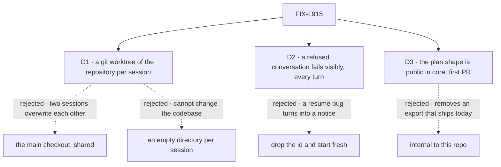

# FIX-1915 · Decisions

[Spec](SPEC.md) · **Decisions** · [Rules](BUSINESS-RULES.md) · [Plan](PLAN.md) · [Docs](DOCS.md) · [Evolution](EVOLUTION.md)

What was chosen, what lost, and what each locks in. The epic already decided the route (every
harness through the shared contract, Claude Code `detached: true`, plan sync one-way and
read-only, the shape in core: [FIX-1907 D2, D3](../../epics/FIX-1907/DECISIONS.md#d2)). These are the
three calls that remained.

## The tree

Solid edges are what you sign. Dashed edges lost, and the label says why.

## D1 · Each session works in its own git worktree of the flow-state repository, on its own branch

| | |
|---|---|
| **Instead of** | The main checkout, which every session would share · an empty directory per session, under one root (this decision's first draft) |
| **Because** | The mode is for changing the codebase itself, so the run has to work on the real repository: an empty directory can't. Two sessions running at once in one tree overwrite each other's work, and nothing stops them: the turn queue is per session. A worktree per session gives each its own tree and branch, leaves the main checkout untouched, and never moves, since a harness continues a conversation where it started |
| **Locks in** | Kitchen Sink is a place to work on this repository: a session's edits land on the session's own branch, in its own worktree, cut from the checkout `KITCHEN_SINK_HARNESS_WORKSPACE` names. Nothing is merged, pushed or committed for the person. The worktree and branch stay when a session goes idle or is deleted, until the host clears them. The worktree comes from `@flow-state-dev/workspace`'s local-repository host, the one harness-manager uses: no second worktree path |

![D1: where does a harness session work? Chosen: its own git worktree of the flow-state repository, on its own branch. Instead of: the main checkout every session shares, or an empty directory per session. It comes down to two sessions at once: in one checkout they overwrite each other with nothing to stop them. Both work on the real repository; an empty directory does not. The main checkout stays untouched only with a worktree. A tie: each is stable across turns. Locks in Kitchen Sink as a place to work on the repository itself, one branch per session, kept until the host clears it. Flips if sessions need to share one tree](figures/d1-workspace.svg)

It comes down to two sessions at once: a shared checkout lets them overwrite each other silently,
and mixes a session's edits with whatever the person has open.

**What would change my mind:** sessions needing to work in one tree, such as two harnesses on
the same change. Then a shared checkout with a lock across sessions, as a new issue.

## D2 · A conversation Claude Code won't continue is shown as refused on every turn; the session never starts a new one by itself

| | |
|---|---|
| **Instead of** | Dropping the id after a refused resume, so the next turn starts a fresh conversation and the session shows a notice. That is what the coding-skill lab does (`labs/fsd-coding-skill`) |
| **Because** | Kitchen Sink exists to show a broken continuation. A session that moves on after one failure turns a resume bug into a notice and a passing next turn, which is the gap the epic is looking for. Keeping the id also means a passing failure (a dropped network, an expired sign-in) recovers on the next turn instead of losing the conversation |
| **Locks in** | One Kitchen Sink session is one harness conversation, for all three harnesses. The binding changes only when the harness itself confirms a different id |

![D2: what happens when Claude Code won't continue a session's conversation? Chosen: show it refused on every turn and keep the id. Instead of: drop the id and start fresh with a notice. It comes down to whether a resume bug can hide: dropping the id makes the next turn pass. The price: a conversation that is really gone keeps the session stuck until the person starts a new one. A passing failure recovers on its own only if the id is kept. Locks in one session, one conversation. Flips if conversations that are gone for good turn out to be common](figures/d2-refused.svg)

It comes down to hiding: dropping the id makes the turn after a refusal pass.

**What would change my mind:** conversations gone for good turning out to be common, for
example a harness that expires them. Then add a "start over" action the person presses. Never
an automatic one.

## D3 · The plan record becomes a published shape in core, shipped first in its own PR

| | |
|---|---|
| **Instead of** | Keeping it internal to this repo's harnesses, the default FIX-1701 D2 set for its reader · or moving it in the same PR as the mode |
| **Because** | The shape is public already: Claude Code exports it and its docs teach reading it. Making it internal in core removes an export that ships today, or keeps two. One shape that any harness writes is what lets a reader not care which harness ran (epic ER-5). And FIX-1916, FIX-1917 and FIX-1185 need the shape, not the mode, while the mode waits on the picker |
| **Locks in** | The `observed-plan` key and fields are a promise to outside readers and writers: fields stay nullable, and a new one is added, never changed. Claude Code's old names stay, as the same objects |

It comes down to today's export: internal would remove a public name or keep two.

**What would change my mind:** FIX-1916 or FIX-1917 finding the shape needs a change rather than
a new field. Then keep it internal until all three harnesses have written it.

## Decided, not asked

- **Claude Code runs `detached: true` with `recordWork: true`** (epic D2) and every tool it has.
  The coding-skill lab turns sub-agents off; this mode doesn't.
- **No approval prompts; the sandbox is the fence.** Kitchen Sink has no in-page approval for a
  harness, so the SDK's prompts would have no one to answer them. Writes stay in the session's
  worktree, and nowhere else: not the main checkout, and not the repository's `.git`. No sandbox, or a server running as root, makes the mode unavailable with that reason.
  The run starts with an allowlisted environment (`harnessEnv`), as Shift Manager passes Claude Code,
  never the server's whole environment. That filters what commands start with; it is not a
  security boundary (amended Oct 13, below).
- **The binding is session state, with a record per turn.** The session holds the confirmed id,
  written only by `onSession`. Each turn holds, under its request, the id it asked for (noted by
  `resume`) and the id `onSession` confirmed *during that turn*, if any. The page derives the
  notice from that turn's entry and its end: confirmed what it asked → *continued*; confirmed
  another → *started a new one*; failed with the harness's unknown-conversation classification
  → *refused*; confirmed nothing and failed otherwise → an error, id kept; stopped → *stopped*,
  never refused. Two session-wide fields can't tell a refusal from a turn that confirmed and then
  failed. Kitchen Sink writes no item.
- **A turn sent while one runs waits** (`concurrency: "queue"`).
- **The panel shows the session's latest turn**: its rows · "this turn's plan is empty" · "no
  plan recorded for this turn", even when an earlier turn recorded one · "<Mode label> reports
  no plan", when no record is declared, the label from FIX-1914's mode list · its rows marked "may be incomplete", from the list
  marker below. An earlier turn's plan is never shown as the current one.
- **The plan record streams live** (`client.live: true`); today it refreshes when the request ends.
- **One setting, `KITCHEN_SINK_HARNESS_WORKSPACE`, now names the repository**, and the root
  the worktrees live under is derived from it, never set: `${XDG_STATE_HOME:-~/.local/state}/flow-state-dev/kitchen-sink-harness/<repository name>-<hash of its path>/`,
  outside the checkout. The name stays, since a person already types it from FIX-1914.
  One function reads it, and FIX-1914's gate and this spec's resolver both call it:
  - on Vercel → off;
  - set → it must be the top level of an existing git checkout, else off with that reason;
  - unset, in local development (`NODE_ENV !== "production"`) → the top level of the git
    checkout the server runs from, or off if there is none;
  - unset, otherwise → off. A production server lets a run edit a repository only when the
    host names it.

  Off means the mode is hidden and the Claude Code flow is not registered at all (FIX-1914
  BR-15). The root is derived rather than a second setting because nothing needs it elsewhere.
- **The worktree root is outside the checkout**, in the person's state directory, keyed by the
  repository, as harness-manager's hosts keep their checkouts under a root apart from the source
  repository: inside it, the main checkout's test and lint globs, typecheck and file watchers
  would walk into full copies of the repository.
- **A session's work stays uncommitted, on its branch.** The run edits files in its worktree but
  can't commit: its index and the repository's objects live under `.git`, which the sandbox
  doesn't open, because a run that can write there can plant a hook that runs outside the sandbox
  the next time the person uses git. The person reviews the worktree and commits. The branch is
  named `kitchen-sink/<flow kind>/<session>`, so it can be found.
- **The run doesn't read the repository's Claude Code settings** (`settingSources: []`). A turn
  can edit `.claude/settings.json` in its worktree, and a hook it adds would run outside the
  sandbox on the next turn. The prompt can point the run at `CLAUDE.md` or `AGENTS.md`.
- **Whole-list plans become rows through one helper in core**, beside the plan record:
  `replacePlanList(collection, marker, namespace, items)`. Cursor reports its plan as the whole
  list, with no item ids (FIX-1917), and so would an outside harness author's; the helper keys
  rows by place, keeps the previous status when the wording at a place is unchanged and its
  status changed, and deletes rows past the new end. Its invariant: one writer per run
  namespace, per invocation, which is why it may remember how many rows it wrote instead of
  listing the prefix. It is public and in core, not in the Cursor package, because the list
  marker's meaning belongs with the record. It ships in PR-A, so Cursor calls it rather than
  writing a copy.
- **Each turn's plan carries a list marker**, a second small record in core (`observed-plan-list`,
  one row per run namespace): *writing*, *complete* or *incomplete*, the number of places, and
  why it is incomplete. Two things need it. A confirmed empty list writes no rows, and without a
  marker it reads the same as a turn that never reported; with one, the panel says the plan is
  empty. And the collection only writes one key at a time, so a write that fails halfway leaves
  old and new rows mixed; the marker says so, and the panel shows those rows as possibly
  incomplete, never as the plan. A reader shows only places below the marker's count, so a row
  past the end that a lost count left behind doesn't show either. Claude Code's plan arrives item
  by item, so it has no empty list to report and writes no *complete* marker; a plan row it fails
  to write marks the turn *incomplete*, besides the gap row it writes today, so the panel reads
  one signal for every harness.
- **Sign-in is probed** (epic ER-1), with the sign-in probe FIX-1904 D1 settles (#3175) ([below](#shared-with-other-specs)).
  A host where Claude Code is not signed in shows the mode unavailable with that reason and
  opens no session. A sign-in that lapses later fails that turn with Claude Code's own error.
- **One flow kind per harness**, from one factory: each rail lists its own sessions, and a
  session can't switch harness.

## Shared with other specs

| With | What is shared | Position |
|---|---|---|
| FIX-1914 (the gate) | The setting | One function reads `KITCHEN_SINK_HARNESS_WORKSPACE`, as above; FIX-1914's gate and this spec's worktree both call it |
| FIX-1916, FIX-1917 (Codex, Cursor) | The plan writer and the session's worktree | They call `replacePlanList` and write the list marker rather than each keeping a copy; their sessions get worktrees through the same factory, on `kitchen-sink/<flow kind>/<session>` |
| FIX-1904 (another epic, Shift Manager's start check) | The sign-in probe | **One probe, in `@flow-state-dev/claude-code`**: the sign-in probe FIX-1904 D1 settles (#3175). How it detects sign-in is #3175's to settle, not this spec's. Kitchen Sink's mode check and Shift Manager's start check both call it. Whichever lands first builds it; the other imports it |
| Shift Manager (harness-manager) | Worktrees of the same checkout | Its branches start `conductor/`; this mode's start `kitchen-sink/`, scoped by flow kind and session. Neither prefix is a prefix of the other, and this mode's worktree root is its own, so no branch and no worktree collides |

## Considered and dropped

| Alternative | Why not |
|---|---|
| Drive Claude Code through harness-manager, or its in-session resume | Epic D2 |
| Kitchen Sink writes a notice item when a conversation moves or is refused | Epic ER-11: no shell-written items. Session state carries it |
| One flow kind, harness chosen per session | The rail per mode would need a filter, and a session could change harness mid-conversation |
| A plan reader helper in core | Two readers today (Shift Manager, the panel), a few lines each. The one part not to hand-copy is the turn's key prefix, which the recorder escapes; see [PLAN → Notes from review](PLAN.md#notes-from-review) |
| A marker field on every plan row instead of a separate record | A new field on the row is an epic-level change (ER-15), and a turn with no rows would have nowhere to hold it |
| Each whole-list harness keeps its own place-keyed writer | Cursor is the one caller in this repo, but an outside harness author needs the same thirty lines, and what the marker means (when a turn's rows read as the plan) belongs with the record, not with one harness |
| A second setting for the worktree root | Nothing else reads it, and a second setting is a second thing FIX-1914's gate must agree on |
| Let the run commit, by opening `.git` to the sandbox | A run that can write `.git` can plant a hook the person's next git command runs unsandboxed. The host committing at turn end, with hooks off, is the follow-up if people want commits |
| Move the file and gap records to core too | Only Claude Code writes them. The epic moves the plan alone |
| Approval prompts in the page | A new in-page approval surface for harnesses; not needed to test the contract |

## What the POC showed

None built. The load-bearing premise, that `detached: true` with `resume` and `onSession`
continues one conversation across turns, ships in `labs/fsd-coding-skill/src/flow.ts` and in
the Claude Code docs ([continuing a run on the background path](../../../apps/docs/docs/tools/claude-code-sdk.md#continuing-a-run-on-the-background-path)).
The one unproved mechanism, live rows on a lazily loaded collection, is a CI check in the plan
(V4). No counted facts rest under this spec, so there is no fact checker.

## How it got here

- **Draft** — framed as the first harness mode plus the shared parts; one session flow on the
  shared contract, a directory per session, a refused conversation shown and never replaced, the
  plan shape public in core and shipped first; two PRs.
- **Review round 1** — the binding gained a record per turn, because two session-wide fields
  could not tell a refusal from a turn that confirmed and then failed, nor from a stop; sign-in
  is probed, because the epic's ER-1 requires it; the root became FIX-1914's
  `KITCHEN_SINK_HARNESS_WORKSPACE` gate, so the mode is registered only through it.
- **Review round 2** — D1 flipped on the owner's direction: a session works on the flow-state
  repository itself, in its own git worktree and branch, so the main checkout stays untouched.
  The setting now names the repository, defaulting in local development to the checkout the
  server runs from, with the worktree root derived from it. The worktree comes from
  `@flow-state-dev/workspace`, not a second path. Whole-list plans get one writer in core,
  ahead of Codex and Cursor needing it, and each turn's plan a marker that tells an empty list
  from none and a half-written list from a whole one. The sign-in probe is FIX-1904's, shared
  rather than built twice, and the session branches got a prefix of their own.
- **Amended after merge (Oct 12, cross-spec check)**: one fence for every harness mode (BR-13b);
  `replacePlanList` keeps a previous status only on a status change and marks its rows
  *applied*; the undeclared panel state names the mode; S8 pins `systemPrompt` and passes the
  allowlisted environment to the sign-in probe; VH loops over every harness mode.
- **Amended again (Oct 12, cross-spec check, decided by the coordinator)**: a turn is refused
  only when the harness reports it doesn't know the stored conversation, through a neutral
  classification each package sets (S13); any other failure before confirmation is an error.
- **Amended after merge (Oct 13, owner decision)**: the allowlist is environment filtering, not a
  security boundary. BR-13b claimed the run never sees the server's secrets; on Linux a command
  running as the server's user can read the server's environment through `/proc/<pid>/environ`.
  Jake decided to ship it as filtering: commands start with only the allowlisted variables, and the
  docs say it is not a security boundary. A real boundary, a separate operating-system user or a
  container, is a follow-up issue. BR-13b and V6 now claim only what the allowlist does.

**Open: none.**
