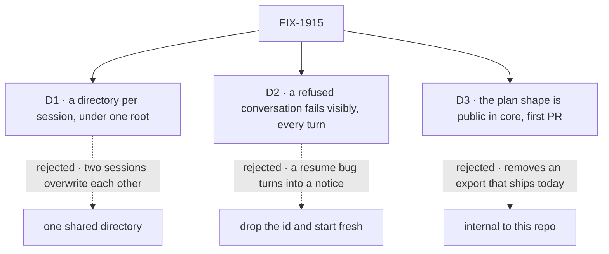

# FIX-1915 · Decisions

[Spec](SPEC.md) · **Decisions** · [Rules](BUSINESS-RULES.md) · [Plan](PLAN.md) · [Docs](DOCS.md) · [Evolution](EVOLUTION.md)

What was chosen, what lost, and what each locks in. The epic already decided the route (every
harness through the shared contract, Claude Code `detached: true`, plan sync one-way and
read-only, the shape in core: [FIX-1907 D2, D3](../../epics/FIX-1907/DECISIONS.md#d2)). These are the
three calls that remained.

## The tree

Solid edges are what you sign. Dashed edges lost, and the label says why.

## D1 · Each session works in its own directory, under one root the host sets

| | |
|---|---|
| **Instead of** | One directory every session shares, such as the person's own repository |
| **Because** | Two sessions running at once in one tree overwrite each other's work, and nothing stops them: the turn queue is per session. A session's directory must also never change, since a harness continues a conversation where it started. One directory per session gives both, for all three harnesses |
| **Locks in** | Kitchen Sink is a place to try a harness, not to work on your code: a new session starts in an empty directory. Directories stay until the host clears them |

It comes down to two sessions at once: a shared tree lets them overwrite each other silently.

**What would change my mind:** the product wanting people to use Kitchen Sink on their own
repositories. Then a shared directory with a lock across sessions, as a new issue.

## D2 · A conversation Claude Code won't continue is shown as refused on every turn; the session never starts a new one by itself

| | |
|---|---|
| **Instead of** | Dropping the id after a refused resume, so the next turn starts a fresh conversation and the session shows a notice. That is what the coding-skill lab does (`labs/fsd-coding-skill`) |
| **Because** | Kitchen Sink exists to show a broken continuation. A session that moves on after one failure turns a resume bug into a notice and a passing next turn, which is the gap the epic is looking for. Keeping the id also means a passing failure (a dropped network, an expired sign-in) recovers on the next turn instead of losing the conversation |
| **Locks in** | One Kitchen Sink session is one harness conversation, for all three harnesses. The binding changes only when the harness itself confirms a different id |

![D2: what happens when Claude Code won't continue a session's conversation? Chosen: show it refused on every turn and keep the id. Instead of: drop the id and start fresh with a notice. It comes down to whether a resume bug can hide: dropping the id makes the next turn pass. The price: a conversation that is really gone keeps the session stuck until the person starts a new one. A passing failure recovers on its own only if the id is kept. Locks in one session, one conversation. Flips if conversations that are gone for good turn out to be common](figures/d2-refused.svg)

It comes down to hiding: dropping the id makes the turn after a refusal pass.

**What would change my mind:** conversations gone for good turning out to be common, for
example a harness that expires them. Then add a "start over" action the person presses. Never
an automatic one.

## D3 · The plan record becomes a published shape in core, shipped first in its own PR

| | |
|---|---|
| **Instead of** | Keeping it internal to this repo's harnesses, the default FIX-1701 D2 set for its reader · or moving it in the same PR as the mode |
| **Because** | The shape is public already: Claude Code exports it and its docs teach reading it. Making it internal in core removes an export that ships today, or keeps two. One shape that any harness writes is what lets a reader not care which harness ran (epic ER-5). And FIX-1916, FIX-1917 and FIX-1185 need the shape, not the mode, while the mode waits on the picker |
| **Locks in** | The `observed-plan` key and fields are a promise to outside readers and writers: fields stay nullable, and a new one is added, never changed. Claude Code's old names stay, as the same objects |

It comes down to today's export: internal would remove a public name or keep two.

**What would change my mind:** FIX-1916 or FIX-1917 finding the shape needs a change rather than
a new field. Then keep it internal until all three harnesses have written it.

## Decided, not asked

- **Claude Code runs `detached: true` with `recordWork: true`** (epic D2) and every tool it has.
  The coding-skill lab turns sub-agents off; this mode doesn't.
- **No approval prompts; the sandbox is the fence.** Kitchen Sink has no in-page approval for a
  harness, so the SDK's prompts would have no one to answer them. Writes stay in the session's
  directory. No sandbox, or a server running as root, makes the mode unavailable with that reason.
- **The binding is two fields in session state**: the confirmed id, written only by `onSession`,
  and the id the turn asked for, noted by `resume`. The page derives *continued*, *started a new
  one* or *refused*. Kitchen Sink writes no item.
- **A turn sent while one runs waits** (`concurrency: "queue"`).
- **The panel shows the latest turn that recorded a plan**, in three states: rows · "no plan
  recorded for this turn" · "this harness reports no plan", when no record is declared.
- **The plan record streams live** (`client.live: true`); today it refreshes when the request ends.
- **The root is `KITCHEN_SINK_HARNESS_ROOT`**, defaulting under the user's home, never a temp
  directory a reboot clears.
- **Sign-in is not probed.** The first turn fails with Claude Code's own error.
- **One flow kind per harness**, from one factory: each rail lists its own sessions, and a
  session can't switch harness.

## Considered and dropped

| Alternative | Why not |
|---|---|
| Drive Claude Code through harness-manager, or its in-session resume | Epic D2 |
| Kitchen Sink writes a notice item when a conversation moves or is refused | Epic ER-11: no shell-written items. Session state carries it |
| One flow kind, harness chosen per session | The rail per mode would need a filter, and a session could change harness mid-conversation |
| A plan reader helper in core | Two readers today (Shift Manager, the panel), about ten lines each. File one when a third appears |
| Move the file and gap records to core too | Only Claude Code writes them. The epic moves the plan alone |
| Approval prompts in the page | A new in-page approval surface for harnesses; not needed to test the contract |

## What the POC showed

None built. The load-bearing premise, that `detached: true` with `resume` and `onSession`
continues one conversation across turns, ships in `labs/fsd-coding-skill/src/flow.ts` and in
the Claude Code docs ([continuing a run on the background path](../../../apps/docs/docs/tools/claude-code-sdk.md#continuing-a-run-on-the-background-path)).
The one unproved mechanism, live rows on a lazily loaded collection, is a CI check in the plan
(V4). No counted facts rest under this spec, so there is no fact checker.

## How it got here

- **Draft** — framed as the first harness mode plus the shared parts; one session flow on the
  shared contract, a directory per session, a refused conversation shown and never replaced, the
  plan shape public in core and shipped first; two PRs.

**Open: none.**
