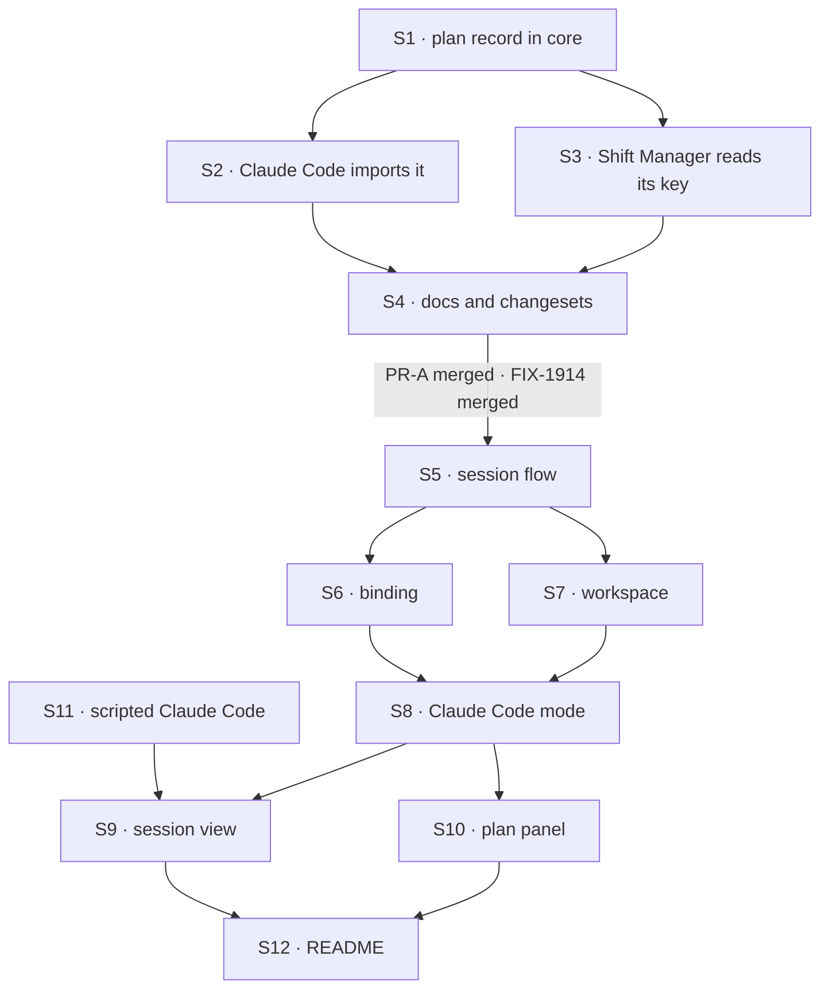

# FIX-1915 · Plan

[Spec](SPEC.md) · [Decisions](DECISIONS.md) · [Rules](BUSINESS-RULES.md) · **Plan** · [Docs](DOCS.md) · [Evolution](EVOLUTION.md)

Written for the implementing agent. IDs cross-reference [BUSINESS-RULES.md](BUSINESS-RULES.md)
(BR-n), [DECISIONS.md](DECISIONS.md) (D-n) and the epic's rules (ER-n). `tdd`. Two PRs; the seam
is the plan record in core, which needs no picker.

## Surfaces

| ID | Package · role | Change | Rules |
|---|---|---|---|
| S1 | `core` · a harness plan-record module beside `types/harness` | The plan key, its item state schema, its outcome enum and the collection definition, moved from Claude Code unchanged except `client.live: true`. Exported from the package root (D3) | BR-19 BR-21 BR-22 |
| S2 | `claude-code` · `sdk/work-collections` | Import S1 and **remove** the local definitions. Re-export the same names from `sdk`, as the same objects. File and gap records stay | BR-20 |
| S3 | `shift-manager` · the recorded-work reader | Read the plan pattern from S1's key, **removing** its own copy of the string | — |
| S4 | Docs and release notes for S1 to S3 | Per [DOCS.md](DOCS.md): core README, Claude Code README, coding agents page, Claude Code page. Changesets: `core` minor, `claude-code` patch | — |
| S5 | `kitchen-sink` · the harness session flow factory | One factory: a flow kind and a function that builds a harness block from the shared resolvers. One action taking the prompt, `concurrency: "queue"`. Session state holds the binding. No harness-specific code | BR-5 BR-7 ER-6 |
| S6 | `kitchen-sink` · the binding resolvers | `resume` reads the confirmed id and notes what the turn asked for; `onSession` writes the confirmed id. Nothing else writes either (D2) | BR-1 to BR-4 BR-6 BR-7 ER-2 |
| S7 | `kitchen-sink` · the workspace resolver | `<root>/<flow kind>/<tenant>/<session>`, each segment derived the way the Claude Code page's checkout example does it, created on first use. Root from `KITCHEN_SINK_HARNESS_ROOT`, defaulting under the user's home (D1) | BR-11 BR-12 |
| S8 | `kitchen-sink` · Claude Code mode | The flow from S5 with `claudeCodeAgent`: `detached`, `recordWork`, `bypassPermissions`, `containmentSandbox` on S7's directory with `failIfUnavailable`. Its availability probe for FIX-1914's picker. Registered in `fsdev.config.ts`; the package and the SDK added as dependencies | BR-10 BR-13 BR-23 |
| S9 | `kitchen-sink` · the session view in FIX-1914's Claude Code slot | The conversation with Claude Code's items through the existing renderers, a stop control on the session's abort, and the binding notice read from session state | BR-3 BR-4 BR-8 BR-9 ER-3 ER-4 |
| S10 | `kitchen-sink` · the plan panel | Reads the manifest for the plan record, then the latest turn's rows by request prefix. Three states. Read-only | BR-14 to BR-18 ER-5 |
| S11 | `kitchen-sink` · a scripted Claude Code for test mode | Behind the app's existing test mode, through the block's `resolveClaudeAgent` seam: a script that names a session, emits items with a pause, writes plan rows, refuses a named id | All CI rows |
| S12 | Docs for S5 to S10 | Kitchen Sink README, per [DOCS.md](DOCS.md) | — |

## Sequence



### The PR plan

| PR | Surfaces | depends_on | Why it stands alone |
|---|---|---|---|
| PR-A | S1 S2 S3 S4 | — | The public shape first (BP-004, D3). Needs no picker, so it can merge while FIX-1914 is in flight, and FIX-1916, FIX-1917 and FIX-1185 build on it |
| PR-B | S5 to S12 · the goal check | PR-A · FIX-1914 | The mode. Needs FIX-1914's mode slot and rail |

## Checks

| ID | PR | Passes when | Red state |
|---|---|---|---|
| V1 | A | Core's plan collection parses a row in today's shape, and an old row as a fixture (BR-19) | Rename a field in S1 |
| V2 | A | The Claude Code `sdk` names are `===` core's (BR-20); Claude Code's recorder tests pass unchanged | Re-declare the collection in Claude Code |
| V3 | A | Shift Manager's recorded-work tests pass, reading the key from core | Change S1's key |
| V4 | A | A plan row upserted mid-run reaches a subscribed client as a live delta, on the lazy collection (BR-21) | Drop `live` |
| V5 | B | Resolvers, with a scripted Claude Code: BR-1 to BR-4. Nothing but `onSession` writes the confirmed id (D2) | Clear the id on a refused resume, as the lab does: BR-3 fails |
| V6 | B | Workspace: every turn of a session gets one directory; two sessions, two; hostile ids stay inside the root (BR-11, BR-12) | Key by session id raw |
| V7 | B | Browser, scripted: a step shows before the turn completes; stop leaves the id and turn 2 continues it; a second turn queues (BR-5, BR-8, BR-9) | Await the run before rendering |
| V8 | B | Browser, scripted: the panel's three states and latest-turn labelling (BR-14 to BR-17); no control in it writes (BR-18) | Return `[]` for an undeclared record: BR-16 fails |
| V9 | B | Availability: each named reason disables the mode (BR-23) | Set `VERCEL=1` and expect available |
| VG | B | [The goal](SPEC.md#the-goal-and-how-well-know-its-met): `goals/kitchen-sink-harness/claude-code-continues-its-conversation/run.mts` PASSES on real Claude Code after FAILING under `GOAL_CONTROL=no-resume` (**c**, **s**) and `GOAL_CONTROL=no-record` (**p**) | The controls are the red state |

The second path (BP-035) here is the resumed turn, the stopped turn and the reload. A check that
covers only a first turn proves none of them.

## Pinned names

| Where | Name | Why pinned |
|---|---|---|
| Flow kinds | `claude-code-session`, and `codex-session`, `cursor-session` for the siblings | FIX-1914's rail lists a mode's sessions by kind. Confirm with FIX-1914's spec at implement time |
| Host setting | `KITCHEN_SINK_HARNESS_ROOT` | A person types it |
| Goal controls | `GOAL_CONTROL=no-resume`, `GOAL_CONTROL=no-record` | The goal check and the closure name them |
| Record key | `observed-plan` | Stored rows and Shift Manager read it today (BP-030) |

Everything else is yours to name.

## Guardrails

| Rule | Because |
|---|---|
| Kitchen Sink writes no item, no plan row and no progress of its own | ER-11. A test bed that patches a gap hides it |
| Nothing harness-specific in S5 to S7, S9 or S10 | ER-6. Codex and Cursor plug in with block options only; a branch on harness kind here is a gap in a package |
| The conversation and the directory come from session state and the server, never the request | BP-031. The prompt reaches the model |
| One definition of the plan record, in core; every writer and reader goes through it (tenet 5) | Two copies drift, which is how FIX-1692 hid a task's steps |
| The move keeps the key and every field nullable (BP-023, BP-030) | Rows already stored must read |
| The panel reads the record; it never derives a plan from items | The record is the promise. A plan rebuilt from items is a second, unproved one |

## Docs

Publish [DOCS.md](DOCS.md)'s package and site sections with PR-A, after V1 to V4. Publish the
Kitchen Sink section with PR-B, after VG. Reconcile each against shipped behaviour first.

## Sketch · pseudocode, illustrative, react to the shape

```
harness session flow (kind, buildAgent):
    shared resolvers:
        cwd       ← workspace(root, kind, tenant, session)       (D1)
        resume    ← state.binding.confirmed; note it as asked    (D2)
        onSession ← state.binding.confirmed = id                 (only writer)
    one action "turn", queued per session:
        step buildAgent(shared resolvers) with { prompt }

page:
    notice   ← asked vs confirmed, once the turn ends: continued · new · refused
    panel    ← manifest has observed-plan?  no → "reports no plan"
               rows under the latest turn's request prefix? no → "none this turn"
```

**POC:** none. See [DECISIONS.md → What the POC showed](DECISIONS.md#what-the-poc-showed).

## At implement time

- Read FIX-1914's merged spec and code for the mode slot, the rail and how availability is shown.
  This plan assumes a mode is a flow kind plus a session view plus a probe.
- Check whether FIX-1185 has landed. If its fix writes plan rows, VG's **p** leg reads rows;
  either way it passes on the record's state.
- `client.live` on a `prefetchMode: "lazy"` collection is V4's question. If it does not stream,
  raise it to the epic rather than polling in the panel.
- The Claude Agent SDK may need listing as a server-only package in `next.config.mjs`.
- Compare [EVOLUTION.md](EVOLUTION.md)'s claims against current code before moving S1.

## Follow-ups

- The file and gap records stay Claude Code's. If a second harness writes either, they follow
  the plan record into core; raise it at that sibling's spec.
