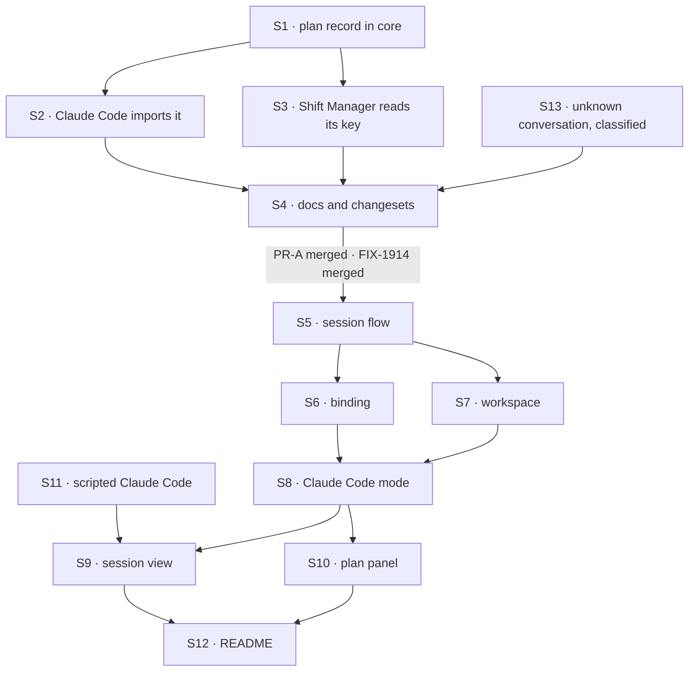

# FIX-1915 · Plan

[Spec](SPEC.md) · [Decisions](DECISIONS.md) · [Rules](BUSINESS-RULES.md) · **Plan** · [Docs](DOCS.md) · [Evolution](EVOLUTION.md)

Written for the implementing agent. IDs cross-reference [BUSINESS-RULES.md](BUSINESS-RULES.md)
(BR-n), [DECISIONS.md](DECISIONS.md) (D-n) and the epic's rules (ER-n). `tdd`. Two PRs; the seam
is the plan record in core, which needs no picker.

## Surfaces

| ID | Package · role | Change | Rules |
|---|---|---|---|
| S1 | `core` · a harness plan-record module beside `types/harness` | The plan key, its item state schema, its outcome enum and the collection definition, moved from Claude Code unchanged except `client.live: true`. Beside them, new: a per-turn **list marker** record (`observed-plan-list`, one row per run namespace: what state the turn's plan write is in, how many places it holds, and why it is incomplete, every field nullable) and **`replacePlanList(collection, marker, namespace, items)`** for harnesses whose plan arrives as the whole list. The helper marks the turn *writing* with the new count, upserts place *n* with `lastOutcome: "applied"`, since it writes only lists the harness confirmed (where the wording at that place is unchanged and the status changed, the earlier status becomes `previousStatus`; a repeated status leaves it as it was; a reworded place clears it), deletes places past the new end, then marks it *complete*, or *incomplete* with the failure. One writer per run namespace, per invocation: it remembers the count it last wrote and never lists the prefix. Exported from the package root (D3) | BR-19 BR-21 BR-22 BR-22a to BR-22d |
| S2 | `claude-code` · `sdk/work-collections` and the work recorder | Import S1 and **remove** the local definitions. Re-export the same names from `sdk`, as the same objects. Declare the list marker beside the plan record. When a plan row's write fails, besides the gap row it writes today, mark the turn *incomplete* in the list marker. Claude Code writes no *writing* or *complete* marker: its plan arrives item by item, not as a list. File and gap records stay | BR-20 BR-22d |
| S3 | `shift-manager` · the recorded-work reader | Read the plan pattern from S1's key, **removing** its own copy (the `observed-plan/**` glob) | — |
| S4 | Docs and release notes for S1 to S3 | Per [DOCS.md](DOCS.md): core README, Claude Code README, coding agents page, Claude Code page. Changesets: `core` patch, `claude-code` patch (additive, per AGENTS.md) | — |
| S5 | `kitchen-sink` · the harness session flow factory | One factory: a flow kind and a function that builds a harness block from the shared resolvers. One action taking the prompt, `concurrency: "queue"`. Session state holds the binding. No harness-specific code | BR-5 BR-7 ER-6 |
| S6 | `kitchen-sink` · the binding resolvers | `resume` reads the confirmed id and notes, under the turn's request, what it asked for; `onSession` writes the confirmed id and marks it confirmed for that turn. Nothing else writes either (D2) | BR-1 to BR-4 BR-6 BR-7 BR-9 ER-2 |
| S7 | `kitchen-sink` · the session's worktree | One reader of `KITCHEN_SINK_HARNESS_WORKSPACE`, shared with FIX-1914's gate: the repository (the setting, or in local development the checkout the server runs from) or off with a reason ([DECISIONS → Decided, not asked](DECISIONS.md#decided-not-asked)). A place per session through `@flow-state-dev/workspace`'s `localWorkspaceHost({ root: <derived root>, localRepositories: [repository], source: () => ({ kind: "repo", repo: repository, baseRef: "HEAD" }) })`, keyed on flow kind, tenant and session, with branch `kitchen-sink/<flow kind>/<session>`. No `mkdir` and no git of Kitchen Sink's own; harness-manager's `workspace.ts` is the worked example. The root is derived outside the checkout ([Pinned names](#pinned-names)). Nothing clears a place (D1) | BR-11 BR-12 BR-13a BR-23a |
| S8 | `kitchen-sink` · Claude Code mode | The flow from S5 with `claudeCodeAgent`: `detached`, `recordWork`, `bypassPermissions`, `settingSources: []`, `containmentSandbox` on S7's worktree with `failIfUnavailable` (the worktree only: not the main checkout, not `.git`), and `env` from `harnessEnv` with an allowlist like Shift Manager's (BR-13b). `systemPrompt` pinned: unset, or the `claude_code` preset with `append` only, never a plain string, which turns off Claude Code's planning tool (FIX-1185 D2). Its own check in FIX-1914's mode-check slot: SDK, root, sandbox, sign-in, through the sign-in probe FIX-1904 D1 settles (#3175), in `claude-code`, which S8 calls with the run's allowlisted environment so the probe sees what the run will. Registered in `fsdev.config.ts` only through FIX-1914's gate; the package and the SDK added as dependencies | BR-10 BR-13 BR-13b BR-23 BR-24 |
| S9 | `kitchen-sink` · the session view in FIX-1914's Claude Code slot | The conversation with Claude Code's items through the existing renderers, a stop control on the session's abort, and the binding notice read from session state | BR-3 BR-4 BR-8 BR-9 ER-3 ER-4 |
| S10 | `kitchen-sink` · the plan panel | Reads the manifest for the plan record, then the latest turn's list marker and rows by request prefix. Its states: rows · "this turn's plan is empty" (marker *complete*, no places) · "no plan recorded for this turn" (no marker, no rows) · "<Mode label> reports no plan", the label from FIX-1914's mode list · rows marked "may be incomplete", with the reason (marker *incomplete*, or still *writing* after the turn ended). With a count in the marker, only places below it show. Read-only | BR-14 to BR-18 BR-22c BR-22d ER-5 |
| S11 | `kitchen-sink` · a scripted Claude Code for test mode | Behind the app's existing test mode, through the block's `resolveClaudeAgent` seam: a script that names a session, emits items with a pause, writes plan rows, refuses a named id | All CI rows |
| S12 | Docs for S5 to S10 | Kitchen Sink README, per [DOCS.md](DOCS.md) | — |
| S13 | `core` and `claude-code` · the unknown-conversation classification | No harness package has one today: the Codex and Cursor blocks document only that a refused resume throws before `onSession` (`packages/codex/src/agent.ts:93`, `packages/cursor/src/agent.ts:101`), and their run errors carry one code for every failure (`CODEX_AGENT_RUN_FAILED`, `CURSOR_AGENT_RUN_FAILED`, `CLAUDE_AGENT_RUN_FAILED`). Core gains a neutral classification on the error a harness block fails with, beside the handle in `types/harness`, additive and not a field on the handle (epic ER-13). Each package sets it for its own unknown-conversation failure: Claude Code's here, measured at implement time; Codex's `no rollout found for thread id` in FIX-1916; Cursor's equivalent in FIX-1917. The shared flow and the page read only the classification | BR-3 ER-6 ER-13 |

## Sequence



### The PR plan

| PR | Surfaces | depends_on | Why it stands alone |
|---|---|---|---|
| PR-A | S1 S2 S3 S4 S13 | — | The public shape first (BP-004, D3), with `replacePlanList`, the list marker and the unknown-conversation classification. Needs no picker, so it can merge while FIX-1914 is in flight, and FIX-1916, FIX-1917 and FIX-1185 build on it |
| PR-B | S5 to S12 · the goal check | PR-A · FIX-1914 | The mode. Needs FIX-1914's mode slot and rail |

## Checks

| ID | PR | Passes when | Red state |
|---|---|---|---|
| V1 | A | Core's plan collection parses a row in today's shape, and an old row as a fixture (BR-19) | Rename a field in S1 |
| V2 | A | The Claude Code `sdk` names are `===` core's (BR-20); Claude Code's recorder tests pass unchanged | Re-declare the collection in Claude Code |
| V3 | A | Shift Manager's recorded-work tests pass, reading the key from core | Change S1's key |
| V4 | A | A plan row upserted mid-run reaches a subscribed client as a live delta, on the lazy collection (BR-21) | Drop `live` |
| V10 | A | `replacePlanList`: a list of three, then three with the second reworded, then two. Places hold the new items, each `applied`; unchanged wording with a changed status keeps the earlier status as `previousStatus`, a repeated status leaves it as it was, reworded clears it; place 2 is deleted; it never calls `list()` (BR-22a, BR-22b) | Key by index without the trim: a stale third row survives |
| V11 | A | A confirmed empty list writes a *complete* marker with no places, and a reader tells it from a turn that reported nothing (BR-22c) | Skip the marker when the list is empty: the two read the same |
| V12 | A | A collection that fails on the second write: the marker ends *incomplete* with the error, and a reader shows the rows as incomplete, never as the plan. The same for a Claude Code plan row whose write fails (BR-22d) | Write the marker *complete* before the rows, or not at all |
| V5 | B | Resolvers, with a scripted Claude Code: BR-1 to BR-4, including a turn that confirms *X* then fails (an error, not a refusal), one that fails before confirming with the unknown-conversation classification (refused), and one that fails before confirming for another reason (an error; the id stays). Claude Code's own unknown-conversation failure carries the classification and no other run error does (S13). Nothing but `onSession` writes the confirmed id (D2) | Clear the id on a refused resume, as the lab does: BR-3 fails · derive the notice from session-wide fields only: the confirmed-then-failed turn reads wrong · read every failure before confirmation as refused: the other-reason turn reads refused |
| V6 | B | Worktree: every turn of a session, and a restart, gets the same worktree and branch; two sessions, two; hostile ids stay inside the root and make valid, distinct branches; the main checkout's `git status` is unchanged after a run edits a file; a deleted session leaves its worktree and branch; a variable set on the server and left off the allowlist is not in the run's environment; with harness modes turned off and the server restarted, the mode's sessions stay in the store, unlisted (FIX-1914 BR-16) (BR-11 to BR-13b, BR-23a) | Key by session id raw · hand the run the repository itself · leave `env` unset: the planted variable shows · delete sessions when modes go off |
| V7 | B | Browser, scripted: a step shows before the turn completes; stop leaves the id and turn 2 continues it; a stop before the confirmation shows stopped, not refused; a second turn queues (BR-5, BR-8, BR-9) | Await the run before rendering |
| V8 | B | Browser, scripted: the panel's states (S10) and latest-turn labelling, including turn 2 with no plan after turn 1 recorded one (BR-14 to BR-17); no control in it writes (BR-18) | Return `[]` for an undeclared record: BR-16 fails · pick the latest turn *with* rows: BR-15 fails |
| V9 | B | Availability: each named reason disables the mode, sign-in included (BR-23) | Report a host with no sign-in as available |
| VH | B | FIX-1914's goal check (`goals/kitchen-sink-harness-mode/opens-on-the-picker/`), extended with two legs, written once as a loop over every harness mode in FIX-1914's mode list so FIX-1916 and FIX-1917 don't edit that goal: with harness modes off, opening each mode's address creates **no session**, and **no harness flow is served** (`/api/flows/<flow kind>/…` not found) (BR-24). A mode whose flow kind is still unset checks the address leg only | `GOAL_CONTROL=gate-open`: both legs FAIL |
| VG | B | [The goal](SPEC.md#the-goal-and-how-well-know-its-met): `goals/kitchen-sink-harness/claude-code-continues-its-conversation/run.mts` PASSES on real Claude Code after FAILING under `GOAL_CONTROL=no-resume` (**c**, **s**) and `GOAL_CONTROL=no-record` (**p**) | The controls are the red state |

The second path (BP-035) here is the resumed turn, the stopped turn and the reload. A check that
covers only a first turn proves none of them.

## Pinned names

| Where | Name | Why pinned |
|---|---|---|
| Flow kinds | `claude-code-session`, and `codex-session`, `cursor-session` for the siblings | FIX-1914's rail lists a mode's sessions by kind. `cursor-session` is settled by FIX-1917's merged spec; confirm the rest with FIX-1914's spec at implement time |
| Host setting | `KITCHEN_SINK_HARNESS_WORKSPACE`, now naming the repository | FIX-1914's, the one setting every harness mode is gated on. A person types it |
| Worktree root | `${XDG_STATE_HOME:-~/.local/state}/flow-state-dev/kitchen-sink-harness/<repository name>-<hash of its path>/`, hash = first 12 hex of the SHA-256 of the repository's real path | Derived, not set, outside the checkout. A person looks there for a session's work |
| Session branch | `kitchen-sink/<flow kind>/<session>`, segments encoded | A person takes a session's work from it; goal **w** reads it |
| Core names | `replacePlanList`, the `observed-plan-list` key | FIX-1916 and FIX-1917 call and read them |
| Goal controls | `GOAL_CONTROL=no-resume`, `GOAL_CONTROL=no-record`, `GOAL_CONTROL=main-checkout`; FIX-1914's `gate-open` for VH | The goal checks and the closure name them |
| Record key | `observed-plan` | Stored rows and Shift Manager read it today (BP-030) |

Everything else is yours to name.

## Guardrails

| Rule | Because |
|---|---|
| Kitchen Sink writes no item, no plan row and no progress of its own | ER-11. A test bed that patches a gap hides it |
| Nothing harness-specific in S5 to S7, S9 or S10 | ER-6. Codex and Cursor plug in with block options only; a branch on harness kind here is a gap in a package |
| The conversation and the worktree come from session state and the server, never the request | BP-031. The prompt reaches the model |
| One definition of the plan record, in core; every writer and reader goes through it (tenet 5) | Two copies drift, which is how FIX-1692 hid a task's steps |
| The move keeps the key and every field nullable (BP-023, BP-030) | Rows already stored must read |
| The panel reads the record; it never derives a plan from items | The record is the promise. A plan rebuilt from items is a second, unproved one |

## Docs

Publish [DOCS.md](DOCS.md)'s package and site sections with PR-A, after V1 to V4. Publish the
Kitchen Sink section with PR-B, after VG. Reconcile each against shipped behaviour first.

## Sketch · pseudocode, illustrative, react to the shape

```
harness session flow (kind, buildAgent):
    shared resolvers:
        cwd       ← host.provision(place: kind/tenant/session,
                                    branch: kitchen-sink/<kind>/<session>)  (D1)
        resume    ← state.binding.confirmed; turns[request].asked = it          (D2)
        onSession ← state.binding.confirmed = id; turns[request].confirmed = id  (only writer)
    one action "turn", queued per session:
        step buildAgent(shared resolvers) with { prompt }

page:
    notice   ← this turn's entry and how it ended:
               stopped → stopped · confirmed = asked → continued
               confirmed ≠ asked → new
               failed, classified unknown conversation → refused
               none confirmed, failed otherwise → error, id kept
    panel    ← manifest has observed-plan?  no → "reports no plan"
               marker for the latest turn:
                 complete, count 0 → "empty"
                 incomplete, or writing after the turn ended → rows + "may be incomplete"
                 none, and no rows → "none this turn"
               rows: places below the marker's count, when it has one

replacePlanList(collection, marker, namespace, items):
    marker[namespace] ← writing, count = len(items)
    for n, item: upsert namespace/n, lastOutcome applied
        (same title: previousStatus ← old status only if the status changed, else kept · new title: null)
    for n in len(items) .. countWrittenBefore: delete namespace/n
    marker[namespace] ← complete    · on any throw: incomplete, reason
```

**POC:** none. See [DECISIONS.md → What the POC showed](DECISIONS.md#what-the-poc-showed).

## At implement time

- Read FIX-1914's merged spec and code for the mode slot, the rail, the gate and how
  availability is shown. Its gate and S7 call the one reader of the setting. This plan assumes a mode is a flow kind registered through the gate,
  plus a session view, plus its own check.
- Use the sign-in probe FIX-1904 D1 settles (#3175), in `@flow-state-dev/claude-code`, shared
  with Shift Manager's start check. If FIX-1904 hasn't landed it, build it there, to its
  spec, and FIX-1904 imports it. Don't write a second.
- Check whether FIX-1185 has landed. If its fix writes plan rows, VG's **p** leg reads rows;
  either way it passes on the record's state.
- `client.live` on a `prefetchMode: "lazy"` collection is V4's question. If it does not stream,
  raise it to the epic rather than polling in the panel.
- The Claude Agent SDK may need listing as a server-only package in `next.config.mjs`.
- A fresh worktree has no `node_modules`, and pnpm's store is outside the sandbox. Find whether
  the run can install and test in its worktree; if it can't, say so in the README rather than
  widening the sandbox.
- How long worktrees and branches are kept, and any "clear this session's worktree" control,
  are yours to decide or leave out. The spec only requires that nothing clears one by itself.
- Compare [EVOLUTION.md](EVOLUTION.md)'s claims against current code before moving S1.

## Notes from review

Recorded for the implementer, not baked into the design. Quoted verbatim; elisions marked.

- **cursor[bot], PLAN S5–S7:** "S5, S6, and S7 are one conceptual unit (“harness session host plumbing”) for a single consumer app. Consider merging to **one surface row** in this table (factory + binding + workspace) and keeping ER-6 / the sketch as the split between generic vs harness-specific."
- **cursor[bot], PLAN S11:** "Consider folding into V5–V8 as “scripted agent via `resolveClaudeAgent` + existing `KITCHEN_SINK_TEST_MODE`”, with a pointer to `labs/fsd-coding-skill/test/scripted-claude.ts` as the canonical script shape — unless you want S11 as documentation for FIX-1916/17 test seams."
- **cursor[bot], pinned flow kinds:** "Pre-pinning `codex-session` / `cursor-session` before FIX-1916/1917 specs exist may be premature. [...] siblings could be “`<harness>-session` via same factory” without freezing names in this issue’s pinned table."
- **cursor[bot], the plan reader:** "S10 (plan panel) is that third reader on manifest + request prefix. You may still keep the helper out of **core** (reasonable), but the plan should name **where** the shared ~30 lines live so kitchen-sink panel, goals, and shift-manager don’t diverge."
- **Second look (PR comment), the plan reader:** "the prefix is `<request>/…`, and the recorder **percent-escapes** the request id [...]. `readRecordedWork` builds the prefix from the raw `requestId`. A second hand-copy of that is where the two readers will diverge. A small `planRowsPrefix(requestId)` exported next to the schema in S1, used by both, costs less than the divergence." And: "`PlanStep` (`{id,title,status}`) in that file is a third hand-written row shape. Once the schema is in core, derive it from the schema."
- **cursor[bot], S10 live reads:** "S10 should reference the same manifest/prefix rules and **`useResourceCollectionList` / `useSession` with `live: true`** so implementers don’t poll or buffer until turn end." And: "steer implementers away from **re-listing all prefixes on every plan delta**".
- **cursor[bot], S7:** "Claude Code `physicalPath` / doc `segment` checkout — S7 should say to match workspace encoding + realpath, not raw `join`."
- **Second look, S5:** "build S5 as the extraction from S8 (write Claude Code mode concretely, then pull the factory out) so the shared surface is whatever Claude Code actually needed, not what this spec predicts."
- **Second look, the lab's resolvers:** "Add a Follow-ups line: “if the lab or a sibling needs the keep-the-id binding, lift S6 into a shared helper”."
- **cursor[bot], spec bundle:** "BR-1–BR-7 overlap heavily on “recorded id + server-owned binding.” Grouping into fewer rules with sub-bullets [...] would dedupe against DECISIONS “Decided, not asked” and PLAN V5." And: "pick **one spine**: DECISIONS (forks) → grouped BUSINESS-RULES → PLAN (S* + V* only) → DOCS as a **checklist**, not draft prose."

## Follow-ups

- The file and gap records stay Claude Code's. If a second harness writes either, they follow
  the plan record into core; raise it at that sibling's spec.
