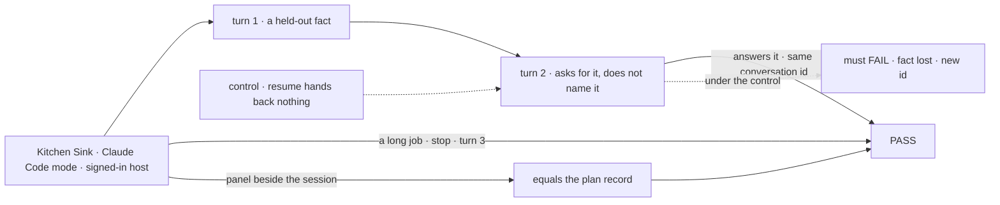
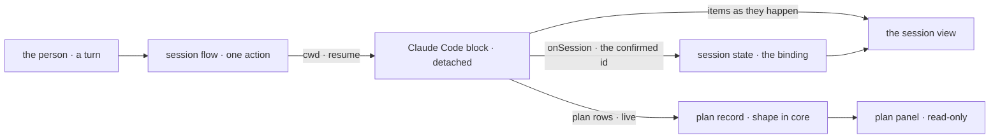

# FIX-1915 · Claude Code mode in Kitchen Sink: one harness session flow, live items, continuity, and the run's plan in one shared record

**Spec** · [Decisions](DECISIONS.md) · [Rules](BUSINESS-RULES.md) · [Plan](PLAN.md) · [Docs](DOCS.md) · [Evolution](EVOLUTION.md)

## Who feels this, before and after

| Someone who… | Today | After |
|---|---|---|
| **builds on the Claude Code harness** | Sees it run only inside Shift Manager, where a task board drives it | Picks **Claude Code** in Kitchen Sink and works a session: turn 2 continues turn 1's conversation, and the run's steps show while it works |
| **stops a run halfway** | Has no app that shows what a stop leaves behind | Sees the turn end as stopped. The next turn continues the same conversation |
| **comes back to a session whose conversation Claude Code can't continue** | Nothing to come back to | Sees which conversation was refused, on every turn, until it works again. The session never moves to a new conversation by itself ([D2](DECISIONS.md#d2)) |
| **wants to know what the run planned** | Reads Claude Code's plan record over the resource route, by hand | Reads it in a panel beside the session, read-only, or a plain "no plan recorded for this turn" |
| **adds Codex or Cursor mode next** (FIX-1916, FIX-1917) | Would start from nothing | Passes its block to the same session flow, and writes its plan to the same record shape in core ([D3](DECISIONS.md#d3)) |

Kitchen Sink is the test bed for the harness integrations ([epic FIX-1907](../../epics/FIX-1907/SPEC.md)). This is its first
harness mode, and it builds the parts the other two reuse: one session flow, one place each
session works ([D1](DECISIONS.md#d1)), one plan record.

## The goal, and how we'll know it's met

**A person picks Claude Code in Kitchen Sink and works a session as they would use Claude Code
directly: each turn continues the same conversation, a stop leaves it continuable, the run's
steps show while it works, and the panel beside it shows exactly what Claude Code recorded of its
plan.**

| Is it the right goal? | |
|---|---|
| **The real need** | The epic's goal for one mode, plus the shared parts the other two plug into ([FIX-1907 → the goal](../../epics/FIX-1907/SPEC.md#the-goal-and-how-well-know-its-met), [ER-2 to ER-6](../../epics/FIX-1907/BUSINESS-RULES.md#what-a-team-gets-and-what-it-doesnt)) |
| **Smaller, and rejected** | "Claude Code answers a prompt in Kitchen Sink." One turn passes it while continuity, stop and the plan go untested |
| **Bigger, and not this issue's** | Claude Code's plan actually filling on the SDK path ([FIX-1185](https://linear.app/fixpoint-labs/issue/FIX-1185)) · the picker ([FIX-1914](https://linear.app/fixpoint-labs/issue/FIX-1914)) · Codex and Cursor modes · the four-mode closure ([FIX-1918](https://linear.app/fixpoint-labs/issue/FIX-1918)) |
| **Not done if** | It passes only on the scripted Claude Code · turn 2 answered from text Kitchen Sink re-sent, not from the conversation · Kitchen Sink wrote an item of its own · the panel is blank without saying why · the plan shape still lives only in the Claude Code package |



The check reads the page and the session's recorded conversation id, never the harness's own
tests. With `resume` cut, turn 2 must fail, which is what makes its pass mean the conversation
carried.

| How we verify | |
|---|---|
| **Goal check** | `goals/kitchen-sink-harness/claude-code-continues-its-conversation/` · real Claude Code on a signed-in host, in a real browser · run by the implementer at completion, handed to `fsd-qa` over the mailbox if no signed-in browser host is available · verdict in the implementation PR |
| **Signal** | **c** turn 2 names turn 1's held-out token, and the recorded id is unchanged · **l** at least one of Claude Code's items shows before the turn completes · **s** after stop, turn 3 names the token under the same id · **r** after a reload, the same · **p** the panel shows what the record holds for the turn: its rows, or "no plan recorded for this turn", never "this harness reports no plan" |
| **Input** | A fresh random token per run, and a job long enough to stop. Any other token or job must pass. Durable store (`STORE_TYPE=filesystem`) |
| **Anti-game** | Assert on what the page shows and on the id in session state. Never on the scripted SDK, never on a prompt Kitchen Sink built from earlier turns |
| **Control that must fail** | `GOAL_CONTROL=no-resume`: **c** and **s** FAIL. `GOAL_CONTROL=no-record`: **p** FAILS (the panel says "reports no plan"). Today's `main`: every leg FAILS, as there is no Claude Code mode |
| **The gate** | FIX-1914's goal check gains two legs: with harness modes off, opening Claude Code creates *no session* and *no harness flow is served*. Both FAIL under its `GOAL_CONTROL=gate-open` |

## What changes


Left is today: one path to a real Claude Code run, through a board. Right is the mode: the
session flow owns the conversation id and the directory, the harness owns everything else, and
the plan shape moves down into core where all three harnesses can write it.

**What Codex mode will write, once this lands** (illustrative; the names are the implementer's):

```diff
+ export const codexSession = harnessSessionFlow({
+   kind: "codex-session",
+   agent: (shared) => codexAgent({ ...shared }),   // shared = cwd, resume, onSession
+ });
```

**What a harness that records a plan imports:**

```diff
- import { observedPlanCollection } from "@flow-state-dev/claude-code/sdk";
+ import { observedPlanCollection } from "@flow-state-dev/core";
```

The old import keeps working and returns the same object.

## How a turn runs



Kitchen Sink decides only where the run works and which conversation it continues. What the
run says and plans comes from the harness, and the page reads it.

## What stays as it is

- The three harness blocks and their handle. Claude Code gets options, not new code paths.
- Claude Code's in-session resume, harness-manager and the task board (epic D2).
- Claude Code's file and gap records, which stay in its package.
- The plan record's storage key and fields: rows already written still read.
- The picker and rail: FIX-1914's. This issue fills the Claude Code slot.

## Sign off

**[The goal](#the-goal-and-how-well-know-its-met), at that size:** continuity, stop, live steps
and an honest plan panel, on real Claude Code. If wrong: the mode passes on one turn while
continuity breaks, or we hold this issue for a plan that FIX-1185 owns.

1. **[D2](DECISIONS.md#d2) · A conversation Claude Code won't continue is shown as refused on
   every turn; the session never starts a new one by itself.** If wrong: a session whose
   conversation is really gone stays stuck until the person starts a new one.
2. **[D1](DECISIONS.md#d1) · Each session works in its own directory, under one root the host
   sets.** If wrong: a person can't point the mode at their own repository.
3. **[D3](DECISIONS.md#d3) · The plan record becomes a published shape in core, shipped first in
   its own PR.** If wrong: a shape outside authors write is harder to change.

**Open: none.** D2 is the one to weigh. Reasoning and what lost: [DECISIONS.md](DECISIONS.md).
The cases: [BUSINESS-RULES.md](BUSINESS-RULES.md).

Feature · `core` + `claude-code` + `shift-manager` + `kitchen-sink` · large (12 surfaces, 11
checks, 5 doc surfaces) · 2 PRs · epic [FIX-1907](../../epics/FIX-1907/SPEC.md)
