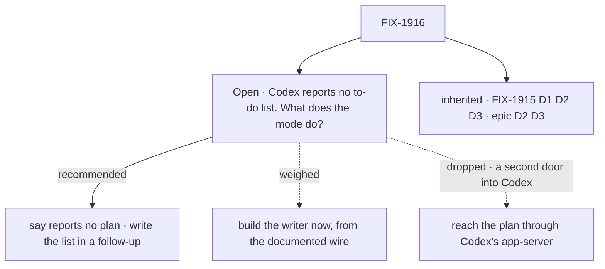

# FIX-1916 · Decisions

[Spec](SPEC.md) · **Decisions** · [Rules](BUSINESS-RULES.md) · [Plan](PLAN.md) · [Docs](DOCS.md) · [Evolution](EVOLUTION.md)

The route was decided above this issue: every harness through the shared contract, one session
flow, plan sync one-way into one record in core ([epic D2, D3](../../epics/FIX-1907/DECISIONS.md#d2)),
and FIX-1915's choices for the session itself: where each session works, a refused conversation
shown and never replaced, the plan shape in core
([FIX-1915 D1 to D3](../FIX-1915/DECISIONS.md)).
Codex mode inherits all of them. One question is left, and the POC is why it exists.

## The tree

Nothing here is signed yet. The dashed edges are the options the recommendation is weighed against.

## Open · Codex reports no to-do list at the version we pin. Ship the mode saying so, or hold out for a list?

**In plain terms.** The issue asked for Codex's to-do list in the panel, written to the record
Claude Code uses. We ran the real Codex program, at the version our package pins and at the
newest release: in the headless mode our package drives, Codex offers the model no planning
tool, and answers a request for one with "unsupported call". No to-do list ever comes out.
Everything else in Codex mode works.

**The trade-off.** Shipping now, the panel says "Codex reports no plan", which is true; the
issue's promise isn't met, and the epic's "Codex writes the plan record" becomes a follow-up.
Building the writer now means code no real Codex run reaches, proved only on a script we wrote,
and a panel saying "no plan recorded for this turn" on every turn, as if Codex could have planned.

**My recommendation: ship Codex mode with the panel saying Codex reports no plan,** and file one
follow-up to write the list when a pinned Codex offers its plan tool. The package refuses any SDK
version it wasn't tested on, so every bump is a deliberate step where this gets rechecked.

**What would change my mind:** a real Codex run signed in through a ChatGPT account that does
produce a to-do list, the one path the POC couldn't reach. The goal check will show it.

**What being wrong costs.** Little, and reversible: a list Codex did produce still shows in the
session's steps, and the follow-up moves up. Building the writer and being wrong leaves code we
maintain and can't verify.

It comes down to a real run: the writer-now panel says "none this turn" when Codex can't plan at all.

**For the epic coordinator, not decided here (ER-15):** taking the recommendation amends epic
D3's *Codex and Cursor write it*. Epic D1's collapse trigger is not met today: it needs both
FIX-1916 and FIX-1917 to be a few lines of options and no plan work, and FIX-1917 writes Cursor's
list.

## Decided, not asked

- **Codex runs headless in the session's own git worktree, from FIX-1915's factory,** in its own
  sandbox (`workspace-write`) with no approval prompts, as FIX-1915 runs Claude Code. The
  worktree is a git repository, so Codex's repository check stays on and nothing turns it off.
- **The run starts with an allowlisted environment** (`harnessEnv`), as FIX-1915 passes Claude Code.
  Left unset, Codex's process inherits every secret the server holds. The list carries `HOME`
  (or `CODEX_HOME`), because Codex keeps its sign-in and its threads there.
- **Codex's own check, in FIX-1914's per-mode slot**: the pinned SDK, signed in, a sandbox that
  runs. Another SDK version is a reason on the card, never a crash at server start.
- **Sign-in counts as `codex login status` succeeding, or Codex's API key in the allowlisted
  environment.** Measured: `login status` exits 1 with only an environment key, though a run
  works with one. Either alone would mark a working host unavailable.
- **Codex's default model.** The cost estimate is then absent, as the Codex page documents.
- **No change to the Codex package, except one error mapping.** Its thread lifecycle already
  matches FIX-1915's binding (the POC, legs A to E), and the epic forbids changing the contract
  here (ER-13). The exception: the package classifies Codex's `no rollout found for thread id`
  failure as an unknown conversation (FIX-1915 S13), so the shared flow can tell a refusal from
  any other early failure without a Codex branch.

## Which methods already do this job

The job is *run one harness turn in a Kitchen Sink session*. FIX-1915's session-flow factory is
the closest entry, and this issue is a parameter on it: a block and its options. Searched
`apps/kitchen-sink`, `labs/fsd-coding-skill` and `packages/*` for `resume`, `onSession`,
`codexAgent`. The coding-skill lab also runs Codex this way, with its own binding, which
FIX-1915 D2 deliberately doesn't follow. Nothing to fold.

## Considered and dropped

| Alternative | Why not |
|---|---|
| Reach Codex's plan through its app-server protocol, which streams plan updates | A second door into Codex in `@flow-state-dev/codex`: its own issue, and epic ER-13's spirit |
| Map Codex's *goal* tools (`create_goal`, `update_goal`), which the pinned version does offer, into the plan record | A goal is one objective with a budget, not a to-do list. Recording it as one invents a plan (epic ER-11) |
| Initialise a git repository in each session directory so Codex's check passes | Moot: each session is already a git worktree (FIX-1915 D1). It was also Codex-specific code in the shared workspace resolver (FIX-1915's guardrail) |
| Bump the pinned SDK to get the plan tool | The newest release, 0.162.1, behaves the same (POC leg D) |

## Settled

**Codex's thread lifecycle and its missing plan tool, at SDK 0.152.1 (pinned) and 0.162.1
(newest)** ([poc/codex-wire](poc/codex-wire/), the real `codex` program against a scripted model).
A new thread names its id; a resumed turn names the **same** id again; an id Codex doesn't have
fails with `no rollout found for thread id …`, names no thread and starts no new one; after a stop
the next turn continues the same id; and Codex offers no `update_plan` tool, on nine model names,
answering a scripted call with `unsupported call: update_plan`. Resolved; don't reopen without a
new run.

## How it got here

- **Draft** — framed as the second harness through FIX-1915's shared parts; a characterization
  POC confirmed Codex's thread lifecycle fits the per-turn binding unchanged, and found Codex
  emits no to-do list at the pinned version, so the plan writer became the open question and the
  build shrank to options and one availability check; one PR.
- **Amended after merge (Oct 12, cross-spec check)**: Codex consumes FIX-1915's worktree, so
  the repository-check option is gone; the `.git` fence is required (FIX-1915 BR-13b); only
  Codex refusing a known thread is a refusal; a lapsed sign-in is an error, not a refusal.
  The Codex package maps that one error to FIX-1915's unknown-conversation classification.
- **Amended after merge (Oct 13, owner decision)**: the allowlist is environment filtering, not a
  security boundary (FIX-1915 BR-13b). A command running as the server's user can still read the
  server's environment through `/proc` on Linux; a separate user or container is a follow-up issue.
  BR-12, V5 and the README text now claim only what commands start with.

**Open: 1.**
