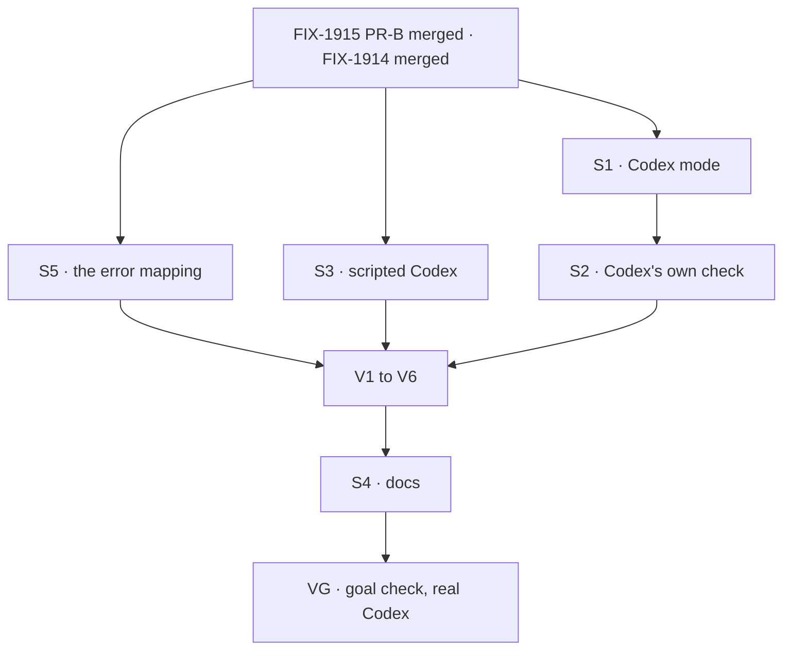

# FIX-1916 · Plan

[Spec](SPEC.md) · [Decisions](DECISIONS.md) · [Rules](BUSINESS-RULES.md) · **Plan** · [Docs](DOCS.md) · [Evolution](EVOLUTION.md)

Written for the implementing agent. IDs cross-reference [BUSINESS-RULES.md](BUSINESS-RULES.md)
(BR-n), FIX-1915's rules (1915 BR-n) and the epic's (ER-n). `tdd`. One PR, after FIX-1915's PR-B
merges: this issue consumes its session flow, workspace, session view and plan panel, and adds
no surface to any of them.

## Surfaces

| ID | Package · role | Change | Rules |
|---|---|---|---|
| S1 | `kitchen-sink` · Codex mode | FIX-1915's factory with flow kind `codex-session` and `codexAgent`: `sandboxMode: "workspace-write"`, `approvalPolicy: "never"`, the sandbox fenced to the session's worktree, not `.git` (FIX-1915 BR-13b), `client.env` from `harnessEnv`. No plan collection. The package and the SDK at the version `@flow-state-dev/codex` pins added as dependencies | BR-1 to BR-13 |
| S2 | `kitchen-sink` · Codex's own check | In FIX-1914's per-mode slot: SDK installed and at the pinned version (build the block inside the check, so the package's version refusal becomes a reason), signed in, sandbox runs. Registration in `fsdev.config.ts` only through FIX-1914's gate | BR-15 to BR-19 |
| S3 | `kitchen-sink` · a scripted Codex client for test mode | Behind the app's existing test mode, through `resolveCodexClient`: names a thread, re-names it on resume, refuses a named id by throwing Codex's error, fails a turn after naming, emits a command item with a pause, holds a turn open until stopped | All CI rows |
| S4 | Docs | Per [DOCS.md](DOCS.md): Kitchen Sink README, the Codex page, the coding agents page. Changeset: `codex` patch, for S5 only | — |
| S5 | `codex` · the one error mapping | A failure carrying Codex's `no rollout found for thread id` sets core's unknown-conversation classification (FIX-1915 S13) on the error the block fails with. No other error does. Nothing else in the package changes | BR-3 BR-20 |

Nothing is removed. **Nothing in the Codex package changes but S5's error mapping** (ER-13). If a check here needs one,
that is a gap in the package, filed as an epic child (ER-15), not patched in Kitchen Sink.

## Sequence



One PR. FIX-1915 left Codex a parallel window beside Cursor (epic PLAN), and this is all of it.

## Checks

| ID | Passes when | Red state |
|---|---|---|
| V1 | Binding, scripted: BR-1 to BR-5 and BR-9, each turn's notice derived by FIX-1915's code with no Codex branch; a later turn that fails before Codex names a thread, for a reason other than the resume error, reads as an error, not a refusal (BR-3, BR-20) | Have the scripted refusal name a fresh id: BR-4's "never a new thread" check fails · read every pre-thread failure as a refusal: the sign-in case reads refused |
| V2 | Browser, scripted: a command shows before the turn completes; a stop leaves the id and the next turn continues it (BR-7, BR-8) | Hold rendering until the run returns |
| V3 | The panel reads "Codex reports no plan" (BR-13) | Declare the plan collection on the block: the panel reads "no plan recorded for this turn" |
| V4 | Availability: each reason in BR-15 to BR-18 shows and registers no flow; a mismatched SDK leaves the server up (BR-16) | Build the block at module scope: a planted version crashes the start |
| V5 | A variable set on the server and left off the allowlist is not in the environment of a command the scripted run reports (BR-12) | Leave `client.env` unset |
| V6 | S5: an error carrying `no rollout found for thread id` is classified as an unknown conversation; a sign-in error and a failed spawn are not (BR-3, BR-20) | Classify every error before a thread is named: the sign-in case reads refused |
| VG | [The goal](SPEC.md#the-goal-and-how-well-know-its-met): `goals/kitchen-sink-harness/codex-continues-its-thread/run.mts` PASSES on real Codex after FAILING under `GOAL_CONTROL=no-resume` (**c**, **s**); FIX-1914's gate legs FAIL for Codex under `GOAL_CONTROL=gate-open` | The controls are the red state |

For leg **x**, plant the refusal the way a person meets it: remove the thread's record from the
Codex home the run uses, between turns. Writing an unknown id into session state is the fallback
if the host's Codex home can't be isolated for the run.

## Pinned names

| Where | Name | Why pinned |
|---|---|---|
| Flow kind | `codex-session` | FIX-1914's rail and address list it |
| Goal | `goals/kitchen-sink-harness/codex-continues-its-thread/` | The closure runs it |
| Goal control | `GOAL_CONTROL=no-resume` | Shared with FIX-1915's check |
| Panel text | "Codex reports no plan" | FIX-1915's undeclared-record state, with the harness named; the goal asserts it |

The host workspace setting is FIX-1914's and FIX-1915's; this issue reads it only through them.

## Guardrails

| Rule | Because |
|---|---|
| No branch on harness kind in FIX-1915's flow, workspace, view or panel | ER-6. A Codex need there is a gap in the shared parts, raised to the epic |
| Kitchen Sink writes no item, no plan row, no notice of its own | ER-11. A to-do list Codex shows is a step, not a plan Kitchen Sink keeps |
| The thread and the directory come from the server, never the request | BP-031; the prompt reaches the model |
| Build the Codex block where a refusal can be caught | The package refuses an untested SDK at build time; at module scope that takes the server down (BR-16) |
| Never pass the server's whole environment | Codex's process inherits it by default, and the model runs shell commands |

## Docs

Publish [DOCS.md](DOCS.md) with the PR, after VG. Reconcile each section against shipped
behaviour first.

## Sketch · pseudocode, illustrative, react to the shape

```
codex mode:
    flow  ← sessionFlow(kind "codex-session", shared → codexAgent(shared + codex options))
    check ← sdk at pinned version? (build the block; its refusal is the reason)
            signed in? (login status ok, or a key in the allowlist)
            sandbox runs?
    register flow only if FIX-1914's gate says codex is available
```

**POC:** [poc/codex-wire](poc/codex-wire/), characterization. Showed the thread lifecycle fits
FIX-1915's per-turn binding as is (legs A, B, C, E), and that the pinned Codex offers no plan
tool (leg D). Recorded in [DECISIONS.md → Settled](DECISIONS.md#settled).

## At implement time

- Read FIX-1915's merged spec and code first. This plan assumes its factory takes a block builder
  and its view reads a failed run from the neutral handle's `outcome` (BR-5). If the view only
  reads a thrown error, that is a FIX-1915 gap to raise, not a Codex branch.
- Each session is a git worktree of the repository (FIX-1915 D1), and a run edits files without
  committing, as decided (FIX-1915 BR-13b). Check on the merged workspace that Codex's
  `workspace-write` sandbox keeps `.git` closed; if it can't, the mode is unavailable with the
  reason (BR-10). Never widen the sandbox here.
- Sign-in: `codex login status` exits 1 when only `CODEX_API_KEY` is set, though a run works with
  it (measured on 0.152.1). Probe both.
- Sandbox probe: find the cheapest check that doesn't start a run (Codex ships a sandbox debug
  command). If none, raise it to the epic as an ER-1 question rather than dropping BR-18.
- Re-run [poc/codex-wire](poc/codex-wire/) if the pinned SDK has moved since this spec.
- If FIX-1185 or a Codex bump changes what records a plan, re-read [the open question](DECISIONS.md#open).

## Follow-ups

- **If the open question takes the recommendation:** file "Write Codex's to-do list to the plan
  record when a pinned Codex offers its plan tool", tied to the next `@openai/codex-sdk` bump in
  `@flow-state-dev/codex`, through `issue-manager`.
- The Codex package's translator says to-do lists arrive already settled; the SDK's own type
  notes say they start, update and complete. Moot while no list arrives; correct it with the
  writer follow-up.
