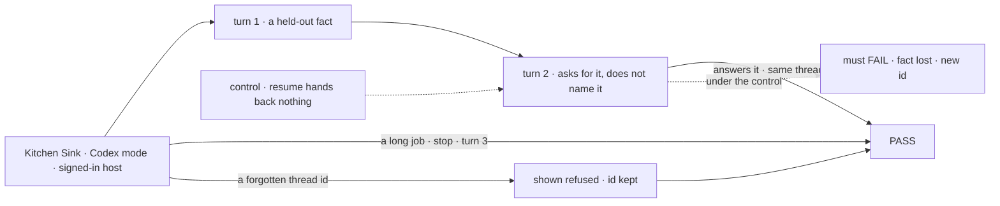
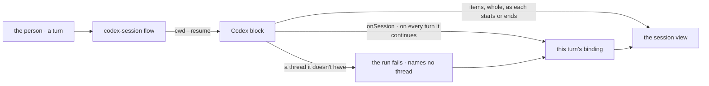

# FIX-1916 · Codex mode in Kitchen Sink, with Codex's to-do list written to the shared plan record

**Spec** · [Decisions](DECISIONS.md) · [Rules](BUSINESS-RULES.md) · [Plan](PLAN.md) · [Docs](DOCS.md) · [Evolution](EVOLUTION.md)

## Who feels this, before and after

| Someone who… | Today | After |
|---|---|---|
| **builds on the Codex harness** | Has one goal script, run from a terminal, whose verdict log reads *not yet run* on a real model | Picks **Codex** in Kitchen Sink and works a session: turn 2 continues turn 1's Codex thread, and each step shows as Codex takes it |
| **stops a Codex run halfway** | Has no app that shows what a stop leaves | Sees the turn stopped; the next turn continues the thread |
| **comes back to a thread Codex no longer has** | Nothing to come back to | Sees which thread Codex refused, on every turn. Nothing starts a new thread in its place |
| **wants to know what a Codex run planned** | Finds nothing: no record exists | Reads "Codex reports no plan": at the version we pin, Codex makes no to-do list ([the open question](DECISIONS.md#open)) |
| **maintains the shared harness contract** | Can't tell whether FIX-1915's session flow is really shared | Sees Codex plug in with its block's options and one availability check (epic ER-6) |

FIX-1915 builds the session flow, the workspace and the plan panel ([epic FIX-1907](../../epics/FIX-1907/SPEC.md));
Codex is the second harness through them. Research found one difference the issue didn't
expect: **at the pinned version, Codex has no to-do list to write.**

## The goal, and how we'll know it's met

**A person picks Codex in Kitchen Sink and works a session as they would use Codex directly:
each turn continues the same Codex thread, a stop leaves it continuable, a thread Codex refuses
shows as refused, each step shows as Codex takes it, and the plan panel says truthfully what
Codex reports.**

| Is it the right goal? | |
|---|---|
| **The real need** | [The epic's goal](../../epics/FIX-1907/SPEC.md#the-goal-and-how-well-know-its-met) for Codex: on the real path, beside the other harnesses, where a gap shows |
| **Smaller, and rejected** | "Codex answers a prompt in Kitchen Sink." One turn passes it while continuity, stop and refusal go untested |
| **Smaller, and recommended** | The issue also promised **Codex's to-do list in the panel**. Codex makes none at the pinned version, so the panel says so. Shipping at that size is [the open question](DECISIONS.md#open) |
| **Not done if** | It passes only on a scripted Codex · turn 2 answered from re-sent text · a refused thread was replaced · the panel is blank or says "no plan recorded for this turn" · FIX-1915's shared parts grew a Codex branch · Kitchen Sink wrote an item or plan row |



With `resume` cut, turn 2 must fail, which is what makes its pass mean the thread carried.

| How we verify | |
|---|---|
| **Goal check** | `goals/kitchen-sink-harness/codex-continues-its-thread/` · real Codex on a signed-in host, in a real browser · run as FIX-1915's check is · verdict in the implementation PR |
| **Signal** | **c** turn 2 names turn 1's token, same recorded id · **l** a command shows before the turn completes · **s** after a stop, turn 3 names the token, same id · **x** a thread Codex no longer has shows *refused* with its id, and the next turn asks for it again · **r** after a reload, the same · **p** the panel says "Codex reports no plan" |
| **Input** | A fresh random token per run; a job that runs a shell command, long enough to stop. Any other must pass. Durable store |
| **Anti-game** | Assert on the page and the id in session state. Never on the scripted client, or a prompt Kitchen Sink rebuilt |
| **Control that must fail** | `GOAL_CONTROL=no-resume`: **c** and **s** FAIL. FIX-1914's `GOAL_CONTROL=gate-open`: *no session created* and *no harness flow served* FAIL for Codex. Today's `main`: every leg FAILS |

## What changes


The middle column is all this issue builds. The rest is FIX-1915's or FIX-1914's, and the Codex package doesn't change.

**What Codex mode writes** (illustrative; the names are the implementer's):

```diff
+ export const codexSession = harnessSessionFlow({
+   kind: "codex-session",
+   agent: (shared) => codexAgent({
+     ...shared,                                       // cwd, resume, onSession
+     thread: { sandboxMode: "workspace-write", approvalPolicy: "never" },
+     client: { env: harnessEnv({ pass: [/* PATH, HOME, Codex's key */] }) },
+   }),
+ });
```

Codex works in the session's working directory as FIX-1915 defines it
([Decided, not asked](DECISIONS.md#decided-not-asked)). No plan collection: a harness that declares no plan record is what the panel
reads as "reports no plan" (FIX-1915 BR-16).

## How a Codex turn runs



Codex re-names the thread on every turn it continues and names nothing when it refuses, which
is exactly FIX-1915's per-turn binding. Codex needs no binding code.

## What stays as it is

- The Codex package and its contract (epic ER-13), and its LAB-153 goal script.
- FIX-1915's session flow, binding, workspace, view and panel; FIX-1914's picker and gate.
- The plan record in core. Codex writes nothing to it.

## Sign off

**[The goal](#the-goal-and-how-well-know-its-met), at that size:** continuity, stop, refusal
and live steps on real Codex, and a panel that says Codex reports no plan. If wrong: the mode
passes one turn while continuity breaks, or we ship a panel that is empty where a list belonged.

**Open: 1.** [Codex reports no to-do list at the version we pin. Ship the mode saying so, or
hold out for a list?](DECISIONS.md#open) Recommendation: ship it saying so; write the list in a
follow-up when a pinned Codex offers its plan tool. The one to weigh: it narrows the issue's
promise and amends the epic's D3. If wrong: Codex's plan stays out of the panel for a while.

No other call needed a sign-off ([Decided, not asked](DECISIONS.md#decided-not-asked)). The
cases: [BUSINESS-RULES.md](BUSINESS-RULES.md).

Feature · `kitchen-sink` only · small (4 surfaces, 6 checks, 3 doc surfaces) · 1 PR, after
FIX-1915's PR-B · epic [FIX-1907](../../epics/FIX-1907/SPEC.md) · POC: [codex-wire](poc/codex-wire/)
