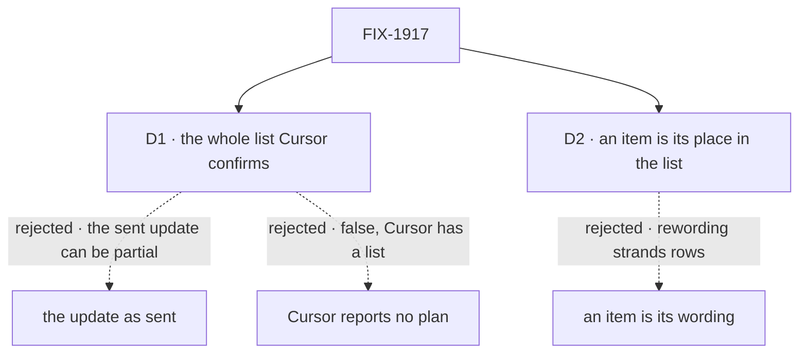

# FIX-1917 · Decisions

[Spec](SPEC.md) · **Decisions** · [Rules](BUSINESS-RULES.md) · [Plan](PLAN.md) · [Docs](DOCS.md) · [Evolution](EVOLUTION.md)

What was chosen, what lost, and what each locks in. The epic decided the route (every harness
through the shared contract, plan sync one-way and read-only, one shape in core:
[FIX-1907 D2, D3](../../epics/FIX-1907/DECISIONS.md#d2)). FIX-1915 decided the shared parts: each
session's own git worktree and branch of the repository `KITCHEN_SINK_HARNESS_WORKSPACE` names
(here `kitchen-sink/cursor-session/<session>`, under a derived root outside the checkout, as
FIX-1915 defines it, provisioned through `@flow-state-dev/workspace`), a refused continuation
shown and never replaced, the plan shape public in core, and one whole-list writer in core,
`replacePlanList`, with its `observed-plan-list` marker ([FIX-1915 → Shared with other
specs](../FIX-1915/DECISIONS.md)). This spec consumes all of it. The two calls left are about Cursor's plan.

## The tree

Solid edges are what you sign. Dashed edges lost, and the label says why.

## D1 · Cursor mode shows the whole to-do list Cursor confirms after each update, and never says Cursor reports no plan

| | |
|---|---|
| **Instead of** | Recording each update as Cursor sends it · or treating Cursor as a harness that reports no plan, the fallback the issue allowed |
| **Because** | Cursor has a to-do list, so "reports none" would be false. The update it sends can change only part of the list, and the SDK drops the item ids that would say which part. The call's result carries the whole list after the update. Only that list can make the panel equal Cursor's own ([POC](poc/sdk-wire/README.md) F1, F1b, F1c) |
| **Locks in** | Four of the panel's five states in Cursor mode: rows, "this turn's plan is empty", "no plan recorded for this turn", and rows marked "may be incomplete" when a write fails partway (FIX-1915 BR-22c, BR-22d). Never "Cursor reports no plan" while recording is on. A row appears when Cursor confirms the update, not when it sends it. An update Cursor rejects changes nothing |

It comes down to a partial update: without ids, only the confirmed list is right.

**What would change my mind:** real runs showing Cursor never updates its list in agent mode.
The panel would still be right, but bare. Then file it as a finding against Cursor, as FIX-1185
is for Claude Code, and keep the record.

## D2 · A Cursor to-do item is known by its place in Cursor's list, because Cursor's SDK drops the id

| | |
|---|---|
| **Instead of** | Knowing an item by its wording · or waiting for Cursor to pass its ids before recording anything |
| **Because** | Cursor's runtime gives every item an id, and the SDK at the version we pin removes it ([POC](poc/sdk-wire/README.md) F1, F1b). Wording breaks when Cursor rewords an item, which is common as a plan firms up: a new row starts and the old one is left behind. Two items with the same wording would become one row. Place breaks only on a reorder or an insert, which a to-do list rarely does |
| **Locks in** | Cursor's list goes through core's `replacePlanList`, which keys rows by place: reworded in place, a row keeps its place and clears its previous status; a list that shrinks drops its rows past the end (FIX-1915 BR-22a). A reader cannot follow one Cursor item through a reorder |

It comes down to rewording: by wording, every reworded item strands a row.

**What would change my mind:** Cursor's SDK passing the id it already has. Then key by that id,
in the package release that pins the new SDK. Rows from earlier runs keep their place keys.

## Decided, not asked

- **Recording is opt-in on the Cursor block, off by default**, like Claude Code's `recordWork`.
  Off, the block declares no session state, which task boards rely on
  ([the Cursor page](../../../apps/docs/docs/tools/cursor.md#continuing-an-agent)).
- **The Cursor package turns Cursor's result into items and calls core's `replacePlanList`**,
  never Kitchen Sink (epic ER-11). It keeps no writer of its own.
- **The to-do step stays in the stream.** The record is in addition, so the goal check can
  compare the two.
- **Statuses are Cursor's own words**, and an unknown word records as itself. `lastOutcome` is
  always `applied`: only confirmed lists are written.
- **Summaries (`task` messages) stay status notes, and plan mode's document is not recorded.**
  Neither is a to-do list, and Kitchen Sink runs `mode: "agent"`.
- **Kitchen Sink's Cursor options**: `composer-2.5` (the coding-skill lab's default), agent mode,
  the sandbox on, recording on. No model setting until someone needs a second model.
- **Cursor's sandbox fences writes to the session's worktree only**: not the main checkout,
  another session's worktree, or the repository's `.git` (FIX-1915 BR-13, BR-13b). The run edits
  files and leaves them uncommitted. A sandbox that can't hold that fence makes the mode unavailable.
- **The run's environment is filtered by the Cursor package** (FIX-1915 BR-13b, BR-23 here), not
  bounded: the child runs as the server's user (amended Oct 13, below). The
  block gains `env`, the allowlisted environment the runtime sees; set, the package runs Cursor's
  local runtime in a child process whose environment is exactly that. It is the only lever: every
  local shell Cursor's SDK spawns copies the process's environment, its sandbox changes only file
  and network access, and the SDK has no environment option ([Evolution](EVOLUTION.md)). Kitchen
  Sink only passes FIX-1915 BR-13b's allowlist through `env` (epic ER-11). A host where the child
  process can't start shows the mode unavailable with the reason.
- **Sign-in is probed** (epic ER-1), as FIX-1915 does: the pinned SDK is installed, and a Cursor
  key is in the environment or the SDK reports a stored login. No run is started. A rejected key
  fails that turn with Cursor's own error.
- **The Cursor flow is registered only when the mode is available**, decided once per server
  start through FIX-1914's per-mode check, and gets each session's worktree through FIX-1915's
  factory, the one every harness mode uses.
- **The turn's notice is FIX-1915's.** Cursor confirms the agent when it opens it, before the
  prompt, so only a resume the Cursor package classifies as an unknown agent (FIX-1915 S13)
  reads as refused; any other failure before that is an error. Stop is the block's own abort and reads as
  stopped; a command Cursor started can outlive it, and the README says so.

## Considered and dropped

| Alternative | Why not |
|---|---|
| Write Cursor's rows from Kitchen Sink, reading the to-do steps | Epic ER-11: a gap fixed in the app is a gap every other host keeps |
| Spawn Cursor's runtime in a child process from Kitchen Sink | Same: every other host would keep the leak, and Kitchen Sink would hold Cursor-only code beyond the block's options |
| Turn recording on by default | Adds a session collection to every Cursor host, including task boards that rely on there being none |
| A place-keyed writer of Cursor's own | FIX-1915 put one in core, `replacePlanList`, for every whole-list harness (Codex too), with the marker that tells an empty list from none and a half-written one from the plan. A copy here would be a second writer of the same record |
| Record Cursor's summaries as the plan | A summary describes the past. The panel shows what the run planned |
| Probe the key by starting a run | Costs a run per server start. The SDK's login status and the environment answer the same question for free |

## What already does these jobs

The job is *record a coding run's own to-do list*. Searched `packages/` for `observed-plan`,
`OBSERVED_PLAN`, `todo` and `updateTodos`. One writer exists today: Claude Code's work recorder,
keyed by the harness's own item ids. Cursor hands over a whole list with no ids, a different
input, which FIX-1915's `replacePlanList` takes. The Cursor package adds only the translation.

## What the POC showed

[`poc/sdk-wire/`](poc/sdk-wire/README.md) checks seven facts against the pinned SDK's shipped code;
all pass and a planted wrong fact fails. It moved the design twice: from "does Cursor report a
plan?" to D1, and from "key by item id" to D2.

## Settled

- **Cursor's SDK reports a to-do list, as `updateTodos`, with the whole list on the result and no
  item ids.** Read off `@cursor/sdk` 1.0.31's code by the POC. Re-run it on every SDK pin bump.
  Whether a real run calls it on a given job is the goal check's **p** leg, not a premise.

## How it got here

- **Draft** — framed as Cursor on FIX-1915's session flow plus Cursor's plan; the POC found Cursor
  does report a to-do list, partial on the way in and whole on the way back, without ids; so the
  record takes the confirmed list, keyed by place, written by the Cursor package behind an opt-in
  option; two PRs.
- **Review round 1** — aligned with FIX-1915: the write is core's `replacePlanList` and its list
  marker, not a Cursor writer, so an empty list and a half-written one each read as what they are;
  each session gets FIX-1915's worktree and branch; the off conditions follow FIX-1914's amended
  gate; one empty-state string; the changeset is a patch.
- **Amended after merge (Oct 12, cross-spec check)**: the option is `recordPlan`; checks match on
  "reports no plan"; the run's environment is fenced through a child process (BR-23), under the
  fence FIX-1915 owns (BR-13b). BR-3 reads a refusal only from the package's unknown-conversation
  classification (S8).
- **Amended again (Codex review of the cross-spec PR)**: the environment fence moved from Kitchen
  Sink into the Cursor package, as the block's `env` option (PLAN S9, in PR-A); the changeset
  becomes a minor.
- **Amended after merge (Oct 13, owner decision)**: `env` filters what commands start with; it is
  not a security boundary (FIX-1915 BR-13b). The child process runs as the server's user, and on
  Linux a command can read the server's environment through `/proc/<pid>/environ`. A separate user
  or container is a follow-up issue. BR-23, V8 and the docs text now claim only that.

**Open: none.**
