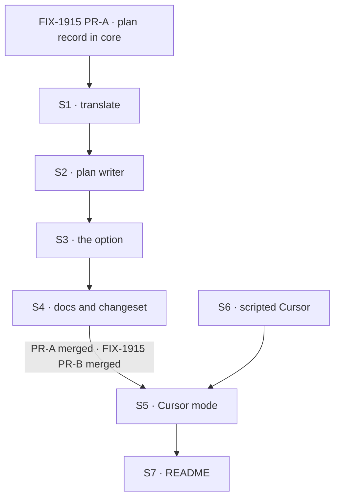

# FIX-1917 · Plan

[Spec](SPEC.md) · [Decisions](DECISIONS.md) · [Rules](BUSINESS-RULES.md) · **Plan** · [Docs](DOCS.md) · [Evolution](EVOLUTION.md)

Written for the implementing agent. IDs cross-reference [BUSINESS-RULES.md](BUSINESS-RULES.md)
(BR-n), [DECISIONS.md](DECISIONS.md) (D-n), FIX-1915's plan (1915/S-n, 1915/V-n) and the epic's
rules (ER-n). `tdd`. Two PRs; the seam is the Cursor package, which needs no picker and no
session flow.

## Surfaces

| ID | Package · role | Change | Rules |
|---|---|---|---|
| S1 | `cursor` · `translate` | A settled `updateTodos` call with a success result also yields a plan-list event carrying the result's list. The `tool_output` step is unchanged. A running call, an error result, or a result that isn't a list yields nothing extra. The args are never read for the plan | BR-8 to BR-11 BR-20 |
| S2 | `cursor` · a plan writer, new | Given a run namespace and core's plan collection: on each plan-list event, upsert one row per place (wording, Cursor's status word, previous status per D2, `lastOutcome: "applied"`), and delete rows past the list's end. Exact-key reads only, never a prefix list (the collection is lazy). A failed write becomes a status note | BR-8 BR-12 to BR-15 BR-17 BR-18 |
| S3 | `cursor` · `agent` | An opt-in option (illustratively `recordPlan`) that declares core's `observedPlanCollection` (1915/S1) on the block and opens S2 per invocation, under a namespace per invocation the way Claude Code's recorder does. Off: no resources, no writer | BR-18 BR-19 D1 |
| S4 | `cursor` docs and release note | Per [DOCS.md](DOCS.md): the Cursor page and the Cursor README. Changeset: `cursor` minor | — |
| S5 | `kitchen-sink` · Cursor mode | 1915/S5's factory with kind `cursor-session` and `cursorAgent`: the option from S3 on, `composer-2.5`, `mode: "agent"`, the sandbox on. Its own check in FIX-1914's mode-check slot: the pinned SDK, and a Cursor key in the environment or a stored Cursor login (the SDK's login status, no run). Registered in `fsdev.config.ts` only when the mode is available, decided once per server start. The package and the SDK added as dependencies | BR-1 to BR-7 BR-21 BR-22 ER-6 |
| S6 | `kitchen-sink` · a scripted Cursor for test mode | Behind the app's test mode, through the block's `resolveCursorClient` seam: opens an agent, emits steps with a pause, sends `updateTodos` with a partial update and a whole-list result, fails one update, refuses a named agent id | All CI rows |
| S7 | `kitchen-sink` README | Per [DOCS.md](DOCS.md) | — |

FIX-1915's session view and panel are used as they are; a change Cursor needs there is raised to
the epic (ER-15).

## Sequence



### The PR plan

| PR | Surfaces | depends_on | Why it stands alone |
|---|---|---|---|
| PR-A | S1 S2 S3 S4 | FIX-1915 PR-A | The Cursor package can record its plan for any host. It needs core's shape, not the picker or the session flow, so it can merge while those are in flight |
| PR-B | S5 S6 S7 · the goal check | PR-A · FIX-1915 PR-B (which needs FIX-1914) | The mode. A flow kind and options on FIX-1915's flow |

## Checks

| ID | PR | Passes when | Red state |
|---|---|---|---|
| V1 | A | Translate, with fixtures shaped from the [POC](poc/sdk-wire/README.md)'s facts: a settled success yields the result's list; running, error and a missing result yield nothing extra; the step is still emitted (BR-8 to BR-11) | Read the args: the partial-update fixture records two rows where Cursor's list has four |
| V2 | A | Writer over an in-memory collection: BR-12 to BR-15, BR-17. A sequence of lists ends with the record equal to the last one | Key by wording: the reworded fixture leaves a stranded row (D2) |
| V3 | A | Block with a scripted client: option off declares no resources and writes nothing (BR-19); on, two invocations in one request keep separate rows (BR-18); a write that rejects becomes a status note and the run finishes | Turn the option on by default |
| V4 | A | A Cursor row parses with core's `observedPlanItemStateSchema` and reaches a subscribed client live (reuses 1915/V4's harness) | Write a field the shape lacks |
| V5 | B | Resolvers with the scripted Cursor: BR-1 to BR-3a. A refused resume leaves the id and the next turn asks for it again; a resume that succeeds and then fails reads as an error, not a refusal | Clear the id on a refused resume · read the notice from session-wide fields: BR-3a reads as refused |
| V6 | B | Browser, scripted: a step shows before the turn completes; stop shows stopped, leaves the id, and the next turn continues; the panel shows the partial-update fixture's whole list, then "no plan recorded for this turn" on a later turn without one (BR-5, BR-6, BR-9, BR-16) | Register the Cursor flow with the option off: the panel says "reports no plan" |
| V7 | B | Availability: each named reason disables the mode, sign-in included, and an unavailable mode registers no flow (BR-22) | Report a host with no key and no stored login as available |
| VH | B | FIX-1914's goal check (`goals/kitchen-sink-harness-mode/opens-on-the-picker/`), with FIX-1915's two legs added for `/cursor`: with harness modes off, opening it creates **no session**, and **no harness flow is served** (`/api/flows/cursor-session/…` not found) (BR-21) | `GOAL_CONTROL=gate-open`: both legs FAIL |
| VG | B | [The goal](SPEC.md#the-goal-and-how-well-know-its-met): `goals/kitchen-sink-harness/cursor-continues-its-agent/run.mts` PASSES on real Cursor after FAILING under `GOAL_CONTROL=no-resume` (**c**, **s**) and `GOAL_CONTROL=no-record` (**p**) | The controls are the red state |

The second path (BP-035) here is the resumed turn, the stopped turn, the reload, and the update
that was partial or failed. A check that covers only a first turn with a whole list proves none.

## Pinned names

| Where | Name | Why pinned |
|---|---|---|
| Flow kind | `cursor-session` | FIX-1915 pins it for FIX-1914's rail |
| Host setting | `KITCHEN_SINK_HARNESS_WORKSPACE` | FIX-1914's, the one setting every harness mode is gated on. Never add a Cursor-only setting |
| Goal controls | `GOAL_CONTROL=no-resume`, `GOAL_CONTROL=no-record`; FIX-1914's `gate-open` for VH | The same names as FIX-1915's; the closure runs them |
| Record key | `observed-plan` | 1915/S1's |
| Status words | Cursor's own, unchanged | A reader matches on them as text |

The opt-in option's name is aligned with Codex's (FIX-1916) in the cross-spec pass. Everything
else is yours to name.

## Guardrails

| Rule | Because |
|---|---|
| The plan writer lives in the Cursor package; Kitchen Sink writes no row and no item | ER-11. A gap fixed in the app is a gap every other host keeps |
| Write only what Cursor confirmed: the result's list, never the args | D1. The args can be partial, and without ids nothing can place them |
| Nothing Cursor-specific in Kitchen Sink beyond S5's options and its availability check | ER-6. A branch on harness kind in the shared flow is a gap in a package |
| Read and write the record through core's definition only | Tenet 5. One shape, one definition; FIX-1915 removed the copies |
| Option off means today's block, exactly | BP-035's off state. Task boards rely on a block with no session state |
| Never list the plan collection by prefix inside a run | The collection is lazy; a prefix read loads every earlier run's rows |

## Docs

Publish [DOCS.md](DOCS.md)'s Cursor page and README sections with PR-A, after V1 to V4. Publish
the Kitchen Sink section with PR-B, after VG. Reconcile each against shipped behaviour first.

## Sketch · pseudocode, illustrative, react to the shape

```
translate(message):
    ...as today, the tool step...
    if message is tool_call "updateTodos", settled, result.status == success:
        also yield plan-list(result.value.todos)          # never message.args

plan writer(namespace, plan collection):
    on plan-list(todos):
        for place, todo in todos:
            key  = namespace / place
            row  = read(key)
            same = row and row.title == todo.content
            upsert(key, title = todo.content, status = todo.status,
                        previousStatus = same and row.status != todo.status ? row.status
                                       : same ? row.previousStatus : null,
                        lastOutcome = applied)
        delete namespace / place for place >= len(todos) that were written before
```

**POC:** [`poc/sdk-wire/`](poc/sdk-wire/README.md). Showed: Cursor reports a to-do list as
`updateTodos`; the args can be partial and carry no ids; the result carries the whole list; `task`
messages are summaries. Premise held for the record, and moved the keying (D2).

## At implement time

- Re-run the POC; if the SDK pin moved, its facts are what V1's fixtures are built from.
- Read FIX-1915's merged code for the factory, its writers' namespace and how the panel reads a
  declared record. This plan assumes Cursor plugs in with options only.
- Check that Cursor's sandbox fails closed when it can't start, and what environment Cursor's
  commands see (the block has no `env` option, unlike Claude Code's). Either gap is filed against
  the Cursor package (ER-15); an unenforced sandbox makes the mode unavailable until fixed.
- Record whether Cursor called `updateTodos` on the goal check's job. Never → file it (D1's flip).

## Follow-ups

- **Raised to the epic (ER-15):** Codex's to-do list also arrives without ids, so FIX-1916 should
  key by place the same way; a shared helper in core may earn its place once both exist.
- Ask Cursor to keep the to-do item id in its SDK's `updateTodos` messages. When it does, D2 flips.
- The POC could graduate into a check that runs when the Cursor SDK pin is bumped.
