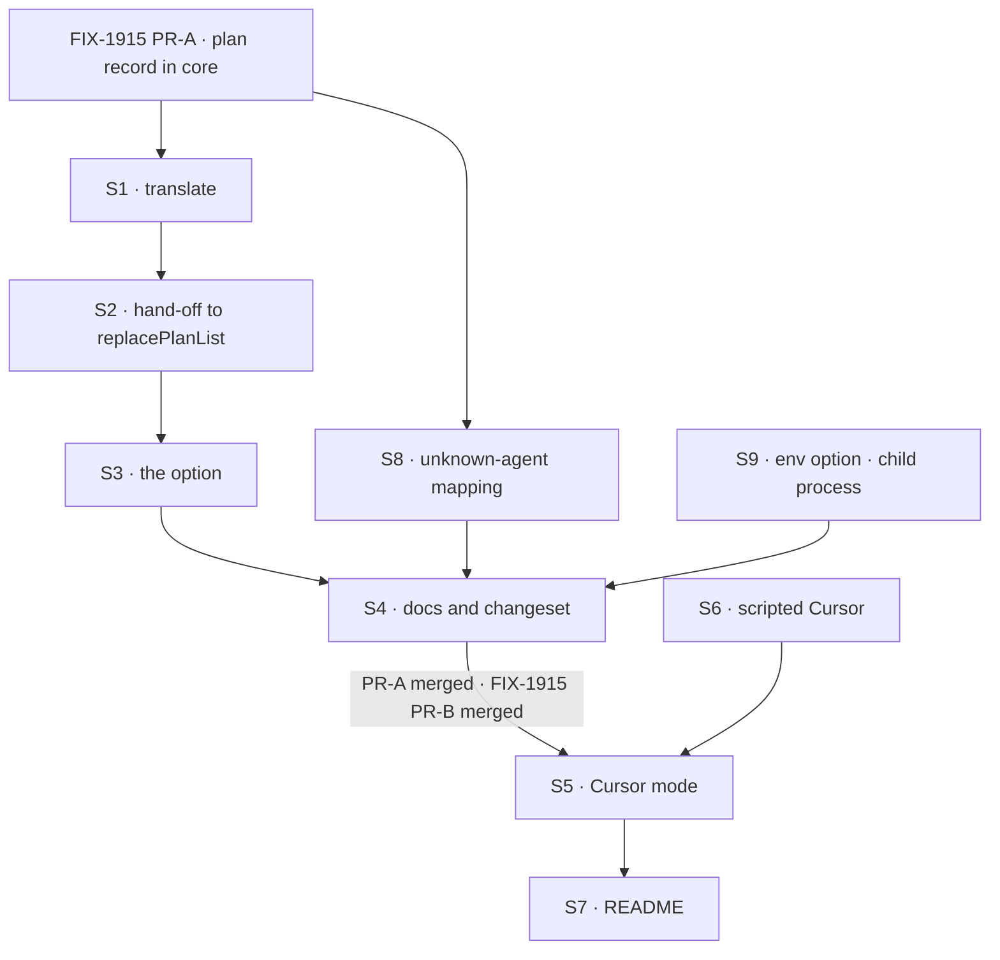

# FIX-1917 · Plan

[Spec](SPEC.md) · [Decisions](DECISIONS.md) · [Rules](BUSINESS-RULES.md) · **Plan** · [Docs](DOCS.md) · [Evolution](EVOLUTION.md)

Written for the implementing agent. IDs cross-reference [BUSINESS-RULES.md](BUSINESS-RULES.md)
(BR-n), [DECISIONS.md](DECISIONS.md) (D-n), FIX-1915's plan (1915/S-n, 1915/V-n) and the epic's
rules (ER-n). `tdd`. Two PRs; the seam is the Cursor package, which needs no picker and no
session flow. Every Cursor-specific mechanism, the environment fence included, is in that package.

## Surfaces

| ID | Package · role | Change | Rules |
|---|---|---|---|
| S1 | `cursor` · `translate` | A settled `updateTodos` call with a success result also yields a plan-list event carrying the result's list. The `tool_output` step is unchanged. A running call, an error result, or a result that isn't a list yields nothing extra. The args are never read for the plan | BR-8 to BR-11 BR-20 |
| S2 | `cursor` · the plan-list hand-off, new | On each plan-list event, translate the result's todos into core's items (wording, Cursor's status word as itself) and call core's `replacePlanList(collection, marker, namespace, items)` (1915/S1), an empty list included. The helper owns the rows, previous status, the trim and the `observed-plan-list` marker: *writing*, then *complete*, or *incomplete* with the error (FIX-1915 BR-22a to BR-22d). No row logic here | BR-8 BR-12 to BR-15b BR-17 BR-18 |
| S3 | `cursor` · `agent` | An opt-in option, `recordPlan`, that declares core's `observedPlanCollection` and the list marker (1915/S1) on the block and runs S2 per invocation, under a run namespace per invocation the way Claude Code's recorder does (one writer per namespace, BR-22b). Off: no resources, no writer | BR-18 BR-19 D1 |
| S4 | `cursor` docs and release note | Per [DOCS.md](DOCS.md): the Cursor page and the Cursor README. Changeset: `cursor` minor (new options `recordPlan` and `env`, both additive and opt-in, pre-1.0) | — |
| S5 | `kitchen-sink` · Cursor mode | 1915/S5's factory with kind `cursor-session` and `cursorAgent`: the option from S3 on, `composer-2.5`, `mode: "agent"`, the sandbox on and fenced to the session's worktree, not `.git`. `env` from S9 set to FIX-1915 BR-13b's allowlist, passed through and nothing more (BR-23). Each session's worktree and branch (`kitchen-sink/cursor-session/<session>`) come from the factory, through `@flow-state-dev/workspace`. Its own check in FIX-1914's mode-check slot: the pinned SDK, and a Cursor key in the environment or a stored Cursor login (the SDK's login status, no run). Registered in `fsdev.config.ts` only when the mode is available, decided once per server start. The package and the SDK added as dependencies | BR-1 to BR-7 BR-21 BR-22 ER-6 |
| S6 | `kitchen-sink` · a scripted Cursor for test mode | Behind the app's test mode, through the block's `resolveCursorClient` seam: opens an agent, emits steps with a pause, sends `updateTodos` with a partial update and a whole-list result, fails one update, refuses a named agent id | All CI rows |
| S7 | `kitchen-sink` README | Per [DOCS.md](DOCS.md) | — |
| S8 | `cursor` · the unknown-agent mapping | The error a refused resume throws sets core's unknown-conversation classification (FIX-1915 S13); measure Cursor's message at implement time against the pinned SDK. No other error does | BR-3 |
| S9 | `cursor` · `agent` · the environment fence, new | An opt-in option, `env`: the allowlisted environment the runtime sees. Set, the package runs Cursor's local runtime in a child process whose environment is exactly `env`, nothing inherited from the server's process. Unset: today's in-process runtime, exactly. A child process that can't start fails the run with that reason, never falls back to in-process | BR-23 |

FIX-1915's session view and panel are used as they are; a change Cursor needs there is raised to
the epic (ER-15).

## Sequence



### The PR plan

| PR | Surfaces | depends_on | Why it stands alone |
|---|---|---|---|
| PR-A | S1 S2 S3 S4 S8 S9 · V8 | FIX-1915 PR-A | The Cursor package can record its plan and fence its runtime's environment for any host. It needs core's shape and `replacePlanList`, not the picker or the session flow, so it can merge while those are in flight |
| PR-B | S5 S6 S7 · the goal check | PR-A · FIX-1915 PR-B (which needs FIX-1914) | The mode. A flow kind and options on FIX-1915's flow |

## Checks

| ID | PR | Passes when | Red state |
|---|---|---|---|
| V1 | A | Translate, with fixtures shaped from the [POC](poc/sdk-wire/README.md)'s facts: a settled success yields the result's list; running, error and a missing result yield nothing extra; the step is still emitted (BR-8 to BR-11) | Read the args: the partial-update fixture records two rows where Cursor's list has four |
| V2 | A | Hand-off over an in-memory collection: a sequence of Cursor results ends with the record equal to the last list, the same-wording pair as two rows, an unknown status as itself (BR-15, BR-17); a confirmed empty list still calls `replacePlanList`, so the marker is *complete* with no places (BR-15a). The helper's own cases are FIX-1915's V10 to V12, not repeated here | Skip the call on an empty list: it reads as "no plan recorded for this turn" |
| V3 | A | Block with a scripted client: option off declares no resources and writes nothing (BR-19); on, two invocations in one request keep separate rows and markers (BR-18); with 1915/V12's collection that fails on its second write, the marker ends *incomplete* and the run finishes (BR-15b) | Turn the option on by default |
| V4 | A | A Cursor row parses with core's `observedPlanItemStateSchema` and reaches a subscribed client live (reuses 1915/V4's harness) | Write a field the shape lacks |
| V5 | B | Resolvers with the scripted Cursor: BR-1 to BR-3a. A resume classified as an unknown agent leaves the id and the next turn asks for it again; a resume that succeeds and then fails, and an early failure without the classification, read as errors, not refusals | Clear the id on a refused resume · read the notice from session-wide fields: BR-3a reads as refused · read every early failure as refused |
| V6 | B | Browser, scripted: a step shows before the turn completes; stop shows stopped, leaves the id, and the next turn continues; the panel shows the partial-update fixture's whole list, then "no plan recorded for this turn" on a later turn without one (BR-5, BR-6, BR-9, BR-16) | Register the Cursor flow with the option off: the panel says "Cursor reports no plan" |
| V7 | B | Availability: each named reason disables the mode, sign-in included, and an unavailable mode registers no flow (BR-22) | Report a host with no key and no stored login as available |
| V8 | A | A canary variable planted in the server's process is not in the environment of a command in a real Cursor run with the block's `env` set, and a control run with `env` unset sees it (BR-23). The first implementation step of S9; CI covers that `env` set spawns the child with exactly that environment | Ignore `env` and start the runtime in the server's own process: the canary shows |
| VH | B | FIX-1914's goal check (`goals/kitchen-sink-harness-mode/opens-on-the-picker/`), whose loop over every harness mode (FIX-1915 VH) covers `/cursor` with no edit here: with harness modes off, opening it creates **no session**, and **no harness flow is served** (`/api/flows/cursor-session/…` not found) (BR-21) | `GOAL_CONTROL=gate-open`: both legs FAIL |
| VG | B | [The goal](SPEC.md#the-goal-and-how-well-know-its-met): `goals/kitchen-sink-harness/cursor-continues-its-agent/run.mts` PASSES on real Cursor after FAILING under `GOAL_CONTROL=no-resume` (**c**, **s**) and `GOAL_CONTROL=no-record` (**p**) | The controls are the red state |

The second path (BP-035) here is the resumed turn, the stopped turn, the reload, and the update
that was partial or failed. A check that covers only a first turn with a whole list proves none.

## Pinned names

| Where | Name | Why pinned |
|---|---|---|
| Flow kind | `cursor-session` | FIX-1915 pins it for FIX-1914's rail |
| Host setting | `KITCHEN_SINK_HARNESS_WORKSPACE` | FIX-1914's, the one setting every harness mode is gated on. Never add a Cursor-only setting |
| Goal controls | `GOAL_CONTROL=no-resume`, `GOAL_CONTROL=no-record`; FIX-1914's `gate-open` for VH | The same names as FIX-1915's; the closure runs them |
| Record keys | `observed-plan`, `observed-plan-list` | 1915/S1's |
| Plan writer | core's `replacePlanList(collection, marker, namespace, items)` | 1915/S1's, the one writer for whole-list harnesses |
| Session branch | `kitchen-sink/cursor-session/<session>` | FIX-1915's `kitchen-sink/<flow kind>/<session>` |
| Status words | Cursor's own, unchanged | A reader matches on them as text |
| Opt-in option | `recordPlan` | Settled in the cross-spec check; the docs and Kitchen Sink name it |
| Environment option | `env` | The fence's seam (BR-23); Kitchen Sink passes FIX-1915 BR-13b's allowlist through it |

Everything else is yours to name.

## Guardrails

| Rule | Because |
|---|---|
| The translation lives in the Cursor package and the write is core's `replacePlanList`; Kitchen Sink writes no row, no item and no marker | ER-11. A gap fixed in the app is a gap every other host keeps. A second writer of the record is a copy FIX-1915 removed |
| Write only what Cursor confirmed: the result's list, never the args | D1. The args can be partial, and without ids nothing can place them |
| Nothing Cursor-specific in Kitchen Sink beyond S5's options and its availability check; the environment fence is S9's, in the package | ER-6, ER-11. A branch on harness kind in the shared flow is a gap in a package |
| Read and write the record through core's definition only | Tenet 5. One shape, one definition; FIX-1915 removed the copies |
| Option off means today's block, exactly | BP-035's off state. Task boards rely on a block with no session state |
| Never list the plan collection by prefix inside a run | The collection is lazy; a prefix read loads every earlier run's rows |

## Docs

Publish [DOCS.md](DOCS.md)'s Cursor page and README sections with PR-A, after V1 to V4. Publish
the Kitchen Sink section with PR-B, after VG. Reconcile each against shipped behaviour first.

## Sketch · pseudocode, illustrative, react to the shape

```
translate(message):
    ...as today, the tool step...
    if message is tool_call "updateTodos", settled, result.status == success:
        also yield plan-list(result.value.todos)          # never message.args

on plan-list(todos):                                      # per invocation, recordPlan on
    items = todos.map(t => { title: t.content, status: t.status })
    replacePlanList(planCollection, listMarker, runNamespace, items)   # core · 1915/S1
    # rows by place, previousStatus, trim, marker writing → complete | incomplete:
    # all core's (FIX-1915 BR-22a to BR-22d, V10 to V12). An empty list is still a call.
```

**POC:** [`poc/sdk-wire/`](poc/sdk-wire/README.md). Showed: Cursor reports a to-do list as
`updateTodos`; the args can be partial and carry no ids; the result carries the whole list; `task`
messages are summaries. Premise held for the record, and moved the keying (D2).

## At implement time

- Re-run the POC; if the SDK pin moved, its facts are what V1's fixtures are built from.
- Read FIX-1915's merged code for the factory, its writers' namespace and how the panel reads a
  declared record. This plan assumes Cursor plugs in with options only.
- **S9 starts with the real-run canary (V8).** With the block's `env` set, the package runs
  Cursor's local runtime in a child process whose environment is that allowlist; plant a variable
  in the server and show a real run can't see it while a control run with `env` unset can. The SDK
  copies its process's environment into every shell it spawns ([Evolution](EVOLUTION.md)); the
  child process is the only lever.
- Check that Cursor's sandbox fails closed when it can't start, and that it can fence writes to
  the session's worktree only, not `.git` (FIX-1915 BR-13, BR-13b). Each gap is filed against the
  Cursor package (ER-15); a sandbox that can't hold the fence makes the mode unavailable until fixed.
- Record whether Cursor called `updateTodos` on the goal check's job. Never → file it (D1's flip).

## Notes from review

Recorded for the implementer, not baked into the design. Quoted verbatim; elisions marked.

- **cursor[bot], PLAN sketch (the per-place loop, now core's `replacePlanList`):** "This loop does
  `read` + `upsert` per place on every settled list. If Cursor emits many `updateTodos` updates per
  run, consider the same **buffer / flush** model as Claude's `work-recorder` rather than hitting
  the lazy collection on every settlement. Also keep **per-run max-place** (or equivalent) so tail
  deletes don't require a prefix `list()`." The max-place half is the helper's remembered count
  (FIX-1915 BR-22b). Whether to coalesce settled updates before calling it is the implementer's
  call; measure on the goal check's job first.
- **cursor[bot], review summary, POC maintenance:** "if this graduates to a pin-bump gate, prefer
  `--sdk` against the workspace install and/or a single translate chunk, not `npm pack` every run."

## Follow-ups

- Ask Cursor to keep the to-do item id in its SDK's `updateTodos` messages. When it does, D2 flips.
- The POC could graduate into a check that runs when the Cursor SDK pin is bumped.
