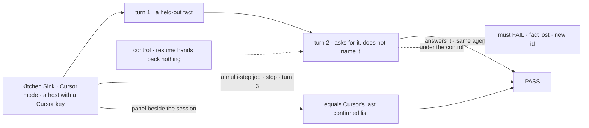
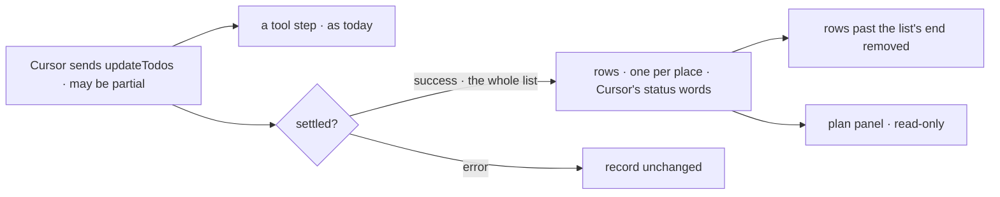

# FIX-1917 · Cursor mode in Kitchen Sink, with Cursor's plan written to the shared plan record or shown as not reported

**Spec** · [Decisions](DECISIONS.md) · [Rules](BUSINESS-RULES.md) · [Plan](PLAN.md) · [Docs](DOCS.md) · [Evolution](EVOLUTION.md)

## Who feels this, before and after

| Someone who… | Today | After |
|---|---|---|
| **builds on the Cursor harness** | Has unit tests and a scripted client. Cursor has never run on a real model anywhere | Picks **Cursor** in Kitchen Sink and works a session: turn 2 continues the same Cursor agent, and the run's steps show while it works |
| **wants to know what a Cursor run planned** | Sees each change to Cursor's to-do list only as one more tool step in the stream. Nothing records it | Reads Cursor's to-do list in a panel beside the session, as Cursor last confirmed it, or a plain "no plan recorded for this turn" ([D1](DECISIONS.md#d1)) |
| **comes back to a session Cursor won't resume** | Nothing to come back to | Sees which agent Cursor refused, on every turn, until it works again. The session never moves to a new agent by itself (FIX-1915 D2) |
| **stops a Cursor run halfway** | Has no app that shows what a stop leaves | Sees the turn end as stopped. The next turn continues the same agent |
| **hands Cursor work from a task board** | The block declares no session state, so the board takes it with no extra option | Unchanged. Recording the plan is off unless a host turns it on |

This is the Cursor half of [epic FIX-1907](../../epics/FIX-1907/SPEC.md), on the session flow,
workspace and plan panel [FIX-1915](https://linear.app/fixpoint-labs/issue/FIX-1915) builds.

**What Cursor actually reports.** Cursor keeps a to-do list and passes it through an
`updateTodos` call; the `task` messages the issue suspected are run summaries. The update Cursor
sends can be partial and the SDK drops each item's id, but the call's result carries the whole
list. A [POC](poc/sdk-wire/README.md) reads this off the pinned SDK.

## The goal, and how we'll know it's met

**A person picks Cursor in Kitchen Sink and works a session as they would use Cursor directly:
each turn continues the same Cursor agent, a stop leaves it continuable, the run's steps show
while it works, and the panel beside it shows exactly the to-do list Cursor last confirmed, or
says no plan was recorded for the turn.**

| Is it the right goal? | |
|---|---|
| **The real need** | The epic's goal for the Cursor mode: Cursor's first real-path run of any kind, side by side with the other harnesses on the same session flow ([FIX-1907 → the goal](../../epics/FIX-1907/SPEC.md#the-goal-and-how-well-know-its-met), ER-2, ER-5, ER-6) |
| **Smaller, and rejected** | "Cursor answers a prompt in Kitchen Sink." One turn passes while continuity and the plan go untested. And "Cursor reports no plan" would be false: it does |
| **Bigger, and not this issue's** | The session flow, workspace and panel (FIX-1915) · the picker and the harness gate (FIX-1914) · the four-mode closure (FIX-1918) · Cursor's plan-mode document · Cursor's cloud agents |
| **Not done if** | It passes only on the scripted Cursor · turn 2 answered from text Kitchen Sink re-sent · the panel shows a list Cursor did not confirm, or is blank without saying why · it says "reports no plan" · Kitchen Sink has a line of Cursor-only code beyond the block's options · the plan writing lives in Kitchen Sink rather than the Cursor package |



The panel is checked against the run's own to-do steps, which Cursor's emitter writes, not
against the record it reads. With `resume` cut, turn 2 must fail.

| How we verify | |
|---|---|
| **Goal check** | `goals/kitchen-sink-harness/cursor-continues-its-agent/` · real Cursor, in a real browser, on a host with a Cursor key · run by the implementer at completion, handed to `fsd-qa` over the mailbox if no such host is available · verdict in the implementation PR |
| **Signal** | **c** turn 2 names turn 1's token and the recorded agent id is unchanged · **l** a Cursor step shows before the turn completes · **s** after stop, turn 3 names the token under the same id · **r** after a reload, the same · **p** the panel's rows equal the last successful `updateTodos` result among the turn's steps, in order, or the panel says "no plan recorded for this turn" and the turn has no such step. Never "this harness reports no plan" |
| **Input** | A fresh random token per run, and a job of several steps long enough to stop. Durable store (`STORE_TYPE=filesystem`) |
| **Anti-game** | Assert on what the page shows and the id in session state. Never on the scripted client, and never on a prompt Kitchen Sink built from earlier turns |
| **The gate** | FIX-1914's goal check gains FIX-1915's two legs for `/cursor`: with harness modes off, opening Cursor creates *no session* and *no harness flow is served*. Both FAIL under its `GOAL_CONTROL=gate-open` |
| **Control that must fail** | `GOAL_CONTROL=no-resume`: **c** and **s** FAIL. `GOAL_CONTROL=no-record`: **p** FAILS (recording off, so the panel says "reports no plan"). Today's `main`: every leg FAILS, as there is no Cursor mode |

## What changes


Kitchen Sink adds a flow kind and Cursor's options. The Cursor package gains the plan writer,
because a gap patched in the app would hide from every other host (epic ER-11).

**What Kitchen Sink writes** (illustrative; the option name is aligned with Codex's in the
cross-spec pass):

```diff
+ export const cursorSession = harnessSessionFlow({
+   kind: "cursor-session",
+   agent: (shared) => cursorAgent({
+     ...shared,                                   // cwd, resume, onSession
+     recordPlan: true,
+     agent: { model: { id: "composer-2.5" }, mode: "agent",
+              local: { sandboxOptions: { enabled: true } } },
+   }),
+ });
```

**What any host that wants Cursor's plan writes:**

```diff
  cursorAgent({
    cwd, resume, onSession,
+   recordPlan: true,   // declares observed-plan and writes Cursor's to-do list to it
  });
```

Leave it out and the block behaves exactly as today.

## How a to-do update becomes rows



Only a confirmed list is written ([D1](DECISIONS.md#d1)). Each row is an item's place in that list
([D2](DECISIONS.md#d2)).

## What stays as it is

- The Cursor block's contract and every step it emits, the to-do update included.
- FIX-1915's session flow, binding, workspace, session view and panel. Cursor brings options.
- The plan record's key and fields. Cursor writes them and adds none.

## Sign off

**[The goal](#the-goal-and-how-well-know-its-met), at that size:** continuity, stop, live steps and
Cursor's own to-do list, on real Cursor. If wrong: the mode passes on one turn while continuity
breaks, or the panel claims a list Cursor never confirmed.

1. **[D1](DECISIONS.md#d1) · Cursor mode shows the whole to-do list Cursor confirms after each
   update. It never says Cursor reports no plan.** If wrong: if Cursor rarely updates its list in
   agent mode, the panel mostly says "no plan recorded for this turn", which is true but bare.
2. **[D2](DECISIONS.md#d2) · A Cursor to-do item is known by its place in Cursor's list, because
   Cursor's SDK drops the id.** If wrong: when Cursor reorders its list, a reader following one
   item sees its row change to another.

**Open: none.** D1 is the one to weigh. Reasoning and what lost: [DECISIONS.md](DECISIONS.md).
The cases: [BUSINESS-RULES.md](BUSINESS-RULES.md).

Feature · `cursor` + `kitchen-sink` · medium (7 surfaces, 9 checks, 4 doc surfaces) · 2 PRs ·
blocked by FIX-1915 · epic [FIX-1907](../../epics/FIX-1907/SPEC.md)
