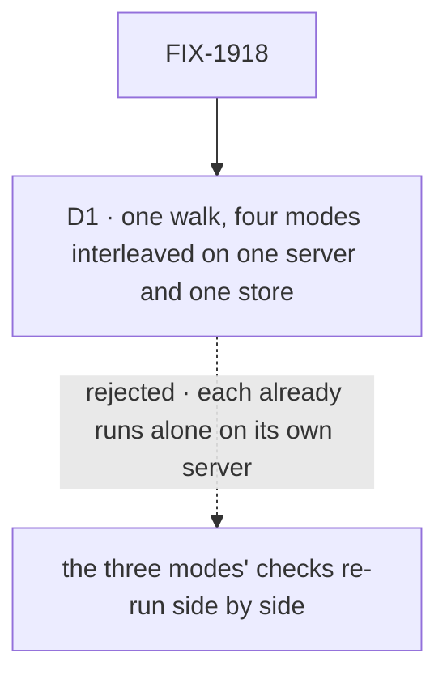

# FIX-1918 · Decisions

[Spec](SPEC.md) · **Decisions**

The plan's four rows are the [closure rule's](../../../docs/contributing/orchestration.md#the-closure-issue-every-epic-ends-in-qa)
and its legs are the [epic's](../../epics/FIX-1907/SPEC.md#the-goal-and-how-well-know-its-met).
One call is this spec's: how the walk puts the four modes together.

## The tree

Solid edges are what you're signing. Dashed edges lost, and the label says why.

## D1 · One walk, four modes interleaved on one server and one store, not the modes' checks side by side

| | |
|---|---|
| **Instead of** | Re-running `claude-code-continues-its-conversation`, `codex-continues-its-thread` and `cursor-continues-its-agent`, and calling the set proved when each is green |
| **Because** | Each of those starts its own server and uses one mode. What none of them sees is the modes meeting: a session binding read back after another harness's turn wrote to the same store, a rail listing another mode's session, a plan panel drawing rows another harness recorded, one mode's run slowing another's items. The epic's promise to the team that maintains the packages is that a gap shows "in one mode against the others", which needs the modes in one app at once |
| **Locks in** | Every harness signed in on the one host, real models, some minutes per attempt, repeated in full per finding. Each assertion is tagged `<mode>:<leg>`, so a red mode doesn't hide the others, and every attempt is printed |

It comes down to leaks between modes: a check with one mode on its own server can never show one.

**What would change my mind:** a host where the three coding harnesses can't all be signed in at
once. Then the walk splits by host, and `<m>:own` is graded on the host that has the most modes.

## The plan in full

| # | What runs | PASS means |
|---|---|---|
| 1 | The walk ([the signal](SPEC.md#the-signal)) and its four controls | Each leg green; each control red where named, and nowhere else |
| 2 | **One journey per team**, mapped and printed. *Builds on a harness*, *maintains the packages* and *wants to know what a run planned* are walked by row 1 (c, l, r · `own` · p). *Learns the framework*: from the picker, Flow State mode opens the framework's own flows, and `chat-agent`'s conversation is row 1's `fs`. *Runs Shift Manager*: nothing in Kitchen Sink imports `@flow-state-dev/harness-manager` or `@flow-state-dev/orchestration` at runtime, read from the built app's server bundle, not its source | Each green |
| 3 | **Every child's goal check** with its controls, on the same commit: `opens-on-the-picker` (FIX-1914, with `gate-open`), the three `*-continues-*` checks (FIX-1915, 1916, 1917; with `no-resume`, `no-record`, `plan-per-turn`, `main-checkout`), `it-keeps-its-own-plan` (FIX-1185, with `empty-prompt`, `no-record`), `runs-the-picked-model` (FIX-1952, with `ignore-model`) and `keeps-the-servers-environment-from-its-commands` (FIX-1917 V8, with `ignore-env`). **None is skipped:** row 1 walks c, l, p and r, but each check also owns legs row 1 doesn't (stop, worktree, refused resume, the plan across turns, the model, the environment) | Each PASS beside its documented FAIL |
| 4 | **The gap sweep:** each [coordination seam](../../epics/FIX-1907/PLAN.md#coordination-seams-to-watch) from both sides (one plan shape, in core, written by each package and read by Kitchen Sink; each mode's flow is the shared factory with options only, ER-6 and ER-11; the rail scoped per mode; the README's per-mode sections). Kitchen Sink's README followed as written from a clean checkout (ER-18). Each epic *not done if* state checked absent | Every seam two-sided |

**Must be green first:** every blocker merged (done: FIX-1914, 1915, 1916, 1917, 1185, 2259), and
the commit pinned before row 1 starts.

## Open · Codex's plan: wait for Codex's CLI, or fold it into FIX-2259 now

This is the owner's call, and it's shared with FIX-2259. The closure doesn't settle it. It grades
whichever answer both specs write down.

- **The evidence.** On 2026-10-28, at the SDK `main` pins (0.164.0), Codex's CLI still offers its
  model no `update_plan` tool, and a scripted call gets `unsupported call: update_plan`. Turning on
  `include_plan_tool`, `tools.update_plan` or `features.collaboration_modes` changes neither
  ([poc/codex-plan-tool](poc/codex-plan-tool/README.md), with the command and the full output). A
  ChatGPT-account sign-in on a real model is the one path not probed.
- **If FIX-2259 takes Codex in** and a signed-in run shows Codex's list, `cx:p` grades Codex's own
  rows the way `cc:p` does, and `cx:kept` grades them after the reload. Codex's plan then blocks
  this run.
- **If Codex waits for its CLI**, `cx:p` grades "Codex reports no plan." with no row, as this
  issue's acceptance item says. FIX-2259's amendment says the same, and FIX-1951 stays a follow-up
  that doesn't block.

**My recommendation: wait for the CLI,** unless the signed-in probe finds the tool. FIX-2259 can't
write a list that Codex never produces, so folding it in would hold the epic on another company's
release. **What would change my mind:** a ChatGPT-account run that offers `update_plan`.

## Decided, not asked

- **FIX-1948 doesn't block.** On `main` after #4016 a real run moved each row about 1 s after its
  update, inside its own done-when; closing it is the owner's call in its own thread.
- **Flow State's plan leg is not graded.** Its flows' sessions and plans are their own (ER-8), and
  the epic gives it no plan record. Its `own` leg is graded: its rail lists none of the harness
  sessions.
- **Flow State's control acts at the page.** `new-conversation` rewrites turn 2's session to a new
  one in the page's `fetch`, as `kitchen-sink-talk`'s controls strip items there, so Kitchen Sink
  carries no switch for it.
- **"Today's main" is the commit before FIX-1914** (`ff0a871817^`): no picker, so every leg fails
  at entry. It proves the walk can't pass on an app without the modes, nothing finer.
- **Here first, then `fsd-qa`.** This container runs as root with no harness signed in, so the
  first attempt is expected to stop at each mode's **host** leg. The run then goes to `fsd-qa` over
  the mailbox, on the same pinned commit.

## Considered and dropped

| Alternative | Why not |
|---|---|
| Re-run the modes' checks and stop there | Each mode alone is proved by its own child; row 3 re-runs them. What none can show is the modes together (D1) |
| A deployed host | Harness modes are off on a deployed host (ER-12); the picker's check proves that |
| A Kitchen Sink switch for the Flow State control | The product would carry a switch only a goal uses |

## How it got here

- **Draft** — the epic's legs walked in four modes on one server; FIX-2242's closure shape kept.
  Found on `main`: no committed closure check, Codex still has no plan tool at 0.164.0, FIX-1948
  doesn't reproduce.

## Notes from review

- **FSD Architect, folded:** `cx:p` no longer fixes Codex's empty state in place. It follows the
  one answer FIX-2259 and FIX-1951 settle, now [open](#open-codexs-plan). The 0.164.0 re-check is
  kept as a poc with its command and output. FIX-2259 is in the debt table, and `<m>:kept` grades
  the plan as FIX-2259 keys it, after the reload. D1 unchanged.

**Open: one,** [Codex's plan](#open-codexs-plan), shared with FIX-2259.
