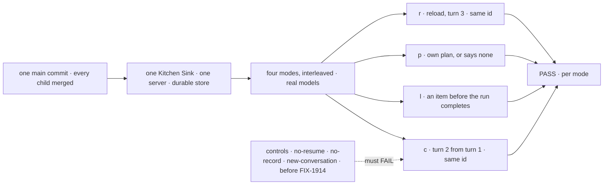
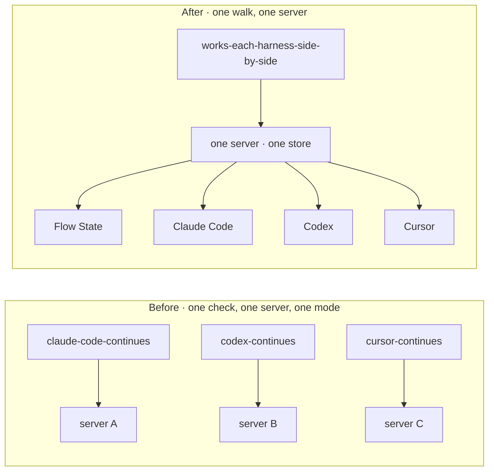

# FIX-1918 · Closure: each harness is worked from Kitchen Sink on the real path, with its session and its plan kept in step

**Spec** · [Decisions](DECISIONS.md)

## Five teams, before and after

| A team that… | Today | After this closes |
|---|---|---|
| **decides whether the epic is done** | Each mode's check passed on its own branch or commit, some never on a real model (Cursor, the picked model) | One report on one `main` commit: every leg in all four modes, each beside its control's FAIL |
| **builds on one of our coding harnesses** | Works one mode at a time, in a check that starts its own server | Works all three in one Kitchen Sink, one server and one store, and each turn 2 answers from its own turn 1 |
| **maintains the harness packages** | Sees a gap only in the one mode whose check found it | Sees the modes side by side on one commit, so a gap one mode has and the others don't is named in one run |
| **wants to know what a run planned** | Proved per mode; Codex's empty state proved on a scripted model only | Each panel shows its own harness's rows, and only those, with the other modes' sessions running beside it |
| **learns the framework from Kitchen Sink** | Flow State mode has no check of its own for a conversation that carries | A Flow State conversation carries across a turn and a reload, on the real model, in the same run |

## The goal, and how we'll know it's met

**On one `main` commit with every other child merged, a person picks each of the four modes in
one Kitchen Sink, on each harness's real model, and in each one: turn 2 answers from turn 1 in the
same conversation, an item shows before the run completes, the plan panel shows that harness's own
plan or says it reports none, and after a reload turn 3 continues the same conversation.**

| Is it the right goal? | |
|---|---|
| **The real need** | [The epic's goal](../../epics/FIX-1907/SPEC.md#the-goal-and-how-well-know-its-met) on the assembled set ([ER-17](../../epics/FIX-1907/BUSINESS-RULES.md#the-closure)): the gaps *between* children ([closure rule](../../../docs/contributing/orchestration.md#the-closure-issue-every-epic-ends-in-qa)) |
| **Smaller, and rejected** | "Re-run the three modes' checks." Each starts its own server with one mode in use, so a binding, a rail or a plan that leaks across modes still passes ([D1](DECISIONS.md#d1)) |
| **Not done if** | The [epic's list](../../epics/FIX-1907/SPEC.md#the-goal-and-how-well-know-its-met), plus: a check ran on another commit · a control was skipped or passed · a leg graded through a child's helper instead of the page · a finding is open |

The walk reads only the page; each control breaks its named leg in every mode it applies to.

| How we verify | |
|---|---|
| **Goal check** | `goals/kitchen-sink-harness-mode/works-each-harness-side-by-side/`, new · one browser against `next dev`, `KITCHEN_SINK_REAL_HARNESS=1`, `STORE_TYPE=filesystem` · run here first, then by `fsd-qa` on a signed-in host when this one can't ([rule](../../../docs/contributing/orchestration.md#the-closure-issue-every-epic-ends-in-qa)) · the report is the closure PR's body |
| **Signal** | Every `<mode>:<leg>` in [the signal table](#the-signal) passes, for `fs`, `cc`, `cx` and `cu` |
| **Input** | A fresh token per mode per run, which no other mode or run uses; a three-step job whose step names are picked per run; each harness's own default model, and the Flow State default (`vercel:anthropic/claude-sonnet-5.5`) |
| **Anti-game** | Read the token, the rows and the id off the page, and the id off the page's own display of session state. Never a child's helper, never the scripted model, never a prompt Kitchen Sink built: each prompt is the person's alone, and turns 2 and 3 never name the token |
| **Control that must fail** | `no-resume`: **c** and **r** FAIL for `cc`, `cx`, `cu` · `no-record`: **p** FAILS for `cc` and `cu` · `new-conversation`, at the page's `fetch`: **c** FAILS for `fs` · the commit before FIX-1914 (`ff0a871817^`): every leg FAILS |

### The signal

| Assertion | Passes when |
|---|---|
| `<m>:c` | Turn 2 asks for the token without naming it; the reply names it, and the conversation the page shows (the harness id for `cc`, `cx`, `cu`; the session for `fs`) is turn 1's |
| `<m>:l` | One of the run's items shows on the page before turn 1 completes |
| `<m>:p` | `cc` and `cu`: after the job, the panel's rows are the job's steps, in order, with the names picked for this run, none "No plan recorded…". `cx`: the panel says "Codex reports no plan." and holds no row. `fs`: not graded (its flows' plans are their own, ER-8) |
| `<m>:r` | After a reload, the page is back in that session without a click, with the same id, and turn 3 names the token |
| `<m>:own` | The mode's rail lists only its own session, and its panel holds none of another mode's step names |

The modes run interleaved: turn 1 in each, then turn 2 in each, then the job in each, then a reload
and turn 3 in each, so every binding is read back after the others have run.

**The rest of the plan** is [in DECISIONS](DECISIONS.md#the-plan-in-full): one journey per team, the
children's checks with their controls, and the gap sweep. A failure becomes a child of FIX-1907
blocking this issue, and the plan runs again as the closure rule says.

## What changes

Before, each mode was proved alone; the closure adds one walk where all four share a server and a store.

**Docs:** no documentation impact: no page is written or changed. Row 4 follows Kitchen Sink's
README ([ER-18](../../epics/FIX-1907/BUSINESS-RULES.md#the-closure)) and the three harness pages
as written; a page that doesn't hold is a finding against its child.

**Stays as it is:** all product code; every child's check as it is on `main`. Kitchen Sink gets no
switch for the new control: `new-conversation` acts at the page's `fetch`, as
`kitchen-sink-talk`'s controls do.

## What's already here, and the debt

| Already here | What this does with it |
|---|---|
| The epic's goal and its two controls | **Builds on.** Walked in four modes at once |
| `goals/kitchen-sink-harness/*-continues-*` (FIX-1915, 1916, 1917) | **Composed.** Their prompts, token reading and `no-resume`, `no-record` controls reused, not their servers |
| `goals/kitchen-sink-harness-mode/opens-on-the-picker` (FIX-1914) | **Re-run** in row 3; the walk enters each mode through its picker |
| `goals/lib/kitchen-sink.mts`, `playwright.mts` | **Reused** for the browser and the page's handles |
| [FIX-2242](../FIX-2242/SPEC.md), the last closure | **Kept** its shape |
| Anything else grading the set | **None.** Searched `goals/` for `KITCHEN_SINK_REAL_HARNESS`, `plan-row`, `closure` |

| The debt | |
|---|---|
| **Removes** | Nothing |
| **Adds** | One goal. Permanent by design, as every closure's is |
| **Leaves** | Codex writes no plan: its CLI offers the model no plan tool at SDK 0.164.0, re-checked on 2026-10-28 ([FIX-1951](https://linear.app/fixpoint-labs/issue/FIX-1951), not a blocker). Plan rows move about 1 s after their update ([FIX-1948](https://linear.app/fixpoint-labs/issue/FIX-1948)) |

**Net: up, a little.** One goal, for an epic's promise that stays true.

## Sign off

**[The goal](#the-goal-and-how-well-know-its-met), at that size:** four modes interleaved on one
server, real models, one commit. If wrong: the epic wraps on modes that pass apart and leak together.

**[The debt](#whats-already-here-and-the-debt), net up a little:** one goal. If wrong: one more
real-model check to keep green.

1. **[D1](DECISIONS.md#d1) · One walk, four modes on one server, not the three checks side by side.**
   If wrong: a longer run whose failures are harder to split.

**Open: none of its own.** Codex's plan leg grades its empty state until FIX-1951 can land
([decided](DECISIONS.md#decided-not-asked)).

Improvement · closure (QA) · `goals/` only · medium, repeats per finding · epic
[FIX-1907](../../epics/FIX-1907/SPEC.md), closure · required · runs now: every blocker (FIX-1914,
1915, 1916, 1917, 1185, 2259) is done · Linear [FIX-1918](https://linear.app/fixpoint-labs/issue/FIX-1918)
