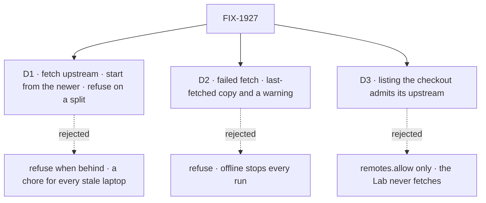

# FIX-1927 · Decisions

[Spec](SPEC.md) · **Decisions** · [Rules](BUSINESS-RULES.md) · [Plan](PLAN.md) · [Docs](DOCS.md) · [Evolution](EVOLUTION.md)

What was chosen, what lost, and what each choice locks in. D1 and D2 record the engineer's
brief; D3 is where the code on `main` corrected it.

## The tree

Solid edges are what you're signing. Dashed edges lost, and the label says why.

## D1 · Fetch the base's upstream, start from the newer of local and upstream, refuse only when they have split. No setting

| | |
|---|---|
| **Instead of** | Refusing the run whenever the local branch is behind its upstream |
| **Because** | Behind is the common case and catching up is mechanical, so the host does it. Ahead means unpushed commits the person meant to build on. Only a split needs a person's choice, so only a split refuses. One default covers all three, so no setting ([tenet 3](../../../docs/philosophy.md#3-earn-every-addition)) |
| **Locks in** | A run's branch can hold upstream commits the person's `main` lacks, so review must exclude both copies. Pinning runs to the local branch would be a new setting later |

It comes down to the person who hasn't pulled: refusing turns a mechanical catch-up into a chore on every run.

## D2 · A fetch that fails does not stop the run: it compares with the last-fetched copy and warns

| | |
|---|---|
| **Instead of** | Refusing the run when the fetch fails |
| **Because** | Offline, an expired credential, or a ref lock from the person's own `git pull` is not the run's fault. The last-fetched copy is never older than what today's code uses, so the fallback is never worse than today |
| **Locks in** | Offline, a run can still start behind upstream, signalled only by a server log line: the quiet staleness, narrowed to a failed fetch |

It comes down to offline work: a refusal stops every coding run for a failure that isn't the run's.

**The call most likely to flip.** What would change my mind: stale PRs from offline runs in
practice, or runs gaining a place to show a provision warning. Then say so on the run, or refuse.

## D3 · Listing a checkout in `localRepositories` admits fetching its own upstream; `remotes.allow` is not asked

| | |
|---|---|
| **Instead of** | Fetching only when `remotes.allow` admits the upstream's URL, as the brief said |
| **Because** | Both local entry points run with `remotes: { allow: [] }`: the Lab's `fsd` profile (`teams/devteam/fsd.fsdev.config.mts`) and harness-manager's `hostForConfig`. Under the allowlist rule the case this issue is about never fetches, and adding `github.com` to the Lab is what [FIX-1904 D3](../FIX-1904/DECISIONS.md#d3) rejected: it would clone projects people add. The URL is the operator's repository config, still judged for shape before git sees it |
| **Locks in** | The Lab contacts its checkout's upstream (GitHub, here) on each new run, and "the Lab reaches no git remote" leaves the docs. No network means a checkout with no upstream |

It comes down to the Lab: under the allowlist rule, the headline case stays exactly as stale as today.

**What would change my mind:** an operator who needs a host with no network calls at all.

## Decided, not asked

- **"Upstream" is git's own `<base>@{upstream}`**, for a branch or `HEAD` on one. No upstream
  (a tag, a commit, a detached `HEAD`, `origin/main` named directly) means today's cut, no fetch.
- **The recorded `baseRef` stays what was asked** (`main`, or `HEAD`); `baseCommit` is now set
  for a local checkout, as the commit cut at.
- **`readRunCommits` also excludes the base's upstream.** On `main` it excludes `origin/<base>`
  and the local branch, so a run cut from `origin/main` reports only its commits; an upstream
  on another remote name would be counted as the run's.
- **Review with `git log -p <branch> --not main origin/main`**, not `git diff
  origin/main...<branch>`: a three-dot diff against either copy is wrong in one of the two cases.

## Considered and dropped

| Alternative | Why not |
|---|---|
| Warn when behind, cut from local | A server-log warning is what *quietly stale* means in practice |
| A per-checkout setting | Nobody asked; starting from local when ahead already keeps unpushed commits |
| Fast-forward the person's `main` | Moves their branch, maybe under a dirty tree |
| `git fetch --all` | Slower, and moves tracking refs nobody asked for |

## Settled

- **`<base>@{upstream}` resolves for `main` and `HEAD` on `main`, fails for a detached `HEAD`;
  `git fetch origin refs/heads/main` moves only `origin/main`.** **CONFIRMED** by hand, git 2.43:
  bare upstream, `file://` clone, a push from a second clone, a fetch; local `main` stayed put.

## How it got here

- **Draft** — a stale base on a local checkout; fetch the upstream, start from the newer,
  refuse on a split, no setting; a `workspace` host change, one PR.
- **Code check** — the brief admitted the fetch by `remotes.allow`, but both local entry points
  allow none, so D3 admits it by the listing. The brief said test repositories have no remote;
  `local-host-local.spec.ts` clones from a bare path, so they do, and stay unchanged because local equals upstream.

**Open: none.**
