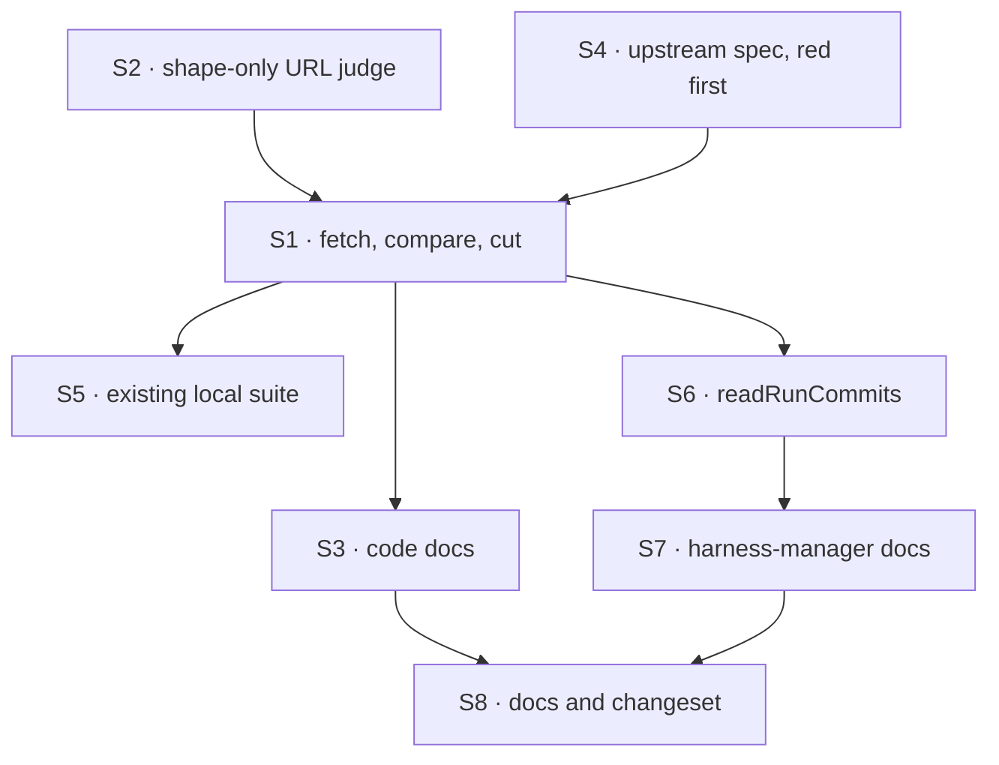

# FIX-1927 · Plan

[Spec](SPEC.md) · [Decisions](DECISIONS.md) · [Rules](BUSINESS-RULES.md) · **Plan** · [Docs](DOCS.md) · [Evolution](EVOLUTION.md)

Written for the implementing agent. IDs cross-reference [BUSINESS-RULES.md](BUSINESS-RULES.md)
(BR-n) and [DECISIONS.md](DECISIONS.md) (D-n). `tdd`. One PR.

## Surfaces

| ID | Package · role | Change | Rules |
|---|---|---|---|
| S1 | `workspace` · `provisionLocalCheckout`'s `base` callback in `src/local-host.ts` | Resolve the base's upstream; judge its URL; fetch that one branch; compare; return local, upstream's commit, or refuse `base-diverged`. Return `commit` so `baseCommit` is set. Runs only inside `base`, which `provisionWorktree` calls only for a new branch | BR-1 to BR-15, BR-17 |
| S2 | `workspace` · `src/remotes.ts` | A way to judge a URL for shape only (the `invalid-remote` rules and the scheme set), with an absolute path read as `file://`. Reuse `checkRemote`'s rules; don't fork them | BR-10, BR-15 |
| S3 | `workspace` · code docs in `src/local-host.ts` | File header (the "Existing work…" rule and the layout comment), `localRepositories` JSDoc ("no clone, no fetch"), `provisionLocalCheckout` doc, `WorkspacePlace.repo.baseCommit` ("only for a clone"), `WorkspaceRefusedError`'s reason list | — |
| S4 | `workspace` · new `test/local-host-upstream.spec.ts` | Real repositories: a bare upstream, the person's `file://` clone, a second clone that pushes. Host built with `remotes: { allow: [] }` and the clone in `localRepositories`, as the Lab builds it | BR-1 to BR-18 |
| S5 | `workspace` · `test/local-host-local.spec.ts` | Re-read the header ("no clone and no fetch") and any git-command counts. These repositories clone from a bare path, so a new run now runs one `fetch`; results don't change | BR-6, BR-17 |
| S6 | `harness-manager` · `src/commits.ts` `readRunCommits` | Also exclude `<baseRef>@{upstream}` when it resolves and `baseRef` isn't `HEAD` | BR-20 |
| S7 | `harness-manager` · `hostForConfig` JSDoc in `src/workspace.ts` | "reaches no remote" becomes "reaches only the base's upstream, to cut a new branch". `manager.ts`'s `workspace` option doc needs no change | BR-19 |
| S8 | Docs and release notes | [DOCS.md](DOCS.md)'s operations. One `minor` changeset for `@flow-state-dev/workspace` (a new refusal reason and a behaviour change), with `@flow-state-dev/harness-manager` as `patch`. Both are published | — |

## Sequence



## Checks

| ID | Runs after | Passes when |
|---|---|---|
| VG | S1 | [The goal](SPEC.md#the-goal-and-how-well-know-its-met): S4's behind case passes `starts-from-upstream` and `local-base-unmoved`, after the same spec FAILED `starts-from-upstream` on today's `main` and with the fetch step removed |
| V1 | S1 | BR-2, BR-3, BR-5, BR-8; BR-4 rejects `base-diverged` and leaves no worktree, branch or marker (D1) |
| V2 | S1 | BR-9: every ref in the person's repository except the upstream's tracking ref, and `git status`, equal before and after |
| V3 | S1 | BR-11, BR-12: upstream removed after the clone; the run starts and one `console.warn` names the checkout and the error (D2). Control: make the fetch failure throw and the spec goes red |
| V4 | S2 | BR-10: an `ext::` upstream starts no git process with that URL. BR-15: `allow: []` still fetches (D3); the spec fails with the allowlist rule in place |
| V5 | S1 | BR-14: a fetch that never returns times out in its slice, and the provision finishes inside `provisionTimeoutMs` |
| V6 | S1 | BR-6: tag, commit, detached `HEAD`, untracked branch, `origin/main` as base: no `fetch` among the counted git commands |
| V7 | S1 | BR-17: a second provision of the same run runs no `fetch`, after upstream moved again |
| V8 | S1 | BR-18: two runs on one checkout at once both start |
| V9 | S6 | BR-20: the remote renamed to `upstream`, a run cut from it ahead of local `main`, two commits: count is 2. Fails without S6 |
| V10 | S1 | BR-19: one behind case through harness-manager's `provisionCheckout` |
| V11 | S5 | The whole `workspace` and `harness-manager` suites pass, and `goals/projects/a-mapped-project-works-in-your-checkout/run.mts` still passes (it now fetches this repository's upstream; offline it warns and passes) |

No counted facts rest under this spec, so no factual-base checker.

## Pinned names

| Where | Name | Why pinned |
|---|---|---|
| `WorkspaceRefusedError.reason` | `base-diverged` | Public and stable. A caller branches on it |
| `WorkspacePlace.repo` | `baseCommit`, now set for a local checkout | An existing field; the docs say what it means |

Everything else is yours to name.

## Guardrails

| Rule | Because |
|---|---|
| The fetch writes only the upstream's remote-tracking ref (`--no-write-fetch-head`, no tags, no auto-maintenance) | The repository is the person's. Their branches, index and files are theirs (BR-9) |
| Cut at the upstream commit's id, never at the ref's name | `git worktree add -b` from a remote-tracking ref sets the run's branch to track it |
| The URL is judged before any git process receives it, and git's `GIT_ALLOW_PROTOCOL` is that one scheme | The host's rule that a remote is judged before git sees it holds. An agent in a worktree can write the shared config (D3) |
| Every fetch failure degrades to a warning; only a split refuses | D2. A refusal for a failure the run didn't cause stops every coding run |
| The fetch timeout is a slice of the remaining budget, not all of it | One budget per provision ([`worktree.ts`](../../../packages/workspace/src/worktree.ts) rule 2); a hung fetch must leave time to cut |
| Read upstream with the `gitAnsweredNo` split: "no upstream" is an answer, a failed probe is raised | A failed probe read as "no upstream" silently restores today's stale cut |
| One code path for both entry points: the change lives in the host ([tenet 5](../../../docs/philosophy.md#5-fix-at-the-owning-layer)) | The Lab and harness-manager's `sourceRepo` both reach `provisionLocalCheckout` |

## Docs

Reconcile and publish [DOCS.md](DOCS.md) after V1 to V4 pass. S3 and S7 are code docs, not
reader docs, and are listed there only.

## Sketch · pseudocode, illustrative, react to the shape

```
base(left), only for a new branch:
    local ← resolve base to a commit                   (missing → refused, as today)
    upstream ← the base's configured upstream ref, and its remote
    if none → cut from local                           (BR-6)
    url ← the URL git would use for that remote
    if url passes the shape judge:
        try fetch that one branch into its tracking ref, timeout = slice of left
        on failure: warn
    else: warn
    up ← the tracking ref's commit, if any             (none → cut from local)
    if up is an ancestor of local → cut from local     (equal or ahead)
    if local is an ancestor of up → cut at up          (behind)
    otherwise → refused base-diverged
```

**POC:** none committed. The git behaviour the sketch leans on was checked by hand
([Settled](DECISIONS.md#settled)).

## At implement time

- Check whether FIX-1926 (per-organization checkouts) landed first. If it moved
  `provisionLocalCheckout`, the change still lives where a new branch's base is chosen.
- Compare [Evolution](EVOLUTION.md)'s rows with the code; approved intent alone is not shipped behaviour.

## Follow-ups

- None filed. If D2 flips, a run needs a place to show a provision warning; that is a harness-manager change.
