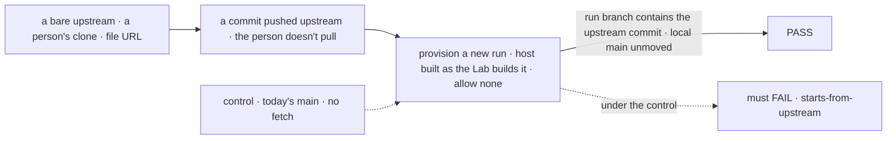
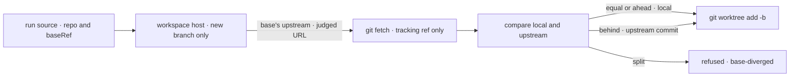

# FIX-1927 · A coding run on a local checkout starts from the current base, not whatever main the person last pulled

**Spec** · [Decisions](DECISIONS.md) · [Rules](BUSINESS-RULES.md) · [Plan](PLAN.md) · [Docs](DOCS.md) · [Evolution](EVOLUTION.md)

## Five people, before and after

| Someone who… | Today | After |
|---|---|---|
| **asks for work on a project mapped to their checkout, without pulling first** | The run starts from their stale local `main`; its PR conflicts or redoes merged work | The host fetches `main`'s upstream and starts from its tip. Their `main`, index and files don't move |
| **has unpushed commits on `main`** | The run starts from them | The same: their branch is newer than upstream, so the run starts from it |
| **has a `main` and upstream that have each moved** | The run silently misses upstream's commits | Refused before anything is made, naming both commits: pull or rebase, or push |
| **is offline, or their credential expired** | Not affected; nothing is fetched | The run starts from the last-fetched copy; the server logs a warning |
| **reviews what a run did** | `git diff main...<branch>` | `git log -p <branch> --not main origin/main`: only the run's commits, from either start |

The docs tell people to pull `main` themselves. People forget, and nothing tells them.

## The goal, and how we'll know it's met

**A new coding run on a local checkout never starts behind its base's upstream without saying so: it starts from upstream when you haven't pulled, from your branch when it is ahead, and is refused when the two have split.**

| Is it the right goal? | |
|---|---|
| **The real need** | "A coding run on a local checkout starts from the current base, not whatever main the person last pulled", so runs stop producing conflicting PRs and duplicated work (the issue) |
| **Smaller, and rejected** | "Warn when behind": a server-log warning is what *quietly stale* means. "Compare with the last-fetched `origin/main`" without fetching: stale for anyone who never fetches |
| **Bigger, and not this issue's** | Keeping a running run's branch current mid-run · per-organization checkouts ([FIX-1926](https://linear.app/fixpoint-labs/issue/FIX-1926)) · the default projects ([FIX-1904](https://linear.app/fixpoint-labs/issue/FIX-1904)) |
| **Not done if** | The test fetched by hand in its setup · the person's `main` moved · the Lab, which allows no remote, still never fetches · a failed fetch fails the run · a run handed back was fetched or moved |

The check reads the person's repository with git, not what the host reports; under the control it must fail.

| How we verify | |
|---|---|
| **Goal check** | No `goals/` script: the real path is git and the host, model-free and offline, so a `packages/workspace` CI spec on real repositories covers it with nothing mocked. Verdict in the implementation PR |
| **Signal** | `starts-from-upstream`: the upstream commit is an ancestor of the run's branch tip. `local-base-unmoved`: the person's `refs/heads/main` and `git status` are unchanged. `split-refused`: reason `base-diverged`, with no branch, worktree or marker left |
| **Input** | Upstream one commit ahead. Three commits ahead, and `baseRef` left out with `HEAD` on `main`, must pass too |
| **Anti-game** | No fetch in the test's setup. Don't assert on `place.repo` alone; read the branch in the repository. The clone's `origin` is a real `file://` upstream |
| **Control that must fail** | Today's `main`, and the same spec with the fetch step removed, must FAIL `starts-from-upstream`. The PR shows that FAIL before the PASS |

## What changes

Read where the run's branch leaves the line: today from your commit, after from the newer of
yours and upstream's, and a split stops it. Nothing a person writes changes; the fix is in the
host, so every app that lists a checkout gets it.

## How it reaches the branch

A checkout that already exists never reaches the fetch: existing work is never moved.

## What stays as it is

- A run handed back, on a retry or a continuation: no fetch, no move.
- A base with no upstream (a tag, a commit, a detached `HEAD`, an untracked branch): cut as today.
- Clones, and what `remotes.allow` admits. A project you add in the Lab is still refused by name.
- The recorded `baseRef`: still what was asked for, such as `main`.

## Sign off

**[The goal](#the-goal-and-how-well-know-its-met), at that size:** never behind upstream without
saying so, and refused on a split. If wrong: runs keep landing stale PRs, or every split
checkout blocks runs a person expected to start.

1. **[D1](DECISIONS.md#d1) · Fetch the base's upstream, start from the newer of the two, refuse
   only on a split. No setting.** If wrong: a run starts from commits the person never saw locally, which confuses review.
2. **[D2](DECISIONS.md#d2) · A failed fetch falls back to the last-fetched copy and warns.** If
   wrong: offline runs still start stale, with only a log line. This is the one most likely to flip.
3. **[D3](DECISIONS.md#d3) · Listing a checkout admits fetching its own upstream;
   `remotes.allow` is not asked.** This corrects the brief: the Lab allows no remote. If
   wrong: the Lab contacts GitHub on each new run, and an operator wanted no network at all.

**Open: none.** D3 is the one to weigh: it departs from the brief. D2 is the likeliest to flip. Reasoning and what lost: [DECISIONS.md](DECISIONS.md).
The cases: [BUSINESS-RULES.md](BUSINESS-RULES.md).

Improvement · `workspace` (+ one line in `harness-manager`) · small (3 source files, 1 new spec, 4 doc surfaces) · 1 PR · project Workforce: Shift Manager
