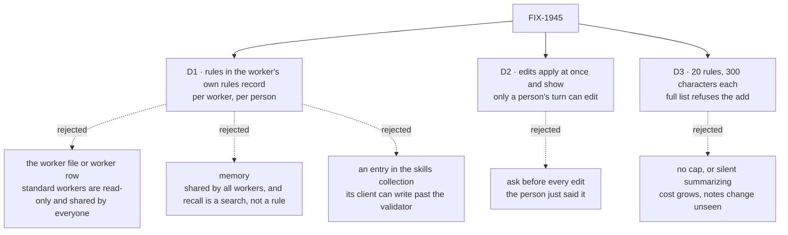

# FIX-1945 · Decisions

[Spec](SPEC.md) · **Decisions** · [Rules](BUSINESS-RULES.md) · [Plan](PLAN.md) · [Docs](DOCS.md) · [Evolution](EVOLUTION.md)

What was considered, what was chosen, why, and what each choice locks in. Three decisions are
the sign-off surface. Everything else here is context for them.

## The tree

Solid edges are what you're signing. Dashed edges lost, and the label says why.

## D1 · A worker's standing rules live in its own rules record, keyed like its skills drawer: one list per person, read on every turn after its instructions

| | |
|---|---|
| **Instead of** | Editing the worker's instructions (its `WORKER.md` body or worker row), saving notes into memory, or keeping them as an entry in the skills drawer |
| **Because** | The skills drawer already shows the keying a rule needs: its own per worker ([arch C3](../../../docs/architecture/workforce-default-worker-flow.md#c3--a-workers-skills-are-stored-per-worker-and-stored-is-not-the-same-as-filled)) and per person through its user scope ([FIX-1788 D6](../FIX-1788/DECISIONS.md#d6)), for standard workers and the coordinator too (`createSkillsLibrary({ scope: "user", collectionConfig: { flowIsolation: true }, partitionBy: verifiedWorkerOf })` in `agent-worker-flow.ts`). The rules record copies that keying exactly. It is not an entry in the drawer itself, because the skills collection lets the generic resource client create, update and delete entries (`defineSkillsCollection`, `client.content`), so a rule written there would skip the one validator that holds the cap and the stale-edit check. The rules record allows client reads only. Instructions are shared by every user of a standard worker and are read-only ([FIX-1788 BR-3](../FIX-1788/BUSINESS-RULES.md)), so the coordinator could not take a note without a fork. Memory is shared by all of a person's workers and nothing in it is keyed by worker ([FIX-1788 D8](../FIX-1788/DECISIONS.md#d8)); recall is a search that may miss, and a rule must apply every time. Nothing else stores a person's notes to a worker, so the record is not a second registry (FIX-1457 ER-14) |
| **Locks in** | Rules are per worker and per person. A note to the coordinator does not reach the coder. A rule for a whole team, or one person's workers at once, is a later feature on top. A fork starts with no rules |

It comes down to the coordinator: it is a standard worker, so its file is read-only and shared,
and a record keyed by worker and person is the only place that is its own and the person's.

**What would change my mind:** people mostly give notes meant for all their workers. Then a
person-level rule list, read by every worker, is the better first build.

## D2 · The worker edits its rules without asking; each edit is shown, and only a turn a person started can make one

| | |
|---|---|
| **Instead of** | Asking the person to approve each add, change or remove |
| **Because** | The person just gave the note; asking "save this?" doubles every piece of coaching. Safety comes from three things instead: the tool itself posts a visible line naming the rule (not the model's choice to mention it), the Shift Manager list shows every rule with where it came from, and the tools exist only on a turn a person's own message started, never on a task turn, a coordinator's post, a delegate's answer or a task-ended notice |
| **Locks in** | A misread note becomes a rule at once, and stays until someone notices. Text that reaches a person's turn, such as a pasted document, can still lead the worker to add a rule; the line and the list are how that gets caught |

It comes down to coaching cost: asking first turns every note into two messages.

**What would change my mind:** people find rules they never meant to give. Then the add stays
pending until the person confirms it, and change and remove stay immediate.

## D3 · At most 20 rules of 300 characters each; a full list refuses the add, and the worker asks the person what to merge or drop

| | |
|---|---|
| **Instead of** | No cap, or summarizing the list automatically when it grows |
| **Because** | The list is in every turn's prompt, so its size is a cost on every turn: 20 × 300 characters is about 1,500 tokens at most. A refusal the worker relays keeps the person in charge of what their rules say; an automatic summary would rewrite their words unseen ([FIX-1775](https://linear.app/fixpoint-labs/issue/FIX-1775): no summarizing by default) |
| **Locks in** | Lists stay short and specific. Raising the cap later is cheap; lowering it means trimming people's lists |

It comes down to cost on every turn: an uncapped list is paid for again on each reply.

**What would change my mind:** people hit the cap within weeks. Then raise it, or move rules
past a threshold into a skill that loads only when it applies.

## Decided, not asked

- **One rule is one line of the person's meaning, in the worker's words.** The worker may
  rephrase a note into a rule, and the visible line shows the result, so the person can object.
- **Change and remove name the rule by number and quote its current text.** A stale number
  fails rather than editing the wrong rule (BR-15).
- **The list is a workforce-declared record, `standing-rules`, on the agent and coordinator
  flows, always in context.** Client reads are on and client writes are off, so only the rule
  tools and the rules action write it, both through the one validator. It carries each rule's
  date and source conversation. Being outside the skills collection, the skill catalog,
  activation, `loadSkill` and the seeded-skill refresh never see it, and no skill name is reserved.
- **The page edits through the worker's own flow, as the signed-in person.** The record's
  storage belongs to the worker's flow, so the roster flow cannot open it; an action on the
  agent and coordinator flows can, with no engine change. The person comes from the server's
  identity, never from the request (BP-031).
- **Tools are offered by allowlist.** The person's own door marks the turn; everything else
  gets no tools, so a new entry point is safe by default.
- **Rules apply on task turns too.** A task the person's coordinator filed runs for that person,
  so their rules hold; it just cannot edit them.
- **No opt-out setting.** An app that never edits rules pays four tool schemas and nothing
  else; an empty list adds no prompt text.

## What already does this job

The job: *keep an instruction a worker follows on every later turn.* Searched `packages/` for
instructions, skills, memory writes, `pin`, `rules`, `preferences` and `standing`.

| Existing | Does it | Gap |
|---|---|---|
| The worker's `instructions` (`WORKER.md` body; the `workforce-edit` action on a user-owned row) | Yes, for everyone who uses the worker | Shared, not per person; standard workers are read-only; no model-facing tool |
| A skill listed in `skills.active` | Yes, in context every turn | Written by the file's author only; no write tool exists (`loadSkill`, `runSkill` only) |
| Memory capture, digest and `memory/recall` | Partly | Shared by all the person's workers; recall may miss; capture is off by default |
| Working memory `pin` | For one session | Session-scoped, two slots |

**Closest: an active skill in the worker's drawer.** This change differs only in who writes it
(the worker, from a person's note) and in being per person, which the drawer already is. So it
is a record keyed exactly like that drawer, plus write tools, not a new kind of thing.

## Considered and dropped

| Alternative | Why not |
|---|---|
| An entry inside the skills drawer, `standing-rules` | The skills collection lets the generic resource client create, update and delete entries, so a rule could be written past the cap, length and stale-edit checks. It also needed a reserved skill name and a hidden-from-catalog rule. Chosen in the draft, dropped in review |
| Appending rules to the worker row's instructions | Only user-owned workers have a row; the coordinator is standard and read-only. It would also mix the author's base prompt with a person's notes |
| A rules section inside `WORKER.md` | A file is shared by everyone who uses that worker, and changing it is a deploy |
| A pending rule the person confirms in Shift Manager | Rejected in D2 for coaching cost; kept as the fallback if D2 proves wrong |

## How it got here

- **Draft** — framed as notes that outlive a session; refined the substrate: the worker's
  existing per-person skills drawer holds one always-on rules entry, edited by four tools and a
  Shift Manager page, with no new store and no Layer 1 change.
- **Review** — rules moved from the skills collection to a sibling record keyed the same way,
  because the skills collection lets the generic resource client write entries, which would
  bypass the validator (Codex). Client writes are off on the new record; no reserved skill name.

- **Review** — every write now carries the list version it read, so two racing adds can't both
  land; a failed rules read never fails the turn; the Rules view is promised only for workers
  on the `agent` flow and the coordinator (Codex). The product lead relayed Jake's agreement
  with D2 and D3 as written.

**Open: none.**
