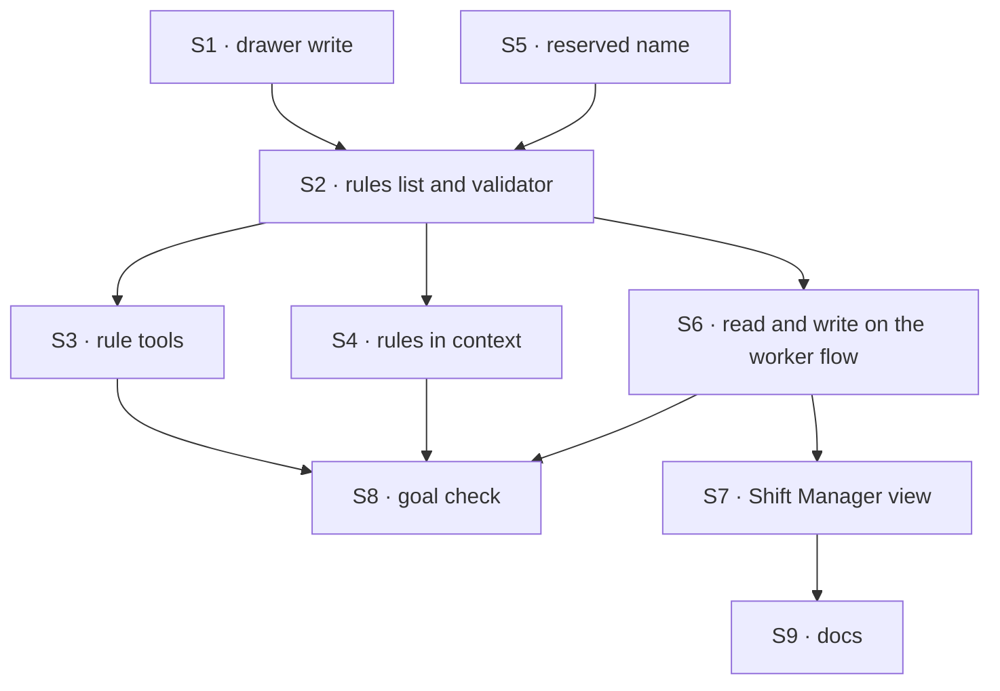

# FIX-1945 · Plan

[Spec](SPEC.md) · [Decisions](DECISIONS.md) · [Rules](BUSINESS-RULES.md) · **Plan** · [Docs](DOCS.md) · [Evolution](EVOLUTION.md)

Written for the implementing agent. IDs cross-reference [BUSINESS-RULES.md](BUSINESS-RULES.md)
(BR-n) and [DECISIONS.md](DECISIONS.md) (D-n). `tdd`. Two stacked PRs.

## Surfaces

| ID | Package · area | Change | Rules |
|---|---|---|---|
| S1 | `orchestration` · skills library | **New export:** `writeSkillFolder` (`packages/orchestration/src/skills/internal/write-skill-folder.ts`, internal today) becomes public, used to write one holder-owned entry. The entry is never offered as a skill (catalog, activation, `loadSkill`): a folder with no `SKILL.md`, or one with model invocation off, whichever the collection allows. It holds per-rule date and source conversation. BR-12 relies on `refreshSeededSkills` (`refresh.ts`) iterating only the names in its `sources` argument, plus its rule-1 skip of a name with no manifest; S5 keeps `standing-rules` out of every `sources` | BR-12 |
| S2 | `workforce` · the rules list | Read, parse, render and write the `standing-rules` entry in the drawer `createSkillsLibrary` already keys per person and per worker (`scope: "user"`, `collectionConfig: { flowIsolation: true }`, `partitionBy: verifiedWorkerOf`; `agent-worker-flow.ts`, the `skills` constant). One validator for every writer: 20 rules, 300 characters, one line, not empty; change and remove carry the quoted current text (D3) | BR-15 BR-16 BR-17 BR-18 |
| S3 | `workforce` · the rule tools | `rules/read`, `rules/add`, `rules/change`, `rules/remove`. Each write emits a client-visible line naming the rule and the count. Offered by allowlist. **New in S3:** a person-turn marker in workforce request state, set by a new `markPersonTurn` step on each door: the agent flow's public `run` action (in `defineAgentFlowAround`, before `run`), and the coordinator's `postStateOf` when it opens a round-0 post. Only a marked turn gets the tools. Delivered through the turn's `extraTools` share (`coordinator-flow.ts`, the `agentWorkerTurn` call), not `uses`, since the tools fence drops catalog tools from `uses` (D2) | BR-1 BR-2 BR-3 BR-4 BR-5 |
| S4 | `workforce` · the agent turn | Put the rules in context after the instructions, team instructions and packages, as one more dynamic entry in `usesEntries` (`agent-worker-flow.ts`, beside `workerCapabilities`), not a fourth `prompt` entry. Its user is the request's identity: a task turn runs in a task session at the filing person's user scope (`conversation-board/task-entry.ts`, header), so the drawer resolves to that person with no new lookup; V4 proves it on a task turn. Reaches the coordinator through the shared turn. Nothing when the list is empty (D1) | BR-6 BR-7 BR-8 |
| S5 | `workforce` · loader | Refuse a file-declared skill named `standing-rules` | BR-13 |
| S6 | `workforce` · worker flows + client | A public rules action on the agent and coordinator flows, run in the person's session with that worker (the request's verified worker; the server's user), through S2's validator. Client methods reach it through `ensureWorkerSession`. Not the roster flow: the drawer's storage belongs to the worker's flow. Fork copies no rules | BR-11 BR-14 BR-19 |
| S7 | `shift-manager` · Rules view | A Rules view per roster worker (from its Roster row) and a Rules section on the Shift Coordinator view: list with when and from which conversation; add, edit, delete through S6 | BR-19 BR-20 BR-21 |
| S8 | `goals` | `goals/standing-rules/a-note-outlives-its-session/` with `GOAL_CONTROL=no-rules-context` | goal |
| S9 | Docs | Publish [DOCS.md](DOCS.md); one `minor` changeset for `workforce` and `orchestration`, one for `shift-manager` | — |

## Sequence



| PR | Deliverables | depends_on |
|---|---|---|
| A | S1–S6, S8, the `workforce` part of S9 | — |
| B | S7, the `shift-manager` part of S9, the browser leg | A |

Stack B on A as a GitHub stack; if A has merged, base B on `main`.

## Checks

| ID | Runs after | Passes when |
|---|---|---|
| V1 | S1 | A holder-owned entry is written and read back in one worker's drawer for one person; a refresh of seeded skills leaves it (BR-12) |
| V2 | S2 | Each limit refuses with its reason (BR-16, BR-17); a stale quote refuses with the current list (BR-15); two writers racing: one wins, the other refuses (BR-18) |
| V3 | S3 | Tools present on a person-started turn of both the agent and coordinator flows; absent on every other entry point named in BR-4, one test each, including a person's answer inside a task session; each write emits the visible line; a failed write emits no "saved" line (BR-5) |
| V4 | S4 | Rules come after the three prompt entries (order among other capabilities' context is not controlled); a task turn filed by Alice reads Alice's list, never Bob's or none; empty list adds nothing (BR-7); an edit is read on the next turn with no new session (BR-8). D1's check |
| V5 | S5, S6 | Reserved name refused and the entry absent from the skill catalog (BR-13); fire and re-hire, and a flow move (BR-13a, BR-13b); second person sees and edits only their own list; another person's id in the request is ignored or refused (BR-9, BR-14); a fork has none (BR-11) |
| V6 | S6 | D2's check: page and tool edits go through one validator; a tool write from a task turn is impossible, not merely unused |
| VG | S8 | [The goal](SPEC.md#the-goal-and-how-well-know-its-met) PASSES on a real model after the same run FAILED `next-session-follows` under `GOAL_CONTROL=no-rules-context` |
| V7 | S7 | Browser: add, edit, delete on the page; the next session follows the edit (BR-19 to BR-21). D3's limits shown on the page |

## Pinned names

| Where | Name | Why pinned |
|---|---|---|
| Tools | `rules/read`, `rules/add`, `rules/change`, `rules/remove` | Model-facing and named in docs |
| Drawer entry | `standing-rules` | Reserved; a file that uses it is refused |
| Limits | 20 rules, 300 characters | D3 |
| Goal check | `goals/standing-rules/a-note-outlives-its-session/`, `GOAL_CONTROL=no-rules-context` | `SPEC.md` names it |

Everything else is yours to name.

## Guardrails

| Rule | Because |
|---|---|
| Every write, tool or page, goes through S2's one validator (tenet 5) | A cap enforced on one path is a cap the other path breaks |
| The worker and person come from the verified session and the server's identity (BP-031) | A rules write keyed on input lets one person write another's rules |
| Write tools are offered by allowlist on the person's door, never by a denylist of other turns | D2's safety rests on a task turn being unable to edit, including entry points added later |
| The visible line comes from the tool, not the model's reply | D2 says each edit is shown; a model can forget to say it |
| Nothing in `core` or `engine` changes | Workforce concepts stay out of Layer 1 |
| Don't widen the three-entry prompt seam | `agent-worker-flow.ts` and arch doc say a fourth entry re-decides the seam; a `uses` context entry does not |
| Say "worker", never "seat", in every new prose line | Jake's vocabulary rule |

## Docs

Reconcile and publish [DOCS.md](DOCS.md): the workforce pages in PR A after VG passes, the
Shift Manager pages in PR B after V7.

## Sketch · pseudocode, illustrative, react to the shape

```
on a person-started turn:
    tools += rules tools bound to (verified worker, signed-in person)
on every turn:
    list ← drawer(worker, person).entry("standing-rules")
    if list not empty: context += numbered list, after the worker's own prompt
rules/add(text):
    validate(text, list)                 ← the one validator, shared with the page
    write; emit visible line "Rule added (n of 20): …"
```

**POC:** none. The drawer, its per-person isolation and the context seam are on `main`; no
premise is unproven.

## At implement time

- Re-list the agent flow's entry points (`run`, task, delegated post, board notices, workstream)
  and the coordinator's door; BR-4's allowlist must cover any added since.
- Re-check FIX-1793 D3's "coordinator-written skill" follow-up has not started elsewhere.
- Re-check the per-turn context budget against the memory digest on the coordinator.

## Follow-ups

- Rules shared across one person's workers, or an org: file if D1's change-my-mind signal shows.
