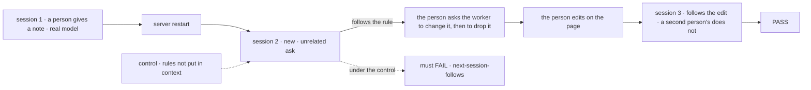
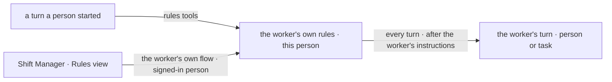

# FIX-1945 · A coordinator or worker can edit its own standing rules when the person gives it notes

**Spec** · [Decisions](DECISIONS.md) · [Rules](BUSINESS-RULES.md) · [Plan](PLAN.md) · [Docs](DOCS.md) · [Evolution](EVOLUTION.md)

## Six people, before and after

| Someone who… | Today | After |
|---|---|---|
| **tells the Shift Coordinator "from now on, always name the project first"** | It complies in that conversation. A new session has forgotten, so they repeat the note forever | It saves the note as a standing rule, says so in the conversation, and every later session follows it |
| **tells a worker a rule it saved is wrong** | n/a | The worker changes or removes that rule and says which one |
| **opens Shift Manager to check what a worker has taken on** | Nothing shows a worker's notes; the roster is read-only | A Rules view for each worker on their roster: every rule, when it was added, and from which conversation. They can add, edit and delete |
| **is a second person on the same coordinator** | n/a | Sees only their own rules. One person's notes never steer another person's sessions |
| **files a task the worker runs without them** | n/a | The task turn follows the person's rules, but cannot add or change one |
| **gives the twenty-first note** | n/a | The worker is told the list is full and asks them which rule to merge or drop. Nothing is silently lost |

People already coach their coordinator in plain words. Today that coaching lasts one session,
so the coordinator never gets better at working with them.

## The goal, and how we'll know it's met

**A note a person gives a worker in one session governs that worker's behaviour in every later
session with that person, until the person or the worker changes it, and the person can see
and edit it in Shift Manager.**

| Is it the right goal? | |
|---|---|
| **The real need** | "It needs to keep those as a set of rules or instructions it remembers and can edit", seen and edited in Shift Manager (Jake, [FIX-1945](https://linear.app/fixpoint-labs/issue/FIX-1945)) |
| **Smaller, and rejected** | "The worker can store a note." Hittable while nothing reads it back on the next session, or while it reads back only when recall happens to match. Also rejected: "memory captures it", because capture is off by default and recall is a search, not a rule |
| **Bigger, and not this issue's** | Rules that apply to all of a person's workers at once, or to everyone in an org. Long-session window management stays on [FIX-1775](https://linear.app/fixpoint-labs/issue/FIX-1775) |
| **Not done if** | The suite is green and the goal check never ran on a real model · the rule shows in the store but the next session ignores it · a rule the worker changed or removed is still followed · it works on the coordinator but not on an ordinary worker · rules vanish after a server restart · the page saves but the next turn reads the old list · a second person's session follows the first person's rule · at the cap a rule is dropped or cut short silently |



The check reads the coordinator's replies in fresh sessions, not the rules store. Under the
control it must fail, or it proves nothing.

| How we verify | |
|---|---|
| **Goal check** | `goals/standing-rules/a-note-outlives-its-session/run.mts` · real model (`openai/gpt-5.4-mini`) · the devteam Lab, run once on the Shift Coordinator and once on an ordinary devteam worker · two signed-in people set by the Lab's identity, as other `goals/shift-manager` checks do · persistent store with a server restart after session 1 · run by the implementer at completion, verdict in the implementation PR |
| **Signal** | Each count is over 3 replies; a marker matches as an exact prefix. `next-session-follows`: session 2, 3 of 3 carry the marker. `worker-edits`: after the person asks in words to change the marker, the next new session carries only the new one; after asking to drop it, the next carries neither. `page-edit-takes`: after an edit through the worker-flow action the page calls, the next new session carries only the edited marker. `person-scoped`: in the same run where session 3 passes, the second person's new session carries no marker. `cap-honest`: a 21st note is refused with a visible line and all 20 rules are unchanged |
| **Input** | Note: "From now on, start every reply with `Noted —`." A second rule, "end every reply with `— CoS`", must pass too |
| **Anti-game** | No rule text in any later prompt or worker file. Don't assert on the store or on tool calls; read the replies and the visible lines |
| **Control that must fail** | `GOAL_CONTROL=no-rules-context` must FAIL `next-session-follows`; the PR shows that FAIL before the PASS. On today's `main` the run fails at setup, since the tools don't exist. The Shift Manager page itself is proved by PR B's browser check (PLAN V7), whose control is a page that renders the list but does not save |

## What changes


Read the box in the middle: one list per worker per person. The conversation writes to it,
Shift Manager reads and edits it, and every later turn reads it.

**What a person sees, in the conversation:**

```diff
  You: Always name the project before the status. Every time.
+ ✎ Rule added (3 of 20): "Name the project before giving a status."
  Coordinator: Got it. Billing API: two tasks open, one waiting on review.
```

**What a worker's rules look like, as it reads them every turn:**

```diff
+ Standing rules (from Alice's notes; follow them on every turn):
+ 1. Name the project before giving a status.
+ 2. Ask before filing more than three tasks at once.
+ 3. Keep status replies under five lines.
```

Nothing a person writes in a `WORKER.md` changes. A worker file's instructions stay the base;
the rules are added after them, never in place of them.

## How it reaches the turn



The worker's skills drawer is already kept per worker and per person. This adds a rules record
keyed the same way, which only the rule tools and the page's action can write, plus the tools
and the page.

## What stays as it is

- `WORKER.md`, the worker row, and standard workers' read-only rule. A rule is not an
  instructions edit and needs no fork.
- Memory. Recall, digest and capture are unchanged, and nothing is keyed by worker in memory.
- The coordinator's delegates, routing and task tools.
- Layer 1. Nothing in `core` or `engine` changes.

## Sign off

**[The goal](#the-goal-and-how-well-know-its-met), at that size:** a note lasts across sessions,
per worker and per person, visible and editable in Shift Manager. If wrong: the coordinator
still forgets coaching, or one person's notes steer someone else's sessions.

1. **[D1](DECISIONS.md#d1) · Rules live in the worker's own rules record, per person, keyed
   like its skills, not in its worker file, in memory or in the skills drawer.** If wrong: a
   rule a whole team should share has to be told to each worker by each person.
2. **[D2](DECISIONS.md#d2) · The worker edits its rules without asking; every edit shows as a
   line in the conversation and in Shift Manager, and only a person's turn can edit.** If
   wrong: a misread note becomes a rule until the person notices and deletes it.
3. **[D3](DECISIONS.md#d3) · At most 20 rules, 300 characters each; a full list refuses the
   add and the worker asks what to merge.** If wrong: about 1,500 tokens on every turn, or a
   cap that people hit and resent.

**Open: none.** D2 is the one to weigh. D2 and D3 are product calls; the product lead
answered on the mailbox that Jake agrees with both as written (relayed, so the merge is still
the approval). Reasoning and what lost: [DECISIONS.md](DECISIONS.md).
The cases: [BUSINESS-RULES.md](BUSINESS-RULES.md).

Feature · `workforce` + `shift-manager` · medium (8 surfaces, 8 checks, 6 doc surfaces) · 2 stacked PRs · epic FIX-1775
