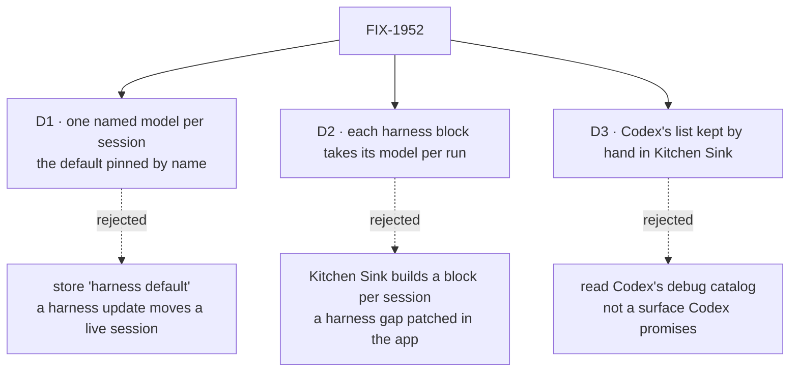

# FIX-1952 · Decisions

[Spec](SPEC.md) · **Decisions**

What was considered, what was chosen, why, and what each choice locks in. Three decisions are
the sign-off surface. Everything else here is context for them.

## The tree

Solid edges are what you're signing. Dashed edges lost, and the label says why.

## D1 · A session runs one named model for its whole life, and the harness default is pinned by name when the session starts

| | |
|---|---|
| **Instead of** | Storing "the harness's default" and letting each turn use whatever the harness defaults to at that moment |
| **Because** | The ask: later turns and resumes use the same model, and the session shows which. A harness update between two turns would move "default" under a live conversation, unannounced, and "default" names no model. The framework already fixes a session field at birth, so stickiness is enforced, not promised (tenet 2) |
| **Locks in** | No switch: a second model is a second session. A session keeps its model after the harness's default moves on. Codex mode runs a named model where today it runs an unnamed one |

It comes down to a harness update between two turns: "default" moves a live session to another model.

**What would change my mind:** wanting a long-lived session to follow each harness's newest
default. Then "default" is a choice in the list, and the header says it follows the harness.

## D2 · Each harness block takes its model per run, as it takes its directory and conversation: a change to three published packages

| | |
|---|---|
| **Instead of** | Kitchen Sink building a fresh block for each session's model, or one flow kind per model |
| **Because** | A block is built once, with its flow, so a fixed setting can't differ by session. The epic says a harness needing more than its options has a gap in its package, not one for Kitchen Sink to patch ([ER-6, ER-11](../../epics/FIX-1907/BUSINESS-RULES.md)). One name over three vendor shapes, for any app on these blocks (tenet 4) |
| **Locks in** | A public option named `model` on all three blocks, a fixed id or a per-run choice, kept in step, with a release note per package. The vendor-shaped settings stay; setting both is refused, one owner per value |

It comes down to whose gap it is: a block built once can't vary by session, and patching that in the app is what the epic forbids.

**What would change my mind:** evidence that no app but Kitchen Sink will choose a model per
run. Today the coding-skill lab sets one per host, and Shift Manager sets none.

## D3 · Codex's model list is kept by hand in Kitchen Sink, because Codex's SDK can't list models

| | |
|---|---|
| **Instead of** | Reading Codex's own catalog through its command-line debug command (`codex debug models`), which works today: ten entries, six marked to show |
| **Because** | The ask sets the rule: the harness's list where its SDK can list, else a short curated one. Codex's SDK has no list, and the debug command is a diagnostic Codex doesn't promise to keep. Claude Code's and Cursor's SDKs both list |
| **Locks in** | When Codex ships or retires a model, Codex mode is wrong until someone edits the list. [FIX-1975](https://linear.app/fixpoint-labs/issue/FIX-1975) removes the list once Codex's SDK can list |

It comes down to what Codex promises: its SDK lists nothing, and a debug command can change in any release.

**What would change my mind:** you'd rather see every model Codex offers today and accept that
a Codex update may break the list until the reader is fixed.

## Decided, not asked

- **The model is set when the session is born and never after**, through a top-level session field
  declared fixed at birth. A turn can't change it; the framework refuses the write.
- **Kitchen Sink does not check the id against the list.** The picker offers listed ids only; the
  harness judges what it runs. A refusal reaches the person in the harness's words, where the
  harness already puts them (its error, or its error item); Kitchen Sink writes none
  ([ER-11](../../epics/FIX-1907/BUSINESS-RULES.md#what-no-child-may-do)). A refusal with no words
  anywhere is a package gap, filed under the epic (ER-15).
- **A new session must name its model**; the flow's create check refuses one that doesn't. A
  session stored before this change has none and runs as it did, on the mode's default, and its
  header says so (BP-030).
- **A list call fails, and the mode has a concrete default id** (Cursor): the picker says
  why and offers that id only. No stale fallback list. Codex never fails: its list is kept by hand (D3).
- **A list call fails, and the default is only an SDK alias** (Claude Code today): the picker says
  why and offers no models. New session stays disabled until a reload successfully loads the list.
  An alias can't be pinned without the list to resolve it ([below](#alias)), and Kitchen Sink keeps
  no Claude model name of its own.
- **Where each list is read.** Claude Code: the package's no-turn start its sign-in check already
  runs. Cursor: its catalog call, beside its sign-in check. Codex: Codex mode's list, first entry
  the default.
- **Where an id has an alias** (Claude Code's `sonnet`), the session pins the id it resolves to
  at birth, per D1.
- **Each harness takes the model on resume**, read off the pinned SDKs: Codex passes `--model` on
  a resumed thread; Claude Code takes `model` beside `resume`; the Cursor package hands
  `Agent.resume` the options `create` gets. The goal check proves it on the real path.
- **The header shows the model's name and id.** The rail is not changed.

## Considered and dropped

| Alternative | Why not |
|---|---|
| A model setting per mode on the host (an environment variable) | The person changes it by restarting the server, and two sessions can't differ. The ask is per session |
| Wrap each SDK seam (the stand-in client hooks) to slip the model in | Patches a harness gap in the app, which the epic forbids (ER-11), and on Cursor a stand-in client turns off the package's environment filter |
| Kitchen Sink checks the id against a fresh list before each turn | Starts Claude Code once more per turn to ask, and second-guesses the harness, which is the one that runs it |
| Lift the model list into core as one shared function | Two harnesses list in different ways and one can't. A shared function with one real caller is surface before need |
| Kitchen Sink keeps a Claude model name to offer when the list fails | The name ages as Claude Code's default moves, and it is a list kept by hand for a harness that can list (D3's rule) |
| A package-only "default" API that returns a concrete id without the list | Surface on a published package for one failure case. Waiting for a reload costs less |
| Flow State mode in scope | It already has its own selector over gateway models, a different mechanism. Out of scope by the ask |

## Settled

- **No POC.** The premises are read off the pinned SDKs (above), and the goal check runs each
  on the real path before the implementation merges. No host signed in to the three harnesses
  was available while drafting.

## How it got here

- **Draft** — framed as a model chosen per session that the harness itself must confirm; built on
  the framework's fixed-at-birth session field and a per-run `model` option on the three harness
  blocks; Codex's list kept by hand because its SDK can't list.
- **Amended 2026-10-14, after merge**, found while building
  ([#3351](https://github.com/fixpoint-labs/flow-state-dev/pull/3351)): a failed list on Claude
  Code offers no model, since its default is an alias with no id to pin. Settles
  [this thread](https://github.com/fixpoint-labs/flow-state-dev/pull/3332#discussion_r4271267307)
  by its third option.

## Notes from review

- "tri-package `model` can land atomically for API parity while **Kitchen Sink** proves the feed pattern on one mode first internally" — cursor ([thread](https://github.com/fixpoint-labs/flow-state-dev/pull/3332#discussion_r4265839356))
- "Consider documenting a **tier split**: scripted-harness / feed wiring in CI … vs this goal as the merge VG" — cursor ([thread](https://github.com/fixpoint-labs/flow-state-dev/pull/3332#discussion_r4265839351))
- "successful model lists may be **memoized with the gate** for the server process … account + models should be **one** no-turn SDK session if possible" — cursor ([thread](https://github.com/fixpoint-labs/flow-state-dev/pull/3332#discussion_r4265839358))
- "a **dev-only** reader for `codex debug models` behind a flag, with the curated list still the default UX" — cursor ([thread](https://github.com/fixpoint-labs/flow-state-dev/pull/3332#discussion_r4265839364))
- "three separate list code paths without a shared 'fetch once per process' helper — duplication smell" — cursor ([thread](https://github.com/fixpoint-labs/flow-state-dev/pull/3332#discussion_r4265839367))
- "optional `GOAL_MODEL` legs on the three existing harness goals would reduce duplicate Playwright harness setup" — cursor ([review](https://github.com/fixpoint-labs/flow-state-dev/pull/3332#pullrequestreview-5512020047))

These are inputs, not instructions. Adopt, adapt, or discard; you owe no justification for
discarding one.

**Open: none.**
