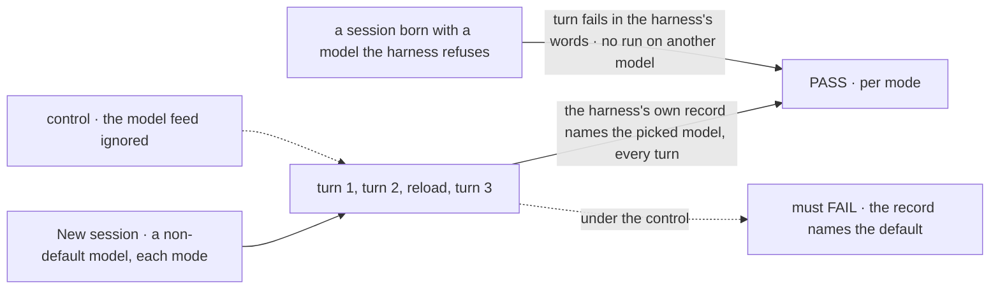
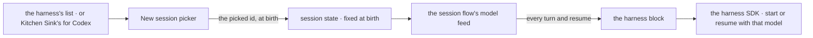

# FIX-1952 · Pick the model each harness runs in Kitchen Sink

**Spec** · [Decisions](DECISIONS.md)

## Six people, before and after

| Someone who… | Today | After |
|---|---|---|
| **wants to try the same task on another model** | Edits Kitchen Sink's code and restarts the server | Picks the model in **New session**, with the harness's default preselected, and starts a second session beside the first |
| **continues or reopens a session days later** | Gets whatever the code says now | Every turn and resume runs the model the session started with, even after the harness changes its default ([D1](DECISIONS.md#d1)). The header names it |
| **picks a model the harness won't run** (no access, retired, misspelt) | n/a | The turn fails, and the person reads the harness's own reason. Nothing runs on another model |
| **opens New session while the harness's model list can't be reached** | n/a | The picker says why. Cursor offers its default only; Claude Code offers nothing, and New session waits for a reload ([amended](DECISIONS.md#decided-not-asked)) |
| **uses Codex mode** | Runs Codex's unnamed default model | Picks from a short list Kitchen Sink keeps, because Codex can't list its models ([D3](DECISIONS.md#d3)) |
| **builds an app on a harness block** | Sets one model per flow, fixed when the block is built | Chooses it per run, as it already chooses the directory and conversation ([D2](DECISIONS.md#d2)) |

Requested by Jake on 2026-10-13: *"We also need to be able to select the model to run within each
harness."* Kitchen Sink is the test bed of [epic FIX-1907](../../epics/FIX-1907/SPEC.md).

## The goal, and how we'll know it's met

**A person starting a Claude Code, Codex or Cursor session in Kitchen Sink picks the model it
runs, and every turn of that session, resumes included, runs that model or fails in the
harness's own words.**

| Is it the right goal? | |
|---|---|
| **The real need** | Try the same task on different models in each harness without changing code ([FIX-1952](https://linear.app/fixpoint-labs/issue/FIX-1952), Jake's words above) |
| **Smaller, and rejected** | "A dropdown that sets the model." It passes while a resume runs the default, or a refused model quietly runs another: both make a comparison wrong unseen |
| **Bigger, and not this issue's** | Switching model mid-session · comparing cost or capability · Flow State mode, which already has its own model selector |
| **Not done if** | The check reads Kitchen Sink's state, not the harness's record · it ran only on scripted harnesses · a refused model ran the default · a resume after reload ran another model · Codex still runs an unnamed default · Claude Code offered a model while its list failed |



The check reads which model the harness says it ran, never what Kitchen Sink asked for; under the
control, every mode runs its default and the check must fail.

| How we verify | |
|---|---|
| **Goal check** | `goals/kitchen-sink-harness/runs-the-picked-model/` · real browser, real harnesses, on a host signed in to all three · run by the implementer at completion, handed to `fsd-qa` if no such host is at hand · verdict in the implementation PR |
| **Signal** | Per mode, for turns 1 to 3: the model the harness recorded for the turn equals the picked id (Claude Code's start-of-run message, Cursor's run result, Codex's own session file), and the header shows it. Refused leg: the turn fails with the harness's words on the page, and nothing ran on another model |
| **Input** | A non-default model from each picker; any other listed model must pass too. The refused leg starts a session through the session API with an id the harness has never had |
| **Anti-game** | Never assert on the session's stored model, the block's options or a scripted harness: all three pass while the harness runs its default |
| **Control that must fail** | `GOAL_CONTROL=ignore-model` (the model feed hands the harness nothing): FAILS on *the harness's record equals the picked id* in every mode, and the refused leg FAILS because the harness runs instead of refusing. Today's `main` FAILS: no picker |

## What changes


Read across each row: the model moves from code to the person. The band is the same for all three.

**A host app choosing the model per run** (the option [D2](DECISIONS.md#d2) adds to each block),
and Kitchen Sink starting a session on the picked model:

```diff
  codexAgent({
    cwd: feeds.cwd,
    resume: feeds.resume,
    onSession: feeds.onSession,
+   model: feeds.model,                // read per run, like cwd and resume
-   thread: { model: CODEX_MODEL, approvalPolicy: "never" },
+   thread: { approvalPolicy: "never" },
  })

- sessions.createSession({ flowKind, userId })
+ sessions.createSession({ flowKind, userId, state: { model: picked } })
```

**Docs:** update `apps/docs/docs/tools/coding-agents.md` (`model` joins the per-run feeds) and
the Claude Code, Codex and Cursor pages and package READMEs (the option, and how each lists
its models); update Kitchen Sink's README mode sections (picking a model, where each list comes
from). No new page. A changeset for the three packages.

## How the model reaches the harness



The model is written once, when the session is born, into a field the framework refuses to change
afterwards. Each run reads it through one feed, beside the directory and the conversation.

## What stays as it is

- **One model per session.** No switching between turns; a second model is a second session.
- **Flow State mode** and its model selector.
- **The harness handle, `resume` and `onSession`** ([ER-13](../../epics/FIX-1907/BUSINESS-RULES.md#what-no-child-may-do)). A block's fixed model setting keeps working.
- **No cost or capability comparison.** A cost estimate shows where it already would.

## What's already here, and the debt

| Already here | What this does with it |
|---|---|
| **Whatever already chooses a harness's model**: each block's fixed setting; the coding-skill lab maps one host setting onto all three | **Extends** the closest, the block's setting, to a per-run choice ([D2](DECISIONS.md#d2)). Searched `model` in the three packages, `harness-manager`, `labs/`, `apps/kitchen-sink`: no per-run choice exists |
| Kitchen Sink's `CURSOR_MODEL` and `CODEX_MODEL` constants | **Removes.** They become each list's preselected default |
| A session field fixed at birth (`.readonly()` session state) | **Builds on.** It is "the choice sticks", enforced by the framework |
| Claude Code's sign-in check, which starts Claude Code without a turn | **Builds on.** The same start answers which models it offers |
| The session flow factory's feeds ([FIX-1915](https://linear.app/fixpoint-labs/issue/FIX-1915)) | **Extends** with one feed, shared by all three modes ([ER-6](../../epics/FIX-1907/BUSINESS-RULES.md#what-a-team-gets-and-what-it-doesnt)) |
| Flow State mode's model selector | **Leaves alone.** Gateway models, one setting across sessions: another job |
| [FIX-1917 → Decided, not asked](../FIX-1917/DECISIONS.md#decided-not-asked): "`composer-2.5` … No model setting until someone needs a second model" | **Superseded in part**, the model setting only: its own condition is met. `composer-2.5` stays the default |
| [FIX-1916 → Decided, not asked](../FIX-1916/DECISIONS.md#decided-not-asked): "Codex's default model" | **Superseded** by [D1](DECISIONS.md#d1): Codex mode runs a named model. Its "no change to the Codex package" was that issue's scope, not a rule; ER-13 still holds |

| The debt | |
|---|---|
| **Removes** | Two model constants in Kitchen Sink |
| **Adds** | A per-run model option on three published packages, beside each one's fixed setting: permanent by design, since a fixed model stays the common case. A hand-kept Codex model list that ages as Codex ships models ([D3](DECISIONS.md#d3)), paid by [FIX-1975](https://linear.app/fixpoint-labs/issue/FIX-1975) when Codex's SDK can list |
| **Leaves** | Core's run handle carries no failure text, so a run reported as failed (not thrown) gets a generic notice while the harness's words sit in the transcript. Epic-level (ER-13), raised there |

**Net: up, slightly.** Two constants go; one option on three packages and one short list come in.

## Sign off

**[The goal](#the-goal-and-how-well-know-its-met), at that size:** the picked model, by the
harness's own record, on every turn and resume, or a failure in its words. If wrong: we ship a
picker whose comparisons are quietly wrong.

**[The debt](#whats-already-here-and-the-debt), net up, slightly:** a per-run option on three
packages and a Codex list kept by hand; two constants go. If wrong: three packages carry an
option only Kitchen Sink uses.

1. **[D1](DECISIONS.md#d1) · A session runs one named model for its life, the default included.**
   If wrong: a session started before a harness update keeps an older model the person didn't
   expect.
2. **[D2](DECISIONS.md#d2) · Each harness block takes its model per run, a change to three
   published packages.** If wrong: public surface nobody but Kitchen Sink uses. **The one to weigh.**
3. **[D3](DECISIONS.md#d3) · Codex's list is kept by hand in Kitchen Sink, since its SDK can't
   list.** If wrong: Codex's newest model is missing until someone adds it.

**Open: none.** Reasoning and what lost: [DECISIONS.md](DECISIONS.md).

Feature · `claude-code` + `codex` + `cursor` + `apps/kitchen-sink` · medium · epic [FIX-1907](../../epics/FIX-1907/SPEC.md)
