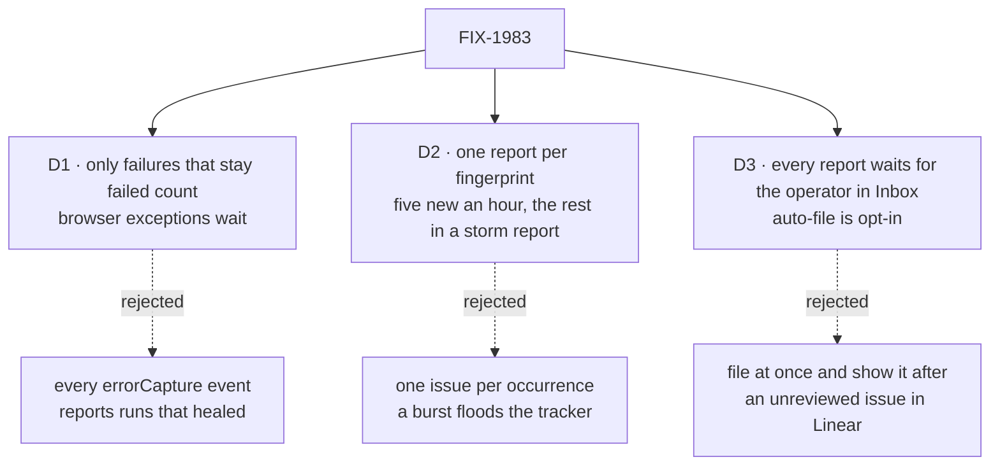

# FIX-1983 · Decisions

[Spec](SPEC.md) · **Decisions**

What was considered, what was chosen, why, and what each choice locks in. Three decisions are the
sign-off surface. Everything else here is context for them.

## The tree

Solid edges are what you're signing. Dashed edges lost, and the label says why.

## D3 · Every report waits for the operator in Inbox before it files. A Lab can name error kinds that file without asking, or a timeout after which a report files; both are off by default

| | |
|---|---|
| **Instead of** | Filing at once and showing the issue afterwards, or a preview with no way to switch it off |
| **Because** | The product lead asked for it: the operator checks the findings, answers the reporter's questions and says how to handle it, and the issue is better for it. While Shift Manager is new, every failure is worth a look. The ask is an ordinary suspension in the reporter's own session, so it shows in Inbox with no coordinator involved. Later, when some error kinds are well understood, the Lab names them in `preview.autoFile`, or sets `preview.autoFileAfter`, and those skip the wait |
| **Locks in** | By default nothing reaches the tracker unseen, and a report nobody answers never files; its count keeps growing in Inbox. At a high error rate the operator is the bottleneck until they turn on auto-file. Each answer is one more thing in the operator's day |

It comes down to a person checking it first: file-at-once puts unchecked issues in Linear.

**What would change my mind:** reports piling up unanswered for days. Then the default becomes a
timeout (say a day) after which the report files as drafted.

## D1 · Only failures that stay failed count: a request that ends failed in any flow, a task that ends errored, a harness run that fails for good. Browser exceptions wait

| | |
|---|---|
| **Instead of** | Every `errorCapture` event as it fires, which is one per failed attempt, rescued failures included |
| **Because** | A report for a run that a retry fixed is noise, and noise trains people to ignore the reporter. The engine knows when a request settles failed and says so once, marked final. A task's attempts are separate requests, so a failed request that belongs to a task waits for the task's ending; every task ending, including one with no failed request (a refused dispatch, a worker that died too often), comes from orchestration's one ending signal, where the Workforce board's recorder marks a report owed. A harness run counts when its failure reaches one of those two: the run throws, or the task's worker turns a failed result into a failed attempt (the harness manager does), so the task ends errored. A flow that records a returned `failed` outcome as data and finishes normally, as the kitchen-sink harness page does, has not failed to the engine and is not reported; a flow that wants a report for it throws. A Lab can narrow the set with a filter; the default is all three |
| **Locks in** | `errorCapture` sends one more event per failed request, marked final, and existing adapters see it too. A harness failure returned as data and never thrown is not reported. Browser-page bugs are still filed by hand until [FIX-1984](https://linear.app/fixpoint-labs/issue/FIX-1984) |

It comes down to a run that passes on retry: every-event reports a bug that already healed.

**What would change my mind:** retried-then-passed runs turning out to hide real bugs. Then they
are reported too, marked as recovered.

## D2 · One report per fingerprint; repeats are counted; at most five new reports an hour per Lab, the rest in one storm report

| | |
|---|---|
| **Instead of** | One issue per occurrence, or reopening a closed issue when its failure comes back |
| **Because** | Twenty repeats of one bug are one bug. While a report waits in Inbox a repeat only raises its count; once filed, a repeat adds at most one comment an hour to the issue, with the count and the newest ids. A burst (the model provider down, say) would otherwise make a hundred reports for one cause; past five new ones in an hour, the rest go in one storm report for that hour, listing each fingerprint and its count. A failure that comes back after its issue was closed starts a new report that links the old issue, so a regression is visible and nobody's closed issue is reopened under them |
| **Locks in** | The fingerprint decides what the same bug is. Two bugs that fail at the same block with the same code are merged until someone splits them. The limits are Lab settings, defaulting to five an hour and one comment an hour |

It comes down to a burst from one cause: one-per-occurrence makes a hundred issues for it.

**What would change my mind:** merged bugs turning out to be common. Then the fingerprint takes
the stack's top frame too, at the cost of more duplicates.

## Decided, not asked

- **It runs on its own flow and never through the Shift Coordinator.** A requirement, not a
  choice: the coordinator is the part most likely to have failed.
- **It runs as the Lab's operator and files into one tracker project the Lab names.** The user
  who hit the failure may have no Linear key and isn't the one asked. The intake makes the
  operator the reporter's user, so [FIX-1905 D4](../FIX-1905/DECISIONS.md#d4) gives it the
  operator's key; the operator must be a member of the tracker project, and its servers must
  include Linear. The reporter's sessions are bound to that project, so its Inbox asks and its
  Teams conversation are there too. A Lab that names no tracker keeps reports in Inbox only.
- **The fingerprint** is flow kind, action, block path, error code, and the message with ids,
  numbers and paths stripped.
- **One intake is the convergence point for "one report per fingerprint"** (tenet 5). The
  engine's final event and the board's owed-report marks both go through it; it
  fingerprints, claims the report row, counts and applies the cap before anything runs. A failed
  request that belongs to a task is held until that task ends, and then joins the task's
  report rather than making its own. The engine's event carries no task field and gets none: the
  intake finds the task itself, from the board row whose `run.requestId` (set when the run
  starts) is the event's `requestId`. `run` holds only the latest attempt, so a retry that starts
  first would hide the match: the intake resolves the task when it first takes the event, and a
  request from a task run's session that no longer matches is still held as that task's, never
  reported alone. Leg 4 is the check.
- **The intake binds after construction.** `createErrorReporter` returns the `errorCapture`
  handler and a `bind(state)`; the handler enqueues and returns, and each occurrence is written by
  a `runAction` into an internal intake action, since a collection has no door outside a flow. The
  final event bypasses the per-request dedupe set, which already holds the thrown value, and the
  setup-failure path emits it only when its failed write landed.
- **The report row is written before the reporter runs**, and is the outbox (FIX-1780's
  pattern), in the Lab's store, so counts survive a restart. A run that fails leaves the row
  unfiled, and the next start retries it.
- **The reporter never reports itself.** Its own flow kind is excluded at the intake; its
  failures go to the log and leave the row unfiled.
- **The dossier is gathered by code before the harness starts:** the request record, its last
  items and events, the session's workstream, project and held task, the task row and its board,
  the worker and its harness, with links. Every value passes a redaction step; env values, MCP
  keys and bearer tokens never reach it. The harness reads the code and writes the draft from
  the dossier, so the ids are exact.
- **The preview card** shows the draft issue and the reporter's questions. *File* (with optional
  instructions) folds the answer in and files; *Don't file* closes it, and repeats of that
  fingerprint are counted without a new card for 24 hours.
- **A person can report a problem by messaging the Error Reporter** in its own conversation,
  naming a session, task or project or none. It takes the same intake (the person's description
  stands in for the error message in the fingerprint, under the same cap), the same Inbox
  preview and the same filing. Jake asked for it on 2026-10-14.
- **Harness is a slot on the reporter's flow**, like `coder`'s, Claude Code by default.
  `WORKER.md` gains no harness key.
- **Instructions are the `WORKER.md` body plus the operator's standing rules**, edited by talking
  to the reporter ([FIX-1945 D2](../FIX-1945/DECISIONS.md#d2)). A preview answer is handling for
  that report; a rule that should stick is said in its conversation.
- **Shift Manager adds no UI of its own.** The reporter is a Workforce feature any app can use. Its
  preview is an ordinary form suspension, so Shift Manager's Inbox draws it with the cards it
  already uses for every ask, and its reply box reaches the reporter's session for follow-ups.
  The *Error Reporter* worker shows in Teams from its `WORKER.md`, and the Linear key is the
  operator's own on the Settings page (FIX-1905). Shift Manager's part is turning the reporter on
  in its Lab config, and docs.
- **Teams:** an org worker named *Error Reporter*, under *General* (FIX-1959). Its conversation
  holds one line per issue filed or commented, with the link. It hires and routes nothing.
- **The report mark rides the ending signal, never a second path.** `endingOf` stays the one
  place an ending is detected. The board's recorder stays pure (it may re-run on a version
  conflict): it only adds a `reportOwed` mark to the row's metadata. The mark is drained where
  owed notices are, after the write and on the board's next touch, by dispatching to the
  intake's internal action, never through the coordinator. No post-commit callback, so a crash
  can't drop a report.
- **Sequencing:** lands after #3304 (FIX-1959, display names); #3325 (FIX-1876 P2, which
  renames the board's dispatch vocabulary) has merged. If FIX-1872 P2's per-row ending handling lands first,
  the recorder change builds on it.
- **The engine carries no worker, preview or tracker word** (layer rule). Orchestration is not
  changed.

## Considered and dropped

| Alternative | Why not |
|---|---|
| A new engine hook beside `errorCapture` | Two sinks for one job. The architecture names `errorCapture` as the error-reporting seam |
| Correlate request failures to tasks only, with nothing on the board | Misses tasks that error without a failed request: a refused dispatch, a worker that died too often |
| A new Lab-wide task-ending observer in orchestration | A second ending path beside `endingOf`, and a post-commit callback a crash can drop |
| Use FIX-1780's task-ending notice | Its receiver runs in the filing conversation, often the coordinator's |
| Use `onErrored` on each flow | Per flow, so a Lab wires every flow, and it misses setup failures after acceptance |
| Preview through the coordinator's "needs you" list | Puts the coordinator back on the path |
| Hand the harness a raw event and let it look everything up | It may lack read tools for sessions and boards, and hand-copied ids can be wrong |
| Reopen the closed issue on a recurrence | Changes state on an issue someone closed, in a tracker we don't own |

## How it got here

- **Draft** — framed as a worker woken by final failures, outside the coordinator, on the
  engine's existing `errorCapture` sink; Workforce owns intake, dedupe, storm cap and filing.
- **Preview** — D3 became "every report waits for the operator in Inbox", because the product
  lead asked that Jake review each report before it files. Running as the operator moved to
  *Decided, not asked*. Validation made a task's failure wait for its ending, because a task's retry is a new request.
- **Review** — the task ending now rides orchestration's one ending signal as a report mark on
  the board's recorder, instead of a new observer, because the architect's coherence check
  found `endingOf` already is that signal.
- **Review, round 2** — the goal check now proves a failed report is retried after restart, that a
  task with no failed request is reported, and that the storm report lists only what got no report
  of its own. D1 now says a harness failure returned as data is not reported unless it is thrown.

## Notes from review

- "D2 bundles a lot for one sign-off decision… Consider splitting product must-have (one card per fingerprint, counted repeats, storm when the provider is down) from nice-first-week (comment rate limit, regression linking)." — cursor ([thread](https://github.com/fixpoint-labs/flow-state-dev/pull/3357#discussion_r4273878394))
- "Suggest tagging legs P0 vs P1 in this table so direction stays intact but delivery can land intake + preview + D1 before storm/restart outbox." — cursor ([thread](https://github.com/fixpoint-labs/flow-state-dev/pull/3357#discussion_r4273878427))
- "Automatic full harness run per new fingerprint (under the hourly cap) will dominate cost during incidents… code-built draft from a bounded dossier → Inbox ask → harness only when the operator asks to refine. If the goal check must keep 'real Claude Code' on leg 1, say that explicitly." — cursor ([thread](https://github.com/fixpoint-labs/flow-state-dev/pull/3357#discussion_r4273878418)). The goal check does name real Claude Code; the dossier's size bound is the implementer's.
- "Could the spec require the same marker/claim/clear pattern as `task-notice.ts` (typed row: `task-settled` vs `error-report`) rather than 'beside' as a parallel design?" — cursor ([thread](https://github.com/fixpoint-labs/flow-state-dev/pull/3357#discussion_r4273878436)). The task path now rides the same recorder; the report row's own shape is the implementer's.
- "Prefer a single `composeErrorCapture(sentry, reporter.capture)` helper in engine (mirror 'observer must not throw')." — cursor ([thread](https://github.com/fixpoint-labs/flow-state-dev/pull/3357#discussion_r4273878454))
- "Exercise recovery of a failed reporter run." — codex ([thread](https://github.com/fixpoint-labs/flow-state-dev/pull/3357#discussion_r4273890528)). Folded: leg 6 now retries the same row after restart.
- "Exercise task failures with no failed request." — codex ([thread](https://github.com/fixpoint-labs/flow-state-dev/pull/3357#discussion_r4273890545)). Folded: leg 7.
- "Align storm membership with D2." — codex ([thread](https://github.com/fixpoint-labs/flow-state-dev/pull/3357#discussion_r4273890553)) and greptile ([thread](https://github.com/fixpoint-labs/flow-state-dev/pull/3357#discussion_r4273898208)). Folded: leg 3 and the D2 figure.
- "Remove the speculative preview bypasses." — codex ([thread](https://github.com/fixpoint-labs/flow-state-dev/pull/3357#discussion_r4273890537)). Kept: the product lead asked for the option, and both are off by default.
- "Failed harness turns go unreported" when a harness returns `outcome: "failed"` without throwing. — greptile ([thread](https://github.com/fixpoint-labs/flow-state-dev/pull/3357#discussion_r4273898201)). Folded: D1 now says such a run is reported only when it throws or its task ends errored.
- "`capture` must enqueue and return immediately (engine awaits handlers today — see `safeCaptureError`)." — cursor ([thread](https://github.com/fixpoint-labs/flow-state-dev/pull/3357#discussion_r4273878406)). Already under *Decided, not asked*.

These are inputs, not instructions. Adopt, adapt, or discard; you owe no justification for
discarding one. A note that turns out to reveal a design problem is a spec blind spot —
surface it and fold it back, per the challenger discipline in `issue-implement`.

**Open: none.**
