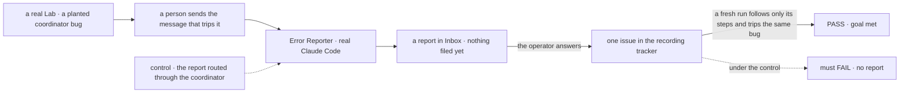
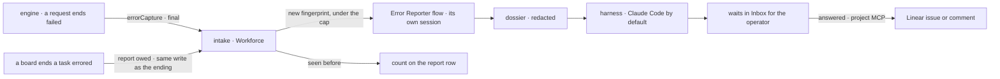

# FIX-1983 · Error Reporter: a team member told about every system error, that files a detailed bug

**Spec** · [Decisions](DECISIONS.md)

## Six people, before and after

| Someone who… | Today | After |
|---|---|---|
| **runs a Lab and hits a failed turn** | Sees a red line, copies what they can, and writes the bug by hand, if they remember | Finds a draft report in Inbox: what they asked, which worker and harness, the ids and links, steps to reproduce, and the reporter's questions. They answer, and it files the issue to the project's Linear with their answer folded in ([D3](DECISIONS.md#d3)) |
| **hits a failure in the Shift Coordinator itself** | The worker that would route the bug is the one that broke | The report still reaches Inbox and the tracker. The Error Reporter runs on its own flow and never goes through the coordinator |
| **sees the same failure twenty times in a morning** | Twenty red lines | One report. Repeats add to its count, and after filing they add a counted comment ([D2](DECISIONS.md#d2)) |
| **sees a burst: every request failing at once** | A wall of red | At most five new reports that hour, and one storm report that lists the rest ([D2](DECISIONS.md#d2)) |
| **watches a task fail once, then pass on retry** | Nothing to file | Nothing reported. Only failures that stay failed count ([D1](DECISIONS.md#d1)) |
| **wants it to write differently, run another harness, or file some errors without asking** | n/a | Edits its `WORKER.md`, or tells it in its conversation, as with any worker. The Lab picks its harness in code, Claude Code by default, and can name error kinds it files without asking |

Requested by Jake on 2026-10-14: *"Add a special team member that is automatically notified of any
error in the system and files an issue for it."* The product lead added the same day that it
previews each report to him first, and files after he answers ([FIX-1983](https://linear.app/fixpoint-labs/issue/FIX-1983)).

## The goal, and how we'll know it's met

**When something in a Lab fails for good, the operator gets a report they can check and add to,
and the project's tracker then gets one issue an engineer can reproduce from, even when the
Shift Coordinator is what failed.**

| Is it the right goal? | |
|---|---|
| **The real need** | Shift Manager bugs reach the tracker with enough context to fix, without anyone writing them, reviewed by Jake first, and not dependent on the part most likely to break (Jake's and the product lead's words above) |
| **Smaller, and rejected** | "Errors are forwarded to Linear." A stack trace with no user, intent or steps is the red line moved somewhere else. It passes while nobody can reproduce anything |
| **Bigger, and not this issue's** | Exceptions inside the browser page ([FIX-1984](https://linear.app/fixpoint-labs/issue/FIX-1984)) · requests cut off by a server crash ([FIX-1985](https://linear.app/fixpoint-labs/issue/FIX-1985)) · fixing the bugs it files |
| **Not done if** | It passed with the coordinator healthy · it ran on a scripted harness · a task that passed on retry got a report · a burst gave one report per failure · an issue reached the tracker before the operator answered · the issue holds a key or token · the ids are present but belong to another session · the report is lost when the reporter itself fails, or loops into reporting itself · the counts reset on a server restart |



The check reads what reached Inbox and the tracker, then replays the issue in a clean Lab. Under
the control the broken coordinator swallows the report, and the check must fail.

| How we verify | |
|---|---|
| **Goal check** | `goals/error-reporter/files-a-reproducible-issue/` · `pnpm tsx goals/error-reporter/files-a-reproducible-issue/run.mts`, each control as `GOAL_CONTROL=<name>` · real Claude Code, the `devteam` Lab on its real server, a local MCP server that records Linear calls in place of Linear · run by the implementer at completion · verdict in the implementation PR |
| **Input** | A bug planted in the coordinator flow that throws only when a message names a project with no repository, so the trigger is a specific message. A second leg plants the bug in a worker's harness run instead, and must pass too |
| **Signal** | **Leg 1:** the message trips the bug. One report appears in Inbox and nothing is filed. Its ids (request, session, user, project, task) equal the store's for that run, and its links open them. The operator answers *"label it P1 and say which model the coordinator ran"*; exactly one issue is filed and it says both. A second Claude Code run, given only the issue text and a clean Lab with the same planted bug, follows the steps and trips the same fingerprint. **Leg 2:** the same failure 10 more times gives the same report, count 11, no second Inbox card. **Leg 3:** 30 different failures inside the window (set to the run's length) give between 1 and 5 reports plus 1 storm report, and every one of the 30 fingerprints is in exactly one of them: its own report, or the storm report's list. **Leg 4, same run as leg 1:** a task that fails once and passes on retry gives no report. **Leg 5:** no report or issue holds a value from the Lab's secrets or MCP keys. **Leg 6:** the reporter's own planted failure leaves its report unfiled and does not report itself; after a restart, with the plant removed and no new failure, that same report is retried and reaches Inbox, and the count from leg 2 is still 11. **Leg 7:** a task that ends errored with no failed request (its dispatch is refused) gives exactly one report |
| **Anti-game** | Don't assert on the reporter's prompt, the intake's return value, field names without values, or a scripted harness. All pass while nothing a person could use reaches the tracker |
| **Control that must fail** | `via-coordinator` FAILS leg 1 on *one report in Inbox* · `stack-only` (the issue holds the error and stack only) FAILS leg 1 on *the replay trips the same fingerprint* · `skip-preview` FAILS leg 1 on *nothing filed before the answer* · `no-dedupe` FAILS leg 2 on *one report* · `no-cap` FAILS leg 3 on *at most 5* · `eager` (report on first failure) FAILS leg 4 · `no-redact` FAILS leg 5. Today's `main` FAILS: no reporter |

## What changes


Read left to right: every final failure takes the same road, the coordinator is not on it, and
nothing reaches the tracker until the operator has answered.

**A Lab adds the reporter in two places.** A worker file, and the server wiring:

```diff
+ # workforce/org/workers/error-reporter/WORKER.md
+ ---
+ name: Error Reporter
+ description: Told about every error that stays failed. Investigates it, asks you, then files it.
+ flow: error-reporter
+ ---
+ You file one issue per failure that an engineer can reproduce from. …

+ const errorReporter = createErrorReporter({
+   worker: "error-reporter",
+   operator: LAB_USER_ID,                    // whose key files, and who is asked
+   tracker: { project: "fsd" },              // a project whose servers include Linear
+   // preview: { autoFile: ["harness.timeout"], autoFileAfter: "1d" },  // both optional, both off by default
+ })
  const state = createFlowState({
-   flows: [...workforceFlows],
+   flows: [...workforceFlows, defineErrorReporterFlow({ harness: claudeCodeAgent(…) })],
+   errorCapture: errorReporter.capture,      // compose with a Sentry handler if the Lab has one
  })
+ errorReporter.bind(state)                   // the intake runs once the runtime exists
```

**Docs:** create `apps/docs/docs/workforce/error-reporter.md` (sidebar: Workforce, after *Shift
Coordinator*). Update `advanced/error-capture.md`, the engine README's *Error capture* section,
the `errorCapture` row of `configuration/runtime.md` and `guides/routing-errors-to-sentry.md` for
the final-failure event. Update `shift-manager/overview.md` (*What a Lab's config provides*, Inbox),
`shift-manager/settings.md` (whose Linear key it files with), `workforce/overview.md`, the
glossary, and the `workforce` and `shift-manager` READMEs. A changeset for `engine` and
`workforce`.

## How a failure reaches the tracker



The engine only says a request ended failed. A task's ending comes from orchestration's one
ending signal, where the Workforce board's recorder marks a report owed in the same write as the
ending. Everything that knows about workers, previews and trackers is Workforce's, behind one
intake. A failed request that belongs to a task waits for that task's ending, so a retry that
passes reports nothing. The engine's event names no task: the intake finds the task on the
Workforce side, from the board row whose `run.requestId` is that request. A harness run that fails for good is its task ending errored.

## What stays as it is

- **The Shift Coordinator**, its flow and its delegates. Nothing reaches the reporter through it.
- **`errorCapture`'s per-block events**, for adapters that use them. The final event is added beside them.
- **FIX-1905's key rules.** FSD holds the key; the run gets tools.
- **A user's red line in the UI.** The reporter files a bug; it does not answer the user.

## What's already here, and the debt

| Already here | What this does with it |
|---|---|
| **Whatever already hears about errors**: `errorCapture` (engine), `onErrored` hooks (per flow), the HTTP `onError` (route errors only), the task board's `errored` change, harness-manager's failed run row | **Extends the closest**, `errorCapture`: the one sink that sees every flow's failures, the coordinator's included. It gains one event per request that settles failed, marked final ([D1](DECISIONS.md#d1)). Searched `errorCapture`, `onErrored`, `onError`, `errored`, `report`, `incident` across `packages/`: nothing files issues, and no Lab wires `errorCapture` |
| Orchestration's one ending signal: [`endingOf`](https://github.com/fixpoint-labs/flow-state-dev/blob/main/packages/orchestration/src/tasks/collection/ending.ts), called from `applyTransition` and `applyAbandonmentSettlement` in `internal.ts`, then each ledger's pure `recordEnding` (FIX-1794 P2, FIX-1816) | **Builds on, unchanged.** Every errored ending (a worker's settle, a refused dispatch, the claim path settling a worker that died too often) already passes it |
| The Workforce board's recorder ([`conversation-board/ledger.ts`](https://github.com/fixpoint-labs/flow-state-dev/blob/main/packages/workforce/src/conversation-board/ledger.ts)), which marks a notice owed in the ending's own write, drained by `sendOwedNotices` and the board's next touch (FIX-1780) | **Extends.** The same recorder also marks a report owed on an `errored` ending. The same drain points hand it to the intake, which clears the mark only when it accepts. Boards outside Workforce's ledger are not covered |
| `docs/architecture/internal-execution-seams.md`: error reporting goes through `errorCapture` and `onErrored` | **Kept.** The reporter consumes that seam |
| Inbox: every suspension a worker's session is waiting on | **Builds on.** The preview is an ordinary ask from the reporter's session; Inbox needs no coordinator |
| [FIX-1780](../FIX-1780/SPEC.md): a task's ending is delivered once, deduped, with the row as the outbox | **Builds on** its pattern. Its receiver runs in the filing conversation, so the reporter does not use it |
| The devteam host's `getRuntime` + `runAction` door | **Builds on.** The intake binds to the runtime after construction, the same way |
| [FIX-1905 D3](../FIX-1905/DECISIONS.md#d3): only Claude Code runs get project servers | **Kept.** On another harness the reporter keeps the report but cannot file it, and says so |
| [FIX-1905 D4](../FIX-1905/DECISIONS.md#d4): a run uses the key of the user its session belongs to | **Kept.** The intake makes the operator the reporter's user, so the operator's key files |
| [FIX-1945 D1, D2](../FIX-1945/DECISIONS.md#d1): rules per worker and person, edited only on a person's turn | **Kept.** The reporter reads the operator's rules; the operator edits them by talking to it |
| FIX-1959 (PR #3304, open): `name:` in `WORKER.md`, org workers under *General* | **Builds on.** The reporter shows as *Error Reporter* under General. Lands after it |
| [FIX-1528 → Not doing](../../epics/FIX-1528/SPEC.md#how-well-know): "notify, always-on" | **Leaves alone.** That was the epic's scope, not a rule. The reporter is woken by an error, as any worker is by a dispatch |

| The debt | |
|---|---|
| **Removes** | Nothing |
| **Adds** | A final-failure event on `errorCapture`: permanent by design. An adapter that forwards every event (the Sentry guide's) gets one more per failed request until it filters on `final`; the guide changes in this issue. A report collection with its own fingerprint and cap, beside the task-notice dedupe: permanent, since it keys on failures, not tasks |
| **Leaves** | Browser exceptions ([FIX-1984](https://linear.app/fixpoint-labs/issue/FIX-1984)) and crash-interrupted requests ([FIX-1985](https://linear.app/fixpoint-labs/issue/FIX-1985)) are not captured. Codex and Cursor runs get no project MCP, so a reporter on them cannot file ([FIX-1986](https://linear.app/fixpoint-labs/issue/FIX-1986)) |

**Net: up.** One engine event, one report mark on the board's recorder and one Workforce collection come in; nothing goes.

## Sign off

**[The goal](#the-goal-and-how-well-know-its-met), at that size:** a reviewed, reproducible issue
per failure that stays failed, filed even when the coordinator broke, proved by replaying the
issue. If wrong: we ship a forwarder whose issues nobody can act on.

**[The debt](#whats-already-here-and-the-debt), net up:** a final-failure event in the engine, a
report mark on the board's ending recorder, and a report collection in Workforce. If wrong: existing
Sentry adapters see an extra event, and two dedupe stores drift.

1. **[D3](DECISIONS.md#d3) · Every report waits for the operator in Inbox before it files. A Lab
   can name error kinds that file without asking, or a timeout; both are off by default.** If
   wrong: reports pile up unanswered, or one that should have waited is filed. **The one to weigh.**
2. **[D1](DECISIONS.md#d1) · Only failures that stay failed count: a failed request in any flow,
   a task ended errored, a harness run failed for good. Browser exceptions wait.** If wrong:
   "default to all" is not met, and UI bugs are still filed by hand.
3. **[D2](DECISIONS.md#d2) · One report per fingerprint; repeats are counted; at most five new
   reports an hour, the rest in one storm report.** If wrong: distinct bugs merged, or a real
   burst hidden in a list.

**Open: none.** Reasoning and what lost: [DECISIONS.md](DECISIONS.md).

Feature · `engine` + `workforce` + `shift-manager` · large · no epic · lands after #3304 (FIX-1959)
