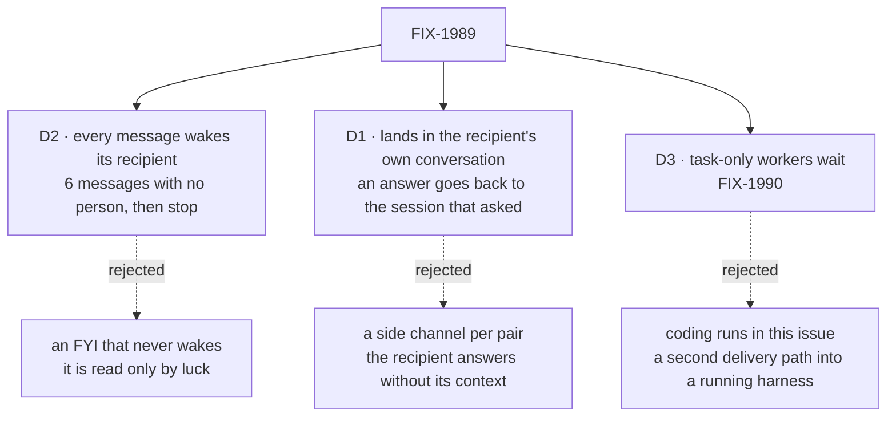

# FIX-1989 · Decisions

[Spec](SPEC.md) · **Decisions**

What was considered, what was chosen, why, and what each choice locks in. Three decisions are the
sign-off surface. Everything else here is context for them.

## The tree

Solid edges are what you're signing. Dashed edges lost, and the label says why.

## D2 · Every message wakes its recipient. A back-and-forth stops after 6 messages with no person in between, and a turn sends at most 3

| | |
|---|---|
| **Instead of** | Letting the sender mark a message as an FYI that does not wake the recipient, or having no limit beyond the model's good sense |
| **Because** | Jake asked that the recipient *sees* the message. A worker sees only what is in a turn it runs, so a message that does not wake it is read only if something else happens to wake it. The wake waits behind any turn the recipient is already running, as a task's ending notice does. A woken worker can decide that nothing needs an answer; that is the FYI case, at the price of one short turn. Two workers that each answer every message would talk forever, so each message carries a hop count, written by the server: a person's turn starts it at 0, and a turn woken by a message carries that message's count plus one. A send from a turn at 6 is refused with a reason the model reads, and each side's conversation shows that it stopped. A person's next line in either conversation starts the count again. 3 sends per turn stops one turn from fanning out to the whole roster |
| **Locks in** | Every message costs the recipient a turn. A long worker-only exchange needs a person to step in after 6 messages. Both numbers are Lab settings (`messages.hopLimit`, `messages.perTurn`) |

It comes down to the recipient seeing it: an FYI that does not wake it is read only by luck.

**What would change my mind:** FYI turns showing up as a real cost. Then a message gains
`wake: false`, and the line still lands for the recipient's next turn.

## D1 · A message lands in the recipient's own conversation with the user (in the sender's project, when the recipient has one there), and an answer goes back to the exact session that asked

| | |
|---|---|
| **Instead of** | A separate session for each pair of workers, or always answering into the sender's main conversation |
| **Because** | In its own conversation the recipient answers with what it already knows, and the user sees the message where they already talk to that worker. A side channel would wake the recipient with none of that context, and add one more place to look. The coordinator keeps one conversation per project, so a sender working in a project reaches the coordinator's conversation for that project; any worker with no conversation in that project is reached in its main one. A recipient with no conversation yet gets one opened, as Shift Manager would open it. The answer names the message it answers, and the message log holds the session that sent it, so it goes back there: a task session that asked gets its answer inside the task, which is what lets the task finish with it. If that session has ended, the answer goes to the sender's main conversation |
| **Locks in** | Worker messages appear in the user's conversations with those workers, and grow them. The sending session is server truth, read from the dispatch stamp, never from the model |

It comes down to the recipient's context: a side channel wakes it knowing nothing.

**What would change my mind:** users finding worker talk crowds their conversations. Then
message lines fold under one "worker messages" row in the conversation, with the log unchanged.

## D3 · Workers that only take tasks, such as the coder, are left out for now

| | |
|---|---|
| **Instead of** | Every worker in this issue, coding-harness runs included |
| **Because** | The coder has no conversation: it exists only as runs of the tasks it is given, each a supervised coding harness in its own checkout. Sending from a run needs a tool inside each harness (Claude Code, Codex, Cursor), and reaching one needs a rule for which of its running tasks a message is for. Both are real design work with their own goal check. The agent workers and every coordinator, which is where Shift Manager's conversation happens today, get messaging now. A message to the coder is refused with *"the coder only takes tasks; file a task"*, so no message is lost silently. [FIX-1990](https://linear.app/fixpoint-labs/issue/FIX-1990) carries the rest |
| **Locks in** | Until FIX-1990, "any worker" means any worker with a conversation. A coding run with a question still parks its task on its filer |

It comes down to the second delivery path: coding runs need one, and it is its own design.

**What would change my mind:** coding runs routinely parking on questions that a teammate
could answer. Then FIX-1990 moves up.

## Decided, not asked

- **Names.** The tool is `messageWorker({ to, text, replyTo? })`; the internal entry is
  `onWorkerMessage`, pinned for the goal check; the Lab option is `messages`. `to` takes a
  worker id or display name on the user's roster.
- **Who may message whom.** Any worker on the user's roster (own or standard) may message any
  other there, the coordinator included. Not itself. Another user's worker looks missing, as it
  does to the delegate check. Messages never cross users.
- **The convergence point for the limits.** Every send passes one check in Workforce, before
  the log row is written: on the roster, has a conversation, hop count under the limit, under the
  per-turn count. Both counts are written by the server from the sending turn's request state,
  never from tool input. The tool, and any later caller (FIX-1990's harness tool), go through it.
- **A message is not delegation.** No task row, no delegate change, no task-chain count. A
  woken recipient may delegate as it always could, to its own delegates, and that task starts a
  fresh chain as any person-free filing does today.
- **The message log** is one user-scoped collection, one row per message: from, to, text,
  thread (the first message's id), `replyTo`, the sending and receiving sessions, hop count,
  status (delivered, refused) and time. It is what the Messages view reads, what an answer is
  routed by, and it survives a restart. Text over a size bound is refused, not cut (BP-042).
- **Delivery.** The row is written, then dispatched. A dispatch the host refuses marks the row
  refused and the sender's tool call fails with the reason. A thrown dispatch is retried once
  before it fails the same way. There is no outbox: the sender knows at once and can try again.
- **What each side sees.** The recipient's conversation shows *From <sender>: <text>* under the
  sender's name, then its own turn. The sender's conversation shows the tool call as *To <recipient>:
  <text>*, and later the answer under the recipient's name. Both lines link to the Messages view.
- **The Messages view** is a Shift Manager surface beside Tasks: newest first, one line per
  message (from, to, when, the text's first line), grouped by thread, each side a link that opens
  that session. It reads the user's own log only.
- **What a worker knows of who it can message.** The tool's description lists the roster
  workers that have a conversation, by name and one-line description, bounded as
  `listDelegates` is.
- **Layer rule.** The core and engine change nothing. The dispatch seam already carries an
  internal entry on another flow to a session by id, and stamps the sender.

## Considered and dropped

| Alternative | Why not |
|---|---|
| A flag on `dispatchTask` (`message: true`) | A task makes a row, a claim and a result owed; a message has none of them. The recipient's side differs, so it is its own entry, not a flag |
| Send every message through the coordinator | The coordinator is on every path again, and the coordinator is one of the recipients Jake named |
| Reuse the task notice's rows as the message store | A notice belongs to a task row and is cleared when acted on; a message has no row and must stay visible in the log |
| A per-pair rate limit instead of a hop count | A rate limit slows a loop, it doesn't end one. The hop count ends it, and a person restarts it |
| An outbox that retries delivery until it lands | Adds the machinery the task notices have, for a message whose sender is still running and can retry |

## How it got here

- **Draft** — framed as a message that is not a task: one Workforce tool and internal entry that
  both worker flows get from the session kit they share, built on the ending notice's
  *line, then wake* step and the engine's existing dispatch seam, with a user-scoped log behind a
  Messages view and a server-written hop count as the loop guard. Coding runs split out to FIX-1990.

**Open: none.**
