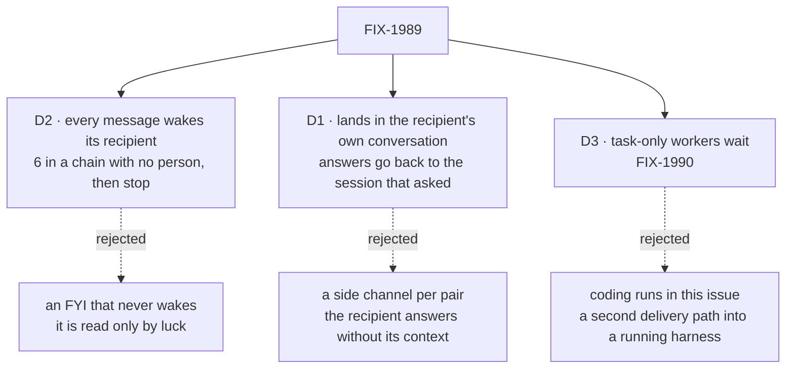

# FIX-1989 · Decisions

[Spec](SPEC.md) · **Decisions**

What was considered, what was chosen, why, and what each choice locks in. Three decisions are the
sign-off surface. Everything else here is context for them.

## The tree

Solid edges are what you're signing. Dashed edges lost, and the label says why.

## D2 · Every message wakes its recipient. A chain of messages stops after 6 with no person in between, and a turn sends at most 3

| | |
|---|---|
| **Instead of** | Letting the sender mark a message as an FYI that does not wake the recipient, or having no limit beyond the model's good sense |
| **Because** | Jake asked that the recipient *sees* the message. A worker sees only what is in a turn it runs, so a message that does not wake it is read only if something else happens to wake it. The wake waits behind any turn the recipient is already running, as a task's ending notice does. A woken worker can decide that nothing needs an answer; that is the FYI case, at the price of one short turn. Workers that each answer every message would talk forever, so each message carries a hop count, written by the server, and only a person resets it: a person's turn is at 0, a turn woken by a message is at that message's count, and every other turn (a task's, a notice's, a post's) is at the count of the turn that started it. A message is sent at its turn's count plus one, so a ring through any number of workers is counted as one chain. A send past 6 is refused with a reason the model reads, and the refused worker's conversation shows that it stopped. A person's next line starts the count again. 3 sends per turn stops one turn from fanning out to the whole roster |
| **Locks in** | Every message costs the recipient a turn. A long worker-only exchange needs a person to step in after 6 messages. A message to a busy worker waits behind its running turn, as a task's notice does. Both numbers are Lab settings (`messages.hopLimit`, `messages.perTurn`) |

It comes down to the recipient seeing it: an FYI that does not wake it is read only by luck.

**What would change my mind:** FYI turns showing up as a real cost: say, more than half of
messages answered with no message and no tool call. Then a message gains `wake: false`, and the
line still lands for the recipient's next turn.

**Amended at implementation (pending Jake's answer on the decision card).** On the real model,
woken workers often answered in plain text instead of calling `messageWorker`, so the sender
never heard. The implementation now relays a woken turn's final text as its answer, through the
same send a `messageWorker` reply takes (replyTo, the hop count, the log row, the wake), when the
turn never messaged the sender back. A turn with no text sends nothing, so declining to answer
still works, and a turn woken by an answer is never relayed, so an exchange ends after one answer.
The relay may be removed if the card goes the other way.

**Also amended at implementation (review).** The hop limit counts the whole exchange, not one
path: everything descending from one user's turn shares one budget of `hopLimit` messages. A
worker that both passes a message on and answers it would otherwise branch the exchange, with
each branch counting to 6 on its own. A user's turn starts a chain id that travels with the count,
and each send takes its place in that chain's user-scoped row with one guarded write.

## D1 · A message lands in the recipient's own conversation with the user, and an answer goes back to the exact session that asked. Nothing waits for it

| | |
|---|---|
| **Instead of** | A separate session for each pair of workers, always answering into the sender's main conversation, or letting a turn wait for the answer |
| **Because** | In its own conversation the recipient answers with what it already knows, and the user sees the message where they already talk to that worker. A side channel would wake the recipient with none of that context, and add one more place to look. Each worker has one conversation per user at an address Workforce can compute, `ensureWorkerSession({ worker })`, and Shift Manager opens a first line there too, so the server and the screen name the same session. The installation's project coordinator, which keeps one conversation per project, is reached in the one for the sender's project when the sender works in a project. A recipient with no conversation yet has it opened by the message. The answer names the message it answers, and the log row holds the session that sent it, written from the sending turn's own session, so the answer goes back there and wakes it. A conversation turn has no need to wait: the answer wakes it. A task's turn can't: the one wait there is, `dispatchTask({ wait })`, refuses a turn that is working a task so that waits stay one deep ([FIX-1816](../FIX-1816/BUSINESS-RULES.md) BR-5a), and a parked task turn would hold its claimed row. So a message has no `wait`. A task's session ends with its turn, so an answer to it goes to the sender's own conversation and wakes it there. A task that can't finish without a fact still asks its filer, as today |
| **Locks in** | Worker messages appear in the user's conversations with those workers, and grow them. A worker's conversation lives at one computed address. The sender is server truth, never tool input. A task can't hold its turn open for a message's answer |

It comes down to the recipient's context: a side channel wakes it knowing nothing.

**What would change my mind:** users finding worker talk crowds their conversations. Then
message lines fold under one "worker messages" row in the conversation, with the log unchanged.
Or tasks that often park on their filer for a fact another worker has. Then a task-turn wait is
worth relaxing FIX-1816's one-deep rule, with a lease rule for the parked row, as its own issue.

## D3 · Workers that only take tasks, such as the coder, are left out for now

| | |
|---|---|
| **Instead of** | Every worker in this issue, coding-harness runs included |
| **Because** | The coder has no conversation: it exists only as runs of the tasks it is given, each a supervised coding harness in its own checkout. Sending from a run needs a tool inside each harness (Claude Code, Codex, Cursor), and reaching one needs a rule for which of its running tasks a message is for. Both are real design work with their own goal check. The agent workers and every coordinator, which is where Shift Manager's conversation happens today, get messaging now. A message to the coder is refused with *"the coder only takes tasks; file a task"*, so no message is lost silently. [FIX-1990](https://linear.app/fixpoint-labs/issue/FIX-1990) carries the rest |
| **Locks in** | Until FIX-1990, "any worker" means any worker with a conversation. A coding run with a question still parks its task on its filer |

It comes down to the second delivery path: coding runs need one, and it is its own design.

**What would change my mind:** coding runs routinely parking on questions that a teammate
could answer. Then FIX-1990 moves up.

## Decided, not asked

- **Names.** The tool is `messageWorker({ to, text, replyTo? })`; the internal entry is
  `onWorkerMessage`, pinned for the goal check; the Lab option is `hireWorkforce`'s `messages`.
  `to` is a worker id on the user's roster. The tool's input is strict, so it can't name a sender.
- **Who may message whom.** Any worker on the user's roster (own or standard) may message any
  other there, the coordinator included. Not itself. Another user's worker looks missing, as it
  does to the delegate check. Messages never cross users.
- **The convergence point for the limits.** Every send passes one check in Workforce, before
  the log row is written: on the roster, has a conversation, hop count under the limit, under the
  per-turn count. Both counts are written by the server from the sending turn's request state,
  never from tool input. The tool, and any later caller (FIX-1990's harness tool), go through it.
- **A message is not delegation.** No task row, no delegate change, no task-chain count. A
  woken recipient may delegate as it always could, to its own delegates; that task starts a
  fresh *task* chain as any filing from a conversation does today, but it keeps the *hop* count.
- **Where the hop count lives.** In a server-owned session-state field, never in the task-chain
  collection, and copied to request state when a turn starts. A person's turn writes 0 (at the
  person's-turn mark). `onWorkerMessage` writes the message's count before it wakes the turn.
  A task session is born with its filer's current count in its starting state, beside the task
  chain fields the board already sets at hand-over, which the create check already refuses from
  any caller but a dispatch. A notice's or post's turn reads the session's current count. So A
  messages B (1), B delegates to C, and C messaging A sends at 2.
- **The message log** is one user-scoped collection, one row per message: from, to, text,
  thread (the first message's id), `replyTo`, the sending and receiving sessions, hop count,
  status (delivered, refused) and time. It is what the Messages view reads, what an answer is
  routed by, and it survives a restart. Text over a size bound is refused, not cut (BP-042).
- **Delivery.** The row is written, then dispatched. `onWorkerMessage` acts on a message id
  once, with a versioned dedupe write in the recipient's session as a task's notice does, so a
  copy sent twice wakes the recipient once. A dispatch the host refuses marks the row refused and
  the sender's tool call fails with the reason. A thrown dispatch may have started, so it is
  never marked refused: it is sent again once, which the dedupe makes safe, and if that throws
  too the row stays *unconfirmed* and the tool says so. There is no outbox.
- **What each side sees.** The recipient's conversation shows *From <sender>: <text>* under the
  sender's name, then its own turn. The sender's conversation shows the tool call as *To <recipient>:
  <text>*, and later the answer under the recipient's name. Both lines link to the Messages view.
- **The Messages view** is a Shift Manager surface beside Tasks: newest first, one line per
  message (from, to, when, the text's first line), grouped by thread, each side a link that opens
  that session. It reads the user's own log only.
- **What a worker knows of who it can message.** The tool's description lists the roster
  workers that have a conversation, by id, the `name:` of their worker file when it has one
  (FIX-1959), and one-line description, bounded as `listDelegates` is.
- **A coordinator whose routing never runs a turn of its own** (round-robin, everyone) refuses
  a message with that reason, rather than taking a line nobody reads. A best-fit coordinator, such
  as the Shift Coordinator, runs its answer turn, as a task's notice already wakes it.
- **An answer to a session that has ended** (a task's) is delivered as a line in the sender's
  own conversation, and wakes it there. It is never dropped.
- **Layer rule.** The engine and core gain one generic option, starting state on an `{ id }`
  dispatch target, which creates the session at that id when absent and is judged by the target
  flow's create check, as a `{ key }` child already is. The seam's create path already runs that
  check: `birthSession` ([`session-birth.ts`](https://github.com/fixpoint-labs/flow-state-dev/blob/main/packages/engine/src/context/session-birth.ts),
  called from `create-request-host.ts`) passes it the sending principal with `via: "dispatch"`,
  and the worker flows' check ([`installation.ts`](https://github.com/fixpoint-labs/flow-state-dev/blob/main/packages/workforce/src/workers/installation.ts),
  `createCheck`) recomputes a derived id for that principal and refuses one that is not theirs.
  The new option must keep the `{ id }` create on that same path; leg 4 proves it with a derived
  id for the second user's worker. No worker word reaches the core or engine; an `{ id }` with
  no state is still never created.
- **Shift Manager's conversation address.** A worker's conversation is always
  `ensureWorkerSession({ worker })`. `newConversationId`, `openConversation` and the
  newest-parentless-session rule are deleted, with no fallback: an older conversation opened at
  a random id stays in the store, reachable from the session lists, but the worker's view opens
  the derived one. Labs are pre-release, so nothing is migrated.

## Considered and dropped

| Alternative | Why not |
|---|---|
| A flag on `dispatchTask` (`message: true`) | A task makes a row, a claim and a result owed; a message has none of them. The recipient's side differs, so it is its own entry, not a flag |
| Send every message through the coordinator | The coordinator is on every path again, and the coordinator is one of the recipients Jake named |
| Reuse the task notice's rows as the message store | A notice belongs to a task row and is cleared when acted on; a message has no row and must stay visible in the log |
| A per-pair rate limit instead of a hop count | A rate limit slows a loop, it doesn't end one. The hop count ends it, and a person restarts it |
| An outbox that retries delivery until it lands | Adds the machinery the task notices have, for a message whose sender is still running and can retry |
| Send answers back with the seam's `{ from: true }` | An answer is a later turn of the recipient, not the dispatched request, so the sender's stamp is gone by then. The log row keeps the sending session |
| Hold a message until the recipient's conversation is first opened | The recipient is not woken, so it never sees the message, which is the need |
| A new engine call to create or list sessions from a block | Two ways to reach a session. Starting state on the existing `{ id }` target reuses the create check `{ key }` children already go through |

## How it got here

- **Draft** — framed as a message that is not a task: one Workforce tool and internal entry that
  both worker flows get from the session kit they share, built on the ending notice's
  *line, then wake* step and the engine's existing dispatch seam, with a user-scoped log behind a
  Messages view and a server-written hop count as the loop guard. Coding runs split out to FIX-1990.
- **Validation** — a server block can't find Shift Manager's conversation (a random id) or create
  a session, so the conversation moved to a computed address and the seam's `{ id }` target gained
  starting state. A task ends with its turn, so `wait: true` was added for a task that needs the
  answer. The hop count now resets only on a person's turn, across every kind of turn, and the goal
  check gained a three-worker ring, a fan-out, the other direction and a failing recipient.

- **Review, round 1** — the architect's pass: the derived-id refusal is now traced to the seam's
  create path, the hop count's carrier through a delegation is named, the random conversation ids
  and their fallback are deleted, and a late answer has a home. Legs 3 and 4 gained the shapes
  that prove the first two. Also, a thrown dispatch is no longer marked refused, and the entry dedupes by
  message id, so a retry can't wake a recipient twice. Leg 3 now asks only the refused worker to
  show that it stopped.
- **Review, round 2** — the architect's coherence check: `wait: true` claimed to reuse
  `dispatchTask({ wait })`'s gate, which refuses a task turn by FIX-1816's one-deep rule and is
  keyed to a task row. `wait` is dropped from v1 (D1): a conversation turn doesn't need it, and a
  task keeps asking its filer. Leg 2 now proves an answer to an ended task lands in the sender's
  conversation.

## Notes from review

- "Consider noting whether v1 could ship fire-and-forget `messageWorker({ to, text })` for conversation turns and restrict `wait: true` to task/session-kit internals… Implicit reply could defer `replyTo` in v1." — cursor ([thread](https://github.com/fixpoint-labs/flow-state-dev/pull/3365#discussion_r4274687755)). Fire-and-forget adopted in round 2: v1 has no `wait`. The Messages view needs `replyTo` for threads.
- "A thin v1 (messaging + labelled lines + goal legs 1–4) and a follow-up (Messages view UI, or engine create-on-dispatch)… a short slice order paragraph would help." — cursor (review summary). The PR split is the implementer's; the goal check covers all five legs.
- "Prefer `parkOnWait` / `resumeWait` with gate id on the log row rather than stretching `WaitGateBinding` / `dispatchAndWait` task semantics." — cursor (review summary). Moot in v1, which has no `wait`; the starting point if a task-turn wait is taken up later.
- "Mirror `taskChainsCollection` + CAS for the log; reuse `workerDoorOf` + `rosterWorker` instead of a new `delegate-check` `use` variant." — cursor (review summary)
- "Call out interaction with the 32 deferred notices cap on a conversation (`task-settled`); bursty messaging + task notices may need an explicit concurrency key or test." — cursor (review summary)
- "If v1 accepted 'refuse until the user has opened that worker once' you could defer `{ id, state }` create-on-dispatch." — cursor ([thread](https://github.com/fixpoint-labs/flow-state-dev/pull/3365#discussion_r4274687737)). D1 requires it: a recipient with no conversation is opened by the message.
- "One shared automation budget on request state with different increment rules… if you keep separate hops, say hop lives on request state, not in `taskChainsCollection`." — cursor ([thread](https://github.com/fixpoint-labs/flow-state-dev/pull/3365#discussion_r4274687751))
- "Calling out minimal row shape for v1 vs view-enrichment fields." — cursor ([thread](https://github.com/fixpoint-labs/flow-state-dev/pull/3365#discussion_r4274687759))
- "Leg 5 ties durability to the Messages view UI… could follow." — cursor ([thread](https://github.com/fixpoint-labs/flow-state-dev/pull/3365#discussion_r4274687747)). Kept: Jake asked to see who talked to whom.
- "Specify idempotent `onWorkerMessage` by message id." — cursor ([thread](https://github.com/fixpoint-labs/flow-state-dev/pull/3365#discussion_r4274687773)) and codex ([thread](https://github.com/fixpoint-labs/flow-state-dev/pull/3365#discussion_r4274704737)). Folded into *Delivery*.
- "What metric would trigger the `wake: false` flip." — cursor ([thread](https://github.com/fixpoint-labs/flow-state-dev/pull/3365#discussion_r4274687765)). Folded into D2.

These are inputs, not instructions. Adopt, adapt, or discard; you owe no justification for
discarding one. A note that turns out to reveal a design problem is a spec blind spot —
surface it and fold it back, per the challenger discipline in `issue-implement`.

**Open: none.**
