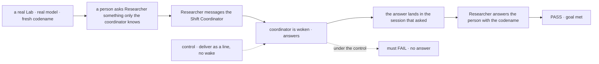
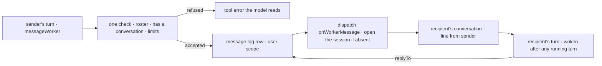

# FIX-1989 · Any worker can message any other worker (talk, not delegate)

**Spec** · [Decisions](DECISIONS.md)

## Six people, before and after

| Someone who… | Today | After |
|---|---|---|
| **is a worker that needs a fact another worker has** | Can ask only the conversation that filed its task, and only by parking the task on a question. It cannot ask the coordinator or a sibling | Sends a message to any worker on the user's roster, the Shift Coordinator included. The answer comes back to the session that asked and wakes it. A task that can't finish without a fact still asks its filer, as today ([D1](DECISIONS.md#d1)) |
| **is the coordinator and wants to give a worker a heads-up** | Files a task or a post, which makes a row, counts against the task chain and waits for a result | Sends a message. No task, no row, no result owed. Delegation is unchanged |
| **is a worker that is idle when a message arrives** | n/a | Is woken. Its conversation shows *"From Researcher: …"*, and it answers, or decides no answer is needed. A worker in the middle of a turn gets it after that turn ([D2](DECISIONS.md#d2)) |
| **is Jake, wanting to see who talked to whom** | Only the coordinator's conversation labels its delegates' answers. Nothing shows talk between other workers | A **Messages** view lists every message: from, to, when, which thread, and links that open either side. Each conversation labels a message by its sender |
| **is a few workers that keep passing messages around** | n/a | After 6 messages with no person in between, the next send is refused, however many workers the loop goes through. The worker refused says it stopped, and the next line from a person lets them go on. One turn can send at most 3 ([D2](DECISIONS.md#d2)) |
| **is a worker that only takes tasks, such as the coder** | n/a | Cannot send or get a message yet. A worker that tries to message it is told to file a task instead ([D3](DECISIONS.md#d3)) |

Requested by Jake on 2026-10-14, through the product lead: *"every worker in Shift Manager should be
able to send a message to any other worker, including the Shift Coordinator, when it wants to. That
is a separate ability from delegation"* ([FIX-1989](https://linear.app/fixpoint-labs/issue/FIX-1989)).

## The goal, and how we'll know it's met

**Any worker with a conversation (every agent worker and coordinator) can say something to any
other on its user's roster, whenever it decides to. The recipient sees it, is woken, and can answer
into the session that asked, with no task, no delegation and no person relaying it, and no group
of workers can talk forever. Coding runs, which have no conversation, follow in
[FIX-1990](https://linear.app/fixpoint-labs/issue/FIX-1990) ([D3](DECISIONS.md#d3)).**

| Is it the right goal? | |
|---|---|
| **The real need** | Workers talk to each other when they need to: an FYI, a question, a heads-up. The recipient sees it in its session and can reply. Delegation stays as it is. Jake can see who talked to whom (Jake's and the product lead's words above) |
| **Smaller, and rejected** | "Messages go through the coordinator." The coordinator already relays answers between delegates in a post's rounds. It passes because the text arrives, while the coordinator stays on every path and two workers still can't talk |
| **Bigger, and not this issue's** | Coding runs sending and getting messages ([D3](DECISIONS.md#d3), FIX-1990) · messages between different users' workers · messages to a person |
| **Not done if** | The message arrives but the recipient's turn never runs · a message to a busy worker is dropped or cuts into its running turn · the answer arrives after the asker's turn ended and nothing wakes it · an answer to a task whose turn has ended is lost · a message makes a task row, adds a delegate or counts against the task chain · delegation behaves differently · a worker can message a worker not on its user's roster · a loop through three workers slips past a two-worker limit · one turn messages the whole roster · the sender's name can be set by the sending model · the Messages view shows one side only, or loses messages on a restart |



The person's answer can only hold the codename if a message went out, woke the coordinator, and
its answer came back and woke Researcher. Under the control the coordinator never runs, and the
check must fail.

| How we verify | |
|---|---|
| **Goal check** | `goals/shift-manager/workers-message-each-other/` · `pnpm tsx goals/shift-manager/workers-message-each-other/run.mts`, each control as `GOAL_CONTROL=<name>` · the `devteam` Lab on its real server, the Lab's own model and keys, driven through its HTTP API; leg 5 in a browser with Playwright · run by the implementer at completion · verdict in the implementation PR |
| **Input** | A codename made fresh for each run, told by the person to the Shift Coordinator in its own conversation. Researcher and two more agent workers (*Helper A*, *Helper B*) added to the roster by the run. A second user with a roster of their own, made by the run |
| **Signal** | **Leg 1:** the person tells Researcher *"Ask the Shift Coordinator what the codename is, and tell me."* Researcher's answer to the person, in a turn after the coordinator's answer arrived, holds the codename. The coordinator's conversation shows one message *from Researcher* and its answer; Researcher's shows the answer under the coordinator's name. **Leg 1b, the other way:** the person tells the coordinator *"Tell Researcher the codename."* Researcher's conversation shows it from the coordinator, and Researcher's next answer to the person holds it. **Leg 2, from a task:** the coordinator files Researcher a task that says *"Ask Helper A for its favourite colour."* The message reaches Helper A and makes no row; Researcher's task ends with its turn, and Helper A's answer lands in Researcher's own conversation, under Helper A's name, and wakes it. **Leg 2b, no waiting:** Researcher told to wait for an answer inside its turn has no way to: the tool has no `wait`, and its strict input refuses one. **Leg 3:** Researcher, Helper A and Helper B are each told *"pass every message on to the next one, always"*, in a ring. The ring stops at 6 messages in all: the seventh send is refused, and the refused worker's conversation shows that it stopped. One more line from the person allows one more round. A worker told *"message every worker on the roster"* sends 3 and is refused the rest. **Leg 3b, through a delegation:** Researcher messages Helper A, Helper A files a task to Helper B, and Helper B's task messages Researcher: that message carries a hop count of 2, read from the log, and a ring of that shape is refused at the same limit. **Leg 4:** across legs 1 to 3 no task row, delegate or task-chain count came from a message, and `goals/coordinators/*` still pass. A message to a worker on the second user's roster is refused as if it did not exist, and a dispatch into that user's derived conversation id is refused by the create check, with no session created; a message to the coder is refused with *file a task*; a tool call that names its own sender is refused by the tool's schema. **Leg 5:** after a server restart, the Messages view lists every message from legs 1 to 3 with sender and recipient, and each side's link opens the session that holds it |
| **Anti-game** | Don't assert on the tool's return value, the prompt, or a scripted model. Read what reached each session and the store. Each passes while no worker ever hears another |
| **Control that must fail** | `no-wake` (the message is a line only) FAILS leg 1 on *the answer holds the codename* · `drop-ended` (an answer to an ended session is dropped) FAILS leg 2 on *lands in Researcher's own conversation* · `no-hop-cap` FAILS leg 3: the ring passes 6 messages before the run stops it at 20 · `no-roster-check` FAILS leg 4 on *refused* · `fresh-hop-on-task` (a task session starts at 0) FAILS leg 3b on *hop count of 2* · `memory-log` (the log kept in memory) FAILS leg 5 after the restart. Today's `main` FAILS: there is no message tool |

## What changes

![Two worker sessions and the message log. Researcher's turn calls messageWorker; Workforce checks the roster and the limits, writes one row to the user's message log, and dispatches it to the recipient's own conversation, opening it if needed. There it shows as a line from Researcher and wakes the coordinator's turn. The coordinator's answer names the message and goes back to the exact session that sent it. The Messages view reads the log. The task board, delegate lists and task chain are not on the path](figures/what-changes.svg)

Read left to right: a message goes from a turn to a conversation and back, with one row in the
log for each, and nothing on the task board moves.

**An app changes nothing.** Every agent worker and every coordinator gets the tool through the
session kit both flows already spread. A Lab can tune the two limits:

```diff
  const flows = hireWorkforce(installation, {
    taskChainLimit: 100,
+   // both optional; these are the defaults
+   messages: { hopLimit: 6, perTurn: 3 },
  })
```

What a worker's model sees:

```diff
+ messageWorker({ to: "chief-of-staff", text: "What is the release codename?" })
+ // → { sent: "msg_7Q…" }   the answer arrives later, as a line from the coordinator, and wakes this worker
+ messageWorker({ to: "researcher", text: "It is Bluebird.", replyTo: "msg_7Q…" })
```

**Docs:** create `apps/docs/docs/workforce/messaging-workers.md` (sidebar: Workforce, after
*Delegating work*). Update `workforce/delegating-work.md` with a short *message or delegate?*
section, `shift-manager/overview.md` for the Messages view, `workforce/ui.md` for the message
line, the `workforce` README, and the engine README's dispatch section for the new target. A
changeset for `workforce`, `core` and `engine`.

## How a message travels



Everything that knows about workers is Workforce's. The engine's dispatch seam already carries an
internal entry to a session by id on another flow. It gains one generic thing: an `{ id }` target
may carry starting state, and the session is then created at that id when absent, judged by the
target flow's own create check, as a `{ key }` target's child already is. Workforce derives the
recipient's conversation id, so the address is computed, never typed.

## What stays as it is

- **Delegation.** Delegate lists, filing, posts, task sessions, the task chain and its limits.
  A message never makes a row, and a worker can still delegate only to its own delegates.
- **A person's turn** in any conversation, and FIX-1764's reopen: a message is an internal entry,
  never a person's line, so it never reopens a finished task.
- **A post's rounds**, where the coordinator relays delegates' answers to each other.
- **Who is on a roster.** Messages reach only workers the user's roster already holds.
- **An `{ id }` target with no starting state** is still never created: a wrong id is still refused.

## What's already here, and the debt

| Already here | What this does with it |
|---|---|
| **What already says something to another worker's session** (searched `message`, `notify`, `tell`, `ask`, `notice`, `post`, `wake`, `answer`, `dispatcher(` across `packages/`): a task's ending notice ([`task-settled.ts`](https://github.com/fixpoint-labs/flow-state-dev/blob/main/packages/workforce/src/conversation-board/task-settled.ts), FIX-1780), a delegated post ([`delegated-post.ts`](https://github.com/fixpoint-labs/flow-state-dev/blob/main/packages/workforce/src/coordinator/delegated-post.ts)), `parkOnQuestion` / `answerTask`, a follow-up task, a reopen into the filing session ([`reopen.ts`](https://github.com/fixpoint-labs/flow-state-dev/blob/main/packages/workforce/src/conversation-board/reopen.ts)), and the coder's message door into a running run | **Builds on the closest**, the ending notice's *line, then wake the turn* step, and shares it. It does not use the notice's rows: a notice belongs to a task, and a message has none. The others each make or park a task, or go one way only, which is the delegation a message must not be |
| A workstream's write reaching the project coordinator: it derives that coordinator's session id on the server and dispatches into it by `{ id }` on another flow ([`workstream-writes.ts`](https://github.com/fixpoint-labs/flow-state-dev/blob/main/packages/workforce/src/projects/workstream-writes.ts)) | **Follows it.** The direct precedent for reaching another worker's session. Where it skips a session not created yet, a message opens it |
| The dispatch seam: `internal` on another flow, `{ id }`, `{ key, state }` children judged by the create check, and `{ from: true }` back to the sender ([`dispatch.ts`](https://github.com/fixpoint-labs/flow-state-dev/blob/main/packages/core/src/types/dispatch.ts)) | **Extends** `{ id }` with optional starting state. `{ from: true }` is not used for answers: an answer comes in a later turn, after the stamp is gone, so the log row holds the sending session instead |
| Waiting on a dispatched task ([`wait-for-response.ts`](https://github.com/fixpoint-labs/flow-state-dev/blob/main/packages/orchestration/src/tasks/helpers/wait-for-response.ts), `dispatchTask({ wait })`), on the engine's `resumeWait` | **Not used.** It refuses a turn that is working a task ([FIX-1816](../FIX-1816/BUSINESS-RULES.md) BR-5a, so waits stay one deep), and its gate is keyed to a task row. A conversation turn has no need to wait, since the answer wakes it. So a message has no `wait` ([D1](DECISIONS.md#d1)) |
| The roster check in [`delegate-check.ts`](https://github.com/fixpoint-labs/flow-state-dev/blob/main/packages/workforce/src/delegates/delegate-check.ts) | **Reuses** its roster half. Its "takes a post or a task" half is replaced by "has a conversation" |
| The task chain's server-written depth and count ([`chain.ts`](https://github.com/fixpoint-labs/flow-state-dev/blob/main/packages/workforce/src/conversation-board/chain.ts)) and the person's-turn mark ([`user-turn.ts`](https://github.com/fixpoint-labs/flow-state-dev/blob/main/packages/workforce/src/standing-rules/user-turn.ts), [FIX-1945 D2](../FIX-1945/DECISIONS.md#d2)) | **Copies the pattern** for the hop count, written by the server, and **reuses the mark** as where the count starts again. Messages don't touch the chain |
| The session kit both flows spread ([`session-board.ts`](https://github.com/fixpoint-labs/flow-state-dev/blob/main/packages/workforce/src/conversation-board/session-board.ts)) | **Extends.** It carries the tool and the entry, so both flows get them in one place |
| Shift Manager's conversation: the newest parentless session for the worker, opened at a random id, with senders labelled on the coordinator's flow only ([`conversation.ts`](https://github.com/fixpoint-labs/flow-state-dev/blob/main/packages/shift-manager/src/lib/conversation.ts)) | **Changes.** A first line opens the conversation at the worker's derived address, `ensureWorkerSession({ worker })`, the one messages land in. Message lines are labelled on every worker's conversation |
| [FIX-1786](../../epics/FIX-1786/SPEC.md) and [FIX-1883](https://linear.app/fixpoint-labs/issue/FIX-1883): coordinators with delegates, workstreams as sessions on roster workers | **Kept.** A message is addressed by worker, never by delegate |

| The debt | |
|---|---|
| **Removes** | Shift Manager's random conversation ids, `newConversationId`, `openConversation` and the newest-parentless-session rule: a worker's conversation has one address the server can compute |
| **Adds** | One tool, one internal entry and one user-scoped message log in Workforce, and a Messages view: permanent by design, since messaging is a new job. A hop count beside the task chain's depth: permanent, since one counts messages and the other tasks. Starting state on the seam's `{ id }` target: permanent, generic, with no worker word in it |
| **Leaves** | Coding runs can't message or be messaged ([FIX-1990](https://linear.app/fixpoint-labs/issue/FIX-1990)). A task can't wait for a message's answer: it still asks its filer, and waiting from a task turn is FIX-1816's rule to change, not this issue's. A conversation a user opened before this change, at a random id, stays in the store and in the session lists, but the worker's view opens the derived one |

**Net: up.** A tool, an entry, a log, a view and one seam option come in; random conversation ids go.

## Sign off

**[The goal](#the-goal-and-how-well-know-its-met), at that size:** any agent worker or
coordinator can message any other on the roster, is woken by one and can answer into the session
that asked, with no task and no endless loop, proved by a fresh codename only the recipient knew
reaching the person; coding runs follow in FIX-1990. If wrong: workers still route every question
through a person or a task.

**[The debt](#whats-already-here-and-the-debt), net up:** a message tool, its entry, a log, a
Messages view, and starting state on the engine's `{ id }` dispatch target. If wrong: two ways to
reach a worker that people confuse; the *message or delegate?* docs section is the guard.

1. **[D2](DECISIONS.md#d2) · Every message wakes its recipient. A chain of messages stops after
   6 with no person in between, and a turn sends at most 3.** If wrong: idle workers burn turns
   on FYIs, or a useful exchange is cut short. **The one to weigh.**
2. **[D1](DECISIONS.md#d1) · A message lands in the recipient's own conversation with the user,
   and an answer goes back to the exact session that asked. Nothing waits for it.** If wrong:
   worker talk crowds the user's conversations, or a task needs a fact it can only get by waiting.
3. **[D3](DECISIONS.md#d3) · Workers that only take tasks, such as the coder, are left out
   for now.** If wrong: "every worker" is not met until FIX-1990.

**Open: none.** Reasoning and what lost: [DECISIONS.md](DECISIONS.md).

Feature · `workforce` + `shift-manager` + `core` + `engine` · large · no epic · no blockers
