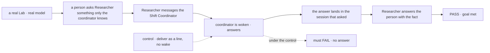
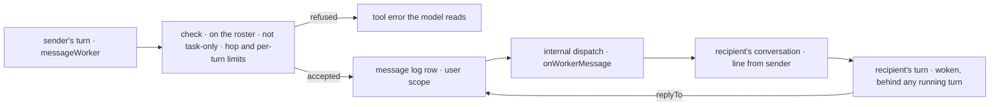

# FIX-1989 · Any worker can message any other worker (talk, not delegate)

**Spec** · [Decisions](DECISIONS.md)

## Six people, before and after

| Someone who… | Today | After |
|---|---|---|
| **is a worker that needs a fact another worker has** | Can ask only the conversation that filed its task, and only by parking the task on a question. It cannot ask the coordinator or a sibling | Sends a message to any worker on the user's roster, the Shift Coordinator included. The answer comes back into the same session that asked, and its turn carries on with it ([D1](DECISIONS.md#d1)) |
| **is the coordinator and wants to give a worker a heads-up** | Files a task or a post, which makes a row, counts against the task chain and waits for a result | Sends a message. No task, no row, no result owed. Delegation is unchanged |
| **is a worker that is idle when a message arrives** | n/a | Is woken. Its conversation shows *"From Researcher: …"*, and it answers, or decides no answer is needed ([D2](DECISIONS.md#d2)) |
| **is Jake, wanting to see who talked to whom** | Only the coordinator's conversation labels its delegates' answers. Nothing shows talk between other workers | A **Messages** view lists every message: from, to, when, which thread, and links that open either side. Each conversation labels a message by its sender |
| **is two workers that keep answering each other** | n/a | After 6 messages with no person in between, the next send is refused. Both sides say they stopped, and the next line from a person lets them go on ([D2](DECISIONS.md#d2)) |
| **is a worker that only takes tasks, such as the coder** | n/a | Cannot send or get a message yet. A worker that tries to message it is told to file a task instead ([D3](DECISIONS.md#d3)) |

Requested by Jake on 2026-10-14, through the product lead: *"every worker in Shift Manager should be
able to send a message to any other worker, including the Shift Coordinator, when it wants to. That
is a separate ability from delegation"* ([FIX-1989](https://linear.app/fixpoint-labs/issue/FIX-1989)).

## The goal, and how we'll know it's met

**A worker can say something to any other worker on its user's roster, coordinator included,
and the recipient sees it, is woken, and can answer into the session that asked, without a task,
a delegation, or a person relaying it, and without two workers being able to talk forever.**

| Is it the right goal? | |
|---|---|
| **The real need** | Workers talk to each other when they need to: an FYI, a question, a heads-up. The recipient sees it in its session and can reply. Delegation stays as it is. Jake can see who talked to whom (Jake's and the product lead's words above) |
| **Smaller, and rejected** | "Messages go through the coordinator." The coordinator already relays answers between delegates in a post's rounds. It passes because the text arrives, while the coordinator stays on every path and two workers still can't talk |
| **Bigger, and not this issue's** | Task-only workers (the coder and other coding-harness runs) sending and getting messages ([D3](DECISIONS.md#d3), [FIX-1990](https://linear.app/fixpoint-labs/issue/FIX-1990)) · messages between different users' workers · messages to a person |
| **Not done if** | The message arrives but the recipient's turn never runs · the reply lands in the sender's main conversation when a task session asked · a message makes a task row, adds a delegate or counts against the task chain · a worker can message a worker that is not on its user's roster · two workers told to "always answer" never stop · the Messages view shows only one side, or loses messages on a restart · the sender's name on a message can be set by the sending model |



The person's answer can only hold the fact if a message went out, woke the coordinator, and its
answer came back to the turn that asked. Under the control the coordinator never runs, and the
check must fail.

| How we verify | |
|---|---|
| **Goal check** | `goals/shift-manager/workers-message-each-other/` · `pnpm tsx goals/shift-manager/workers-message-each-other/run.mts`, each control as `GOAL_CONTROL=<name>` · the `devteam` Lab on its real server with a real model · run by the implementer at completion · verdict in the implementation PR |
| **Input** | The person first tells the coordinator, in its own conversation, a codename nobody else has heard. Then, in Researcher's conversation: *"Ask the Shift Coordinator what the codename is, and tell me."* |
| **Signal** | **Leg 1:** Researcher's answer to the person holds the codename. The coordinator's conversation shows one message *from Researcher* and the coordinator's answer. Researcher's session shows the answer under the coordinator's name. **Leg 2, task session asks:** the same ask filed as a task to Researcher; the answer lands in that task session, not in Researcher's main conversation, and the task's result holds the codename. **Leg 3:** Researcher and a second agent worker are each told *"always answer the other"*; the exchange stops at 6 messages and each side shows that it stopped. One more line from the person allows one more round. **Leg 4:** after legs 1 to 3, no task row, delegate or task-chain count was added by a message; a message to a worker on another user's roster is refused as if it did not exist; a message to the coder is refused with *file a task*. **Leg 5:** the Messages view, opened in a browser after a server restart, lists every message from legs 1 to 3 with sender and recipient, and each link opens the right session |
| **Anti-game** | Don't assert on the tool's return value, the prompt, or a scripted model. Read what reached each session and the store. Each passes while no worker ever hears another |
| **Control that must fail** | `no-wake` (the message is a line only) FAILS leg 1 on *the answer holds the codename* · `reply-to-main` (an answer always goes to the sender's main conversation) FAILS leg 2 on *lands in that task session* · `no-hop-cap` FAILS leg 3 on *stops at 6* · `no-roster-check` FAILS leg 4 on *refused* · `memory-log` (the log kept in memory) FAILS leg 5 after the restart. Today's `main` FAILS: there is no message tool |

## What changes


Read left to right: a message goes from a turn to a conversation and back, with one row in the
log for each, and nothing on the task board moves.

**An app changes nothing.** Every agent worker and every coordinator gets the tool through the
session kit both flows already spread; a Lab can tune the two limits:

```diff
  const workforce = hireWorkforce({
    roster,
    taskChainLimit: 100,
+   // both optional; these are the defaults
+   messages: { hopLimit: 6, perTurn: 3 },
  })
```

What a worker's model sees:

```diff
+ messageWorker({ to: "shift-coordinator", text: "What is the release codename?" })
+ // → { sent: "msg_7Q…" }       its answer arrives later, as a line from the coordinator
+ messageWorker({ to: "researcher", text: "It is Bluebird.", replyTo: "msg_7Q…" })
```

**Docs:** create `apps/docs/docs/workforce/messaging-workers.md` (sidebar: Workforce, after
*Delegating work*). Update `workforce/delegating-work.md` with a short *message or delegate?*
section, `shift-manager/overview.md` for the Messages view, `workforce/ui.md` for the message
line, and the `workforce` README. A changeset for `workforce`.

## How a message travels



Everything here is Workforce's. The engine's existing dispatch seam carries the message to a
session by id on another flow, and stamps the sending session, so a sender is never a value the
model writes. The core and engine gain nothing.

## What stays as it is

- **Delegation.** Delegate lists, filing, posts, task sessions, the task chain and its limits.
  A message never makes a row, and a worker can still delegate only to its own delegates.
- **A person's turn** in any conversation, and FIX-1764's reopen: a message is an internal entry,
  never a person's line, so it never reopens a finished task.
- **A post's rounds**, where the coordinator relays delegates' answers to each other.
- **Who is on a roster.** Messages reach only workers the user's roster already holds.

## What's already here, and the debt

| Already here | What this does with it |
|---|---|
| **What already says something to another worker's session** (searched `message`, `notify`, `tell`, `ask`, `notice`, `post`, `wake`, `answer` across `packages/`): a task's ending notice ([`task-settled.ts`](https://github.com/fixpoint-labs/flow-state-dev/blob/main/packages/workforce/src/conversation-board/task-settled.ts), FIX-1780), a delegated post ([`delegated-post.ts`](https://github.com/fixpoint-labs/flow-state-dev/blob/main/packages/workforce/src/coordinator/delegated-post.ts)), `parkOnQuestion` / `answerTask`, a follow-up task (`followUpOf`), and the coder's message door into a running run | **Builds on the closest**, the ending notice's *line, then wake the turn* step, and shares it. It does not use the notice's rows: a notice belongs to a task, and a message has none. The others each make or park a task, or go only one way, which is the delegation a message must not be |
| The dispatch seam: an `internal` address on another flow, a session by `{ id }`, and the stamped sender ([`dispatch.ts`](https://github.com/fixpoint-labs/flow-state-dev/blob/main/packages/core/src/types/dispatch.ts)) | **Builds on, unchanged.** The layer rule holds: no worker word in the core or engine |
| The roster check in [`delegate-check.ts`](https://github.com/fixpoint-labs/flow-state-dev/blob/main/packages/workforce/src/delegates/delegate-check.ts): on the user's roster, readable, another user's worker looks missing | **Reuses** its roster half. Its "takes a post or a task" half is replaced by "has a conversation" |
| The task chain's server-written depth and count ([`chain.ts`](https://github.com/fixpoint-labs/flow-state-dev/blob/main/packages/workforce/src/conversation-board/chain.ts)) | **Copies its pattern** for the hop count: written by the server from the turn that sent it, never by the model. It is a separate count; messages don't touch the chain |
| The person's-turn mark ([`standing-rules/user-turn.ts`](https://github.com/fixpoint-labs/flow-state-dev/blob/main/packages/workforce/src/standing-rules/user-turn.ts), [FIX-1945 D2](../FIX-1945/DECISIONS.md#d2)) | **Reuses.** A person's turn is where the hop count starts again |
| The session kit both flows spread ([`session-board.ts`](https://github.com/fixpoint-labs/flow-state-dev/blob/main/packages/workforce/src/conversation-board/session-board.ts)), and the coordinator's own conversation per project | **Extends.** The kit carries the tool and the entry, so both flows get them in one place |
| Shift Manager's conversation, which labels lines by sender only on the coordinator's flow (`delegateOf` in [`conversation.ts`](https://github.com/fixpoint-labs/flow-state-dev/blob/main/packages/shift-manager/src/lib/conversation.ts)) | **Extends** to a message line on any worker's conversation |
| [FIX-1786](../../epics/FIX-1786/SPEC.md) and [FIX-1883](https://linear.app/fixpoint-labs/issue/FIX-1883): coordinators with delegates, workstreams as sessions on roster workers | **Kept.** A message is addressed by worker, never by delegate, and delivered to sessions those designs already open |

| The debt | |
|---|---|
| **Removes** | Nothing |
| **Adds** | One tool, one internal entry and one user-scoped message log in Workforce, and one Shift Manager view: permanent by design, since messaging is a new job. A hop count beside the task chain's depth: permanent, since one counts messages and the other tasks |
| **Leaves** | Task-only workers can't message or be messaged ([FIX-1990](https://linear.app/fixpoint-labs/issue/FIX-1990)) |

**Net: up.** A tool, an entry, a log and a view come in; nothing goes.

## Sign off

**[The goal](#the-goal-and-how-well-know-its-met), at that size:** any roster worker, coordinator
included, can message another, is woken by one and can answer into the session that asked, with
no task and no endless loop, proved by a fact only the recipient knew reaching the person. If
wrong: workers still route every question through a person or a task.

**[The debt](#whats-already-here-and-the-debt), net up:** a message tool, its entry, a log and a
Messages view. If wrong: two ways to reach a worker that people confuse; the *message or
delegate?* docs section is the guard.

1. **[D2](DECISIONS.md#d2) · Every message wakes its recipient. A back-and-forth stops after 6
   messages with no person in between, and a turn sends at most 3.** If wrong: idle workers
   burn turns on FYIs, or a useful exchange is cut short. **The one to weigh.**
2. **[D1](DECISIONS.md#d1) · A message lands in the recipient's own conversation with the user
   (in the sender's project, when the recipient has one there), and an answer goes back to the
   exact session that asked.** If wrong: worker talk crowds the user's conversations.
3. **[D3](DECISIONS.md#d3) · Workers that only take tasks, such as the coder, are left out
   for now.** If wrong: "every worker" is not met until FIX-1990.

**Open: none.** Reasoning and what lost: [DECISIONS.md](DECISIONS.md).

Feature · `workforce` + `shift-manager` · medium · no epic · no blockers
