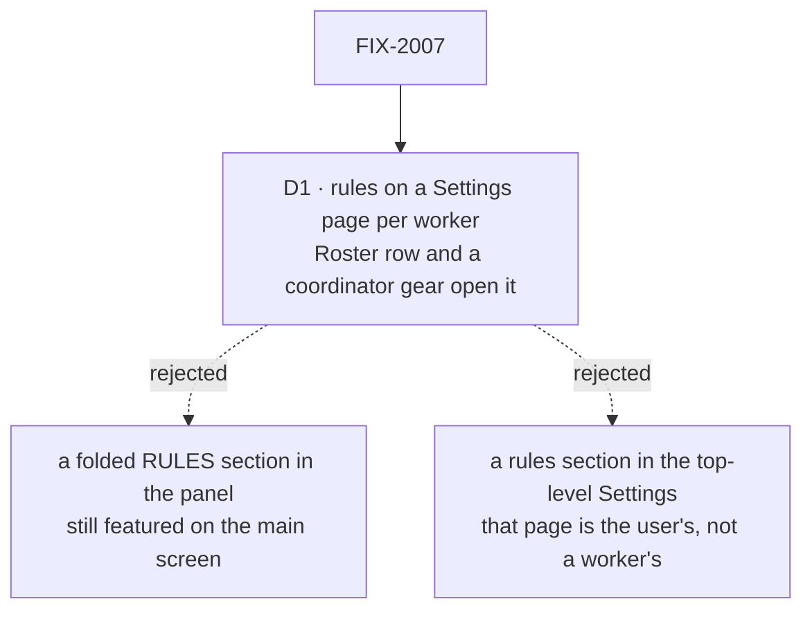

# FIX-2007 · Decisions

[Spec](SPEC.md) · **Decisions**

One decision is the sign-off surface. Everything else here is context for it.

## The tree

Solid edges are what you're signing. Dashed edges lost, and the label says why.

## D1 · A worker's rules live on its own Settings page, opened from its Roster row and, for the Shift Coordinator, from a gear in its header

| | |
|---|---|
| **Instead of** | Keeping the coordinator's RULES in its right panel, folded by default |
| **Because** | Jake's ask is that rules stop being featured. A folded heading is still on every visit to the screen Shift Manager opens on. A page per worker also gives the next per-worker setting a home, for every worker, not only the coordinator |
| **Locks in** | Rules are reached only through a worker's Settings. The address `/roster/<workerId>/settings` is a link people will keep, and the old `/roster/<workerId>/rules` must keep resolving to it |

It comes down to what the main screen features: a folded section still puts RULES on every visit.

**What would change my mind:** evidence that people edit rules mostly in the middle of a
conversation with the coordinator. Then a folded panel section earns its place back.

## Decided, not asked

- **Every worker gets the Settings button**, including one whose flow keeps no rules. The page's
  Rules section shows the existing *doesn't keep standing rules* line and makes no Lab read
  (BR-21a's no-read guarantee holds). On `main` today that line sits on the Roster row instead of
  a button; it moves.
- **The old address is a parse-only alias, not a redirect.** `/roster/<id>/rules` parses to the
  `worker-settings` route and the URL is left as typed (no rewrite); `pathFor` emits
  `/roster/<id>/settings` for every new link. Without it, `parseRoute`'s fallback opens the Shift
  Coordinator, silently.
- **The page is named for the worker, then SETTINGS** (as Rules is today: name, then a tag), so it
  can't be read as the user's own `/settings`. The left sidebar keeps highlighting Roster on it.
- **The gear shows whenever there is one Shift Coordinator**, on any flow, and opens its settings
  page even when its flow keeps no rules. A gear that appears and disappears with a flag teaches
  nothing.
- **Only the coordinator's conversation gets a gear.** Other conversations (a project's Stream)
  are not a single worker's screen; their workers' settings stay on Roster.
- **The chat line is untouched.** It is written by the Workforce rules action
  (`rules-list.ts`), not by Shift Manager, so nothing here can move it.

## Considered and dropped

| Alternative | Why not |
|---|---|
| Delete the panel section and nothing else | The simpler move. It meets *less prominent* but leaves the coordinator's rules three steps away (Roster, find its row, Rules), and keeps a page named after one feature when Jake asked for settings |
| A Rules section in the app's top-level Settings, listing every worker | That page is the user's own keys. A list of every worker's rules there is a second roster |
| A settings drawer over the current screen instead of a page | Keeps the conversation in view, but a drawer has no address to link to and adds a new overlay pattern to Shift Manager for one list |

## How it got here

- **Draft** — framed as moving rules out of the Shift Coordinator's right panel into a per-worker
  Settings page; builds on FIX-1945's `StandingRules` and Rules view. Two points from the brief
  were checked against `main`: a worker that keeps no rules has no button on its Roster row today
  (only a line), so the Settings button is new for it; and the app already has a top-level
  Settings (the user's MCP keys), so the worker page names the worker to tell them apart.

**Open: none.**
