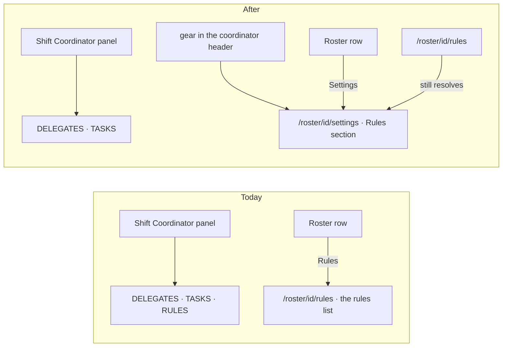

# FIX-2007 · Worker rules move into per-worker settings

**Spec** · [Decisions](DECISIONS.md)

| Someone who… | Today | After |
|---|---|---|
| **opens Shift Manager on the Shift Coordinator** | The right panel shows DELEGATES, TASKS, then the coordinator's full RULES list with its add box | The panel shows DELEGATES and TASKS only. A small gear in the coordinator's header opens its Settings |
| **wants to change what a worker keeps in mind** | Roster row → **Rules** → a page holding only the rules list | Roster row → **Settings** → that worker's settings page; its first and only section is Rules, the same list and editor |
| **looks at a worker whose flow keeps no rules** | The Roster row says *This worker's flow doesn't keep standing rules*, and has no button | The row has a **Settings** button like every other; the page's Rules section carries that same line |
| **follows an old `/roster/<id>/rules` link** | The rules page | The same worker's settings page. Unknown paths still land on the Shift Coordinator, so the old path must be kept, not dropped |
| **tells a worker a rule in conversation** | A chat line: *✎ Rule added (3 of 20): "…"* | The same line, unchanged |

Jake (2026-10-14): standing rules *"were just added to the sidebar, which features them too
prominently. Move them into settings… rather than a top-level sidebar entry. The chat line when
a rule changes stays."* "The sidebar" is the Shift Coordinator's right panel
(`ChiefOfStaffPanel`); the app's left sidebar has no rules entry.

## The goal, and how we'll know it's met

**A person finds a worker's standing rules in that worker's settings, and the Shift Coordinator
screen no longer features them.**

| Is it the right goal? | |
|---|---|
| **The real need** | Rules are a setting, not a headline: out of the main screen, still easy to reach (Jake, above; epic FIX-1958, Shift Manager polish) |
| **Smaller, and rejected** | "Delete the list from the panel." Meets *less prominent*, but leaves the coordinator's rules reachable only by going to Roster and finding its row, and leaves the per-worker page named after one feature |
| **Not done if** | The panel lost RULES but the coordinator screen has no way to them · an old `/rules` link opens the Shift Coordinator instead of the worker's page · the chat line changed |

**Goal check: carried forward.** The retained goal
[`goals/standing-rules/the-rules-page-edits-what-the-worker-follows/`](../../../goals/standing-rules/the-rules-page-edits-what-the-worker-follows/goal.md)
already proves this surface in Chromium against a real model, and its way-in and cos legs
assert what this spec reverses. Adapt it, keep its real-path proof that a page edit changes the
worker's next conversation (reload, edit-is-followed, delete), and rerun its control and
normal case:

- **way-in**: every Roster row, `eng.coder` included, has a **Settings** button; the
  researcher's opens `/roster/researcher/settings`, and the old `/roster/researcher/rules`
  lands there too. `eng.coder`'s settings page says its flow doesn't keep standing rules.
- **cos**: `/cos` draws no RULES in its panel; the coordinator's gear opens
  `/roster/<id>/settings` with its Rules section, where `<id>` is the coordinator
  [`chiefOfStaffOf`](../../../packages/shift-manager/src/lib/derive.ts#L234-L242) found: `chief-of-staff` for an org worker,
  `<team>.chief-of-staff` for a team's.

The screen tests (`packages/shift-manager/test/`) stay, with today's `main` as the control that
must fail on two assertions: *the Shift Coordinator panel holds no `rules` section* and
*`/roster/<id>/settings` draws the worker's settings page*.

## What changes



```diff
  Roster row
- [ Rules ]            (only when the worker keeps rules; otherwise a "doesn't keep" line)
+ [ Settings ]         (every worker)

  Shift Coordinator header
  [SC] Shift Coordinator
       idle · watching 6 workers
+                                               [⚙]  → /roster/<coordinator's id>/settings
```

**Docs:** update `apps/docs/docs/shift-manager/overview.md` (the Shift Coordinator row drops
RULES and gains the gear; the Roster row's **Rules** becomes **Settings**) and
`packages/shift-manager/README.md` (the panel paragraph and the Rules paragraph, including the
`/roster/<workerId>/settings` address). No new page. `apps/docs/docs/workforce/standing-rules.md`
says nothing about where Shift Manager draws them, so it stays.

## What stays as it is

- `StandingRules`, the editor itself: the list, add, edit, delete, the 20-rule cap, the refusal line.
- The rules action, its inventory flag (`rules`), and every chat line a rule change writes.
- The app's top-level **Settings** (`/settings`, the user's own MCP keys, FIX-1905). It is the
  user's, not a worker's, and it gains nothing here.
- Which workers keep rules. FIX-1982 (a hired worker with no standard peer on its flow shows
  `rules: false`) is related and stays its own issue.

## What's already here, and the debt

| Already here | What this does with it |
|---|---|
| `ChiefOfStaffPanel` draws the coordinator's `StandingRules … compact` | **Removes** that section. `compact` then has no caller; it goes too |
| `RulesView` at `/roster/<id>/rules` (route level `rules`: [`routes.ts`](../../../packages/shift-manager/src/lib/routes.ts#L47), [parse](../../../packages/shift-manager/src/lib/routes.ts#L69), [path](../../../packages/shift-manager/src/lib/routes.ts#L105-L106); dispatched at [`App.tsx`](../../../packages/shift-manager/src/App.tsx#L174-L175)) | **Evolves in place** into the worker's settings page at `/roster/<id>/settings`, its one section Rules; no parallel page. The route level `rules` becomes one worker variant, `worker-settings` (distinct from the user's `level: "settings"`), with no separate rules branch |
| Roster row's `roster-worker-rules` button ([`Roster.tsx`](../../../packages/shift-manager/src/surfaces/Roster.tsx#L95-L107)), and the `roster-worker-no-rules` line, branched on the inventory's [`rules` flag](../../../packages/shift-manager/src/lib/reads.ts#L398) | **Replaces** both with one Settings button on every row; the line moves into the page |
| `parseRoute` sends any unknown path to the Shift Coordinator | **Builds on**: `/roster/<id>/rules` stays a parse-only alias for `worker-settings` ([BP-030](../../../docs/contributing/best-practices.md#bp-030-tolerate-the-old-shape-when-you-change-a-persisted-or-in-flight-field)); `pathFor` emits `/roster/<id>/settings` for every link |
| The left sidebar highlights Roster on `route.level === "rules"` ([rail](../../../packages/shift-manager/src/surfaces/Sidebar.tsx#L285), [Roster entry](../../../packages/shift-manager/src/surfaces/Sidebar.tsx#L527)) | **Updates** both checks to `worker-settings`, so Roster stays highlighted on a worker's settings page |
| The coordinator's id comes from [`chiefOfStaffOf`](../../../packages/shift-manager/src/lib/derive.ts#L234-L242): `chief-of-staff` or `<team>.chief-of-staff` | **Builds on**: the gear links to that worker's id, never a fixed `/roster/chief-of-staff/settings` |
| Anything else that shows a worker's settings | **None.** Searched `settings`, `Settings`, `rules` across `packages/shift-manager/src`: the only Settings is the user's own `/settings` |
| [FIX-1945 BR-20](../FIX-1945/BUSINESS-RULES.md) — rules seen on a worker's view *or the Shift Coordinator view* | **Amended in part**: the coordinator's rules are one click from its view (the gear), not on it |
| [FIX-1945 BR-21a](../FIX-1945/BUSINESS-RULES.md) — no Rules view for a flow that keeps none; its row says so | **Amended in part**: such a worker gets a Settings page, and the line moves there. Kept: no rules list, no Lab read, no new contract for custom flows |
| FIX-1945 BR-21, the cap, the chat line | **Kept** |

| The debt | |
|---|---|
| **Removes** | The panel's rules section and the `compact` variant of `StandingRules`; the Roster row's two-way branch |
| **Adds** | An old address kept as an alias (`/rules` → settings). Permanent by design: links to it exist in browser history and notes, and an unknown path silently opens a different screen |
| **Leaves** | FIX-1982 (`rules: false` on a hired worker with no standard peer) |

**Net: down.** A panel section, a component variant and a row branch go; one path alias is added.

## Sign off

**[The goal](#the-goal-and-how-well-know-its-met), at that size:** rules out of the main
screen and into each worker's settings, still one click from the coordinator. If wrong: we
either keep featuring them, or bury the coordinator's rules where nobody looks.

**[The debt](#whats-already-here-and-the-debt), net down:** a panel section and a variant go,
one old-address alias stays. If wrong: an alias kept forever for links nobody follows.

1. **[D1](DECISIONS.md#d1) · A worker's rules live on its own Settings page, opened from its
   Roster row and, for the Shift Coordinator, a gear in its header.** If wrong: a person who
   edits rules mid-conversation pays a page change every time.

**Open: none.** D1 is the one to weigh.

Enhancement · `shift-manager` · small (one package, three surfaces, no public API) · epic FIX-1958
