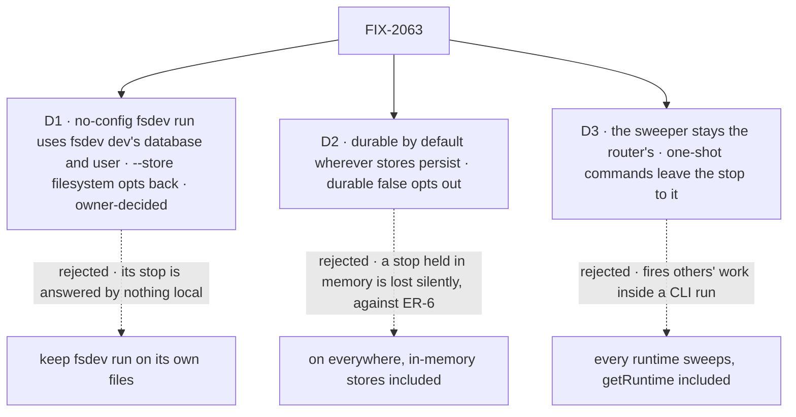

# FIX-2063 · Decisions

[Spec](SPEC.md) · **Decisions**

D2 is the sign-off surface. D1 is decided by the owner (2026-10-23), with a `--store filesystem` opt-back. D3 is an engineering call the epic's review asked for by name.

## The tree

Solid edges are what you're signing. Dashed edges lost, and the label says why.

## D1 · A no-config `fsdev run` uses the database and the user `fsdev dev` uses; `--store filesystem` opts back

*Decided by the owner (Jake, 2026-10-23, on #3734). Not open.*

| | |
|---|---|
| **Instead of** | Keeping `fsdev run`'s own filesystem store under `.fsdev/data` |
| **Because** | A stop made by `fsdev run` is answered after the command exits, and the one local host that answers is `fsdev dev`. On separate stores it never sees the stop, and no sweeper reaches its deadline. Nor does it under a different user: the run defaults to `cli-user`, the DevTool to `devuser`, and the session listing is scoped by user, so both commands take one local default. `fsdev chat` already shares the file; SQLite's WAL mode and busy timeout make a run beside a dev server safe |
| **Locks in** | A no-config run lives in `.fsdev/data/fsdev.db` under the shared local user. Its state is no longer JSON files an agent reads directly: it is read from the SQLite file or through `fsdev dev`'s routes. `--capture` is not a replacement (it carries the command, events and result, never session or resource state). |
| **The opt-back** | `--store filesystem` on `fsdev run` and `fsdev dev` keeps the filesystem store for anyone who wants a run's state as JSON files. Its limit is documented with the flag: the store is single-process, so `fsdev run` and `fsdev dev` can't share it at the same time, and its lease takeover is not atomic. A stop held there is answered only by a `fsdev dev` started on the same store after the run exits. SQLite stays the default |
| **Also** | Sessions earlier runs wrote to files are not read by the SQLite default: local data, no migration, as the epic set for states in flight; `--store filesystem` still reads them. A run with an app config is unchanged |

It comes down to who answers a run's stop: on its own files, nothing local ever does.

The owner chose to ship the opt-back with this rather than accept the JSON files as lost, so
nobody who reads a run's state from files is left without a way back.

## D2 · Durable execution is on by default wherever stores persist; `durable: false` turns it off

| | |
|---|---|
| **Instead of** | Turning it on for every host, in-memory stores included |
| **Because** | The epic's rule ([ER-6](../../epics/FIX-2058/DECISIONS.md#who-owns-what)): durable where stores persist, and a host without it refuses a stop loudly. A stop held in memory is lost silently when the process ends. One fact decides it, carried by the one adapter the engine ships that doesn't persist: the in-memory one says so. Every other adapter, third-party ones included, declares nothing and gets the default |
| **Locks in** | The default of `durable` flips at upgrade for apps on persisting stores, and the cost is real: every sequencer (already `durable: true` by default, FIX-401) writes a checkpoint at each step, a crashed request resumes instead of rerunning, a raw `ctx.suspend()` is held, and the router's sweeper ticks on the store (a lease and a scan) even when nothing waits. A changeset says so, with the migration note. Crash-resume is only safe once a resume never reruns a finished step with traces off ([FIX-2137](https://linear.app/fixpoint-labs/issue/FIX-2137)), so the flip ships after it. `durable: false` is the opt-out. On in-memory stores a stop refuses loudly unless `durable: true` is set, which is how tests opt in |

It comes down to the epic's rule: a stop is held only where it survives the process.

**What would change my mind:** a supported host on persisting stores where holding a stop costs
more than refusing it. Then that host's adapter sets the default, and D2 narrows.

## D3 · The sweeper stays where a router runs; a one-shot command leaves the stop to it

*An engineering call, decided; recorded because the epic's review named it.*

| | |
|---|---|
| **Instead of** | Making every runtime sweep, `getRuntime()` hosts included |
| **Because** | `fsdev run` is one-shot. A sweeper there would fire other requests' due deadlines and wakes inside an unrelated command, then cut them off when it exits. The sweeper already takes a lease per tick, so one server on a shared store sweeps for every command that writes to it |
| **An exception, recorded** | Waits on a task are offered only where a sweeper runs in the process (FIX-1816 BR-5, FIX-2082 D1), so `fsdev run` refuses them. A person's stop is held there anyway: it is answered only through a server's route, and that server sweeps it. A wait has no such answerer, so its rule stays |
| **Locks in** | Every host that answers a person sweeps: `fsdev dev` with or without a config, `fsdev serve`, a self-hosted router. `fsdev run` holds the stop, exits 0 with the stop's id in `--capture`, and says it is answered in `fsdev dev` and that its deadline fires only while a server runs on this store |

## Decided, not asked

- **"A host refuses a stop loudly" has one convergence point:** the stop itself
  (`ctx.suspend()`, which FIX-2129's `waitForUser` builds on). Every host without durability
  reaches it, so the refusal is written there once, naming the setting. Hosts no longer guard
  on durability themselves; their refusals go.
- **One engine rule owns the default.** `createFlowState`, the no-config `fsdev dev` router and
  no-config `fsdev run` all get their provider from one engine function over the stores and the
  `durable` option, so a later change to the default is made once. The low-level
  `createFlowApiRouter` and `runAction` keep taking a provider only when given one.
- **`fsdev run` reports a stop on exit**: exit 0, the stop's id (in `--capture` too), its prompt,
  and where to answer it. The wording is the implementer's.
- **Retention stays opt-in.** On by default means held and swept, not pruned.

## Considered and dropped

| Alternative | Why not |
|---|---|
| On only where every store adapter declares it persists | A second fact every adapter, third-party ones included, must get right; one that forgets it is off. Marking the one that doesn't persist carries the same rule |
| A `fsdev resume` command | A second place to answer a stop, against the epic's one answer route ([ER-7](../../epics/FIX-2058/DECISIONS.md#who-owns-what)) |
| `fsdev dev` reading `fsdev run`'s files | The filesystem store can't hold the dev server's load; that is why `fsdev dev` left it |
| A queue (BullMQ) as the durable layer | A dispatch queue is not a suspension store; the epic's review kept this on checkpoint durability |

## How it got here

- **Draft** — framed as the epic's kill line: hold a stop on every local and self-hosted host
  with no configuration; a default flip on `durable`, one local store for both CLI commands, and
  the router's sweeper as the one that fires deadlines; builds on FIX-2077's person stop and the
  existing checkpoint provider.
- **Round 1** — D2 narrowed from every host to wherever stores persist, because a stop held in
  memory is lost silently and the epic's ER-6 refuses it there. D1 gained the shared local user,
  because the DevTool lists sessions by user and would not have seen the run's stop. D2 priced
  the default's checkpoints, crash-resume and sweeper ticks instead of calling it free.
- **Round 2** — FIX-2132's POC showed a resume reruns finished steps when traces are off, as
  in production (FIX-2137). D2 now ships after FIX-2137, and the goal check runs with traces off
  too, counting the step before the stop.
- **Owner decisions** (Jake, 2026-10-23, #3734) — D1 ships `--store filesystem` as the opt-back,
  with its single-process limit documented; SQLite stays the default. FIX-2137 joins epic
  FIX-2058 as a direct-route bug, parented under it, and stays a hard blocker of D2's default
  flip.

## Notes from review

From the epic review (#3732), routed here on Linear:

- "Person deadlines use the suspension's expiresAt plus the existing sweeper re-arm, not a
  second poll loop. Correlated 7-day expiries may burst sweep ticks; document it if accepted."
  — cursor, round 2
- "The spec must name sweeper-on-CLI, or a loud refusal." — cursor, round 2. Answered by [D3](#d3)
- "Stay on engine checkpoint durability … not BullMQ." — round 1. Kept

From this spec's review (#3734), round 1:

- "The refusal names its rule as well as the setting." — architect. Folded into the refusal's
  contract; the wording is yours
- "Give the two messages parallel wording so a person who hits either learns the host setting
  to change." (no provider, and FIX-1816's no sweeper) — second-look
- "Implementation docs should spell that distinction so D2 isn't read as 'every action now
  checkpoints.'" (host `durable` vs an action's or sequencer's `durable`) — cursor
- "`better-sqlite3` means no-config `fsdev run` may block under contention with a running `dev`
  server; WAL/busy timeout is enough to mention in CLI docs." — cursor
- "Build the no-config dev host with `createFlowState` over its SQLite stores … or keep the
  direct router but import one shared 'durability from stores' helper." — second-look; either
  satisfies the one-rule call above
- "While a request waits on a person, it holds back its filed tasks' notices, which ER-2 doesn't
  allow. The default flip turns that on everywhere." (#3733) — architect. FIX-2129 owns the
  waiting row; flag it there if #3733 hasn't landed
- "Keep leg c on an approval, since FIX-2129 changes a question's deadline." — architect. Kept
- "Fixing the docs' nonexistent `durabilityProvider` option can be a separate one-line docs
  fix." — epic coordinator. Either is fine

Round 2:

- "Add an anti-game line so the goal check also runs with `FSDEV_TRACE_OBSERVABILITY=0`. Also
  list FIX-2137 as a dependency." — epic coordinator (cross-spec, FIX-2132). Folded
- "Make it a hard ordering, not a footnote … The spec can land now; the impl PR that flips the
  default must not merge before FIX-2137." — architect. Folded into D2's Locks in and the debt

**Open: none.** D1 and FIX-2137's placement were decided by the owner on 2026-10-23.
